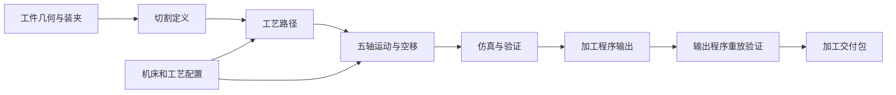
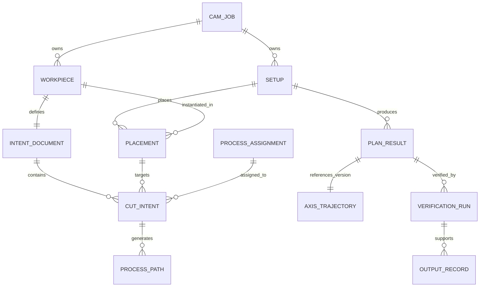
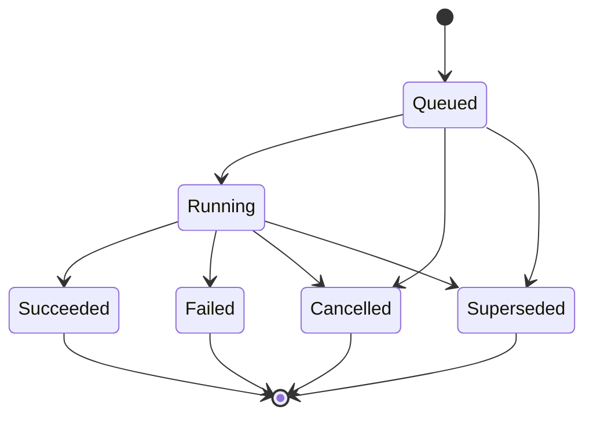
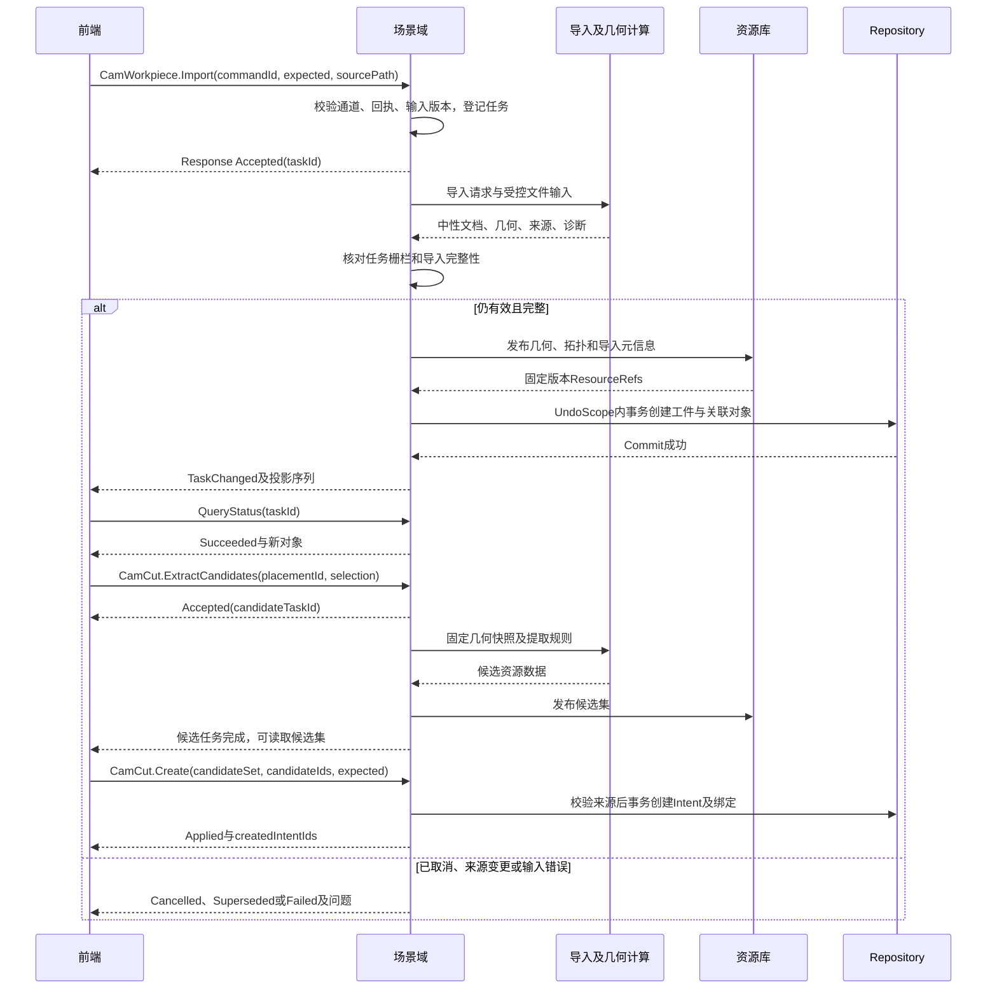
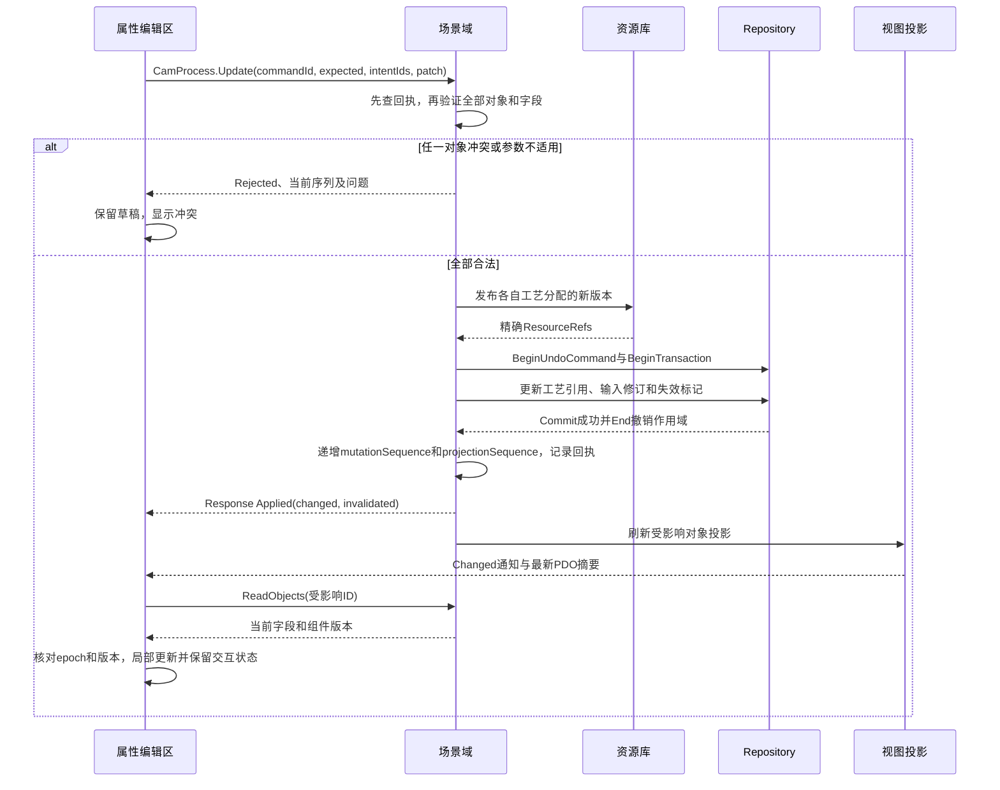
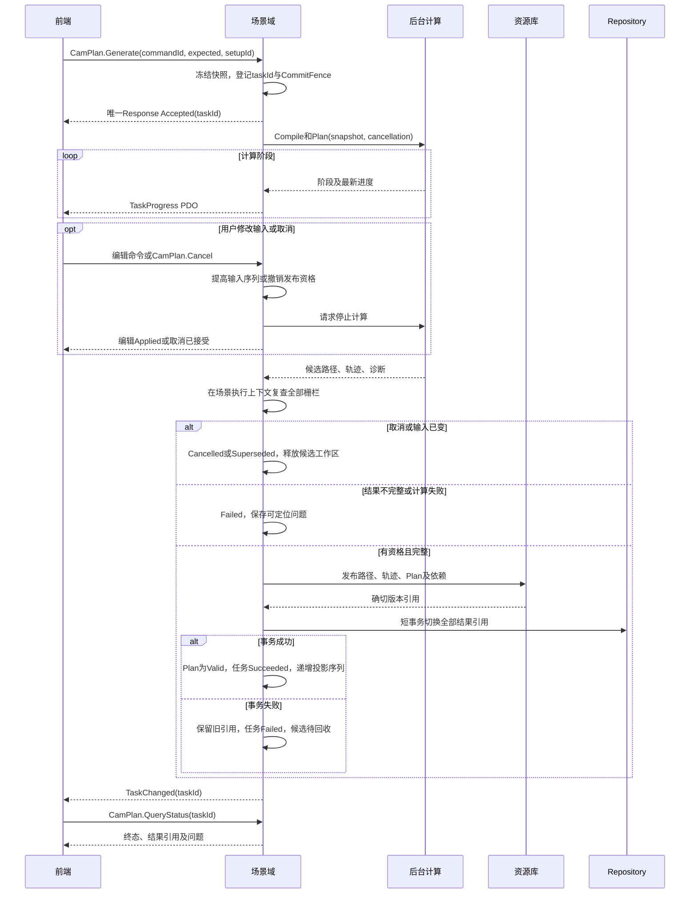
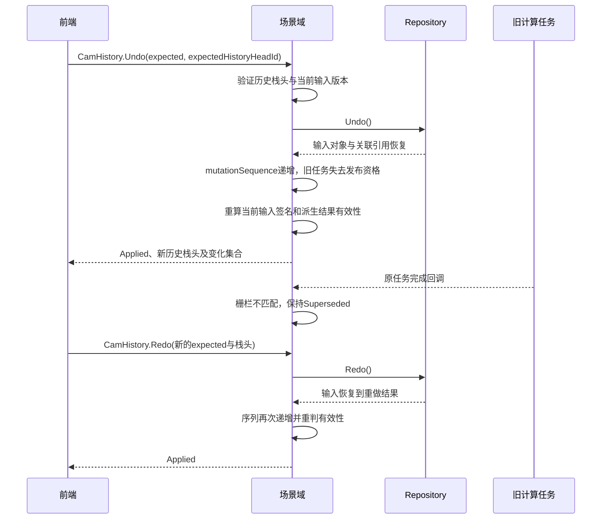
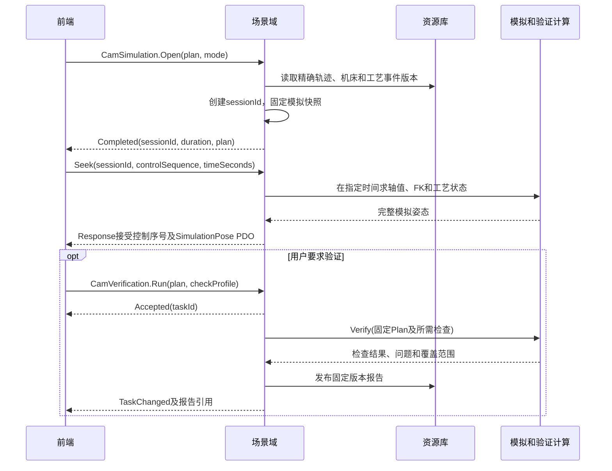
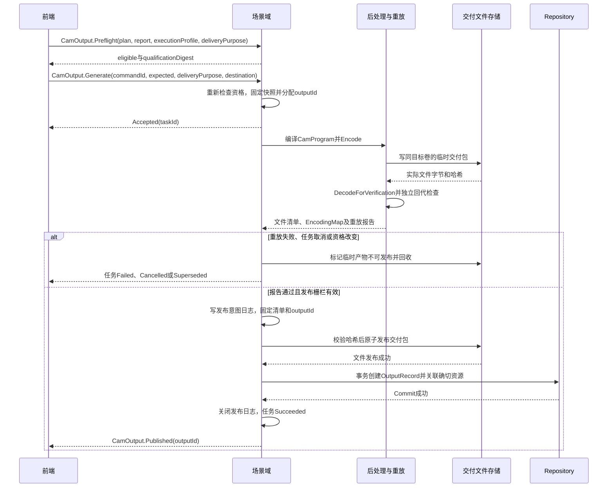

# 三维五轴 CAM 技术方案设计书

版本：设计基线 1.4。日期：2026 年 10 月 13 日。

配套文档：[三维五轴 CAM 产品规格说明书](D:/penguinchinage0609/iCAX/doc/3DCAm/01-三维五轴CAM产品规格说明书.md)。

本方案定义如何基于 iCAX 框架实现一款完整的三维五轴激光 CAM 产品。产品包含工件准备、定位、切割线、工艺、五轴运动、排序与空移、仿真、程序输出和工程交付。FACAM 用于参考功能与编程流程；本产品自行定义工程数据、加工程序和设备适配接口。新产品的模块、算法与验收按本方案建立。

文中“已有”指已核实的框架入口或数据契约；“新增”及下列拟定类型、目录、方法名称属于本次设计。本文是实施设计基线，验收条款是实现后必须满足的目标。

阅读顺序：第 1—16 章说明总体方案、算法与实施；第 17—21 章定义可直接拆成类型与组件的字段契约；第 22—24 章定义 SDO、PDO、资源读取和关键业务消息流；第 25 章定义契约验收，第 26 章列出框架依据。字段级契约用于落实前面的概念模型，不建立第二套业务数据源。

模块实施细则见[详细设计总览与 49 项功能追踪](详细设计/00-详细设计总览与功能追踪.md)。新增候选预览、固定工具方向、连续轴段和消息补充统一见[契约收敛](详细设计/09-源码依据与设计校核.md)。机型范围同时包括龙门五轴及六轴机械臂加地轨；地轨参加联合求解、避碰、定时和输出。逆解采用成熟开源库接入方案，见[开源库选型](详细设计/10-逆运动学开源库选型与接入.md)。上述细则补充本基线，不新增平行框架或第二套领域状态。

## 1 总体实现方案

整个产品围绕五类独立对象组织：CAD 工件、切割定义、工艺路径、机床轨迹、验证与输出结果。用户编辑保存为可追溯的输入，生成结果保存为带来源版本的不可变资源。后续编辑使相应结果过期，再按依赖重算。



排序、姿态和空移存在相互约束：先根据工艺约束产生加工次序候选，再求解姿态与连接；遇到不可行连接时，允许在未锁定的次序和姿态范围内重新规划。所有回退都有次数或时间预算，不能无限循环，也不能在失败时返回看起来完整的部分结果。

### 1.1 功能模块与实现归属

| 规格模块 | 实现责任 | 主要输入 | 主要产出 |
| --- | --- | --- | --- |
| M01 工程与工作台 | 新产品运行时接入、工程 SDO、前端工作台 | 工程文件、用户命令 | 场景、编辑状态、工程快照 |
| M02 工件几何与加工准备 | 几何资源导入通道、STEP 适配器与新产品工件领域逻辑 | CAD 文件、修复与准备参数 | 工件几何资源、拓扑映射、检查结果 |
| M03 坐标与装夹定位 | 定位计算服务、装夹领域逻辑 | 特征点、坐标系、夹具及实测点 | 装夹配置、定位变换及残差 |
| M04 切割线与加工特征 | IntentToolpath 数据基础、切割特征识别与编辑 | 工件面边、加工面与人工选择 | 带来源和规则的切割定义 |
| M05 工艺库与切割刀路 | ProcessPath 数据基础、工艺编译模块 | 切割定义、工艺快照、姿态关键点 | 空间路径、工具轴向、工艺事件 |
| M06 机床模型与五轴运动 | Machine 基础、五轴运动学与时间规划模块 | 机床配置、工艺路径、装夹变换 | 各轴运动、动态约束与可达性结果 |
| M07 排序与空移避碰 | 加工调度、连接规划、几何碰撞计算 | 工序依赖、轨迹端点、障碍物 | 加工顺序、连接轨迹及间隙结果 |
| M08 仿真与验证 | 仿真调度与验证模块、既有视图显示机制 | 最终轨迹、机床与工件资源 | 动画、问题列表、版本绑定的报告 |
| M09 加工程序输出 | 中间程序编译、后处理、输出重放 | 已验证轨迹、工艺事件、设备能力 | 设备程序、交付包、重放报告 |
| M10 配置诊断与交付 | 资源目录、设置、诊断、发布工具 | 产品设置和受控资源 | 配置快照、诊断包、发布清单 |

### 1.2 分层边界

前端负责选择、表单、交互预览和结果展示。无状态 SDO 方法负责取得上下文、校验业务命令、协调领域逻辑、提交事务及返回结果。业务状态放在 Repository 的实体和组件中，大型几何及计算结果放在版本化 Resources 中。

中性服务通过 `IService` 注册，通过 `ServiceProvider` 获取。几何服务接收几何数据和计算参数，返回几何结果与诊断；运动学服务接收中性的机床运动链与目标位姿任务；碰撞服务接收形状、变换、运动及距离阈值。这些服务不接收产品 SDO、SceneContext、Repository 或项目文件路径，不决定工序、留料侧、用户撤销和输出发布。

工艺编译、标准孔模式、加工排序约束、生成失效和导出资格属于 CAM 领域。领域逻辑可调用通用计算服务，但不能把产品业务规则塞进中性 CAD 服务。现有 CAD 编辑保留基体及可编辑特征，CAM 从其结果生成加工定义。

产品按 M01—M10 分工，用户页面按规格第 2.1 节组织为工件、CAD、CAM、仿真、帮助；工程文件操作复用 iCAX 外壳。工件拥有导入/模型库、定位装夹与夹具制造；CAD 只提供可选几何辅助，不作为加工前置；切割线准备、工艺、生成和头部轨迹仿真在 CAM；真实机型的完整数字孪生在独立仿真页。设备与规划参数归 CAM/设置，实机页引用同一固定版本配置并核对完整性，不建立第二套设备权威状态。场景域 CamPlan 协调 M05—M07，一次“生成刀路”形成当前 Setup 的完整计划。规格第 19 章 F01—F53 为竞品功能参考索引，第 20 章 S01—S04 约束支持组合。新增夹具制造及独立实机页属于本产品设计，不宣称竞品同样提供。

手工绘制的主要交互为工作平面内的二维草图沿指定方向投影到选定曲面。保存工作平面的原点与正交基、草图及尺寸约束、目标几何版本/面引用、投影方向和用户选定的结果分支；后续修改输入重新计算。孔的设计轴向作为加工意图保存，投影方向与切割头姿态另行表达，不在投影后默认改为沿曲面法向切割。平面尺寸不冒称为曲面弧长尺寸；多层命中、跨面断裂和近相切退化必须诊断。投影计算属于中性几何服务；定义持久化、分支确认、失效传播与生成属于CAM业务域。此段是设计要求，尚无实现或验收声明。

### 1.3 已有框架的具体接入点

| 已核实入口 | 本产品使用方式 |
| --- | --- |
| `CProductRuntime` 与产品 manifest | 加载产品模块和网页入口，按模块回放组件、服务、Behaviour、资源和 SDO 注册 |
| `AUTO_REGIST_SERVICE`、`RegisterSingleton`、`Resolve` | 注册并获取算法服务；按声明依赖初始化，线程使用约束在服务接口明确 |
| `ISceneContext` | 访问场景通道、Database、Resources、PDOHub、Views、Services 和停止信号 |
| `IRepository` | 使用事务创建和修改实体组件；需要撤销的操作显式使用 `BeginUndoCommand` |
| `ResourceLibrary::PutVersioned` | 发布带明确版本的结果资源；组件引用具体资源版本 |
| 无状态 `SDO` 与 `ExposeMethod` | 建立稳定命令入口，业务状态不存入 SDO 成员 |
| IntentToolpath | 复用曲线、承载曲面、参数区间、方向、来源拓扑及派生关系表达 |
| ProcessPath | 复用空间曲线、工具方向、前进方向、工艺事件和按时间表达的轴运动数据契约 |
| Machine | 复用机床描述、实例化、装配变换及碰撞附件基础，按本产品要求验证并补充五轴规划能力 |

数据契约存在不等于生成算法已完成。连续逆解、约束姿态、曲面工艺、连续碰撞检查和后处理必须各自具备可执行实现及验收证据。

## 2 模块工程组织

建议新增产品入口 `src/apps/five-axis-cam`，产品业务模块 `src/iCAX-Plugins/cam/FiveAxisCAM`。名称在实施时可按项目命名规范调整，职责固定如下。

| 逻辑模块 | 职责 | 依赖限制 |
| --- | --- | --- |
| FiveAxisCAM 产品域 | 工程、工件、装夹、切割定义、工艺与生成生命周期；对外 SDO | 调用领域编译器和服务，协调资源与事务 |
| CamFeaturePlanning | 加工面分类、边界候选、孔特征、来源关系维护 | 使用 CAD 查询结果，不直接写 Repository |
| CamProcessPlanning | 补偿、引线、过切、事件、姿态约束及加工依赖编译 | 接收完整输入快照，返回工艺计划 |
| FiveAxisKinematics | 机床运动链、FK、IK、分支、奇异与可达性计算 | 中性机床与数学数据，不感知项目 |
| FiveAxisMotionPlanning | 轴路径连续化、速度规划、连接动作、约束迭代 | 接收目标与约束，调用运动学与碰撞计算 |
| CamVerification | 几何、轴动态、碰撞、事件、输出重放的统一校验 | 只读快照，返回可定位问题 |
| CamProgram | 中间程序、后处理插件契约、文件生成与读取重放 | 以能力声明校验目标设备 |
| 产品网页 | 工具栏、树、属性、选择、模拟控制、问题定位 | 经正确上下文的 SDO/PDO 交互 |

上述是逻辑边界，初期可把相关实现放在少量 DLL 中；不要为了目录数量制造空模块。通用几何能力补充到现有 CAD 服务模块，IntentToolpath、ProcessPath、Machine 的共同契约在原独立模块中扩展，避免再造同义数据体系。

### 2.1 计算接口契约

以下接口以强类型数据传递，具体类名为建议。服务方法不读写当前工程，领域编译器不持有活动 SceneContext。

| 计算接口 | 主要方法与输入 | 返回内容 |
| --- | --- | --- |
| GeometryQuery | InspectTopology、EvaluateCurve、EvaluateSurface；几何快照与拓扑引用 | 邻接关系、点/切向/法向/曲率、退化诊断 |
| CurveConstruction | Intersect、Project、Connect、Offset；精确几何、构造参数及容差 | 精确曲线、支撑面和来源映射、残差/失败 |
| RigidRegistration | Solve；对应点、测量权重、退化与残差阈值 | 正刚体变换、逐点残差、条件性与诊断 |
| MachineKinematics | Forward、InverseCandidates；运动链、轴值或位置加轴向 | 部件变换或逆解候选、分支、回代误差和求解覆盖 |
| CollisionQuery | Distance、CheckMotion；形状、运动函数、误差上界与间隙 | 最小距离界、首个违规区间和参与对象 |
| ProcessCompiler 领域接口 | Compile；切割定义、工艺快照、人工约束 | 工艺路径、事件、姿态约束和来源映射 |
| MotionPlanner 领域接口 | Plan；工艺任务、机床/装夹、初末状态、规划约束 | 完整轴轨迹、连接、时间线及终止原因 |
| ProgramVerifier 领域接口 | Verify；运动/事件、参考路径、设备契约及检查集 | 固定版本验证报告与结构化问题 |

统一计算请求包含取消令牌、算法版本、容差配置及计算预算；结果包含完整性状态和来源映射。服务返回数值和几何事实，产品域把它们转换成用户操作所需的业务诊断。并发可变数据使用任务私有工作区，避免单例服务把不同工程的临时结果混在一起。

## 3 数据模型

### 3.1 实体和组件

| 对象 | 建议保存的核心字段 | 约束 |
| --- | --- | --- |
| CamJob | 工程 ID、活动装夹、加工对象集合、全局修订、单位、容差配置引用 | 工程是唯一的业务入口；显示名称不作对象身份 |
| Workpiece | 几何资源及版本、导入元数据、基准变换、几何修订、拓扑映射 | 保留原始几何和准备后的几何，来源可追踪 |
| FixtureInstance | 夹具资源版本、变换、启用状态、碰撞角色 | 夹具变更使相关碰撞和输出结果过期 |
| MachiningSetup | 编程坐标系、工件到机床变换、定位方案、机床实例引用 | 坐标变换有方向、来源、单位和版本 |
| CutFeature | Intent 引用、轮廓或标准孔类别、承载面、留料侧、来源特征 | 几何来源与加工语义分别表达 |
| CutDefinition | 曲线区间、闭合状态、起点、方向、分段、启用状态 | 不存为唯一一条最终离散折线 |
| ProcessAssignment | 工艺资源版本、局部覆盖项、补偿/引线/过切规则、层或工序分组 | 继承值与用户覆盖值可区分，工艺库升级不静默改工程 |
| OrientationConstraint | 路径位置、工具轴约束、可选机床轴锁定、插值策略 | 锁定机床轴时绑定机床配置版本 |
| SequencePlan | 工序依赖、手动锁定前缀、局部锁定、排序策略 | 自动排序不能破坏人工锁定与工艺依赖 |
| TransitionOverride | 前后工序 ID、连接方式、必经点、间隙要求 | 前后端点变化后必须重新验证 |
| GenerationState | 输入签名、任务 ID、状态、阶段、结果引用、失败摘要 | 当前结果是否有效由依赖签名决定 |
| OutputRecord | 轨迹/报告/后处理版本、目标能力、输出文件哈希、生成时间 | 能从输出追踪到完整输入快照 |

上述为业务概念划分，不要求每行都新建一套实体。每条 CutDefinition 对应一个 Intent 实体，区间、反向、坐标系和曲线资源引用复用已有 Intent 组件；CutFeature 作为附加语义组件或明确关联对象。避免对起点、方向和区间维护两份权威数据。

CutFeature 明确区分 `geometryKind` 与 `rotaryStrategy`，另存测量截面、方向来源、识别残差和适用条件。固定轴约束保存轴 ID、锁定值、机床及装夹版本。由几何方向派生出的摆轴值属于有来源的生成结果，不能反向替换原始几何方向输入。

### 3.2 不可变资源

大型数据作为资源保存：CAD 文档与 BRep、拓扑来源映射、精确曲线及承载面、显示网格、工艺路径、机床定义、碰撞形状、各轴轨迹、验证报告、中间加工程序和输出文件清单。

`ProcessPath` 在现有契约上完善以下信息：来源 Intent 与区间映射、离散采样误差界、承载面与姿态来源、工艺事件位置、机床与工艺版本、轨迹插补语义及验证签名。轴位置和速度已有表达基础，加速度/跃度可存为显式轨迹量或由指定插补器求值，但校验必须能获得它们及其上界。

需要随工程保存的资源注册稳定类型和持久化 codec；运行缓存明确标记可重算。资源引用采用资源键加确切版本，不能把“当前最新资源”当作可复现工程的输入。现有 `CurveResourceID`、`PoseFieldResourceID`、`TrajectoryResourceID` 等引用应扩充配套版本或统一固定版本引用值，来源映射同样记录版本。资源版本以 ResourceLibrary 返回元数据为准，不自行递增载荷中的同名字段。

计算缓存以输入签名索引，失去引用的缓存可回收；用户编辑输入与保存所需资源不能仅存在缓存中。保存收集组件引用的确切版本及其依赖。选择不保存的生成缓存在重开后恢复为 Missing 或 Stale，不能留下 Valid 状态和悬空引用。

### 3.3 坐标和单位约定

内部长度统一为毫米，时间为秒，角度计算为弧度；界面和后处理可显示角度并显式转换。导入时完成单位归一化，保留来源单位。刚体坐标变换统一记为 `T_A_B`，表示把 B 坐标中的点转换到 A 坐标。

定义模型 M、编程 W、机床基座 B、工具参考 T 四类坐标。点与方向的变换分别使用齐次变换和旋转部分；法向不能当作带平移的点处理。机床定义必须声明受控参考点是喷嘴端、焦点还是其他标定点，以及其与实际喷嘴和光束的关系。

几何目标由材料上的切割点和从材料指向喷嘴的工具轴向表达。喷嘴高度、焦点偏置和工具长度是独立量，编译时依据工具定义组合，不能混为一项平移。

### 3.4 依赖失效

| 编辑内容 | 至少需要重算的结果 | 可以保留的输入 |
| --- | --- | --- |
| 工件几何、加工面或拓扑 | 来源解析、受影响切割定义校验及全部下游 | 能明确重绑定的人工工艺与关键点 |
| 起点、方向、分段、留料侧 | 工艺路径、相关排序/连接、轴轨迹、验证、输出 | 工件及其他独立切割定义 |
| 补偿、引线、过切、姿态 | 受影响工艺路径、轴轨迹及相邻连接、验证、输出 | 原始切割定义 |
| 速度及动态工艺参数 | 时间规划、相关事件/动态验证、输出 | 适用条件未变时的几何路径 |
| 排序与空移 | 受影响连接、整体时间线、验证、输出 | 各条切割路径的编辑输入 |
| 机床或工具标定 | 轴轨迹、可达性、连接、验证、输出 | 几何切割定义和机床无关工艺意图 |
| 装夹变换、夹具 | 机床空间中的轨迹与碰撞/行程校验、输出 | 模型坐标中的切割定义 |
| 仅显示、颜色、树展开 | 显示状态 | 全部加工结果 |

修改工艺库只生成新的库版本。工程继续引用旧版本，用户执行“更新所选工艺”后才修改工程输入。局部重算依赖明确来源映射；映射不确定时扩大重算范围并报告原因，不能静默沿用结果。

## 4 命令通道与生成生命周期

### 4.1 对外方法设计

下表方法是拟定的 SDO 接口，按 `SDOName.MethodName` 注册。工件和刀路写操作经场景通道调用，产品通道提供库目录、全局设置和无场景的资源预览。

| 通道 | 建议方法组 | 行为 |
| --- | --- | --- |
| 产品 | CamCatalog.ListMachines / ListProcesses / ReadSettings | 查询可用配置及其版本 |
| 场景 | CamWorkpiece.Import / Prepare / Remove | 修改工件及来源关系 |
| 场景 | CamSetup.SetFrame / SetFixture / SolveRegistration / ApplyRegistration | 编辑装夹与定位 |
| 场景 | CamGeometry.QuerySnapCandidates；CamCut.ExtractCandidates / Create / Split / SetStart / Reverse / SetType / SetRetainedSide | 读取捕捉候选，预览或提交切割定义 |
| 场景 | CamProcess.Assign / Update / UpdatePose / SetKeypoint / RemoveKeypoint / Clear / RestoreInherited / RestorePoseDefaults | 编辑工艺和用户约束，显式清除或恢复 |
| 场景 | CamSetup.SetPlanningProfile；CamSequence.SetOrder / SetTransition / RestoreAutomatic | 固定规划配置，编辑排序和空移 |
| 场景 | CamPlan.Generate / Cancel / QueryStatus | 发起、取消和查询计算 |
| 场景 | CamVerification.Run；CamSimulation.Open / Play / Pause / Seek / Close / ReadIssues | 对指定结果版本独立验证、模拟与定位问题 |
| 场景 | CamScene.ReadState / ReadObjects / QueryCommand；CamHistory.Undo / Redo | 读取当前投影、查询命令回执及协调历史操作 |
| 场景 | CamOutput.Preflight / Generate / ReadOutputRecord | 检查输出条件、生成程序并记录产物 |

实体写命令携带 `commandId`、对象 ID、期望修订与具体改动。上下文中的工程/场景身份是权威来源，不能仅凭前端传入的 ID 切换目标场景。命令校验应同时覆盖字段有效性、对象归属、资源版本、机型能力和业务适用条件。

统一返回结果包含成功状态、实际修订、变化对象、资源引用、结构化问题和任务 ID。错误定位包含模块、对象、曲线区间或时间段、原因码及可执行的修正动作。长列表分批查询，大型几何经资源通道共享，避免每次编辑把整个工程 JSON 往返传输。

### 4.2 编辑事务

一个用户动作对应一个撤销步骤，例如“修改所选 8 条路径的引线”。使用 `BeginUndoCommand` 包裹事务提交，完成后显式结束撤销作用域。`BeginTransaction` 返回的事务对象传回 Commit 或 Cancel；不能把事务提交误认为自动产生 Undo。

预览拖动在临时预览状态中计算，用户应用后再提交正式输入。取消预览丢弃临时状态。修改起点、分割或转换类别时，定义、关联约束和失效标记一起提交，避免界面显示新定义却仍把旧路径视为有效。

### 4.3 异步生成与结果发布

1. 在场景所属执行上下文读取实体、资源版本和机床配置，形成不可变输入快照及签名。
2. 校验输入，登记任务 ID；计算阶段使用快照，不在工作线程随意读取或修改 Repository。
3. 运行可取消的计算任务，按阶段返回进度。场景关闭或被替换时取消任务并禁止发布。
4. 结果返回场景所属执行上下文，比较任务 ID 和输入签名；输入已变更则将结果标记为过时，不覆盖当前结果。
5. 发布候选不可变资源，再以短事务切换组件引用并更新生成状态。提交前再次检查期望修订。
6. 若引用切换失败，保留旧有效引用，候选资源进入未引用回收队列。撤销记录或工程快照仍引用的版本不能删除。

Repository 事务与 ResourceLibrary 发布是两套入口，不能假设自动跨库原子提交。采用“先完成计算、发布候选、最后切换引用”的方式，将可见结果切换放入同一事务；保存过程保证只打包可达且版本完整的资源。

事务和撤销作用域不跨越后台计算；任务进度和取消属于运行状态，不逐帧写入撤销。算法服务在所属运行时预先初始化，后台任务只使用可共享的只读实例或声明支持并发的计算上下文。最终输入核对、资源发布和引用切换之间不插入允许其他编辑进入的异步等待。失败候选中的持久版本登记待回收，`DiscardRuntimeResource` 仅用于未引用的运行期预览。

每个任务状态为 Queued、Running、Succeeded、Failed、Cancelled 或 Superseded。对象结果另行标记 Missing、Valid、Stale 或 Invalid。上一次成功结果可以继续显示供比较，但 Stale 结果不能获得新的有效验证报告或作为可执行输出。

### 4.4 缓存与重算

输入签名至少覆盖：算法版本、几何及拓扑版本、切割定义修订、工艺和机床快照、装夹变换、容差与碰撞配置、人工约束。提交检查还包含请求序号、取消状态和框架组件版本，例如 `GetComponentVersion`；不能只比较能够随撤销恢复的业务修订值。显式随机种子也属于签名。相同输入应获得可解释且可复现的结果。

缓存分为几何查询、单条工艺路径、单条轴路径、连接段和整体验证五级。工序端点、端点轴分支或速度边界改变时，即使中间切割几何不变，也要使相邻连接和时间规划失效。

## 5 工件几何和切割线算法

### 5.1 导入与几何准备

通过现有几何资源导入通道及新增或完善的 STEP 适配器读取 STEP/STP，目标是保留装配、实体、面、边和来源单位，生成中性几何资源。装配层级、单位归一化与拓扑映射分别验收；现有 `ICadDocumentImportService` 的 DXF/DWG 中性文档契约不直接等同于 STEP 装配/BRep 导入契约。导入后的业务步骤由产品域完成：选择加工对象、确定厚度或表面表示、配置装夹和夹具、发布资源并创建工件实体。

几何检查包含有效性、开壳、重复面边、极短边、面朝向、非流形连接和局部公差。修复必须产生新版本和来源映射；超出用户允许修复范围的改变需要作为可审阅的修复操作呈现。显示网格用于渲染与碰撞加速，精确几何计算仍使用曲线、曲面和 BRep。

工件准备可复用现有 CAD 编辑能力进行变换、修剪和局部特征处理。保留基体与编辑参数，生成结果回到工件资源。坡口几何特征和 CAM 的切割头倾斜规则分别保存，两者之间通过加工语义关联。

工件族采用明确的识别策略：薄壁曲面件优先识别加工表面及其边界；厚实体区分入口面、侧壁和非加工棱边；弯管与变截面梁使用其实体或表面几何识别孔口和端部加工边界。它们共享后续计算链，但各自拥有输入条件和测试样本，不能把一种工件的外观判断直接套到全部工件。

### 5.2 加工边界识别

本节是流程基线，具体算法和失败判据见[加工特征识别详细设计](详细设计/11-加工特征识别算法与数据契约.md)。现有 CamRuntime 识别仅按 wire 角色启发式处理，不能算圆/矩形/腰型、薄壁或贯通识别的完成证据。FR01—FR36 是待执行计划。

输入为几何快照、候选加工面、提取策略、厚度信息及容差。输出为切割候选、精确曲线、支撑面、闭合与分段关系、类别与识别依据。

处理顺序如下：

1. 建立面边邻接图，区分自由边、共边、孔口、厚度侧壁和表面接缝。
2. 按工件策略选择加工面，提取边界环，剔除不属于切割边界的内部拼接边。
3. 对端点在明确容差内连接的边构造有向 wire；超过容差的间隙报告断裂，不直接拉直补齐。
4. 校验闭合、重边、自交、短段和非流形分叉；识别外轮廓、内孔和开放修边。
5. 按支撑面连续性分段，保留每段精确参数区间与来源。
6. 识别标准孔候选并计算拟合残差；把歧义候选交给用户选择加工面、类别或保留侧。

OCCT 的自由边分析和 wire 连接可作为几何工具；加工面的含义和哪些边需要切割由 CAM 领域确定。不能把“几何库能提取所有边”当成“已识别切割线”。参见 [OCCT 自由边分析](https://occt3d.com/dev/doc/refman/html/class_shape_analysis___free_bounds.html)。

### 5.3 手动构造与拓扑引用

支持从选边、加工面边界、面与面/平面截交、曲线投影构造切割定义。构造输入保存为可编辑定义；投影存在多支或跨越修剪边界时显式选择结果，不能随意取第一支。开放曲线必须明确两端及加工范围。

拓扑引用由工件 ID、来源版本、稳定拓扑身份和几何指纹共同组成。几何更新后先使用内核返回的来源关系重绑定，再在受限候选中匹配；出现一对多、多对一或多个相似候选时返回 `SOURCE_UNRESOLVED`，让用户重新选择。数组下标和遍历顺序不能充当永久拓扑身份。

切割线分割在参数域上建立新的区间并保留父定义；改起点对闭合曲线重参数化，反向改变遍历方向。人工姿态点按几何来源位置重映射，无法确定位置的点标记为待处理，不能自动落到相邻段。

### 5.4 标准孔识别与加工模式

几何类别和加工策略分别保存。圆、矩形、腰型孔属于几何分类；固定摆轴和连续姿态属于加工策略。识别时检查构成曲线、平面或指定测量截面、连接关系、尺寸和拟合残差，屏幕投影近似为圆不构成标准孔依据。

标准孔模式生成由策略确定的起点和完整轮廓，保持机床摆轴固定。需要分割、自由改起点或局部姿态时转换为普通轮廓，保留原标准孔来源。转换回标准孔前重新验证几何和工艺条件。

## 6 工艺路径和姿态算法

### 6.1 工艺编译顺序

工艺输入由库快照、对象覆盖项和机床能力三部分组成。编译器先规范化参数并检查适用条件，再按“保留侧和方向 → 割缝/坡口目标 → 补偿曲线 → 姿态约束 → 起点及引入引出 → 过切 → 工艺事件”的依赖顺序生成。需要互相约束的部分进行有限次迭代，并保留诊断。

例如修改轮廓方向时，成品保留侧保持不变；编译器重新计算有向补偿侧与引线进入方向。不能仅把最终点列倒序，造成尺寸补偿或开关光语义错误。

### 6.2 曲面法向和采样

曲线上一点的切向为 `t`，选定加工支撑面的朝外法向为 `n`，面内横向为归一化的 `n × t`。法向由曲面导数、面拓扑朝向和坐标变换共同确定。棱边有多个邻面法向，应由支撑面与加工规则选择；不以显示三角网格的平均法向抹平真实棱角。

沿弧长自适应采样，同时控制弦差、曲面法向变化、工具轴变化和最短/最长步长。曲率突变、工艺事件、人工关键点、支撑面转换和闭环接点必须成为采样边界。采样输出包含原曲线参数，便于将问题定位回用户可编辑对象。

### 6.3 割缝和坡口补偿

割缝参数必须声明测量截面：板面、垂直光束的截面或指定厚度位置的截面。平面轮廓在其平面内偏置；曲面轮廓采用受支撑面约束的偏移构造，并按曲面的距离度量校核。不能把 UV 坐标中的等距离偏移直接当作三维等距离，也不能把任意曲面问题降为全局 XY 平面。

补偿计算处理拐角连接、圆角/斜接规则、修剪边界、自交、小轮廓消失和曲率导致的退化。坡口按目标截面尺寸、材料厚度和光束方向构造，倾斜切割时不能无条件横移割缝的一半。需要特定光斑或材料工艺模型时由工艺配置明确参数，未经定义不推断尺寸效果。

无有效补偿曲线时返回 `OFFSET_INVALID`，附具体区间与原因，保留编辑定义。补偿执行方在工艺计划中显式声明；本产品默认由 CAM 形成补偿几何，后处理只在目标执行器明确承担补偿时切换责任，并重新校验。

### 6.4 连续姿态

普通轮廓以曲面法向为基准，按前倾、侧倾、坡口及人工关键点构造工具轴向。路径位置三自由度加工具轴向两自由度对应五轴任务；工具绕自身轴的独立滚转不能作为额外的任意控制自由度。

初始化可选板面法向或由明确的切向/面内横向规则构成的板面内方向；“平行板面”本身不唯一确定轴向，必须保存所用方向规则与符号，并校验光束和加工目标的关系。

关键点约束分为几何轴向约束、允许倾角区间和实际摆轴硬约束。前两类尽量保持机床无关；后一类绑定机床和装夹版本。关键点之间采用单位球面上的方向插值及受约束优化，在几何/工艺允许范围内减少姿态变化。锐角、反向轴向或不连续面不能盲目插值，应分段并规划停顿或关光过渡。

“按弧长过渡”和“按方向变化分配过渡”在本产品中定义为不同权重策略；两者均接受相同的姿态误差和机床约束。策略名称不能替代完整的数学定义及结果验证。

#### 6.4.1 目标方向、允许偏离与法向偏好

目标角与允许误差分别存储。名义方向构造器在每个路径位置输出右手正交基`(eLead,eSide,a0)`，其中a0为初始化方向及目标前倾/侧倾作用后的轴向；同一旋转作用于整个局部基，不额外增加可控滚转自由度。构造器固定旋转次序为先绕面内横向施加前倾、再绕已旋转的前进方向施加侧倾，并为SurfaceNormal、TangentInSurface、CrossTangentInSurface各初始化模式提供已知正负角样本。反向时依新的遍历切向重建局部基，不能只倒序旧方向。

候选轴向a相对a0的球面偏差定义为`theta=acos(clamp(dot(a0,a),-1,1))`，非零角时`v=theta*(a-dot(a0,a)*a0)/norm(a-dot(a0,a)*a0)`，零角时v为零。前倾偏差`dot(v,eLead)`、侧倾偏差`dot(v,eSide)`各自不超过leadDeviationLimitRad、sideDeviationLimitRad，theta同时不超过angularToleranceRad。上限有限、非负且严格小于π；对跖方向或局部基退化返回诊断。该定义是本产品的角度语义，不把FACAM手册中的向量投影误差数值直接当角度输入。

先满足固定机床轴、人工硬关键点、工艺偏差、可达性与碰撞等硬约束，再优化软目标。台阶法向偏好使用`surfaceNormalPreferenceWeight∈[0,1]`；在来源拓扑的真实台阶或支撑面法向变化超过规划配置阈值的邻域，增加趋向指定支撑面法向的代价权重。该邻域两侧分别求值，保持锐边分段，不用平均法向填平台阶。可实现为归一化平滑代价与法向偏差代价的加权组合，归一化尺度由策略版本固定。无适用区间时记录不适用；硬约束阻止改善时给出限制对象。权重不能扩大允许误差、修改FixedRotary或解除MachineAxes锁定。验收在固定可行候选集上检查增强权重时法向偏差不增，同时检查完整规划的硬约束。

#### 6.4.2 过渡、自动关键点与默认配置

ArcLength在两个锚点间按累计弧长分配方向插值参数；DirectionChange按该区间名义方向a0的累计角变化分配，累计变化低于方向数值阈值时明确使用ArcLength并记录原因。关键点可覆盖其到下一点的过渡方式，未覆盖时取CamPosePolicy的默认方式。两者都只决定软参考方向的分配，硬约束和优化仍需满足；真实不连续处按第6.4节拆分处理。

自动关键点提取分别使用位置误差和方向角误差，不与显示网格精度、最终轴段拟合误差混用。对来源精确曲线和方向场验证简化误差；保留用户关键点、系统端点、事件位置、曲面转换和不连续边界。自动点属于派生结果，不能作为永久用户锚点；其增删不删除原曲线或人工约束。

Setup固定引用CamPlanningProfile。该配置规定可用规划策略、孔识别阈值、自动关键点阈值、台阶判定阈值、默认姿态与空移策略。策略ID必须由能力目录注册，并声明适用工件族/机床范围；只实现一种时只展示一种。新对象从所选固定版本取得初值，已有对象仅经显式“应用规划配置/恢复继承”改变。业务校验拒绝未知策略及不适用参数，不为旧配置增加兼容映射。

### 6.5 固定摆轴标准孔

标准孔最终锁定的是选定机床的实际旋转轴值。输入为孔的几何轴向时，先在当前装夹和机床运动链下求出可行摆轴组合，再锁定对应轴；输入为用户指定 B/C 或其他命名轴值时，作为硬约束反算工具方向，验证该方向是否符合孔的加工要求。

固定方向向量与固定机床摆轴是不同约束，必须通过真实运动链验证。标准孔全程仍有直线轴运动、进给和跟随行为。机床、工具或定位改变后，已锁定轴值必须重新校验。

### 6.6 引线和过程事件

引入/引出保存类型、长度、半径、角度、板内/板外条件及保留侧关系；在空间中检查其可达、工件相交及不伤成品条件。过切以闭合轮廓起点后的一段真实曲线延续，不能只延长末端切线。

事件使用段 ID 加弧长位置或参数位置绑定，包含穿孔、关开光、停留、气体/功率/焦点设置及工艺参数变化。时间规划后再确定时间位置。切割、穿孔和空移有各自的事件状态规则，任何空移段都必须处于关光状态。最终输出校验检查事件顺序和目标设备是否支持。

## 7 机床五轴运动算法

### 7.1 机床定义

机床定义包含运动链拓扑、每轴类型/轴向/顺序/零位、旋转中心和偏置、头部与工具标定、角度周期、软限位、速度/加速度/跃度约束、受控参考点定义、碰撞几何和可用控制模式。显示模型与用于计算的运动链共用同一份定义。

Machine 模块提供描述和实例基础。新增运动学求解器按支持的机型注册，不能根据界面轴名就套用另一种机床的公式。每种支持配置都必须通过 FK/IK、标定偏置和真实样本验证。

### 7.2 正解与逆解

先实现正向运动学 `FK(q)`，由各轴位置沿真实运动链计算参考点、工具轴和各运动部件变换。逆解目标是参考点位置和工具轴向。解析支持机型枚举限位范围内的分支及合法角度周期；数值求解返回已找到的候选、覆盖范围与终止原因，不宣称穷尽全部解。每个解使用 FK 回代检查位置和方向残差。

确定机型优先接入 IKFast 生成的解析逆解；统一 Pinocchio 运动模型，通用数值任务使用 Pinocchio+Ceres 后端。龙门的位置/刀轴方向任务、机械臂的方向/完整位姿任务，以及机械臂加地轨的冗余联合求解分别验证；外部轴不由固定基座近似替代。数值逆解声明求解条件、收敛阈值、初值、覆盖范围与失败状态，严格回代验证，具体见详细设计第 10 册。这里的机床运动学与管型轮廓反解是独立能力，不改变项目对管型直接反解的约束。

解析约束证明无解、某个数值初值不收敛、搜索预算耗尽属于不同结论。数值迭代或路径搜索未找到解时报告 `SEARCH_EXHAUSTED` 或具体收敛失败，记录尝试范围；只有具备相应证明或完整枚举依据时才标记已确认不可达。

整条路径的分支选择使用分层候选图或动态规划，代价包括角位移、轴速变化、限位裕量、奇异性和碰撞。每个候选连接边也检查可行性，不能仅检查采样节点。角度按合法周期展开，跨越正负 180 度时保持连续，不能逐点使用主值造成整圈突跳。

闭合轮廓增加首末姿态和速度边界约束；需要旋转轴回绕时，只在关光退出后的连接中安排。无法得到连续可行解时返回 `BRANCH_DISCONTINUITY`，不能偷偷跳支。

### 7.3 奇异和动态约束

奇异性使用与位置加轴向任务对应的雅可比及轴变化裕量判断。允许在工艺声明的姿态公差内优化方向；若仍不可行则报告具体路径位置及建议修改的约束，不自动扩大工艺公差。

在已确定的轴路径 `q(s)` 上求时间律，满足轴速、加速度、跃度和工艺进给范围。至少使用下列关系检查约束：

```text
q_dot  = q_prime(s) * s_dot
q_ddot = q_double_prime(s) * s_dot^2 + q_prime(s) * s_ddot
q_jerk = q_triple_prime(s) * s_dot^3
         + 3 * q_double_prime(s) * s_dot * s_ddot
         + q_prime(s) * s_jerk
```

速度规划可评估固定路径的可达性参数化方法；选用库只是实现手段，必须保证几何与姿态误差预算。几何拟合或平滑改变路径后，重新验证切割位置、轴向和碰撞。不能因动态不满足就无限降低进给，降到工艺允许下限以下应返回 `DYNAMICS_INFEASIBLE`。参见 [TOPPRA 作者实现](https://github.com/hungpham2511/toppra) 和 [MoveIt 时间参数化说明](https://moveit.picknik.ai/main/doc/examples/time_parameterization/time_parameterization_tutorial.html)。

每段明确起止轴位置、速度与加速度，拼接时验证这些边界及跃度限制。路径存在切向不连续的角点时，选择在工艺允许误差内过渡并复验，或减速到满足有限加速度/跃度的停点，再启动下一段；不能用两段各自合法的时间律拼出瞬时速度或加速度跳变。工艺不允许停顿的角点则应调整路径或报告不可行。

### 7.4 轴坐标与工具中心控制

本产品的中间程序明确记录控制模式和补偿责任。轴坐标模式由 CAM 生成目标机床轴运动；工具中心控制模式由执行器按声明的运动学和工具标定执行对应变换。两种模式应能在同一标定下重建相同的目标参考点轨迹。

后处理不能重复应用工具长度、装夹定位或工具中心补偿。输出与仿真都通过控制模式适配器求实际轴运动，不能只因两种文件都能被读取就认为运动一致。五轴位置与轴向的表示可参考 [LinuxCNC 五轴运动学文档](https://www.linuxcnc.org/docs/html/motion/5-axis-kinematics.html)，本产品公式必须依据实际机床定义推导。

## 8 排序和空移避碰

### 8.1 顺序规划

先构建工序依赖有向图，包括内外轮廓、支撑保留、工艺分组、用户锁定前缀和固定相对顺序。检测循环依赖并返回 `ORDER_CONFLICT`。默认先加工内部特征，再加工会使工件失去支撑的外轮廓；特殊夹持条件通过显式约束表达。

在合法拓扑次序上以预计空移时间和姿态转换代价优化，可使用最近可行候选加局部交换。时间代价包含各轴动态和回绕需求，不能只用两个空间点的欧氏距离。优化达到预算时可返回最佳完整合法方案，同时记录优化终止原因；不承诺组合优化的全局最优。

### 8.2 连接规划

连接动作统一由关光、退出、转姿态、绕障、进入和下一工序准备组成。提供直接连接、抬升连接和自动绕障策略；用户可以指定必经点和间隙。退刀沿工具轴、沿全局 Z 或其他方向时都要检查整个运动，不能预设某一方向绝对安全。

先尝试低成本的解析连接，并进行完整运动验证；失败后在限定自由空间中搜索轴空间或带可达性约束的配置空间路径。搜索结果经平滑、时间规划后再次检查，不能把粗搜索节点直接当最终可执行运动。无法连接时返回 `RAPID_BLOCKED`，关联前后工序及阻挡对象。

规格中的直接连接、抬升连接和自动绕障分别对应领域策略Direct、ClearancePlane、Search；输入Automatic表示按此顺序尝试并记录最终策略。用户明确选择Direct或ClearancePlane时，失败返回诊断，不自动改成Search。Waypoints是带必经点的搜索约束，不是忽略障碍直连点列的通行证。ClearancePlane使用编程坐标中的有向平面，退出/进入与姿态变换仍由实际机床链检查。未指定合法安全平面且无法从固定配置取得时，不能猜一个全局Z高度。

碰撞环境提供基础间隙，规划默认值或单段覆盖提供非负additionalClearanceMm；最终阈值是基础间隙、附加间隙和各项模型/标定/定位误差预算的组合。结果记录采用策略、分项间隙和未采用候选的原因，供空移面板解释。“飞切/蛙跳/快速规划”的对应仅是公开使用场景对标，不复用竞品未公开算法名称作为正确性依据。

### 8.3 碰撞模型

几何碰撞服务使用包围体层次结构做宽阶段筛选，再对可能接近的对象进行精确距离或三角面检测。输入包含网格误差上界、刚体/轴运动、需要检测的碰撞对和间隙。

检测对象覆盖喷嘴、头部外壳、相关机床运动部件、工件、夹具和工作台。机床相邻装配件的预期接触由明确碰撞对配置处理；不能通过忽略整类对象来消除报警。激光束按工艺命中目标材料属于预期加工，机械实体仍按间隙规则检查。

连续运动使用扫掠检测，或使用有运动上界和保守距离界的自适应细分。固定间隔采样与端点安全都不足以证明整段安全。网格误差、标定不确定性和在线跟随范围计入安全间隙；基础间隙与空移附加间隙分别存储并显示。

切除材料后的障碍更新必须有可信几何和脱落/支撑规则。第一实现可保守保留原工件碰撞体并明确保守结果；要移除废料碰撞体，必须证明其在该工序后确实离开。不能仅播放切割动画就假定废料不再存在。

## 9 坐标定位和现场数据

粗定位通过点、直线或平面建立编程坐标系，检查所选方向是否退化并构造正交右手系。它改变坐标关系，不直接扭曲原始几何。

三点或多点定位接收模型特征点与实测对应点，检查点序、非共线性、点间距离一致性和测量精度。使用刚体最小二乘拟合求旋转和平移，并输出每点残差、总体残差和几何条件。旋转矩阵必须为正旋转，不允许镜像或缩放降低残差。

实测值必须转换到约定的测量参考点。摆头机构的轴 XYZ 读数不必等于实际接触点；通过机床正解、探测工具或喷嘴标定换算后才能进入配准。未执行实测时保存模型特征点和定位计划，不能伪造定位已完成。

装夹配置记录变换由 CAM 烘焙还是执行器应用，实际程序只应用一次。定位改变后重算或重验轴运动、行程、碰撞和输出。若允许执行器现场应用新定位，应由现场执行环节完成同等范围的重验，并将实测变换和验证结果回写交付记录。

## 10 仿真和验证

仿真时间线消费最终轴轨迹和事件，通过 FK 驱动完整机床模型。拖动进度条、单步和反向查看直接求指定时刻的状态，不靠累积帧误差更新位置。界面播放速度变化不改变加工时间或工艺进给。

验证分为几何输入、工艺路径、运动学、动态、碰撞和程序输出六类。每项问题关联工件/切割定义、具体区间或时间、参与对象、误差值及允许阈值。点击问题定位到编辑对象，修正后使受影响报告过期，复算通过才清除问题。

验证报告固定引用全部输入和最终轨迹版本，并记录算法、检测方式、间隙和覆盖范围。名义工况仿真与包含跟随包络的验证分别标识。无法取得的执行器行为不能被当作已验证；可执行输出资格由所选设备配置的必需检查集决定。

在线跟随的位移包络用于几何碰撞覆盖；动态验证还需跟随速度、加速度、跃度和叠加方式的界限。只有位置包络时，报告不能宣称在线跟随动态已验证。执行器通过自身约束保证的部分在能力契约中明确，并记录相应配置版本。

仿真自身不改变工程输入。用户在仿真中编辑关键点、顺序或空移时，退出当前结果的有效状态并重新生成；旧播放结果不能继续被标识为当前可加工结果。

## 11 工程格式和加工程序设计

### 11.1 工程保存

工程采用本产品独立的容器格式，建议扩展名 `.icaxcam`。容器内包含工程清单、Repository 场景数据、固定版本资源、必要显示数据和保存摘要。清单记录 schema 版本、资源类型/键/版本/哈希、算法与产品版本、活动装夹和保存完整性状态。

精确 CAD 几何、可编辑切割定义、工艺覆盖、人工关键点、装夹和机床快照是恢复工程的必要数据。体积大的显示缓存可标记为可重建；验证报告和输出记录保留其对应版本。外部资源必须在保存前收集为工程可达资源，不能依靠开发机上的绝对路径才能打开。

保存过程为：冻结可保存快照 → 收集资源并检查引用完整性 → 写临时容器 → 核对清单与内容哈希 → 原子替换目标文件。失败保留上一次工程。恢复时先验证容器和资源，再创建场景；缺失或损坏资源须准确报告，不能静默用默认几何代替。未知 schema 或不支持的资源类型直接报告不支持。

自动恢复文件保存到用户数据位置，有数量/容量上限，恢复后标记为未正式保存。导入原文件、正式工程和恢复文件相互独立。工程文件只收集该工程所需内容，不打包整个资源目录、缓存目录或日志目录。

### 11.2 中间加工程序

新增 `CamProgramResource` 作为本产品的独立加工程序语义层，建议交付容器扩展名 `.icaxjob`。它将已验证轨迹及事件组织为执行器可解释的明确结构，后处理器再输出所选机床需要的文件。

| 程序部分 | 必需内容 |
| --- | --- |
| Header | schema、单位、程序 ID、生成器版本、输入签名 |
| MachineContract | 机床与标定摘要、轴定义、限位、控制模式、受控参考点 |
| ExecutionBoundary | 初始轴状态、参考建立状态、工具/工位、初始工艺状态、结束条件 |
| Setup | 坐标系、装夹变换、应用责任方、定位状态与变换版本 |
| ProcessSnapshot | 工艺参数、材料/厚度条件、补偿责任、有效覆盖项 |
| Operations | 工序 ID、来源切割定义、顺序、切割/连接类别 |
| Motion | 各段轨迹、插补类型、轴/工具任务模式、进给或时间律 |
| Events | 事件类型、参数、绑定运动段和位置、执行顺序 |
| Verification | 轨迹签名、报告版本、误差与间隙预算、必需检查结果 |
| Traceability | 来源工件、Intent/ProcessPath 区间映射、资源版本 |

程序运动段至少覆盖定位、切割、退刀、空移、进入和回绕。事件至少覆盖准备、穿孔、开光、关光、停留、参数切换和结束。程序表达保留离散采样所依据的插补语义，不能让执行器自行猜测点之间如何运动。

程序从声明的初始轴状态规划到首道工序，末道工序后包含关光、工艺收尾和已验证的退出/结束运动。执行前核对参考建立状态、工具、工位、定位版本及实际轴状态；与编程初始状态不符时必须重新规划并验证接近段，或由执行器执行具有同等验证契约的接近操作。不能从未知当前位置直接跳到程序首点。

### 11.3 后处理插件契约

后处理器绑定机床配置、执行器能力和版本，接口包括：

```text
DescribeCapabilities() -> CapabilityDescriptor
ValidateProgram(program, profile) -> Diagnostics
Encode(program, profile) -> ProgramFiles + EncodingMap
DecodeForVerification(files, profile) -> ExecutableMotion + Events
```

能力声明包含轴和命名、控制模式、支持的插补、数值精度、坐标变换、工艺事件、最小运动段、文件限制及进给解释。Encode 只能使用已声明且已测试的能力。无法表达的事件或运动返回 `OUTPUT_CAPABILITY_UNSUPPORTED`，不能悄悄删除或换成含义不同的命令。

对于目标支持且几何满足条件的圆弧，可以保留圆弧；否则在误差预算内降为目标可接受的运动段。轴角度周期、数字舍入、单位和进给模式必须由同一个配置明确规定。目标机床适配属于本产品的后处理接口，实现时以所选设备的真实规范验收。

### 11.4 输出资格和重放

输出前检查输入签名、轨迹签名、机床/工艺版本与有效报告一致。工程结果过期、机床不匹配、定位状态不符合所选交付模式、存在阻断问题时，拒绝生成可执行交付包并定位原因。

编码完成后读取实际输出文件，按照目标执行器的插补和事件语义重放，经 FK 得到实际参考点、轴向和整机运动，重新检查误差、限位、动态、碰撞和事件。不得以“编码器认为成功”代替重放。参考几何检查尽量使用独立的回代路径，避免编码和验证共享同一个错误假设。

交付包包含机床程序、工艺与装夹摘要、有效验证报告、资源/文件哈希及输出记录。写入临时目录并完成校验后再发布，失败不留下被当作正式程序的半成品。单纯导出中间数据供调试时，明确其用途和未满足的可执行条件，不能与已验证交付混用。

## 12 工作台交互实现

### 12.1 页面结构

主工作台采用工具栏、对象树、三维视图、属性区和按需展开的问题/模拟区。工具按工程、工件、切割线、工艺刀路、机床仿真与输出组织；对象树按工程、装夹、工件、切割定义和加工顺序显示。树和三维视图共用对象身份，实现双向选择和多选。

属性区按当前对象显示可编辑输入、来源工艺及覆盖项，并显示影响范围。编辑起点、姿态关键点和空移使用视图工具加参数面板；候选预览与正式结果有明确外观。报错直接关联可修正对象，不用用户从一段日志猜测位置。

五个工作页面及模块映射以规格第 2.1 节为准。左侧加工任务树跨页保留选择与草稿，CAM 起点、反向、类别、阴阳切入口共同编辑源 Intent，不维护镜像值。M06的后台求解阶段在生成进度中呈现，不另要求用户启动第二次生成。

统一生成默认读取Setup内全部Enabled Intent及固定规划配置。requestedStages只用于表达用户意图和选择可复用缓存，服务端补全完整Plan的依赖。局部预览不能发布为当前完整Plan。重算先保留硬锁定、人工关键点、手动顺序和空移覆盖；无法重绑定时拒绝相关生成并定位输入，不以恢复默认代替失败。端点轴分支或动态边界变化还需重算相邻连接。

手动排序在前端草稿中实现从头、保留所选及之前前缀、撤回一步和重做一步；应用时CamSequence.SetOrder原子提交并形成一次Undo，取消不写Repository。恢复自动分别对连续姿态、顺序锁定和连接覆盖提供明确操作，应用前在面板列出影响对象，不引入重复的导入/生成确认框。

#### 12.1.1 操作语义与公共视图工具

- 阴阳切命令将“保留内部/外部”解析为精确几何区域或相对遍历侧；开放线要求明确侧，歧义返回SUPPORT_AMBIGUOUS。反向命令继续保持该区域，不重新以屏幕左右判定。
- 工艺清除和恢复继承使用不同命令。Clear的LeadIn/LeadOut生成None且lengthMm=0，Overcut设为0，Kerf将widthMm设为0并保留明确测量截面；LocalOverrides清空局部参数覆盖，Pierce移除局部穿孔引用后按库默认解释。RestoreInherited按固定libraryProcess恢复所选类别。两者都保留几何、留料侧、类别、姿态和顺序；基础工艺仍需完整校验。
- 参数和姿态多选编辑使用明确字段存在性的patch；混合值不是空值，不把未编辑字段统一覆盖。沿路径检查姿态使用指定曲线位置求值，未生成轴轨迹时只显示可求值的方向预览，不编造机床轴值。
- GeometryQuery提供中性点/端点/弧长中点/解析圆心及对称轮廓中心的几何查询，领域层按已验证的圆/矩形/腰型孔定义组织中心候选，前端公共捕捉工具负责选择，应用命令再核对资源版本。闭合曲线中点以其明确起点沿弧长的一半定义；矩形中心由两对角线交点、腰型孔中心由两端圆弧中心的中点确定。多个候选须选择，无唯一中心定义的任意轮廓不猜中心。
- ViewDisplayState保存法向、方向、刀序、定位点、行程范围和原定义/结果对比开关，只属于前端显示状态。法向使用承载面；刀序来自固定Plan；行程框为机床定义的显示投影，不能代替可达性判断。切割线、切割段、空移、选中、过期与问题段用颜色加线型/标记区分，图例一致。
- 帮助和操作说明随版本离线部署；关于页显示产品/模块构建。日志按日期、级别、类别筛选，诊断包继续按所选工程范围收集。常规操作结果不新增常驻状态条。

#### 12.1.2 工件夹具制造与 CAD 辅助边界

夹具设计输入和装配状态属于场景业务目标；通用 CAD 服务只计算支撑交线、实体布尔、板件轮廓和几何检查结果。业务目标持有来源工件固定版本、支撑/禁布区、板片布局、连接参数、夹具装配版本及板件清单。生成、拆单和导出分别发布可追踪结果，确认后以短事务切换引用；取消或来源变化后旧候选不能提交。

拆单记录关联实际板件几何资源、板厚/材质、编号/数量及装配变换。导出检查实际平面轮廓和内孔槽，产生毫米 1:1 DXF、板件清单及相同编号的拼焊资料。不能用显示网格投影代替制造轮廓。夹具变化既使拆单/下料包失效，也使依赖碰撞环境的加工验证失效。当前仅有这些流程的页面和草稿，计算服务、业务命令与持久化实现须按本边界另行接入和验收。

CAD 修复与可选 CSG 编辑保留原始几何及可撤销特征，确认后更新工件版本并触发来源重绑定。三维编辑可不提供；正常导入件可直接进入 CAM。不得跨产品引用 TubeDesigner 业务编辑器；只通过共享 CAD 服务/编辑能力接入。

#### 12.1.3 两类仿真使用同源结果

CAM 轨迹仿真读取工艺路径、方向场和过程事件，只显示工件及切割头；播放状态不授予整机验证资格。独立仿真读取同一完整 Plan 的轴轨迹，并引用真实机型的整机几何、运动链、行程、动态限制、工具标定及 Setup 环境。沿用第 20、24 章结果与消息契约，增加页面不新建第二套轨迹。

缺少实机配置或有效轨迹时显示待配置/未生成，运行与有效报告发布不可用。报告与计划、机型、工具及装夹版本绑定，失配即失效；问题回溯到对应工序、关键点、空移或装夹后重新生成并仿真。外观示意模型或单独切割头均不视为真实机型配置通过。

### 12.2 交互状态与增量刷新

将选择、展开、滚动、焦点、选区、正在输入的草稿与后台模型状态分别管理。SDO 查询/提交结果按稳定对象 ID 合并业务状态，PDO 提供可覆盖的当前修订提示、任务进度和模拟遥测；收到修订提示后按需查询完整业务投影。可靠编辑和不可遗漏的增删操作不依赖 PDO 差量。视图刷新只更新受影响对象，不重建整个工作台。

参数编辑和异步预览沿局部 DOM 更新路径。必须替换节点时，在替换前捕获最新焦点、文本选区、左右侧栏及嵌套容器滚动；恢复焦点使用 `preventScroll`，再恢复滚动。字段被移除时不把焦点转给其他字段，跨场景响应不恢复旧焦点。

草稿与提交值分开，输入期间后台刷新不能覆盖用户尚未提交的文字。连续编辑使用最新请求身份处理预览；旧响应晚到时丢弃。取消、页面切换和场景关闭必须同时终止预览发布资格。

### 12.3 参数声明

工艺和机床表单使用描述符声明单位、范围、选择项、条件、可见性及编辑影响。显示与禁用条件复用 `parameterConditions.mjs`；永久隐藏字段使用 `presentation.visible=false`，前端与原生校验一致。不同机床和工艺的字段适用性由能力声明与描述符表达，不能在页面中散布按参数名隐藏的分支。

工艺库和机床库承担完整配置管理；加工对象面板只暴露本次操作可覆盖且实际适用的参数。业务校验在原生端再执行一次。未经应用的草稿可以保留，已关闭条件下的不适用子项不能影响生成。

## 13 误差预算和错误处理

### 13.1 公差定义

| 配置项 | 含义 | 使用环节 |
| --- | --- | --- |
| 模型容差 | 拓扑连接和几何等价判断的长度阈值 | 导入、修复、来源关系 |
| 弦差 | 离散曲线到精确曲线的最大允许距离 | 采样、圆弧降级 |
| 姿态容差 | 工艺允许的工具轴偏离角度 | 姿态优化与插值 |
| IK 残差 | 逆解经 FK 回代的位置和轴向误差 | 运动学求解 |
| 定位残差 | 实测对应点与拟合刚体变换的误差 | 装夹配准 |
| 输出误差 | 重放程序到目标路径及轴向的偏差 | 编码与后处理 |
| 碰撞间隙 | 机械对象之间需保留的距离 | 切割与连接验证 |

各公差都有单位、适用对象、来源和允许范围。数值由目标机床、测量方案、材料工艺及产品精度要求形成配置基线，不把示例数值当作设备精度承诺。几何误差预算至少覆盖离散、拟合、运动学和编码量化；预算已经被上游消耗时，下游必须收紧自己的误差或拒绝输出。

碰撞间隙还要覆盖网格误差、装夹/标定不确定性及允许的跟随变化。不得通过把碰撞阈值降到建模误差以下来获得“通过”。所有报告记录实际使用的参数。

### 13.2 统一问题码

| 错误码 | 典型原因 | 用户可执行处理 |
| --- | --- | --- |
| GEOMETRY_DEGENERATE | 退化曲线、短边、无有效法向 | 修复或重新选择几何 |
| SUPPORT_AMBIGUOUS | 多个可选加工面 | 指定支撑面与加工侧 |
| SOURCE_UNRESOLVED | 几何更新后来源不唯一 | 重选引用并保留可用工艺 |
| OFFSET_INVALID | 补偿自交或小轮廓消失 | 修改补偿/工艺或轮廓 |
| SECTION_UNDEFINED | 坡口或割缝测量截面未明确 | 指定截面与尺寸语义 |
| ORIENTATION_INFEASIBLE | 姿态约束互相冲突 | 修改关键点或允许区间 |
| IK_UNREACHABLE / AXIS_LIMIT | 机床不可达或超行程 | 调整装夹、姿态或机床 |
| BRANCH_DISCONTINUITY | 无连续可行逆解分支 | 修改姿态或安排关光回绕 |
| SINGULARITY_UNRESOLVED | 奇异区无法在公差内通过 | 调整姿态或切分工序 |
| SEARCH_EXHAUSTED | 数值或路径搜索达到预算仍未找到解 | 调整约束、初值或计算预算后重试 |
| DYNAMICS_INFEASIBLE | 轴动态与工艺速度冲突 | 调整工艺或路径 |
| ORDER_CONFLICT / RAPID_BLOCKED | 次序矛盾或连接无解 | 修改锁定约束、空移或装夹 |
| REGISTRATION_DEGENERATE / REGISTRATION_RESIDUAL | 定位点退化或残差超限 | 重新选点或测量 |
| OUTPUT_CAPABILITY_UNSUPPORTED | 设备不能表达程序能力 | 选择正确机型或调整工艺 |
| OUTPUT_RECONSTRUCTION_ERROR | 输出重放超差或事件不一致 | 修正后处理配置/实现 |
| RESULT_STALE / TASK_SUPERSEDED | 输入已变或任务被替代 | 重新生成当前输入 |
| START_STATE_MISMATCH | 实际机床状态不满足程序入口条件 | 重新规划并验证入口连接 |

预期的业务失败返回结构化问题；底层异常转换为带诊断 ID 的失败，详细信息写日志。普通成功操作不显示常驻状态条。任务进度在任务区域呈现，需要重新生成时保留明确入口。

## 14 开发顺序与工作包

按八个可验收工作包推进完整产品，每个工作包都包含原生接口、最小交互入口和回归样本。阶段划分用于控制依赖，不缩减最终规格。

| 工作包 | 具体交付 | 通过条件 |
| --- | --- | --- |
| W01 产品骨架与数据契约 | 新产品入口、manifest、资源类型、核心实体、SDO、工程存储、错误与版本协议 | 能创建/保存/打开工程；修改与撤销正确；错误通道被拒绝 |
| W02 工件与切割定义 | CAD 导入、检查、装夹、拓扑引用、自动候选、手动构造、分割/起点/反向/类别 | 真实 CAD 样本完成切割定义；保存重开保持来源与编辑参数 |
| W03 工艺路径 | 工艺快照、补偿、引线、过切、事件、连续姿态、固定孔模式 | 平面与曲面样本得到可审阅路径；失败位置准确可修正 |
| W04 机床运动 | 首个明确机型、FK/IK、分支连续、轴限位、时间规划 | 单条连续轮廓与固定孔完成真实五轴轨迹并回代通过 |
| W05 排序与连接 | 约束排序、直接/抬升连接、自动绕障、手工必经点、整机碰撞 | 完整工件无未连接工序；中段碰撞样本被检出 |
| W06 仿真与交互闭环 | 全轨迹重放、单步/定位问题、局部修改重算、有效报告 | 修改问题后只更新必要结果；过期报告不能导出 |
| W07 程序与设备适配 | 中间程序、首个后处理、解码重放、交付包 | 实际输出重放通过；在目标设备完成规定的空走和加工样件验收 |
| W08 全规格完善与发布 | 全工件族样本、性能/恢复/异常、配置库、诊断、安装清单 | M01—M10 需求逐条具有证据，受控安装包在干净环境通过 |

W01 同时冻结一套机床定义和基准样本。W02 与机床 FK、碰撞原语可并行；W03 完成前启动后处理能力契约验证；W04 与工作台交互持续集成。不能等全部界面完成后才验证关键几何，也不能最后才确认输出所需的运动和事件语义。

首条端到端链选取一个有曲面外轮廓和标准孔、带简化夹具的工件，完成导入、定义、工艺、五轴、连接、模拟、程序和重放。该链只用于验证架构，后续仍完成规格中的全部模块和边界用例。

### 14.1 按开发职责划分

| 开发职责 | 重点工作 |
| --- | --- |
| 框架与数据 | 产品接入、实体资源、命令、版本、撤销、持久化、任务生命周期 |
| CAD 与工艺算法 | 加工边界、来源重绑定、曲面补偿、引线、姿态与标准孔 |
| 五轴与规划 | 机床定义、FK/IK、分支、动态、排序、连接和碰撞 |
| 交互与仿真 | 选择工具、属性/库、局部刷新、时间线、问题定位 |
| 输出与验证 | 中间程序、后处理、独立重放、测试样本、设备验收与发布 |

职责可由同一开发者兼任，接口和样本必须先统一。每个工作包的完成条件包括算法验证、原生业务链和真实浏览器交互，不以单一层面测试替代整条流程。

## 15 测试与验收设计

### 15.1 样本集

建立受控样本集，每个样本保存输入 CAD、机床/工艺配置、操作脚本、预期几何关系、允许误差和失败预期。最少包含平板孔与外轮廓、连续双曲率表面、跨面接缝、锐边/台阶、厚实体孔口、弯管、变截面梁、窄孔、接近机床限位工件、奇异附近轨迹、复杂夹具与破损 CAD。

参考答案由可解析几何、独立计算或已量测样件提供，不能仅把当前实现输出存成“正确答案”。测试所用设备参数明确标记模拟基线或实机标定，避免混用。

### 15.2 关键验收矩阵

| 测试 | 覆盖模块 | 必须证明的结果 |
| --- | --- | --- |
| T01 工程保存、重开、撤销、恢复 | M01 M10 | 输入与固定资源版本一致，缺损包不会部分成功 |
| T02 正反面、接缝、锐边、开壳 | M02 M04 | 法向和支撑面正确，歧义有明确失败 |
| T03 CAD 更新导致一对多拓扑 | M02 M04 | 不误绑定相邻边，可定位待重选引用 |
| T04 起点、方向、分割及转换 | M04 M05 | 保留侧不变，工艺及关键点映射正确 |
| T05 曲面割缝与坡口截面 | M05 | 按规定测量截面满足尺寸误差预算 |
| T06 窄孔、自交补偿、无效引线 | M05 | 拒绝错误路径，编辑输入仍可恢复 |
| T07 固定孔与装夹更新 | M03 M05 M06 | 实际摆轴全程固定，更新后重新验证 |
| T08 连续轮廓、C 轴跨周期、闭环 | M06 | 无跳支和非法回绕，首末约束成立 |
| T09 不可达、奇异、速度下限冲突 | M06 | 正确拒绝并定位，不夹紧轴值或无限降速 |
| T10 顺序前缀、内外依赖、冲突 | M07 | 锁定有效，依赖冲突明确报告 |
| T11 空移两端安全但中段碰撞 | M07 M08 | 全段检测发现干涉，输出被阻断 |
| T12 整个头部和夹具干涉 | M07 M08 | 不仅检测刀尖，问题定位到对象 |
| T13 定位点共线、错序、噪声 | M03 | 刚体配准与残差正确，不引入缩放/镜像 |
| T14 轴模式和工具中心模式 | M06 M09 | 参考点运动一致，变换及补偿各执行一次 |
| T15 量化、降弧、平滑引入偏差 | M08 M09 | 输出重放发现超差并重新验证碰撞 |
| T16 激光、气体、穿孔和停留 | M05 M09 | 事件与运动位置一致，空移始终关光 |
| T17 请求 A 慢于 B、取消、关闭 | M01 M10 | 旧结果不覆盖新输入，不跨场景发布 |
| T18 双侧滚动、光标和条件字段 | M01 M10 | 真实浏览器保留最新交互状态和节点监听 |
| T19 资源发布与事务失败注入 | M01 M10 | 已提交引用完整，孤立候选可回收，撤销版本保留 |
| T20 程序能力不支持与配置变化 | M09 M10 | 不丢弃事件，过期报告不能获得输出资格 |
| T21 目标设备空走和加工样件 | M03 M06 M08 M09 | 现场坐标、运动方向、事件与样件测量均通过规定标准 |
| T22 干净机器安装 | M01 M10 | 模块和内置资源齐全，包内无开发机用户数据 |
| T23 轴路径角点和分段时间律 | M06 M07 | 拼接处无速度/加速度跳变，跃度在限制内 |
| T24 在线跟随的合成运动 | M06 M08 | 位移包络内仍需满足合成轴速和动态限制 |
| T25 实际起始轴状态与程序不符 | M07 M09 | 拒绝直接执行，入口与结束运动均纳入验证 |
| T26 一键生成与人工修正保留 | M04 M05 M06 M07 | 一次请求获得完整计划；起点/关键点/排序/空移修改后保留其余人工输入，局部预览不冒充全局成功 |
| T27 姿态调整与自动关键点 | M05 M06 | 前侧倾目标与允许偏离独立；两过渡策略按定义工作；法向偏好不越过硬约束；关键边界不被简化 |
| T28 阴阳切、清除与恢复继承 | M04 M05 | 闭合/开放线保留侧正确；反向不改成品区域；清除与继承效果不同，批量失败全回滚 |
| T29 捕捉与辅助显示 | M01 M02 M08 | 捕捉来源和数值精确；法向、刀序、行程及历史标识正确；显示不改变输入或碰撞角色 |
| T30 支持矩阵与离线帮助 | M06 M09 M10 | 不支持组合拒绝；用途和资格可追踪；未设备通过不作生产交付；帮助/日志随版本可用 |

### 15.3 原生与浏览器验收

原生验收从真实 SDO 发起创建、编辑、生成、查询、保存和重开，核对实际 Repository 与资源内容。错误产品通道不得模拟场景命令成功。前端代理测试只验证交互分支，不能替代真实接口链。

浏览器回归同时滚动左右栏及嵌套容器，在输入框保留光标和选区，等待异步期间继续滚动，再接收响应；还要覆盖条件字段移除、切页、切项目和取消。检查画布、输入框节点及事件监听未被常规刷新替换。

原生容器、独立程序、文件选择器、实际机床分别记录测试覆盖。设备验收先在受控配置下校验空走与事件，再按选定材料工艺完成样件尺寸与切口验证；离线图形正确不能代替设备运动和样件结果。

### 15.4 性能和诊断

性能基准固定硬件、CAD 面边数量、路径长度/采样数、工序数、障碍物复杂度和容差。分别记录导入、识别、单条重算、完整规划、首帧显示、定位响应、峰值内存和取消响应，使用多次运行的中位数与高分位数。首轮交互门槛按规格 Q07—Q12 执行，在 W01 冻结 B1/B2 的实际样本与硬件配置；调整目标须进行规格变更，不能使用“实时”“很快”作为验收标准。

界面编辑不等待完整工程重算；耗时任务可见、可取消，场景线程只承担快照和短提交。日志包含任务、输入签名、阶段耗时和问题码。诊断包按用户选择收集工程相关数据，显示内容清单，不默认收集无关工程或凭据。

## 16 发布和规格追踪

| 规格模块 | 主要设计章节 | 工作包 | 核心验收 |
| --- | --- | --- | --- |
| M01 | 3 4 11 12 | W01 W06 W08 | T01 T17 T18 T19 |
| M02 | 5 | W02 | T02 T03 |
| M03 | 3 9 | W02 W07 | T07 T13 T21 |
| M04 | 3 5 12 | W02 | T02 T03 T04 T26 T28 |
| M05 | 6 12 19 | W03 | T04 T05 T06 T16 T26 T27 T28 |
| M06 | 7 | W04 | T07 T08 T09 T14 T23 T24 |
| M07 | 8 | W05 | T10 T11 T12 T23 T25 |
| M08 | 10 15 | W06 | T11 T12 T15 T21 T24 |
| M09 | 11 | W07 | T14 T15 T16 T20 T21 T25 |
| M10 | 4 12 13 15 16 | W01 W08 | T01 T17 T18 T19 T20 T22 |
| Q01—Q06 | 3 4 6 7 9 11 13 | W01—W07 | 精度、来源、并发、失败注入与程序追溯检查 |
| Q07—Q12 | 4 12 15 | W01 W06 W08 | 固定B1/B2样本的交互、帧率、取消和重复开关工程测量 |

补充需求映射：M01-R09、M02-R09对应12.1.1/W02与W06/T29；M04-R09、M05-R09对应12.1.1及22.3/W02与W03/T28；M05-R11至M05-R13对应6.4及19.3/W03与W04/T27；M05-R14对应12.1及24.3/W03至W06/T26；M10-R09至M10-R11对应本章及20.7/W01、W07与W08/T30。规格A11—A15依次由T26—T30支撑，仍需真实SDO和浏览器证据。F01—F53对标记录复用这些证据，不生成另一套“通过”判定。

实施任务从配套规格书的需求 ID 拆解，每项需求关联实际实现、测试与证据路径。阶段验收记录通过、失败或未覆盖，不能用“规划器已接入”等实现状态代替用户需求通过。

部署为新产品生成运行清单，检查实际模块路径，禁止把包含开发构建占位路径的源码清单直接当运行清单。发布输入由显式文件清单控制，只包含程序、依赖和系统内置资源。排除用户工程、个人工艺/机床配置、日志缓存、客户授权文件及签发材料。

完整发布条件为规格 M01—M10 的必需需求均有验证证据，工程可重开，机床配置与后处理版本配套，输出重放与目标设备验收通过，安装包在干净环境可运行。

## 17 类型编码与数据归属契约

以下类型采用结构化字段定义，描述 C++、组件反射、资源 schema 和前端模型之间的共同契约。它们不是已经存在的头文件。已有类型直接复用，新类型按字段表实现并注册；不得仅按名称创建空壳。

### 17.1 基础类型

| 类型 | 原生表示 | 消息和资源表示 | 强制约束 |
| --- | --- | --- | --- |
| EntityId / JobId / SetupId | `iCAX::Data::uuid` | SDO为规范UUID字符串，二进制schema为16字节 | 非空身份不能用nil；名称不是ID |
| Version / Revision / Sequence | `uint64_t` | SDO业务体为十进制字符串；FlatBuffer为ulong | 不能经过JavaScript Number转换；资源有效版本大于0 |
| ResourceRef | 现有 `CResourceReference` | `{url:string, version:U64Text}` | 原生字段为`URL/nVersion`；按固定版本读取 |
| Vec3 | 三个double | `[x,y,z]`，或对应二进制struct | 均为有限数；位置单位mm |
| UnitVector3 | 三个double | 同Vec3 | 长度在方向公差内等于1，不接受零向量 |
| Quaternion | 四个double，顺序w/x/y/z | `[w,x,y,z]` | 单位四元数，刚体旋转，不带缩放 |
| RigidTransform | 旋转四元数加平移Vec3 | `{rotationWxyz, translationMm}` | `T_A_B`将B中的点变换到A，右手系 |
| Digest256 | 32字节 | 小写64字符十六进制 | 用于内容/输入签名，不作实体ID |
| Optional<T> | 显式可选值 | 缺省/null，资源schema有存在标记 | 不用0、空字符串或默认姿态冒充未设置 |
| Enum | 固定枚举 | SDO为规定字符串，资源schema为固定数值 | 未知值拒绝；枚举代码与显示文字分离 |

资源身份复用框架 `CResourceKey::Source` 和规范资源URL，不另增一个与URL竞争的资源UUID。`ResourceRef` 的URL由 `MakeResourceURL(scope,id)` 构造，包含持久化作用域身份，不能用运行期 ChannelID 代替。ResourceLibrary发布返回的版本是权威版本；载荷内若保留既有`Version`字段，只写入同一版本投影，禁止单独递增。

SDO沿当前SDK的 `invoke → serializeVariantText → payloadText` 编码；本文JSON例子均为编码前的业务对象。当前序列化器不能无损传任意范围BigInt，因此所有业务uint64统一用十进制字符串，原生适配器严格解析范围。对外二进制资源投影和PDO采用普通Google FlatBuffer，由同一份schema生成C++与前端访问器；原生几何仍由对应资源类型及codec管理，不把原生指针、C++容器内存或几何内核句柄写入消息。

### 17.2 所有权与唯一权威来源

| 数据 | 权威存储 | 写入者 | 读取者 |
| --- | --- | --- | --- |
| 用户编辑输入、对象关系、固定资源引用 | Repository组件 | 场景执行上下文中的领域事务 | SDO查询、快照构造器、保存器 |
| 几何、工艺参数集、机床定义、轨迹、报告 | ResourceLibrary不可变版本 | 领域发布阶段 | 算法、视图、仿真、输出 |
| 活任务、取消令牌、请求去重、生成资格 | 新增CamSceneRuntime子对象 | 场景执行上下文 | SDO、任务回调、PDO发布器 |
| 选择、草稿、焦点、滚动、展开 | 前端本场景交互状态 | 当前用户交互 | 局部DOM更新和选择工具 |
| 进度、当前模拟姿态、最新修订提示 | PDO可覆盖快照 | 帧循环发布器 | 当前页面/视口 |

CamSceneRuntime由场景产品运行适配层创建并随场景销毁，不存入SDO派生类，也不注册成进程级业务单例。所有后台任务仅持有计算快照和取消句柄；任务完成通过场景调度器回送，不能保留可直接操作活Repository的引用。

### 17.3 实体和资源关系



图中每个有效切割Intent恰有一个工艺分配引用；多个Intent可引用同一不可变分配版本，库中的参数同样可共享。图用于业务关系说明，集合查询不必再保存双向ID数组。

## 18 持久化核心组件

### 18.1 工程和装夹组件

| 组件 | 字段和类型 | 约束及生命周期 |
| --- | --- | --- |
| `CCamJobComponent` 新增 | `Name:string`；`ActiveSetupId:Optional<UUID>`；`ToleranceProfile:ResourceRef`；`InputRevision:uint64` | 附着工程业务根；工件/装夹集合按JobId索引查询，不再存一份可编辑镜像列表 |
| `CCamWorkpieceComponent` 新增 | `JobId:UUID`；`OriginalGeometry:ResourceRef`；`PreparedGeometry:ResourceRef`；`TopologyMap:ResourceRef`；`ImportInfo:ResourceRef`；`WorkpieceFamily:enum`；`IntentDocumentId:UUID` | 原始/准备几何分开；当前引用一起事务更新；Family为Sheet、Tube、VariableSection或ExplicitSurface |
| `CCamSetupComponent` 新增 | `JobId:UUID`；`Name:string`；`MachineInstanceId:UUID`；`MachineDefinition:ResourceRef`；`Registration:ResourceRef`；`Environment:ResourceRef`；`ExecutionProfile:ResourceRef`；`PlanningProfile:ResourceRef`；`SequenceDefinition:ResourceRef`；`TransitionOverrides:ResourceRef`；`InputRevision:uint64` | 一次完整规划针对一个Setup；执行配置固定控制模式、入口状态和输出能力，规划配置固定策略和默认值 |
| `CCamPlacementComponent` 新增 | `SetupId:UUID`；`WorkpieceId:UUID`；`T_W_M:RigidTransform`；`Enabled:bool` | Workpiece模型坐标到编程坐标的唯一摆放变换；同一工程保存多个独立 Workpiece/Placement/Setup。列表选择当前加工工件，View 仅订阅该 Setup 的工件与工装；生成、排序、空移和仿真均限定当前 Setup |
| `CCamFixtureComponent` 新增 | `SetupId:UUID`；`Geometry:ResourceRef`；`T_W_F:RigidTransform`；`CollisionRole:enum`；`CollisionEnabled:bool` | Fixture、Table、Obstacle等角色；显示可见性不等于碰撞启用 |

工件实例身份使用Placement实体ID。切割Intent绑定一个Placement和一个Setup；同一几何用于另一装夹时建立独立Intent并共享不可变曲线/来源资源，不能让一份含摆轴锁定的编辑输入同时指向两个装夹。

`ImportInfo`字段：`sourceDisplayName:string`、`sourceFormat:string`、`sourceUnit:enum`、`scaleToMm:double`、`sourceContentHash:Digest256`、`assemblyNodePath:string[]`、`importerVersion:string`、`diagnosticsRef:Optional<ResourceRef>`。原路径可作为用户可见元信息，不能充当重开工程的必需依赖。

### 18.2 切割Intent组件复用与扩充

| 现有组件 | 本产品使用的字段 | 必需扩充或新增关联 |
| --- | --- | --- |
| `CIntentDocumentComponent` | `WorkpieceEntityID/Name` | 一工件一意图根，复用已有层次关系 |
| `CIntentToolpathComponent` | `Name/Enabled/SourceState` | SourceState约定Current、Unresolved、Invalid；具体工艺不写入通用Kind字段 |
| `CIntentGeometryComponent` | `CurveResourceID/StartParameter/EndParameter/Reversed/SupportSurfaceResourceID/CoordinateSystemResourceID` | 每个资源ID增加固定版本配对；起点和方向在这里保持唯一权威 |
| `CCADIntentSourceComponent` | `WorkpieceEntityID/FeatureCode/TopologyKind/TopologyID/GeometryFingerprint` | 增加`SourceGeometryVersion:uint64`及`TopologyMapRef:ResourceRef`；TopologyID只在绑定来源版本内解析 |
| `CIntentDerivationComponent` | 输入/输出Intent、OperationKind、ParametersResourceID | 分割/投影/截交参数版本化；保持父来源和RoleKey |
| `CCutIntentComponent` | `ParameterSetResourceID` | 配对版本后固定引用本产品的`CamProcessAssignment`资源，不再另存第二份可编辑工艺分配 |
| `CCamCutBindingComponent` 新增 | `SetupId:UUID`；`PlacementId:UUID`；`FeatureDefinition:ResourceRef`；`PosePolicy:ResourceRef` | `operationId`在新产品中即该Cut Intent实体ID，不额外创建同义Operation实体 |

`FeatureDefinition`描述几何类别、留料侧和测量截面；`PosePolicy`描述连续或固定摆轴。树上的“标准孔”是二者联合投影，不以一个字段同时承载几何分类和机床策略。`CLeadIntentComponent`可表达派生引线来源；其几何由主工艺分配生成，不能与主分配维护两份可独立修改的引线参数。

闭合曲线起点的存储约定：`StartParameter`为起始原生曲线参数，`EndParameter`为沿未反向参数化完整遍历的终点，周期曲线允许终点处于后一周期；`Reversed`决定遍历方向。非闭合区间必须在资源声明的有效域内。是否闭合及周期来自曲线资源，不能用起终点恰好相等猜测“空曲线”或“一整圈”。

### 18.3 生成、验证和输出引用

| 组件 | 字段和类型 | 约束 |
| --- | --- | --- |
| `CCamPlanStateComponent` 新增 | `SetupId:UUID`；`Validity:Missing/Valid/Stale/Invalid`；`LastSuccessfulPlan:Optional<ResourceRef>`；`CurrentInputDigest:Digest256`；`LastIssueSet:Optional<ResourceRef>` | 不保存活任务句柄；旧成功结果可显示但有效性独立判断 |
| ProcessPath现有组件组 | Curve/PoseField/EventField/Trajectory/Mapping资源引用及Intent来源 | 给所有字符串资源引用补固定版本；`PlanningState`只表示生成阶段，整体有效性由PlanState与输入签名判定 |
| `CCamGeneratedPathComponent` 新增 | `SetupId:UUID`；`PlanRef:ResourceRef`；`RoleKey:string`；`PathKind:Cut/LeadIn/LeadOut/Overcut/Transition` | 保持实体身份；RoleKey与源Intent/派生角色关联，不以数组序号匹配重算前后实体 |
| `CCamVerificationComponent` 新增 | `SetupId:UUID`；`PlanRef:ResourceRef`；`ReportRef:ResourceRef` | 历史报告不随当前Plan改写；当前有效报告由精确依赖匹配判定 |
| `CCamOutputRecordComponent` 新增 | `SetupId:UUID`；`OutputId:UUID`；`ProgramRef:ResourceRef`；`ReportRef:ResourceRef`；`ArtifactManifestRef:ResourceRef`；`FinalContainerHash:Digest256`；`DeliveryPurpose:Production/Commissioning`；`QualificationRef:ResourceRef`；`CreatedUtc:string` | 仅记录已完成发布的交付，设备验收用途不标为生产交付；时间为ISO8601 UTC文本，不参与几何身份 |

## 19 几何和工艺资源结构

### 19.1 通用曲线定位与来源映射

```text
CurveLocation {
  curve: ResourceRef;
  segmentIndex: uint32;
  u: float64;                    // 本产品段内归一化参数，0 <= u <= 1
}
SourceInterval {
  intentId: UUID;
  intentGeometryVersion: uint64;
  sourceCurve: ResourceRef;
  nativeStartParameter: float64;
  nativeEndParameter: float64;
  reversed: bool;
}
PathSourceSpan {
  resultSegmentIndex: uint32;
  resultU0: float64;
  resultU1: float64;
  source: SourceInterval;
  role: Cut | LeadIn | LeadOut | Overcut | Transition;
}
```

`CurveLocation`只能和所带资源版本一起使用，不能跨版本沿用SegmentIndex。它与Intent原生曲线参数不是同一量，适配器负责转换。现有ProcessPath的SegmentIndex/SegmentParameter在本产品生成结果中按此局部规则解释；转换和序列化测试必须覆盖直线、圆弧、样条和复合曲线。跨重算的人工关键点使用SourceInterval加原生位置绑定，不能用生成点数组下标作为永久锚点。

### 19.2 工件特征与工艺分配

```text
CamFeatureDefinition {
  geometryKind: GeneralContour | Circle | Rectangle | Slot;
  boundaryRole: OuterTrim | Opening | OpenTrim | PatchBoundary | Unknown;
  classificationStatus: Exact | WithinTolerance | NotStandard | Unresolved;
  standardParameters: ShapeParameters;
  recognitionMeasurement: Optional<MeasurementContract>;
  recognitionEvidence: ResourceRef;
  designAxis: Optional<FramedDirectionWithProvenance>;
  passage: PassageEvidence;
  supportGeometry: ResourceRef;
  supportTopologyUses: TopologyUseRef[];
  retainedSide: LeftOfTraversal | RightOfTraversal | ExplicitRegion;
  retainedRegion: Optional<ResourceRef>;
  measurementSection: Surface | BeamNormalSection | ThicknessSection;
  sectionDepthMm: Optional<float64>;
  materialThicknessMm: Optional<float64>;
  recognitionSource: Automatic | SelectedBoundary | Intersection | Projection;
}
CamProcessAssignment {
  libraryProcess: ResourceRef;
  overrides: ProcessOverride[];
  kerf: KerfPolicy;
  leadIn: LeadPolicy;
  leadOut: LeadPolicy;
  overcutLengthMm: float64;
  pierceProfile: Optional<ResourceRef>;
  layerKey: string;
}
ProcessOverride {
  parameterId: string;
  value: Bool | Int32 | Float64 | String | EnumCode;
}
KerfPolicy {
  owner: Cam | Executor;
  widthMm: float64;
  measurementSection: Surface | BeamNormalSection | ThicknessSection;
  cornerMode: Miter | Round | Bevel;
  miterLimit: float64;
}
LeadPolicy {
  kind: None | Line | Arc;
  placement: ScrapSide | OutsideStock;
  lengthMm: float64;
  radiusMm: Optional<float64>;
  angleRad: float64;
}
```

留料侧是几何区域语义。反向命令若使用Left/Right表示，必须同时交换对应枚举以保持原留料区域；ExplicitRegion固定引用区域资源。`measurementSection`在Feature与Kerf中分别是成品测量条件和割缝标定条件，二者可不同但必须有明确换算，禁止无条件认为数值相同。

新增 ShapeParameters、MeasurementContract、TopologyUseRef、PassageEvidence 与识别证据合同见[11 §4、12](详细设计/11-加工特征识别算法与数据契约.md)。`FramedDirectionWithProvenance` 为 `{frame:FrameRef,direction:UnitVector3,provenance:AxisEvidence}`。recognitionMeasurement 表达标准形状在哪个截面上成立；measurementSection/sectionDepthMm 表达工艺控制的成品尺寸位置，两者须一致或经明确几何关系换算。界面残差从 recognitionEvidence 投影，不另存独立 fitResidualMm 权威。GeneralContour 的标准参数为空，拓扑/材料侧及通道证据仍有效；手选和投影的证据可标明哪些识别项 NotApplicable，不能伪造自动识别通过。

工艺库资源提供参数描述符及值、材料/厚度/设备适用范围。Override只能使用描述符中的parameterId和相同类型/单位；重复parameterId、未知字段、NaN、越界数值拒绝。`None`引线的长度应为0且不消费半径；`Arc`必须有正半径。过切长度非负且仅对闭合轮廓适用。最终生效参数由库快照和覆盖项编译得到，不反写覆盖项为整份库数据。

libraryProcess所指资源还须为可继承的Kerf、LeadIn、LeadOut、Overcut、Pierce类别提供明确默认策略及其适用条件；不适用项显式关闭。恢复继承按各Intent的固定库版本读取这些默认值，缺少该类别声明返回不支持，不能猜测工艺。穿孔引用为空表示未设局部穿孔覆盖，生效策略取该库版本；与“没有任何穿孔工艺”区分。

### 19.3 姿态约束

```text
CamPosePolicy {
  mode: Continuous | FixedRotary;
  initialization: SurfaceNormal | TangentInSurface | CrossTangentInSurface;
  leadAngleRad: float64;
  sideAngleRad: float64;
  leadDeviationLimitRad: float64;
  sideDeviationLimitRad: float64;
  angularToleranceRad: float64;
  surfaceNormalPreferenceWeight: float64;
  transitionMetric: ArcLength | DirectionChange;
  keypoints: PoseKeypoint[];
  fixedRotary: Optional<FixedRotaryConstraint>;
}
PoseKeypoint {
  id: UUID;
  anchor: SourceInterval;         // 单点时起终原生参数相同
  constraint: AxisDirection | AllowedCone | MachineAxes;
  transitionToNext: Optional<ArcLength | DirectionChange>;
  toolAxisW: Optional<UnitVector3>;
  coneHalfAngleRad: Optional<float64>;
  axes: AxisValue[];
  machineDefinition: Optional<ResourceRef>;
  setupRegistration: Optional<ResourceRef>;
}
AxisValue { axisId: string; position: float64; }
FixedRotaryConstraint {
  source: GeometryAxis | ExplicitAxes;
  geometryAxisW: Optional<UnitVector3>;
  requestedAxes: AxisValue[];
  machineDefinition: ResourceRef;
  setupRegistration: ResourceRef;
}
```

AxisDirection/AllowedCone使用编程坐标中的轴向，MachineAxes使用真实轴ID和轴单位，不能二者都存在而没有优先级。GeometryAxis模式的请求轴数组为空，求解出的锁定轴值保存在Plan结果；ExplicitAxes数组覆盖需要锁定的全部旋转轴。不能把派生轴解写回输入后丢失几何方向。固定模式不允许与其冲突的局部MachineAxes点；起终点由系统维护且不能删除。

连续姿态的三个偏离上限按6.4.1同时生效，权重必须在[0,1]；固定摆轴模式不消费连续姿态优化字段，编辑器可保留未应用草稿但不能据此改变固定轴。最后一个系统端点没有transitionToNext；锚点之间的排序来自曲线位置，不采用关键点数组插入顺序。来源变更后相邻关系无法重建时要求处理，不把过渡覆盖套到另一区间。

```text
CamPlanningProfile {
  strategyId: string;
  strategyVersion: string;
  supportedFamilies: WorkpieceFamily[];
  recognition: RecognitionProfile;
  keypointPositionToleranceMm: float64;
  keypointDirectionToleranceRad: float64;
  stepNormalChangeThresholdRad: float64;
  directionNumericalThresholdRad: float64;
  defaultPose: ResourceRef;
  defaultTransition: CamTransitionPolicy;
  defaultSequenceStrategy: PreserveOrder | MinimizeTravel;
}
```

长度阈值为正，方向阈值在(0,π)内且数值阈值小于实际方向精度；各项服从整体误差预算。recognition 子配置的连接、平面、形状、角度、尺寸和计算预算采用[11 §5](详细设计/11-加工特征识别算法与数据契约.md)，不再同时保存单一同义阈值。孔形状阈值不放宽闭合、截面或曲线类别条件。默认序列通常为MinimizeTravel，依赖与锁定始终优先；未实现的策略不出现在目录。默认姿态按显式工艺选择初始化，识别为标准孔不自动构造FixedRotary。用户选择固定实际轴时再依据机型求解并验证，不能把模板中的机床轴值跨Setup复制。

defaultTransition不允许Waypoints，因为必经点属于具体前后工序；该模式只用于具有明确端点和点列的单段覆盖。默认安全平面使用当前装夹Programming坐标，应用规划配置时必须显示其位置并校验与工件/夹具范围的关系；摆放或定位变化后重新验证。不存在适用平面时按20.2节处理，不把库中的任意平面静默套到新工件摆放。

PlanningProfile通过Setup与InputSnapshot进入依赖签名。修改库配置只产生新版本，工程引用不变；显式更新工程配置后，识别/自动关键点阈值和规划策略使受影响结果过期，但defaultPose不覆盖已有PosePolicy。已有姿态需另经RestorePoseDefaults对选中Intent应用，工艺继承需经RestoreInherited恢复，不能无条件覆盖人工输入。结果应记录实际策略版本与AlgorithmManifest一致性。

### 19.4 工艺路径资源束

沿用 `CProcessPathCurveResource`、`CProcessPoseFieldResource`、`CProcessEventFieldResource`，新增关联清单而不复制其点列：

```text
ProcessPathBundle {
  pathEntityId: UUID;
  curve: ResourceRef;
  poseField: ResourceRef;
  eventField: ResourceRef;
  sourceMapping: ResourceRef;
  frame: Programming;
  inputDigest: Digest256;
  errorBudget: ResourceRef;
}
CamProcessEvent {
  id: UUID;
  location: CurveLocation;
  orderAtLocation: uint32;
  kind: CutOn | CutOff | Pierce | Dwell | ParameterChange;
  parameters: ParameterValue[];
}
ParameterValue { id: string; value: Bool | Int32 | Float64 | String | EnumCode; }
```

事件名称复用现有SProcessEvent.Kind，补充稳定事件ID和同位置次序。参数按事件类型校验，例如Dwell必须有正的`durationSeconds`，ParameterChange必须符合工艺描述符。多个事件同位置时按`orderAtLocation`执行，重复次序拒绝；关键事件不能因采样或路径简化丢失。

## 20 机床与完整加工结果契约

### 20.1 机床运动链和执行配置

Machine模块继续拥有机床模型；下面是五轴计算必须能从其描述中取得的规范化只读视图，不作为产品内另一份可编辑机床库。适配器发现必需字段缺失时拒绝规划，不能按轴名补猜默认旋转中心。

```text
MachinePlanningModel {
  definition: ResourceRef;
  calibration: ResourceRef;
  rootLinkId: string;
  toolLinkId: string;
  workpieceLinkId: string;
  joints: JointDefinition[];           // 拓扑排序，无环且父链存在
  axisOrder: string[];                  // 所有轨迹数组共用的受控轴顺序
  tool: ToolDefinition;
  collisionBodies: CollisionBody[];
}
JointDefinition {
  jointId: string;
  axisId: Optional<string>;             // Fixed节点没有受控轴
  parentLinkId: string;
  childLinkId: string;
  kind: Fixed | Prismatic | Revolute;
  T_parent_joint0: RigidTransform;
  axisInJoint: UnitVector3;
  T_joint_child0: RigidTransform;
  zeroOffset: float64;
  sign: int32;                         // 仅+1或-1
  lowerLimit: float64;
  upperLimit: float64;
  period: Optional<float64>;
  maxVelocity: float64;
  maxAcceleration: float64;
  maxJerk: float64;
}
ToolDefinition {
  referenceKind: NozzleTip | Focus | CalibratedPoint;
  T_link_reference: RigidTransform;
  beamDirectionInReference: UnitVector3;
  nozzleGeometry: ResourceRef;
  nominalStandOffMm: float64;
  focusOffsetMm: float64;
}
CollisionBody {
  bodyId: string;
  ownerLinkId: string;
  shape: ResourceRef;
  T_link_shape: RigidTransform;
  approximationErrorMm: float64;
  role: Head | Nozzle | Machine | Fixture | Workpiece;
}
```

沿单个关节求值采用 `T_parent_child(q) = T_parent_joint0 × Motion(axisInJoint, sign × (q + zeroOffset)) × T_joint_child0`。轴位置采用机床标定后的工程轴坐标，旋转轴为rad，直线轴为mm；速度、加速度和跃度对应每秒、每平方秒、每立方秒。Fixed节点不消费axisId和运动限制。旋转周期只表示几何等价周期，不能取消实际行程、线缆和回绕限制。全体受控轴ID唯一，axisOrder恰好覆盖这些轴；五轴实现必须声明支持的链结构与自由度。

碰撞体挂接运动链的明确link；工件随工作台运动时，通过workpieceLinkId求工件相对工具的目标，不把工件误当基座静止障碍。装夹中的T_B_W定义于机床约定参考轴状态 `registrationReferenceAxes`；之后的 `T_B_W(q)` 由工作台链相对该参考状态的运动组合得到。固定工作台机型该变换为常量。

```text
CamExecutionProfile {
  machineDefinition: ResourceRef;
  calibration: ResourceRef;
  postprocessor: ResourceRef;
  executorCapabilities: ResourceRef;
  capabilityQualification: ResourceRef;
  controlMode: AxisSpace | ToolCenter;
  transformOwner: Cam | Executor;
  compensationOwner: Cam | Executor;
  requiredEntry: ExecutionState;
  requiredExit: ExecutionState;
  entryPositionTolerance: AxisValue[];
}
ExecutionState {
  axes: AxisValue[];
  referenceEstablished: bool;
  toolId: string;
  stationId: string;
  laser: Off | On;
  processState: ParameterValue[];
}
CamRegistration {
  T_B_W: RigidTransform;
  registrationReferenceAxes: AxisValue[];
  method: DefinedFrame | ThreePoint | WeightedPoints;
  correspondences: RegistrationPoint[];
  rmsResidualMm: Optional<float64>;
  maxResidualMm: Optional<float64>;
  status: Nominal | Measured | Approved;
  machineDefinition: ResourceRef;
  calibration: ResourceRef;
}
RegistrationPoint { id: UUID; pointW: Vec3; measuredB: Vec3; weight: float64; }
```

三点法和加权点法分别验证非共线性、秩与残差；DefinedFrame不伪造测量记录，其残差字段不用于宣称测量精度。`Approved`是本产品的定位确认状态，不能从存在矩阵推断。requiredEntry和requiredExit均要求关光；入口参考已建立，其他设备状态依能力描述符校验。ToolCenter模式仍须保留基于同一机床模型求得的轴运动供仿真与校验；transformOwner指定定位变换恰好应用一次。Executor负责定位或补偿时，输出重放也必须使用其准确语义。beamDirectionInReference指光束从喷嘴射向材料的方向，与第3章定义的材料指向喷嘴的工具轴向相反。

### 20.2 排序和空移输入

```text
CamSequenceDefinition {
  setupId: UUID;
  dependencies: OperationDependency[];
  lockedPrefix: UUID[];
  lockedAdjacentPairs: OperationPair[];
  preferredOrder: UUID[];
  strategy: PreserveOrder | MinimizeTravel | ThermalAware;
  deterministicSeed: uint64;
}
OperationDependency { before: UUID; after: UUID; reason: InnerBeforeOuter | User | Support; }
OperationPair { from: UUID; to: UUID; }
CamTransitionOverride {
  fromOperation: Optional<UUID>;         // null表示程序入口
  toOperation: Optional<UUID>;           // null表示程序出口
  policy: CamTransitionPolicy;
  waypoints: TransitionWaypoint[];
  boundMachine: ResourceRef;
  boundRegistration: ResourceRef;
}
CamTransitionPolicy {
  mode: Automatic | Direct | ClearancePlane | Search | Waypoints;
  additionalClearanceMm: float64;
  clearancePlaneW: Optional<Plane>;
}
Plane { normal: UnitVector3; offsetMm: float64; } // dot(normal, pointW)=offsetMm
TransitionSolution {
  fromOperation: Optional<UUID>;
  toOperation: Optional<UUID>;
  motionSegmentIds: UUID[];
  actualStrategy: Direct | ClearancePlane | Search;
  baseClearanceMm: float64;
  additionalClearanceMm: float64;
  diagnostics: Optional<ResourceRef>;
}
TransitionWaypoint {
  id: UUID;
  frame: Programming | MachineBase;
  referencePosition: Vec3;
  toolAxis: UnitVector3;
  mandatoryStop: bool;
}
```

序列和连接覆盖以固定资源版本挂在Setup的新增 `SequenceDefinition:ResourceRef`、`TransitionOverrides:ResourceRef` 字段上。参与集合由该Setup下Enabled的Intent查询取得；数组无重复、依赖无环，锁定前缀和相邻对必须能同时成立。`preferredOrder`只是未锁定对象的偏好；确切执行顺序只写入PlanResult。前后操作都为null的连接不合法，跨Setup连接拒绝。连接端点从已选轨迹分支取得，必经点不免除整段碰撞检查。

ClearancePlane模式必须提供有向平面；Automatic若含平面则在直接连接失败后尝试该抬升方案，否则记录该候选不适用并尝试Search。Waypoints模式必须有非空点列，其他模式不消费点列；附加间隙有限且非负。默认策略来自PlanningProfile，单段覆盖完整替换该段policy；结果不反写默认配置。CamPlanResult增加`transitionSolutions:TransitionSolution[]`，每项含前后operationId（入口/出口可空）、正式轴段ID集合、实际策略Direct/ClearancePlane/Search、基础与附加间隙、诊断资源引用，供面板解释与验收。纯直接策略同样允许为满足姿态与动态边界采用曲线运动，不暗示机床轴逐点直插安全。

### 20.3 轴轨迹和事件时间线

现有 `CAxisTrajectoryResource` 提供AxisNames及采样位置/速度。五轴执行补充下列明确插补契约，既有Samples只作为由正式段求值的显示或交换投影，不能与正式段各自编辑。

```text
CamAxisTrajectory {
  machineDefinition: ResourceRef;
  calibration: ResourceRef;
  registration: ResourceRef;
  axisOrder: string[];
  durationSeconds: float64;
  segments: AxisMotionSegment[];
  events: TimedProcessEvent[];
  entry: ExecutionState;
  exit: ExecutionState;
}
AxisMotionSegment {
  id: UUID;
  operationId: Optional<UUID>;
  role: Approach | PierceHold | Cut | Retract | Transition | Rewind | Exit;
  startTimeSeconds: float64;
  durationSeconds: float64;
  interpolation: QuinticNormalized;
  coefficients: AxisPolynomial[];
  sources: PathSourceSpan[];
  branchKey: string;
}
AxisPolynomial { axisId: string; c: float64[6]; }
TimedProcessEvent {
  eventId: UUID;
  segmentId: UUID;
  localTimeSeconds: float64;
  orderAtTime: uint32;
  sourceLocation: Optional<CurveLocation>;
  kind: Prepare | Pierce | CutOn | CutOff | Dwell | ParameterChange | End;
  parameters: ParameterValue[];
}
```

第一版正式轴段统一使用五次多项式 `q(τ)=Σ(c[k]×τ^k), τ=(t-t0)/Δt`；每段Δt必须大于0。系数是轴位置单位，求导时分别除以Δt、Δt²、Δt³。不能用归一化参数的导数冒充每秒轴速度。常位置穿孔/停留段采用相同结构且高次系数为0。轨迹连续覆盖 `[0,durationSeconds]`，每轴一组系数，边界位置/速度/加速度按公差相接；动态上界通过多项式极值或保守区间求得，不能只验端点。生成此表示时的拟合误差单独计入预算，并回代核对刀位、方向与碰撞。

段和事件有稳定ID；sources可覆盖多个来源区间，纯空移可为空。全局事件时间为段起时加局部时间；在相邻段公共边界只绑定一个段，同一全局时刻的orderAtTime唯一。穿孔、Dwell持续时间须在轴时间线上有对应保持段，不能仅在事件中写等待却使后续时间不平移。切割段要求开光；空移/回绕/退出要求关光，穿孔只允许在声明的PierceHold中按穿孔策略执行。

后处理可把此轨迹在误差预算内转换为设备支持的插补；转换结果经第11章重放验收。不能把QuinticNormalized写进不支持该插补的控制器后假定能执行。

### 20.4 结果清单和验证报告

```text
CamPlanResult {
  setupId: UUID;
  inputSnapshot: ResourceRef;
  inputDigest: Digest256;
  algorithmManifest: ResourceRef;
  operationOrder: UUID[];
  processPaths: ProcessPathBundle[];
  transitionSolutions: TransitionSolution[];
  trajectory: ResourceRef;
  collisionEnvironment: ResourceRef;
  solvedFixedAxes: SolvedOperationAxes[];
  qualitySummary: ResourceRef;
}
SolvedOperationAxes { operationId: UUID; axes: AxisValue[]; sourcePolicy: ResourceRef; }
CamVerificationReport {
  plan: ResourceRef;
  trajectory: ResourceRef;
  verificationInputDigest: Digest256;
  checkerManifest: ResourceRef;
  toleranceProfile: ResourceRef;
  requiredChecks: string[];
  checks: CheckResult[];
  issues: CamIssue[];
  verdict: Passed | Blocked | Incomplete;
}
CheckResult {
  checkId: string;
  status: Passed | Failed | NotRun | Indeterminate;
  measuredMaximum: Optional<float64>;
  allowedMaximum: Optional<float64>;
  unit: Optional<string>;
  evidence: Optional<ResourceRef>;
}
CamIssue {
  id: UUID;
  code: string;
  severity: Info | Warning | Blocking;
  module: string;
  entityIds: UUID[];
  location: Optional<IssueLocation>;
  values: ParameterValue[];
  messageKey: string;
  suggestedActions: string[];
}
IssueLocation {
  kind: Topology | CurveInterval | MotionInterval;
  resource: ResourceRef;
  topologyIds: uint64[];
  segmentId: Optional<UUID>;
  parameterRange: Optional<float64[2]>;
  timeRangeSeconds: Optional<float64[2]>;
}
```

IssueLocation按kind选用必需字段，区间前后有序且处于对应资源域内。问题定位始终绑定发生问题的版本；资源已变时可展示历史问题，但不能把旧段下标定位到新刀路。报告Passed要求requiredChecks全部存在且Passed；缺失检查、预算用尽或不确定碰撞结果均不能当成通过。显示动画结束不产生Passed报告。

PlanResult引用InputSnapshot；InputSnapshot只引用输入资源，不能反向引用Plan或Report。Report再引用Plan，OutputRecord最后引用Program与Report，形成无环依赖图。processPaths里的pathEntityId是结果实体定位提示，资源读取和重放不依赖当前Repository仍存在该实体。

### 20.5 程序和交付清单

```text
CamProgram {
  schemaVersion: uint32;
  programId: UUID;
  plan: ResourceRef;
  trajectory: ResourceRef;
  verificationReport: ResourceRef;
  executionProfile: ResourceRef;
  capabilityQualification: ResourceRef;
  deliveryPurpose: Production | Commissioning;
  processSnapshots: ResourceRef[];
  operationOrder: UUID[];
  inputDigest: Digest256;
}
CamArtifactManifest {
  outputId: UUID;
  program: ResourceRef;
  postprocessor: ResourceRef;
  replayReport: ResourceRef;
  files: OutputFile[];
  encodingMap: ResourceRef;
}
OutputFile { relativePath: string; byteLength: uint64; sha256: Digest256; role: string; }
EncodingMapEntry {
  relativePath: string;
  firstRecord: uint64;
  lastRecord: uint64;
  motionSegmentIds: UUID[];
  eventIds: UUID[];
}
```

CamProgram通过固定版本资源组合第11章的Header、MachineContract、Setup、Motion与Events，容器收集其依赖闭包。OutputFile使用容器内相对路径，禁止绝对路径、`..`逃逸与重复路径。EncodingMap从实际输出记录映射回轴段/事件，单位和记录编号规则由后处理声明。重放报告除Plan外绑定全部输出文件哈希、后处理与解码器版本；任何字节改变都使其不再有效。manifest.files枚举机床程序及附件，不包含manifest自身和重放报告，避免自引用哈希；最终容器哈希单独保存在发布日志/工程输出记录中。

CamProgram.capabilityQualification必须等于其executionProfile所引用的资格版本，属于输出追踪投影，不是第二份可独立编辑的资格。交付摘要从CamProgram投影用途与资格，OutputRecord在提交时核对一致；恢复发布也不允许改变这些字段后继续沿用旧文件哈希。

### 20.6 容差、碰撞和算法版本

```text
CamToleranceProfile {
  geometryDistanceMm: float64;
  curveApproximationMm: float64;
  motionFitPositionMm: float64;
  motionFitAngleRad: float64;
  outputPositionMm: float64;
  outputAngleRad: float64;
  finalPartDistanceMm: float64;
  continuityPosition: AxisValue[];
  continuityVelocity: AxisValue[];
  continuityAcceleration: AxisValue[];
  numericalResidualMm: float64;
}
CamCollisionEnvironment {
  bodies: EnvironmentBody[];
  excludedPairs: ExcludedBodyPair[];
  minimumClearanceMm: float64;
  registrationUncertaintyMm: float64;
  calibrationUncertaintyMm: float64;
  checkMode: Nominal | BoundedFollowing;
  followingEnvelope: Optional<ResourceRef>;
}
EnvironmentBody {
  bodyId: string;
  ownerEntityId: Optional<UUID>;
  machineLinkId: Optional<string>;
  geometry: ResourceRef;
  T_owner_body: RigidTransform;
  role: Machine | Head | Nozzle | Fixture | Stock;
  approximationErrorMm: float64;
}
ExcludedBodyPair { bodyA: string; bodyB: string; reason: RigidAssemblyContact; }
CamAlgorithmManifest {
  signatureEncodingVersion: uint32;
  modules: AlgorithmModuleVersion[];
}
AlgorithmModuleVersion { moduleId: string; version: string; buildDigest: Digest256; }
```

所有公差有限且非负，需要作为除数或收敛门槛者严格为正；公差profile经校验后成为固定资源版本。连续性数组用AxisValue的键值结构，字段含义分别为轴位置、速度和加速度差值界，不沿用position的单位含义。工件总误差预算按第13章合成，不能把每个子误差都设成最终允许误差。碰撞近似误差、定位和标定不确定性加入保守间隙预算，不能和最小物理净空互相抵扣。

EnvironmentBody的ownerEntityId用于静态装夹对象，machineLinkId用于跟随运动链的对象，两者引用方式由role校验；拥有两者的工件明确通过Placement及workpieceLink组合，不重复应用变换。剔除碰撞对只允许已声明的刚性装配接触，夹具和工件运动区域不能因显示隐藏被排除。BoundedFollowing必须固定引用位置及动态上界资源，只有位置包络时动态检查返回Indeterminate。所有bodyId及排除对均在同一Environment版本内解析。

AlgorithmManifest对实际参与本次计算的模块逐项固定版本和构建摘要；更换IK、碰撞检测、时间规划、签名编码或输出解码器时对应结果需要重新验证。qualitySummary使用第20.4章的CheckResult与CamIssue结构，但只有覆盖requiredChecks的正式VerificationReport才有输出资格。

### 20.7 支持组合与输出用途

支持目录是产品级能力目录，工程固定引用用于计算和记录的确切版本。每个组合使用以下资源，含义对应规格第20章：

```text
CamCapabilityQualification {
  combinationId: UUID;
  scopeIds: string[];                  // S01—S04中的适用行
  workpieceFamilies: WorkpieceFamily[];
  allowedStrategies: string[];
  machineDefinition: ResourceRef;
  calibration: ResourceRef;
  toolId: string;
  postprocessor: ResourceRef;
  executorCapabilities: ResourceRef;
  controlMode: AxisSpace | ToolCenter;
  followingResponsibility: None | Executor;
  transformOwner: Cam | Executor;
  processApplicability: ResourceRef;
  status: Configuring | OfflineVerified | DeviceVerified | Disabled;
  requiredChecks: string[];
  offlineEvidence: ResourceRef[];
  deviceEvidence: ResourceRef[];
}
```

Qualification只引用输入配置及已有验收证据，不反向引用正在生成的Program或当前输出记录。工件族、策略、工具和工艺适用范围均与实际输入匹配；运动链参考模型与实机资格分别记录。首套固定工作台XYZ+BC摆头是结构基线，W01须提供完整参考定义及FK样本，W03完成前绑定候选设备能力，不能以BC两个字补猜偏置或控制语义。

生成和仿真可使用具备相应离线能力的配置。Production输出要求资格为DeviceVerified，当前计划和输出仍通过全部必需检查；Commissioning输出要求至少OfflineVerified，明确标为设备验收用途，并保留完整离线检查和入口契约。此用途用于完成首套设备验收，不能作为跳过碰撞、超限或重放失败的出口。Configuring或Disabled不得发布这两类设备交付。

CamOutput.Preflight及最终发布除检查工程固定资格版本外，还查询产品目录该组合的当前启停状态；Disabled不能被旧版本引用绕过。qualificationDigest包含资格版本、目录状态修订和deliveryPurpose，资格/用途变更后重新检查。CamProgram、交付清单的摘要和OutputRecord同记用途。设备通过状态由产品能力登记与证据校验产生，场景请求不接受前端直接传入“已验证”布尔值替代证据。

## 21 输入快照与任务状态契约

### 21.1 计算输入快照

```text
CamInputSnapshot {
  schemaVersion: uint32;
  jobId: UUID;
  setupId: UUID;
  workpiece: WorkpieceSnapshot;
  placements: PlacementSnapshot[];
  cuts: CutInputSnapshot[];
  machine: ResourceRef;
  calibration: ResourceRef;
  registration: ResourceRef;
  executionProfile: ResourceRef;
  planningProfile: ResourceRef;
  sequenceDefinition: ResourceRef;
  transitionOverrides: ResourceRef;
  environment: ResourceRef;
  toleranceProfile: ResourceRef;
  algorithmManifest: ResourceRef;
  deterministicSeed: uint64;
}
WorkpieceSnapshot { workpieceId: UUID; geometry: ResourceRef; topologyMap: ResourceRef; }
PlacementSnapshot { placementId: UUID; workpieceId: UUID; T_W_M: RigidTransform; }
CutInputSnapshot {
  intentId: UUID;
  placementId: UUID;
  geometryComponentVersion: uint64;
  curve: ResourceRef;
  supportSurface: Optional<ResourceRef>;
  nativeStart: float64;
  nativeEnd: float64;
  reversed: bool;
  feature: ResourceRef;
  process: ResourceRef;
  pose: ResourceRef;
}
```

快照只含当前Setup内参与计算的输入，不持有Repository指针。领域快照构造器负责把ResourceRef解析为只读几何、运动链和计算参数后调用中性服务；不能让中性服务自行访问当前工程资源库或提交资源。环境资源收集夹具、障碍物、工件与机床碰撞体的固定版本、变换和配对过滤规则。`SourceInterval.intentGeometryVersion`对应捕获时的geometryComponentVersion，结合intentId、sourceCurve及原生区间解析来源；资源持久化后不依赖运行期组件版本仍能在数据库中查询。

inputDigest对规范化语义输入求SHA-256：固定字段次序、有限double的规定二进制表示、统一负零、非顺序集合按ID排序、所有资源使用URL/确切版本及内容摘要；操作顺序、关键点顺序等有语义的数组保留顺序。捕获时间、任务ID、显示文字、框架组件版本与运行序号不参与内容签名；它们用于追踪或提交栅栏。签名编码器有明确版本，并用固定样例锁定字节结果，不能对语言默认map遍历输出直接求哈希。

### 21.2 场景运行状态与提交栅栏

```text
CamSceneRuntime {
  sceneEpoch: UUID;
  mutationSequence: uint64;
  projectionSequence: uint64;
  latestGenerationBySetup: Map<UUID,uint64>;
  tasks: Map<UUID,CamTaskRecord>;
  commandReceipts: Map<UUID,CommandReceipt>;
  simulations: Map<UUID,SimulationSession>;
  closing: bool;
}
CommitFence {
  sceneEpoch: UUID;
  capturedMutationSequence: uint64;
  jobId: UUID;
  setupId: Optional<UUID>;
  generationSequence: Optional<uint64>;
  inputDigest: Digest256;
  componentVersions: ComponentVersionStamp[];
}
ComponentVersionStamp { entityId: UUID; componentType: string; version: uint64; }
CamTaskRecord {
  taskId: UUID;
  commandId: UUID;
  kind: Import | Prepare | Extract | Generate | Verify | Output;
  state: Queued | Running | Succeeded | Failed | Cancelled | Superseded;
  stage: string;
  progress: Optional<float64>;            // [0,1]，不能估计时为空
  fence: CommitFence;
  cancelRequested: bool;
  inputSnapshot: Optional<ResourceRef>;
  result: Optional<ResourceRef>;
  issueSet: Optional<ResourceRef>;
  historicalResult: bool;
}
```

`sceneEpoch`每次场景运行实例创建时产生；同一工程重开也不同。`mutationSequence`在成功输入编辑、Undo/Redo和影响输入的外部变更后递增，永不撤回；`projectionSequence`还在结果发布等可见状态变化后递增。持久化InputRevision用于业务追踪，不能代替这些运行栅栏。队列号generationSequence按Setup递增；同一Setup同时只允许一个具有发布资格的Generate任务，新请求取代旧请求时旧任务成为Superseded。

首版提交采用保守策略：场景epoch、mutationSequence、适用的Setup生成序号、依赖组件版本、inputDigest全部相同且未取消才允许发布。generationSequence只用于Generate；Job级导入可无setupId，仍校验工程归属与所有输入栅栏，需要Placement时请求必须指定目标Setup。其他Setup的输入修改也可能使后台任务Superseded；后续只有在具备完整依赖集证明时才收窄为Setup级栅栏。任务计算可使用缓存，但缓存命中仍必须走相同发布核验。

```text
TryPublish(task, result):
  enter scene execution context
  if closing or cancellation or fence mismatch: finish Cancelled/Superseded; return
  validate completeness, schema, references, numerical invariants
  publish immutable candidates and collect exact returned ResourceRefs
  begin short Repository transaction
  replace result references and validity as one visible change
  if commit fails: keep previous references; queue unreferenced candidates for GC
  else: advance projectionSequence; finish task Succeeded; record receipt
  notify changed identities; publish latest PDO projection
```

检查、资源发布与短事务之间不异步让出场景执行上下文；场景调度入口由新增产品运行适配层实现，不假定ISceneContext已有同名调度方法。候选资源发布前可在后台完成序列化和数值检查，正式版本分配与引用切换仍在受控提交段。取消与发布以该上下文中哪个先被接受为准：提交已成功后Cancel返回已完成，不伪装回滚。

### 21.3 任务状态机与恢复语义



终态不可改写。Running中的cancelRequested先撤销发布资格，再请求工作线程停止；线程未退出时运行记录继续保留用于回收，业务查询可以返回Cancelled。迟到成功回调仅释放临时数据，不再转为Succeeded。分阶段成果可作为诊断资源返回，不能用缺段轨迹冒充完整Plan。

任务状态与Plan有效性独立：旧Plan可为Stale而新任务Running；新任务失败后旧Plan仍为Stale，不将其恢复Valid。Undo恢复到一个历史输入时，按输入签名和完整资源检查重新判定历史Plan能否使用；任务ID和旧运行序号不随Undo恢复。

场景关闭先closing=true并撤销所有发布资格，停止PDO发布，取消任务并释放前端订阅，任务计算工作区按真实完成时机释放。工程重开不恢复Running任务，缺少生成资源的结果为Missing，输入变化的为Stale。成功结果和输出记录可持久化，活任务与通信调用不可持久化为正在运行。

## 22 SDO请求与响应契约

### 22.1 传输帧与业务消息的对应关系

继续使用现有SDK，不新增与SDO平行的RPC协议。下表左列是已有机制，右列为本产品的使用约定。

| 层次 | 字段或方法 | 约定 |
| --- | --- | --- |
| 前端路由 | `scene.invoke("CamPlan.Generate", payload)` | 实际通过SceneProxy调用；ChannelID由当前场景代理持有，业务体不传可切换场景的ChannelID |
| SDK桥接帧 | `channelId, callId, methodCode, kind, status, payloadText` | methodCode由公开SDO名称计算；payloadText由Variant序列化器产生 |
| 原生CSDOFrame | `nCallID, nMethodCode, nKind, nStatus, Payload` | ChannelID属于端点路由，不是原生帧的新增成员 |
| 调用阶段 | Request=0、Report=1、Response=2、Event=3 | Request/Report/Response共用CallID；每次调用只发一个最终Response |
| 框架状态 | Ok、SDONotFound、MethodNotFound、InvalidInvocation | 表示方法分派和协议状态；业务冲突使用下面的业务结果，不伪造框架状态枚举 |
| 业务身份 | `commandId:UUID`、`taskId:UUID` | 前者关联一次用户命令与重试，后者关联后台任务；都不能替代CallID |

`scene`为已有SceneProxy实例；其invoke会把请求交给SDOClient并使用该场景的sceneChannelId。当前SDOClient默认超时为15秒，因此Generate在完成校验和登记后及时Response返回Accepted，后台运行时间不占用这个调用。终态通过新调用QueryStatus读取，TaskChanged事件用于及时提示。不能在已返回Accepted的CallID上再发送“最终Response”。

Report只用于尚未结束的当前调用；高频进度用PDO，任务可靠状态保存在运行记录供SDO查询。事件是通知，不作为客户端唯一状态来源；重连、事件丢失或页面重载后可恢复查询。

### 22.2 通用业务头和返回值

```text
CommandContext {
  contractVersion: uint32;               // 首版为1
  commandId: UUID;
  expected: ExpectedState;
}
ExpectedState {
  sceneEpoch: UUID;
  mutationSequence: U64Text;
  setupId: UUID;
  setupInputRevision: U64Text;
}
CamReply<T> {
  contractVersion: uint32;
  commandId: Optional<UUID>;
  outcome: Applied | Accepted | Rejected | NoChange | Completed;
  sceneEpoch: UUID;
  mutationSequence: U64Text;
  projectionSequence: U64Text;
  setupInputRevision: Optional<U64Text>;
  jobInputRevision: Optional<U64Text>;
  data: Optional<T>;
  changed: ChangedObject[];
  invalidated: InvalidatedResult[];
  issues: CamIssue[];
}
ChangedObject { entityId: UUID; componentTypes: string[]; change: Created | Updated | Deleted; }
InvalidatedResult { setupId: UUID; stages: string[]; reasonCode: string; }
TaskAccepted { taskId: UUID; state: Queued | Running; inputDigest: Optional<Digest256>; }
TaskStatus {
  taskId: UUID;
  kind: Import | Prepare | Extract | Generate | Verify | Output;
  state: Queued | Running | Succeeded | Failed | Cancelled | Superseded;
  stage: string;
  progress: Optional<float64>;
  result: Optional<ResourceRef>;
  historical: bool;
  outputId: Optional<UUID>;
  issueSet: Optional<ResourceRef>;
}
CommandReceipt {
  commandId: UUID;
  method: string;
  canonicalPayloadDigest: Digest256;
  reply: CamReply;
  taskId: Optional<UUID>;
}
```

创建尚无Setup的工程对象采用Job级ExpectedState变体，由`jobId`和`jobInputRevision`取代Setup字段；二者不同时存在。Job级响应相应返回jobInputRevision。每次输入编辑在同一事务中推进Job及受影响Setup的InputRevision；Undo/Redo可恢复这些持久字段，运行mutationSequence仍只递增。只读查询没有commandId和expected，响应仍携带观察到的epoch和序列。会影响后续输出或撤销的编辑必须有expected，不能以缺省表示“无条件覆盖”。任务取消、模拟控制不修改输入，用各自taskId/sessionId校验，不要求已过时的输入修订仍相同。

服务端在当前场景先按commandId检查回执，再校验期望修订。同一commandId、同一方法与规范化业务体返回原回执或同一taskId，不重做编辑；同ID不同内容返回 `COMMAND_ID_REUSED`。业务体含原expected，因此冲突后经用户确认重新应用是新命令、新ID。跨场景epoch拒绝旧命令，不能把旧窗口消息用于新场景。

回执保留整个活跃任务生命周期；已终结回执在场景存活期至少保留30分钟，容量耗尽先拒绝新的写命令并提示重试，不能为接收新命令而驱逐保留期内的回执。QueryCommand返回Found、NotFound或Expired；该机制保证保留窗口内重试去重，不承诺跨进程崩溃的恰好一次。客户端超时后先查回执和当前输入，Expired或重新打开场景后不得盲目重放不可判定的操作。输出还按outputId核对已有交付清单。

Applied只表示编辑已提交，Accepted只表示任务登记；Succeeded由QueryStatus的任务终态表示。业务Rejected不修改输入；异步Failed可能留下未引用候选资源，其清理由后台处理，但不能改变当前有效引用。changed仅是刷新索引，不承载完整实体快照。超过返回上限时用 `data.changeSetRef` 返回固定版本变化清单，不能静默截断。

### 22.3 各模块命令载荷

下表的编辑均含CommandContext；Result表示CamReply.data，未列出的重复公共字段不省略其校验。复杂参数对象使用第17—21章类型，避免每个方法采用不同的同义字段。

| 方法 | 请求的业务字段 | Result及提交影响 |
| --- | --- | --- |
| `CamWorkpiece.Import` | `sourcePath:string, targetSetupId:Optional<UUID>, importOptions:{sourceUnit, repairPolicy}` | TaskAccepted；仅在导入和检查成功后创建Workpiece、IntentDocument，指定Setup时同时创建Placement，一次可撤销提交 |
| `CamWorkpiece.Prepare` | `workpieceId, baseGeometry:ResourceRef, operations:PreparationOperation[]` | TaskAccepted；替换PreparedGeometry/TopologyMap，使来源和下游过期 |
| `CamSetup.Update` | `setupId, patch:SetupPatch` | Applied；SetupPatch明确为PlacementTransform、Fixture、Machine或ExecutionProfile的带标签变体 |
| `CamSetup.ApplyRegistration` | `setupId, registration:CamRegistration` | Applied；绑定机床/标定，校验残差与状态，再更新引用和失效标记 |
| `CamSetup.SetPlanningProfile` | `setupId, planningProfile:ResourceRef` | Applied；核对策略适用性，切换固定配置并使受影响结果过期，已有姿态/人工覆盖不被重置 |
| `CamGeometry.QuerySnapCandidates` | `geometry:ResourceRef, topologySelection, kinds, frame, featureDefinition:Optional<ResourceRef>`，只读 | 固定来源及精确点候选、类型和拓扑定位；支持GeometryPoint/Endpoint/ArcLengthMidpoint/CircleCenter/FeatureCenter，后者须匹配已验证特征定义；歧义返回多个候选而非任选一个 |
| `CamCut.ExtractCandidates` | `placementId, sourceGeometry, selection, extractionRuleRef:ResourceRef, measurement?, draftId, draftRevision, draftDigest` | TaskAccepted；固定规划配置 recognition 子对象，完整计算后发布 CutExtraction 凭据和 candidateSet，不自动创建 Intent |
| `CamCut.QueryCandidates` | `candidateSet:ResourceRef, pageToken?, pageSize`，只读 | 固定集合中候选/证据的分页投影；票据过期不代表旧结果可重新确认 |
| `CamCut.Create` | `candidateSet:ResourceRef, candidateIds:UUID[], draftDigest, decisions[], process:ResourceRef, pose:ResourceRef` | `createdIntentIds`；核对源版本/互斥/重复/阻断；一次提交所选项并消费整个凭据 |
| `CamCut.SetStart` | `intentId, curve:ResourceRef, nativeParameter:float64` | `intentId`；曲线/支持面与拓扑仍匹配，闭合遍历与关键点联动更新 |
| `CamCut.Reverse` | `intentIds:UUID[]` | `intentIds`；反向同时保持留料区域、重新解释前后端约束 |
| `CamCut.Split` | `intentId, curve:ResourceRef, nativeParameters:float64[]` | `createdIntentIds, replacedIntentId`；分段来源及工艺继承在同一事务处理 |
| `CamCut.SetType` | `intentId, feature:CamFeatureDefinition, pose:CamPosePolicy`；改分类需 `candidateSet, candidateId, draftDigest` | `intentId`；形状须匹配当前有效证据；需要重识别而缺候选时拒绝；策略变化不改形状/测量事实 |
| `CamCut.SetRetainedSide` | `changes:{intentId, choice:Interior/Exterior/Left/Right/ExplicitRegion, region:Optional<ResourceRef>}[]` | `featureRefs`；逐项解析材料保留区并批量原子提交；只有ExplicitRegion消费region，开放线拒绝无定义的Interior/Exterior |
| `CamProcess.Assign` | `intentIds, libraryProcess:ResourceRef, overrides:ProcessOverride[]` | `assignmentRefs`；固定库版本，保持非工艺约束 |
| `CamProcess.Update` | `intentIds, patch:ProcessPatch` | `assignmentRefs`；patch含明确字段存在性，不用空值代表“不修改” |
| `CamProcess.UpdatePose` | `intentIds, patch:PosePatch` | `poseRefs`；只更新存在字段；初始化、目标角、三个偏离上限、法向偏好及默认过渡可编辑，FixedRotary拒绝不适用调整 |
| `CamProcess.Clear` | `intentIds, categories:ProcessCategory[]` | `assignmentRefs`；按12.1.1清除指定类别，保留几何/留料侧/姿态和顺序，一次Undo |
| `CamProcess.RestoreInherited` | `intentIds, categories:ProcessCategory[]` | `assignmentRefs`；分别读取各自固定工艺库版本，恢复指定类别，不统一未选字段 |
| `CamProcess.RestorePoseDefaults` | `intentIds, planningProfile:ResourceRef, clearUserKeypoints:bool` | `poseRefs`；仅用于Continuous，核对配置为当前Setup引用；显式决定是否移除人工关键点，保持几何及类型，FixedRotary使用专门轴约束编辑 |
| `CamProcess.SetKeypoint` | `intentId, keypoint:PoseKeypoint` | `poseRef`；按keypoint.id插入或替换，锚点与版本核验 |
| `CamProcess.RemoveKeypoint` | `intentId, keypointId` | `poseRef`；系统起终点拒绝删除 |
| `CamSequence.SetOrder` | `setupId, sequence:CamSequenceDefinition` | `sequenceRef`；先验证依赖与锁定可同时满足 |
| `CamSequence.SetTransition` | `setupId, transition:CamTransitionOverride` | `transitionOverridesRef`；更新指定前后操作对的覆盖 |
| `CamSequence.RestoreAutomatic` | `setupId, resetOrderLocks:bool, transitionPairs:OperationBoundaryPair[]` | `sequenceRef, transitionOverridesRef`；仅在指定时清除手动前缀/相邻锁及偏好顺序，保留工艺/支撑及显式用户依赖；仅移除所列连接覆盖并恢复默认策略 |
| `CamPlan.Generate` | `setupId, requestedStages:string[], replaceRunning:bool` | TaskAccepted；服务端补全所需依赖阶段，不能按前端省略必需阶段 |
| `CamVerification.Run` | `setupId, plan:ResourceRef, checkProfile:ResourceRef` | TaskAccepted；验证固定版本，当前资格变化时只能留历史报告 |
| `CamOutput.Preflight` | `setupId, plan, report, executionProfile, deliveryPurpose:Production/Commissioning`，只读 | `eligible:bool, qualificationDigest, requiredChecks, issues`；同时校验支持目录状态和用途，仅检查，不保留后续免检权限 |
| `CamOutput.Generate` | `setupId, plan, report, executionProfile, deliveryPurpose, qualificationDigest, destination` | TaskAccepted；分配outputId，正式发布前再核验全部资格；验收包明确用途 |

PreparationOperation为领域允许的修复/准备操作联合体，类型代码与参数描述符在M02实施时逐项注册，禁止接受任意脚本。ProcessPatch首版可含kerf、leadIn、leadOut、overcutLengthMm、pierceProfile及overrides；每个存在字段完整替换该子对象，删除可选pierceProfile使用显式null，缺失表示不修改。SetupPatch中机床更新必须同时明确执行配置和姿态约束的重验证结果，不能产生半套匹配关系。

候选生成使用只读快照及第21章任务机制，候选集含sourceGeometry/Placement/算法版本。生成完成后即使仍可查看，用户Create时也必须重新核对其输入版本。`selection`保存拓扑ID与几何版本，不收取仅在当前视图有意义的三角网格索引。

库方法`CamCatalog.ListMachines/ListProcesses/ReadSettings`只在产品通道提供只读目录或固定资源引用；写库和全局配置另用明确的产品命令。上述所有场景方法在产品通道调用时返回InvalidInvocation，不能通过请求中的SetupId自动寻找并写入另一个场景。

### 22.4 查询、取消、撤销和模拟控制

补充载荷约束：`ProcessCategory`只允许LeadIn、LeadOut、Overcut、Kerf、LocalOverrides、Pierce，数组非空且无重复；未知类别拒绝。`PosePatch`只允许19.3中初始化、目标角、三个偏离上限、法向偏好和transitionMetric字段，不接受mode、fixedRotary或keypoints的旁路覆盖；后者经SetType或关键点命令处理。恢复时未指定删除的人工关键点保留，恢复默认后与它们冲突则整条命令拒绝。

`OperationBoundaryPair`含可空fromOperation/toOperation，空值仅表示入口或出口，不能都为空；与同Setup当前启用工序核对，重复对拒绝。resetOrderLocks=false且连接对为空返回NoChange。恢复顺序的自动策略取固定PlanningProfile，工艺和显式用户依赖不因清理排序锁而消失。

QuerySnapCandidates的frame限定为Model或Programming；Programming必须同时携带placementId并核对所属Setup和几何版本。返回候选使用`{kind, point:Vec3, geometry:ResourceRef, topologyIds, nativeParameter:Optional<float64>}`及实际坐标系/Placement修订。任意曲线上捕捉还需`pickRayModel:{origin:Vec3,direction:UnitVector3}`和明确拾取容差；服务用精确曲线/曲面求候选，不能直接把屏幕像素或三角面索引当最终几何点。事务应用捕捉结果时再核验来源，过期候选要求重新捕捉。

| 方法 | 请求 | 返回与规则 |
| --- | --- | --- |
| `CamScene.ReadState` | `setupId`可选 | 场景epoch、两类序列、对象摘要、活动任务及有效结果引用；用于首次连接和重连 |
| `CamScene.ReadObjects` | `entityIds`或`cursor, pageSize` | 对象字段投影和组件版本；一页至多200对象；游标绑定查询快照，失效返回QUERY_SNAPSHOT_EXPIRED |
| `CamScene.QueryCommand` | `commandId` | 状态与原回执；不触发原操作 |
| `CamPlan.QueryStatus` | `taskId` | kind/state/stage/progress/result/issues；所有CAM任务复用此查询方法 |
| `CamPlan.Cancel` | `commandId, taskId, sceneEpoch` | 接受取消或AlreadyTerminal；撤销任务发布资格，不撤销已经成功的编辑 |
| `CamHistory.Undo/Redo` | CommandContext及`expectedHistoryHeadId:Optional<UUID>` | 新序列、历史栈头、变化集合；包装Repository Undo/Redo并执行失效重判 |
| `CamSimulation.Open` | `setupId, plan:ResourceRef, mode:Current/InspectHistorical` | `sessionId, plan, durationSeconds, controlSequence`；历史模拟明确标记且不授予输出资格 |
| `CamSimulation.Play/Pause/Seek/Close` | `sessionId, sceneEpoch, controlSequence`；Seek另含`timeSeconds` | 已接受的控制序号和实际时间；小于已处理序号的请求丢弃，重复同序号同内容返回原结果 |
| `CamSimulation.ReadIssues` | `report:ResourceRef, cursor, pageSize` | 固定报告分页问题；定位随IssueLocation版本 |
| `CamOutput.ReadOutputRecord` | `outputId` | Program、重放报告、文件清单、用途、支持资格及发布状态 |

ReadState和分页投影不是业务权威存储；用户输入草稿继续由前端拥有。客户端收到对象变更后，对未编辑字段局部替换，正在编辑且版本冲突的字段保留草稿并提示冲突。Undo/Redo请求不在前端仿造反向patch，原生负责恢复完整对象关系。CAM页面的菜单、快捷键和工具栏统一接CamHistory入口；框架原有Project.Undo/Redo或其他Repository变更路径，也必须由产品运行适配层的提交/历史变更订阅统一触发序列递增与失效重判，防止绕过栅栏，同一次操作不得重复递增。

### 22.5 完整业务消息示例

以下两个JSON分别是`CamProcess.Update`的编码前载荷和成功业务响应。ID仅为文档样例；通过SDK编码后才成为payloadText。命令对两条切割线统一设置引线，任务尚未生成，因此响应将下游标为过期。

```json
{
  "contractVersion": 1,
  "commandId": "ca100000-0000-4000-8000-000000000001",
  "expected": {
    "sceneEpoch": "ca200000-0000-4000-8000-000000000001",
    "mutationSequence": "104",
    "setupId": "ca300000-0000-4000-8000-000000000001",
    "setupInputRevision": "23"
  },
  "intentIds": [
    "ca400000-0000-4000-8000-000000000001",
    "ca400000-0000-4000-8000-000000000002"
  ],
  "patch": {
    "leadIn": {
      "kind": "Line",
      "placement": "ScrapSide",
      "lengthMm": 4.0,
      "angleRad": 0.0
    }
  }
}
```

```json
{
  "contractVersion": 1,
  "commandId": "ca100000-0000-4000-8000-000000000001",
  "outcome": "Applied",
  "sceneEpoch": "ca200000-0000-4000-8000-000000000001",
  "mutationSequence": "105",
  "projectionSequence": "147",
  "setupInputRevision": "24",
  "data": {
    "assignmentRefs": [
      {
        "url": "resource://icax/products/five-axis-cam/projects/ca500000-0000-4000-8000-000000000001/scenes/ca600000-0000-4000-8000-000000000001/resources/ca700000-0000-4000-8000-000000000001",
        "version": "8"
      }
    ]
  },
  "changed": [
    {"entityId": "ca400000-0000-4000-8000-000000000001", "componentTypes": ["CCutIntentComponent"], "change": "Updated"},
    {"entityId": "ca400000-0000-4000-8000-000000000002", "componentTypes": ["CCutIntentComponent"], "change": "Updated"}
  ],
  "invalidated": [
    {"setupId": "ca300000-0000-4000-8000-000000000001", "stages": ["Process", "Motion", "Verification", "Output"], "reasonCode": "PROCESS_CHANGED"}
  ],
  "issues": []
}
```

此例两Intent原始分配相同，更新后共享同一新版本；原始覆盖不同的批量编辑分别保留各自未修改字段并返回对应引用。已有客户端仍带mutationSequence=104提交其他修改时返回Rejected/REVISION_CONFLICT和当前105，不自动覆盖。重新Generate的expected应使用105和24，其Accepted响应携带taskId；同一taskId的进度、事件和QueryStatus结果始终指向同一快照。

### 22.6 业务错误与前端动作

| 错误码 | 触发条件 | 前端处理 |
| --- | --- | --- |
| `SCENE_EPOCH_MISMATCH` | 页面仍持有上次场景运行身份 | 停止旧订阅，重新ReadState，不自动重发编辑 |
| `REVISION_CONFLICT` | 输入修订或mutationSequence已变化 | 保留草稿并刷新权威字段，重新确认后的编辑使用新commandId |
| `RESOURCE_VERSION_MISSING` | 固定版本无法取得 | 标记缺失依赖；不得读取最新版本替代 |
| `SOURCE_UNRESOLVED` | 拓扑、候选或关键点锚点无法匹配 | 定位对象并要求重选/重绑定 |
| `CONSTRAINT_CONFLICT` | 类型、姿态、排序或锁定互斥 | 显示冲突字段和对象，不部分提交 |
| `TASK_SUPERSEDED` | 新输入或新生成使发布栅栏失效 | 保持当前输入，显示任务已过期，不弹出成功结果 |
| `OUTPUT_QUALIFICATION_CHANGED` | 生成后或发布前资格变化 | 拒绝正式发布，提示重新验证 |
| `COMMAND_ID_REUSED` | 重试ID配了不同请求体 | 中止重试并记录客户端错误 |
| `TASK_NOT_FOUND` | 任务不属于当前运行实例或已清理 | ReadState/输出记录恢复；不推断成功或失败 |

算法问题码继续使用第13章定义。错误消息使用messageKey与结构化values生成可读文字；上层不能只解析中文字符串决定业务动作。

## 23 PDO投影与固定版本资源读取

### 23.1 三类通道的职责

| 通道 | 传什么 | 接收端如何恢复 |
| --- | --- | --- |
| SDO请求/响应 | 可靠编辑、任务登记/查询、模拟控制、结果资格 | 超时后按commandId/taskId查询；冲突显式返回 |
| SDO事件 | 某对象、任务或结果发生变化的轻量通知 | 以SDO查询为准；通知丢失可由ReadState/PDO序列发现 |
| PDO | 可覆盖的最新进度、模拟姿态、投影序列 | 中间帧可丢；每帧自包含所声明状态，不依赖上一帧累加 |
| ResourceClient | 刀路、显示几何、报告、分页清单等不可变大数据 | URL+版本精确读取，校验类型/schema/摘要；缺失则失败 |

SDO事件约定为`CamScene.Changed`、`CamPlan.TaskChanged`、`CamOutput.Published`；载荷共有sceneEpoch、projectionSequence，分别携带changed IDs、taskId或outputId。所有事件都可以提示“去查询”，不能仅在事件里保存之后无法再获取的唯一业务结果。

### 23.2 PDO类型与字段

所有新增PDO方向均为后端到前端，即 `kDirection2External`。类型名加实例名经MakePDOID生成ID；实例名使用SetupId或SimulationSessionId，场景各有自己的Hub。拖动Seek仍走SDO并在前端合并待发请求，首版不增加前端写入PDO。

| 类型名与file identifier | 实例名 | 完整快照字段 |
| --- | --- | --- |
| `cam.scene.summary.v1` / `FCSS` | `main` | schemaVersion、sceneEpoch、projectionSequence、mutationSequence、activeSetupId、canUndo、canRedo、activeTaskCount、stateDigest |
| `cam.task.progress.v1` / `FCTP` | taskId | schemaVersion、sceneEpoch、taskId、taskKind、state、stage、progress有无标记及值、workDone、workTotal、updateSequence |
| `cam.simulation.pose.v1` / `FCSP` | sessionId | schemaVersion、sceneEpoch、sessionId、plan ResourceRef、controlSequence、frameSequence、timeSeconds、playState、axisPositions、activeOperationId、laserState、historical |

所有序列和工作量字段使用FlatBuffer ulong，前端保留BigInt或无损文本；UUID在schema中统一采用16字节，调试JSON转成规范文本。schemaVersion与PDODecl.nVersion保持一致，Slot.dataVersion只表示本槽新的数据快照；它不是资源版本、任务进度百分比或工程修订。轨迹资源中的axisOrder固定了axisPositions数组的含义与长度，模拟Open必须先取得该声明才能显示。

每次模拟姿态发布都能独立求出整机位置和当前工艺状态。长事件列表、完整问题列表、切割线点列不写入PDO；激活的操作和光闸状态由后端在指定时刻求值后发布。PDO丢过某个CutOff帧也不能让前端永久显示开光。

任务槽在登记后分配，终态至少保留到后续状态查询可见；最终信息长期依QueryStatus或持久结果查询。槽释放/重建会更新声明，前端按PDOID和最新descriptor查找，不保存共享内存offset。关闭模拟时释放其槽；容量不足时返回明确诊断或降低展示频率，不能将超过容量的FlatBuffer截断发布。

### 23.3 读写与乱序处理

后端在帧结束前申请写租约，构造完整普通FlatBuffer，校验后按实际字节数发布；不另加size prefix。前端通过 `scene.pdo.withRead(typeName, instanceName, callback)` 取得读租约，在回调内校验identifier、schema、向量长度、枚举及数值，再复制下一次渲染必需的小字段。零拷贝视图不得离开租约生命周期，也不能在持有共享字节时异步await资源读取。

新旧sceneEpoch不同直接丢弃。相同模拟sessionId只接受不早于当前controlSequence的姿态，防止Seek到8秒后到达的旧“3秒”帧拉回播放条。同一controlSequence内按frameSequence递增接受。主动回拖导致timeSeconds变小是合法的，不能仅按时间大小过滤消息。

发现projectionSequence跳变时，summary只能说明“有更新”，不能补齐跳过的对象变化；前端发ReadState或ReadObjects取得当前快照。事件与PDO可乱序到达，刷新调度按版本合并；异步资源响应返回后再次检查当前sceneEpoch、视图绑定和ResourceRef，旧结果不得抢占新选中对象。应用数据时在实际DOM修改前捕获焦点、选区和各层滚动状态，优先保留输入框与画布节点。

### 23.4 固定版本读取与对外投影

以下使用已有资源接口读取SDO返回的资源引用：

```javascript
const response = await scene.resources.get(ref.url, {
  headers: {
    Accept: "application/vnd.icax.flatbuffer",
    "ICAX-Resource-Version": ref.version
  }
});
if (!response.ok) throw new Error("RESOURCE_READ_FAILED");
if (response.headers.get("ICAX-Resource-Version") !== ref.version) {
  throw new Error("RESOURCE_VERSION_MISMATCH");
}
const bytes = await response.arrayBuffer();
// 按已知类型校验file identifier、schema和资源内容，再交给页面投影层。
```

URL为规范resource://作用域路径；版本通过头传递，不能添加`?version=`，也不能HEAD最新再把最新数据当成旧Plan所引用的数据。ETag验证同一URL某次表示，ICAX-Schema-Version表示布局，ICAX-Resource-Version表示不可变资源版本；三者各自校验。

当前通用ResourceAccess直接GET的二进制表示使用CFlatBufferResource。原生BRep、曲线对象或其他内核类型不能假定能直接GET为字节；对应资源模块必须提供已注册的持久化codec，并按需生成可读取的FlatBuffer显示/查询投影。投影清单包含原资源Ref与投影资源Ref，两者版本各自独立。前端需要刀路点列时读取投影，计算服务仍读精确原生几何；投影不能成为编辑的唯一几何。

前端只读这些正式业务资源；编辑必须经过SDO校验和事务，不直接PUT替换Plan、几何或工艺资源来绕过失效规则。`resources`对象可访问URL指定的作用域，不能把某个代理层级当成资源访问校验机制。

## 24 关键业务消息时序

图中的“场景域”包括无状态SDO入口和由场景拥有的运行适配层；“计算”只持有不可变快照。虚线返回不代表自动提交。以下每条流都规定成功条件和失败去向，接口实现与集成测试按此核对。

### 24.1 工件导入和候选切割线创建



导入器由资源导入通道取得受控输入，中性计算层不取得工程保存路径。图中资源发布成功而事务失败的分支按21.2处理：已有工件不变，候选列入回收，不创建半个工件。候选提取没有Undo步骤，Create才形成一次用户编辑。用户取消选择候选不必撤销原始导入。

### 24.2 批量编辑与视图刷新



单次批量编辑全成或全败；不存在前4个成功、后4个失败而仍返回Applied的语义。草稿不因一次异步投影被清空，命令成功后只清理与该commandId对应且未被用户再次修改的草稿。响应、事件与PDO三次到达只触发合并后的必要刷新。

### 24.3 生成、取消与结果发布



生成结果不进入用户输入的Undo步骤；仅切换派生结果和投影。Valid在此表示Plan完整且与当前输入一致，不能等同于“所有安全检查已通过”；可执行输出还必须取得Passed报告。后台阶段同时生成的报告也必须绑定最终发布后的精确Plan和Trajectory引用后发布，不能先引用尚未分配的资源版本。

用户启动第二次生成时：replaceRunning=false且已有有资格任务，返回Rejected/TASK_ALREADY_RUNNING；replaceRunning=true则新序号取代旧任务。已经终结任务的再次QueryStatus稳定返回原终态，不因新任务的当前进度而改变。

### 24.4 撤销、重做和旧任务迟到



Undo后输入内容可能与旧任务的inputDigest相同，但mutationSequence已不同，因此旧任务仍不能发布。这解决“编辑→生成→再编辑→撤销”中内容回到原值而旧任务越权覆盖的问题。历史Plan如资源闭包完整且签名相同，可经当前场景核验后恢复Valid；这是当前操作重新选择历史结果，不是允许旧回调提交。

历史派生资源、撤销记录引用的资源和正在保存/输出快照使用的版本都列入保留根。回收检查这些根后才能删除版本。Undo恢复的Validity字段不直接作为结论，产品历史包装层在同一受控操作中重判；这一步不另产生用户Undo步骤。Undo/Redo失败不改变序列或栈头，返回结构化问题。

### 24.5 定位更新与固定轴约束重验

`CamSetup.ApplyRegistration`首先核对定位资源绑定的MachineDefinition与Calibration、变换刚性、实测点条件及残差。事务切换Registration引用后更新输入修订，Process中与机床无关的几何可保留，轴轨迹、连接、碰撞、验证和输出均失效。采用GeometryAxis的固定孔保持几何方向输入，下一次生成重新求锁定轴值；ExplicitAxes保持用户输入的轴值，但原绑定版本改变后必须重验，不把旧约束静默认定为有效。

消息顺序为 `ApplyRegistration → Applied(invalidated) → Generate → QueryStatus(Succeeded) → Verification.Run → QueryStatus(Succeeded, report) → Preflight`。若执行器在现场拥有定位变换应用责任，交付数据携带该责任和确切定位版本，现场更新必须重新满足第9章的验证契约。不能只改显示坐标而继续沿用旧报告输出。

### 24.6 仿真播放和验证



验证任务Succeeded只表示完整报告已产生，报告verdict仍可能Blocked。前端必须检查verdict及requiredChecks，不以任务成功显示“可加工”。验证期间输入改变时，结果可保存为旧Plan的历史报告，但不得挂为当前有效报告，QueryStatus明确结果historical=true；该只读历史产物是Generate禁止过时结果覆盖当前Plan规则的例外，不改变当前输入或Plan引用。

SimulationSession运行字段为 `sessionId:UUID, sceneEpoch:UUID, plan:ResourceRef, controlSequence:uint64, frameSequence:uint64, timeSeconds:double, speedMultiplier:double, playState:Paused/Playing/Closed, historical:bool`。Play的speedMultiplier必须为正且只影响播放墙钟速度。输入编辑后当前模拟暂停并转为historical，用户可明确继续查看历史；Close后拒绝该sessionId的新控制。Seek跳过事件时从最近的不可变事件检查点还原完整工艺状态再推进到目标时间，反向Seek同样重新求值，绝不向真实设备发送这些模拟事件。

### 24.7 输出生成、重放和发布



qualificationDigest覆盖Plan、Passed报告、执行配置、后处理、机床/标定/定位、工艺快照、所需检查集、支持资格/目录启停修订、deliveryPurpose与所有文件生成选项。Preflight不是锁；Generate启动及最终发布均重新核对。发布临界段在场景执行上下文串行执行，完成最终核验后到文件发布和记录事务之间不接收新的输入编辑；耗时编码、校验和重放全部在临界段外完成。产品目录启停更新与该发布资格检查使用同一支持组合的提交锁或等价序列栅栏，不能在核验后被并发停用而仍作为当前合格交付发布。

首版正式交付以单一`.icaxjob`容器为发布单元，机床需要的一个或多个原生程序包含其中；工作临时目录不是正式交付。临时包在目标同卷写入、关闭并校验后替换目标，不能把跨卷复制称为原子改名。用户明确选择覆盖的已有目标仍在新包校验完成前保持可用。

文件发布与Repository提交并非跨系统事务。新增产品级发布日志记录 `outputId, commandId, sceneEpoch, programRef, manifestRef, destination, finalHash, state:Prepared/Published/Recorded`，日志放在该用户可写恢复目录且不进入安装包。若文件已发布但OutputRecord事务失败，任务保持Running、stage=RecoveringPublish而不返回Succeeded；重试根据outputId和文件哈希补记录，不能重复编码或覆盖另一份文件。恢复时发现文件哈希不一致则报告冲突并保留证据。若进程在Prepared阶段中断，检查目标包的outputId和finalHash判断是否已发布；无法匹配则保留旧正式目标并清理临时包。运行任务丢失后，通过发布日志和输出记录恢复状态。

发布日志引用的资源也为保留根。撤销输入编辑会改变当前输出资格，已经交付的文件和历史OutputRecord不会被Undo删除；历史记录显示其来源版本，不声称仍对应当前工程。输出取消在进入不可中断发布段后返回AlreadyPublishing，调用方继续查询最终结果，不向用户宣称已经取消成功。

### 24.8 保存、关闭与重新打开

保存从当前Repository可保存快照和资源引用闭包开始，调用既有工程保存入口；保存期间继续编辑时，保存结果记录所冻结的revision，界面仅在当前输入仍匹配该revision时清除未保存标记。`Project.Save`走主场景的工程保存通道，CAM资源通过注册codec与依赖枚举参与，不自行绕开框架复制资源目录。

保存与后台生成并发时只有已完成引用切换的结果进入保存快照。未引用候选、活任务句柄、共享内存槽、请求回执和本地视图租约都不写入工程。重新打开依次校验容器→导入固定资源版本及依赖→恢复组件→检查当前Plan/Report有效性→创建新sceneEpoch→ReadState→建立PDO及视图订阅。缺失的可重建投影重新生成；缺失的必要几何或编辑资源导致明确打开失败，不能用默认内容补齐。

## 25 数据与消息契约验收

第15章覆盖算法和产品工作流；本章补充接口和并发验收。以下均为待实现的通过条件，不代表当前软件已通过测试。

### 25.1 编码和状态一致性

| 编号 | 构造与操作 | 必须观察到的结果 |
| --- | --- | --- |
| CT-01 | C++写资源和SDO，前端读取；含uint64最大值、非ASCII名称与可选字段 | 版本/序列无精度丢失；UUID、枚举、类型与存在性严格一致；未知schema拒绝 |
| CT-02 | NaN、Infinity、零轴向、非单位旋转、错误数组长度、重复轴ID | 在输入边界返回明确错误，未发布部分资源或部分编辑 |
| CT-03 | 资源已有v9，Plan固定引用v8；再删除当前入口 | 仍按v8读取受保留的历史版本；缺v8时失败，绝不替换为v9 |
| CT-04 | 两条有不同覆盖值的Intent批量修改同一引线字段 | 未修改字段分别保留；一次Undo恢复全部；一条校验失败则全部不变 |
| CT-05 | 同commandId请求发送两次；再改一个字段发送第三次 | 前两次仅一次修改/同taskId；第三次COMMAND_ID_REUSED |
| CT-06 | 原生提交成功但响应丢失，页面超时重连 | QueryCommand或任务查询恢复真实结果，不重复创建对象 |
| CT-07 | 前端尚在输入，后端先有新修订 | REVISION_CONFLICT；保留草稿，原生数据不被旧expected覆盖 |
| CT-08 | Generate A运行中编辑、Undo，再让A回调 | 即使内容摘要相同也Superseded；epoch/序列栅栏阻止发布 |
| CT-09 | A运行中提交替代任务B，B先完成再让A完成 | B结果成为当前；A永不覆盖B；终态查询稳定 |
| CT-10 | 取消、完成回调、场景关闭三者排列交错 | 只有一次合法终态与一次发布；关闭后无Repository访问或跨场景UI更新 |
| CT-11 | 在候选发布后、Repository提交前注入失败 | 旧引用完整；未引用候选可回收，Undo/保存引用版本保留 |
| CT-12 | 同一输入以不同map遍历顺序构造，改变任务ID与捕获时间 | 规范化签名一致；任何真实工艺/几何/机床依赖改变使签名改变 |

### 25.2 轨迹、投影和发布一致性

| 编号 | 构造与操作 | 必须观察到的结果 |
| --- | --- | --- |
| CT-13 | 对五次轴段在端点、内部极值与跨段边界求导 | 轴单位/时间缩放正确；速度加速度连续；动态约束覆盖整段 |
| CT-14 | 同位置穿孔、开光、停留、关光，打乱事件存储次序 | 按正式事件次序与时间线执行；等待时间计入总时长；无空移开光 |
| CT-15 | PDO丢帧、乱序、槽重建和共享内存读写并发 | 每次读完整有效FlatBuffer；无悬空视图；按ID找槽，不使用旧offset |
| CT-16 | Seek到8秒后旧3秒帧到达，再主动回拖到2秒 | 旧控制序号被丢弃；新控制序号的2秒被接受；不以时间单调过滤 |
| CT-17 | 轨迹资源响应晚于场景切换或另选对象 | 不更新错误场景、不抢回焦点；左右及嵌套滚动、选区和节点监听器保持 |
| CT-18 | 验证任务成功生成Blocked报告，或缺少一个requiredCheck | 界面显示具体阻断；Preflight拒绝输出，不能按task Succeeded放行 |
| CT-19 | Preflight通过后改变定位/后处理，再请求Generate或最终发布 | OUTPUT_QUALIFICATION_CHANGED或Superseded；没有新正式交付 |
| CT-20 | 编码后改一个文件字节，或解码丢失关键事件 | 哈希/重放失败；不发布；EncodingMap可定位到来源事件或运动段 |
| CT-21 | 文件发布后数据库提交失败、进程重启 | 按outputId和finalHash补记录，既有正式文件不误删，不产生重复输出 |
| CT-22 | 保存冻结后继续编辑或生成完成，再重新打开保存文件 | 文件只含其冻结快照；新场景epoch不同，活任务不复活，未保存标记准确 |
| CT-23 | 产品通道调用CamCut.Create或CamPlan.Generate | 原生拒绝错误上下文；测试代理也拒绝，不能模拟成功 |
| CT-24 | 固定台和转台机型各使用同一材料目标，更新定位 | FK回代得到相同声明的相对刀位；T_B_W随链运动且定位只应用一次 |
| CT-25 | 多选对象有不同工艺和姿态，依次Clear、RestoreInherited、UpdatePose；混入一条FixedRotary或无效保留侧 | 未改字段分别保留；不适用命令全拒绝；清除不删几何/留料侧/关键点，Undo恢复一次用户动作 |
| CT-26 | 切割线和刀路两入口修改同一起点/阴阳切，再重算、改规划库、显式更新Setup配置 | 只有一个源Intent权威值；库变更不改工程；显式配置更新使结果过期但不静默重置人工姿态 |
| CT-27 | 一次生成中有连接失败，或只完成局部预览；随后修改单段策略并恢复自动 | 部分结果不成为完整Plan；显式Direct失败不偷换Search；结果包含实际策略/间隙，恢复只影响指定覆盖 |
| CT-28 | 相同离线通过组合分别请求生产/验收用途，发布前停用组合，再读取历史输出 | 生产被拒绝、符合条件的验收包明确用途；停用或资格变化阻断新发布；历史记录保留原资格与用途但不授予当前支持 |

CT-01/03先建立跨C++与前端的固定样例；CT-04至12使用真实Repository、ResourceLibrary和SDO通道并注入可控调度；CT-15至17必须在真实浏览器与共享内存/实际容器能力下验证；CT-19至22使用临时工程和临时交付目录注入故障；CT-25至28串接真实场景命令、资源版本、支持目录和输出临时包。纯JSON往返、模拟代理或离线算法通过分别记录，不能替代端到端覆盖。

### 25.3 可交付实现清单

实施时至少交付以下具体文件类别，并纳入所属工作包：

| 产物 | 负责模块 | 验收依据 |
| --- | --- | --- |
| 组件字段声明与反射注册、所有资源的类型/codec/依赖枚举 | FiveAxisCAM及原Intent/Process/Machine模块 | 第18—21章，CT-01至04 |
| `protocol/*.fbs`及C++/前端生成访问器、file identifier注册 | 产品协议与资源模块 | 第17/23章，CT-01/02/15 |
| SDO注册表、请求解析器、业务错误码、回执管理 | 产品场景域 | 第22章，CT-05至10/23 |
| 场景运行适配层、任务调度和提交栅栏、资源保留根管理 | 产品运行时 | 第21/24章，CT-08至12/22 |
| 机床规范化适配器、正式轴段求值器、事件状态求值器 | Machine、MotionPlanning与Simulation | 第20章，CT-13/14/16/24 |
| 固定版本资源投影器、局部视图更新和冲突草稿处理 | 产品网页与视图模块 | 第23/24章，CT-03/07/15至17 |
| 后处理输入输出接口、EncodingMap、重放器、发布日志恢复 | CamProgram与输出领域 | 第20/24章，CT-18至21 |

每个协议变更同时更新字段表、生成schema和双方读写实现；不保留旧协议兼容分支。完成某工作包时提供其原生/浏览器用例证据、真实样本结果与尚未支持的机型或设备能力，不能仅以类型定义和方法注册完成作为功能验收。

## 26 框架依据与参考资料

以下源文件用于核对本设计接入机制。只根据声明和已核范围判断可复用契约，具体新算法依照前述工作包实现和验证。

- [IService](D:/penguinchinage0609/iCAX/src/iCAX-Engine/framework/Services/IService.h:27)、[ServicesHelper](D:/penguinchinage0609/iCAX/src/iCAX-Engine/framework/Services/ServicesHelper.h:9)、[ServiceProvider](D:/penguinchinage0609/iCAX/src/iCAX-Engine/framework/Services/ServiceProvider.h:68)：注册与服务生命周期。
- [ProductRuntime](D:/penguinchinage0609/iCAX/src/iCAX-Engine/framework/Product/ProductRuntime.cpp:775)、[ProductManifest](D:/penguinchinage0609/iCAX/src/iCAX-Engine/framework/Product/ProductManifest.h:17)：产品加载与入口。
- [SDO](D:/penguinchinage0609/iCAX/src/iCAX-Engine/framework/SDO/SDO.h:25)、[SDORegistrationCatalog](D:/penguinchinage0609/iCAX/src/iCAX-Engine/framework/SDO/SDORegistrationCatalog.h:48)：无状态交互面。
- [SDOFrame](D:/penguinchinage0609/iCAX/src/iCAX-Engine/framework/SDO/SDOFrame.h:13)、[SDOClient](D:/penguinchinage0609/iCAX/src/iCAX-UI/SDK/SDO/sdoClient.mjs:97)、[SceneProxy](D:/penguinchinage0609/iCAX/src/iCAX-UI/SceneProxy/SceneProxy.mjs:58)：调用帧、响应结束语义与场景路由。
- [ResourceReference](D:/penguinchinage0609/iCAX/src/iCAX-Engine/framework/Resources/ResourceInfo.h:21)、[ResourceAccess](D:/penguinchinage0609/iCAX/src/iCAX-Engine/framework/Resources/ResourceAccess.cpp:523)：固定版本引用、请求头与二进制资源读取边界。
- [PDO通道](D:/penguinchinage0609/iCAX/src/iCAX-Engine/framework/PDO/README.md:3)、[PDOClient](D:/penguinchinage0609/iCAX/src/iCAX-UI/SDK/PDO/pdoClient.mjs:22)：可覆盖状态、读租约、schema及数据版本、动态槽读取。
- [ISceneContext](D:/penguinchinage0609/iCAX/src/iCAX-Engine/framework/ProjectContext/ISceneContext.h:60)、[IRepository](D:/penguinchinage0609/iCAX/src/iCAX-Engine/framework/Database/IRepository.h:175)、[ResourceLibrary](D:/penguinchinage0609/iCAX/src/iCAX-Engine/framework/Resources/ResourceLibrary.h:206)：场景、事务、撤销与资源版本。
- [IntentToolpathComponents](D:/penguinchinage0609/iCAX/src/iCAX-Plugins/cam/IntentToolpath/IntentToolpathComponents.h:30)、[IntentGeometryResources](D:/penguinchinage0609/iCAX/src/iCAX-Plugins/cam/IntentToolpath/IntentGeometryResources.h:11)：加工意图与来源几何。
- [ProcessPathResources](D:/penguinchinage0609/iCAX/src/iCAX-Plugins/cam/ProcessPath/ProcessPathResources.h:10)、[ProcessPathComponents](D:/penguinchinage0609/iCAX/src/iCAX-Plugins/cam/ProcessPath/ProcessPathComponents.h:8)：工艺路径、事件、轴轨迹和来源映射。
- [Machine 工程](D:/penguinchinage0609/iCAX/src/iCAX-Plugins/cam/Machine/Machine.vcxproj:15)：独立机床模块及其编译组成。
- [CadDocumentImportService](D:/penguinchinage0609/iCAX/src/iCAX-Plugins/cad/OpenCascadeResourceImport/CadDocumentImportService.h:21)、[CadFeatureModelService](D:/penguinchinage0609/iCAX/src/iCAX-Plugins/cad/OpenCascadeResourceImport/CadFeatureModelService.h:22)：中性文档与拓扑来源边界。
- [FACAM 本地手册](D:/penguinchinage0609/iCAX/doc/3DCAm/竞品/FACAM-user-manual.pdf)：功能流程参考；PDF 第 19—22 页为切割线，第 23—31 页为刀路与工艺，第 32—33 页为模拟与定位。手册未公开的算法由本方案自主设计。
- [FACAM 官方手册](https://d.fscut.com/wordpress-fscut/2026/09/FACAM三维五轴套料软件用户手册（汽车覆盖件版）.pdf)：与本地资料对应的官方来源。
