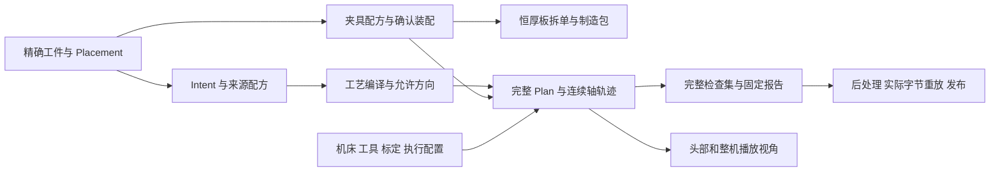

# 三维五轴 CAM 详细设计总览与功能追踪

版本 1.1 · 2026-10-13。面向 iCAX 产品、几何、CAM、运行时和前端实现人员。本套设计为五页工作台的 49 项功能建立数据所有权、计算步骤、接口、失败处理和验收条目，沿用现有 ApplicationRuntime → ProductRuntime → Project → Scene 框架。编号覆盖及链接检查不代表每项算法已实现或已验收；各模块的实现资格必须另有证据。

软件的主链是 **工件及装夹 → 可编辑切割意图 → 工艺路径 → 完整五轴计划 → 验证 → 实际文件重放与交付**。每层保存自己负责的事实和固定版本依赖，不能用页面草稿、显示网格或播放成功替代下游结果。夹具另有“配方 → 装配 → 平面板件 → 下料与拼焊资料”的制造链；两条链通过同一个装夹版本关联。

## 1 设计范围与阅读关系

本目录是[产品规格说明书](../01-三维五轴CAM产品规格说明书.md)和[技术方案设计书 1.4](../02-三维五轴CAM技术方案设计书.md)的模块详细设计。技术基线第 17—24 章给出公共类型、字段和消息框架；本目录细化算法选择、提交边界、难例、失效规则和实施顺序。跨文档字段的收敛见 [09](09-源码依据与设计校核.md)，实现时采用收敛后的契约，不同时实现同义入口。

这里的 F01—F49 严格对应[三级功能规格表](../三维五轴CAM-三级功能规格表.pdf)，也可由[规格表生成源](../../../src/tools/docs/build_five_axis_function_spec.py)核对。上级规格第 19 章的竞品参考也使用 F 编号，但范围不同；引用它时必须写“竞品参考 Fxx”，不能与本表混用。M01—M10 是技术模块，W01—W10 是实施工作包，D01—D40 是待执行验收案例。

当前界面已存在的受控浏览器检查与本套设计的实现验收分开。本文不将拟新增的领域 SDO、规划器、夹具制造、整机验证或后处理描述为已完成软件。首批机型、控制器及试切工艺的数据必须在实施时按证据冻结；设计不编造数值，也不加入旧 Laser3DCAM 迁移或 FACAM 文件兼容范围。

| 分册 | 核心问题 | 主要交付契约 |
| --- | --- | --- |
| [01 框架接入与一致性内核](01-框架接入与一致性内核.md) | 怎样接入既有框架，避免双重状态、旧任务覆盖和错误撤销 | 组件/资源归属、任务 owner、固定引用、提交与保存 |
| [02 工件定位与夹具制造](02-工件定位与夹具制造.md) | 怎样得到真实可定位工件和可制造、可装配夹具 | Placement、FixtureRecipe、Assembly、FlatBlank、制造包 |
| [03 CAD 准备与切割定义](03-CAD准备与切割定义.md) | 怎样保留尺寸、来源和意图身份 | 中性 CAD 服务、面片候选、投影分支、重绑定和分段 |
| [04 工艺编译与姿态约束](04-工艺编译与姿态约束.md) | 怎样把成品要求转成路径和允许方向 | 补偿/姿态耦合、工艺继承、引线/事件、关键点 |
| [05 五轴运动排序与空移规划](05-五轴运动排序与空移规划.md) | 怎样求出整条可连续执行的运动 | 相对运动链、连续逆解、顺序约束、连接和时间规划 |
| [06 双层仿真验证与加工交付](06-双层仿真验证与加工交付.md) | 怎样证明计划和实际输出在已声明范围内合格 | 头部/整机分工、碰撞误差界、报告、重放和发布恢复 |
| [07 工作台交互与端到端消息](07-工作台交互与端到端消息.md) | 怎样让可靠业务状态与不中断输入的界面配合 | 草稿冲突、三通道、四条业务时序、诊断和帮助 |
| [08 实施分解与验收矩阵](08-实施分解与验收矩阵.md) | 怎样分批实施并判断完成 | 十个工作包、四十项验收、支持组合与证据 |
| [09 源码依据与设计校核](09-源码依据与设计校核.md) | 哪些能力现成，哪些契约需要实现 | 源码定位、基线补充、预览候选、连续轨迹及校核记录 |
| [10 逆运动学开源库选型与接入](10-逆运动学开源库选型与接入.md) | 怎样复用成熟库同时覆盖龙门和带地轨机械臂 | Pinocchio、IKFast、Ceres 分工，外部轴联合规划及十二项原型验收 |
| [11 加工特征识别算法与数据契约](11-加工特征识别算法与数据契约.md) | 怎样从真实几何区分轮廓、标准形状和局部贯通，避免假孔与重复加工 | 有向拓扑、材料域、双皮、圆/矩形/腰型、曲面截面、证据与三十六项原生验收计划 |

特征识别的现有代码仅有 wire 角色启发式，未具备本产品要求的标准形状及贯通判定。11 单列源码缺口、算法和原生验收；FR01—FR36 尚未执行。不能用目录完整、既有 UI 报告或静态校核的 passed 字段声称特征识别已完成。

建议先读 01，沿 02—06 理解加工与制造链，再用 07 检查真实用户操作，最后按 08 拆工作包。产品评审可从下方 F 编号直接进入有关分册；框架评审从 01、09 开始。机型主范围同时包含龙门五轴与六轴机械臂加地轨；10 将成熟开源求解器接到同一中性服务，地轨参与逆解、连续规划、碰撞、定时和输出，不作为一次性基座摆放。

## 2 模块协作和权威数据

SDO 负责定位领域 owner、校验命令并组织业务提交，自身不保存状态。Repository 保存实体/组件；Resources 保存不可变几何、配置和计算结果；Behaviour 管理任务和播放的运行生命周期；IService 提供中性计算。View/SDK 投影工程状态，前端只拥有尚未提交的草稿和交互状态。跨产品可复用这些公共能力，不复用 TubeDesigner 业务状态或其专用页面。

## 3 需要统一坚持的设计决定

1. **保留设计原因。** 草图尺寸、投影方向、功能孔轴和来源拓扑均可追溯。孔径改变后重新构造几何，人工工艺在身份有效时保留；不能把一条生成折线当作全部定义。
2. **材料尺寸是硬约束。** 改变切割方向可能改变倾斜切缝在测量面上的边界，因此调姿要回到工艺层核验；不是只转一下显示的切割头。
3. **规划覆盖整次作业。** 首刀进入、各刀内部、刀间连接、最后退出以及光/气/随动事件组成同一个 Plan。局部结果不能覆盖上一份完整结果。
4. **连续性有明确语义。** 轴轨迹必须给出插值函数和单位；逆解、时间规划、连续碰撞、播放器、后处理使用同一求值定义。
5. **通过必须有覆盖范围。** 头部播放、几何检查、整机验证和输出重放分别回答不同问题。未知碰撞模型或未知控制器语义是 Incomplete，不能算通过。
6. **结果发布要核对当前输入。** 版本引用之外还需要 Scene epoch、运行修改序号和生成序号。编辑后再撤销不会让旧任务重新获得发布资格。
7. **夹具必须可制造、可装配。** 检查板厚全域、连接插入顺序、真实恒厚平面拆单和镜像编号；静态外观正确不等于可拼装。
8. **界面刷新不打断操作。** 画布和输入节点优先保留；异步返回前继续输入或滚动的最新状态必须受保护。真实浏览器验证不能用字符串断言替代。

## 4 改动如何传递到下游

下表是最小失效范围；01 的发布栅栏仍使用保守全 Scene 修改序号。局部缓存可以复用，但必须重验依赖，不能靠这个表绕过完整 Plan 的发布检查。

| 变化 | 保留的事实 | 必须失效或复核 |
| --- | --- | --- |
| 工件重导入、修复、CSG | 原文与旧版本，能证明身份的用户参数 | 来源重绑定、夹具、工艺、运动、报告和交付资格 |
| 粗/精定位、Placement | 工件模型坐标下的尺寸和意图 | 装夹相关夹具关系、机床运动、碰撞、定位与输出 |
| 投影孔距、目标面、设计轴 | 有效成员 ID 及适用工艺/人工约束 | 受影响投影、过程路径、相邻连接、整计划与报告 |
| 补偿、引线、姿态关键点 | 源几何与其他人工字段 | 工艺或姿态编译、相关轴段/连接、定时、验证 |
| 手动顺序、连接策略 | 切割定义与工艺配方 | 偏序、支撑状态、连接分支、整体定时和报告 |
| 夹具配方/确认装配 | 工件与切割定义 | 加工环境、完整计划资格、验证；制造包按装配版本失效 |
| 机床、工具、标定、执行配置 | 机器无关且仍适用的意图 | 轴锁适用性、IK、动态、碰撞、重放和支持组合资格 |
| 显隐、布局、筛选、播放时间 | 所有业务输入与固定结果 | 仅显示；不得关闭碰撞或增加输入修订 |

## 5 工件和 CAD 功能追踪

分册栏的数字为章节号，验收编号定位到 [08](08-实施分解与验收矩阵.md)。每项均有设计入口和验收条件；下表表示设计覆盖，不表示软件验收通过。

| 编号 | 三级功能 | 分册及章节 | 关键设计落点 | 验收 |
| --- | --- | --- | --- | --- |
| F01 | 导入模型 | [02](02-工件定位与夹具制造.md) §2.1 | 单位、装配节点、资源闭包、原子创建 | D01、D29、D40 |
| F02 | 多工件项目 | 2026-10-16 按用户澄清修正 | 一个项目保存工件列表，一次显示/加工一个；独立定位、工装、切割定义、生成和仿真；保存重开及撤销重做 | 178 项原生回归、真实双工件浏览器流程通过，独立 CEF/实机未验收 |
| F03 | 已移出当前范围：内置模型 / 参数化模型 | [02](02-工件定位与夹具制造.md) §2.2 | 2026-10-13 用户要求删除入口及相关面板 | — |
| F04 | 粗定位 | [02](02-工件定位与夹具制造.md) §3 | 三点/线面正交基，退化与手性 | D03 |
| F05 | 精定位 | [02](02-工件定位与夹具制造.md) §3 | 正刚体拟合，残差/条件性，不重复应用 | D03、D25 |
| F06 | 装夹环境 | [02](02-工件定位与夹具制造.md) §1、4—5 | 碰撞角色独立于显隐 | D04、D24、D38 |
| F07 | 生成夹具 | [02](02-工件定位与夹具制造.md) §4—5、8 | 板厚包络、接触分支、可装配连接 | D04、D05、D31 |
| F08 | 夹具拆单 | [02](02-工件定位与夹具制造.md) §6 | 恒厚区域、二次加工、镜像和实例映射 | D06 |
| F09 | 夹具导出 | [02](02-工件定位与夹具制造.md) §7 | 1:1 DXF、清单、拼焊资料与独立回读 | D07、D28 |
| F10 | 几何检查 | [03](03-CAD准备与切割定义.md) §2 | 版本绑定问题和检查覆盖 | D08 |
| F11 | 几何修复 | [03](03-CAD准备与切割定义.md) §2、7、9 | 形变预算、预览提交与来源重绑 | D08、D31 |
| F12 | 三维零件编辑 | [03](03-CAD准备与切割定义.md) §2、7、9 | 可选特征编辑，保留历史和一次撤销 | D09、D12 |
| F13 | 测量 | [03](03-CAD准备与切割定义.md) §2 | 精确捕捉、坐标明确、只读 | D09 |

## 6 CAM 功能追踪

| 编号 | 三级功能 | 分册及章节 | 关键设计落点 | 验收 |
| --- | --- | --- | --- | --- |
| F14 | 自动提取 | [03](03-CAD准备与切割定义.md) §3；[11](11-加工特征识别算法与数据契约.md) §4—14 | 有向面片、材料域、双皮/盲腔、标准形状和证据 | D10；FR01—FR34 |
| F15 | 手动选面 | [03](03-CAD准备与切割定义.md) §4；[11](11-加工特征识别算法与数据契约.md) §7—9、13 | 精确拓扑；选面边界不冒充真实材料边界；统一确认 | D10、D29；FR17、FR23—FR25、FR29—FR34 |
| F16 | 草图投影 | [03](03-CAD准备与切割定义.md) §5—7、9 | 尺寸来源、连续分支、相切退化与一次确认 | D11、D12、D31 |
| F17 | 打断切割线 | [03](03-CAD准备与切割定义.md) §8 | 来源区间、父子替代、关键点继承 | D12、D15 |
| F18 | 孔与姿态 | [04](04-工艺编译与姿态约束.md) §3；[11](11-加工特征识别算法与数据契约.md) §10—13 | 圆/矩形/腰型及曲面截面；形状、功能轴和实际轴锁独立 | D13；FR01—FR15、FR19—FR22、FR26、FR34—FR35 |
| F19 | 起点 | [03](03-CAD准备与切割定义.md) §8；[04](04-工艺编译与姿态约束.md) §5 | 单一源锚点，遍历重排与关键点映射 | D14 |
| F20 | 引线 | [04](04-工艺编译与姿态约束.md) §5 | 废料侧、穿孔与板外引线资格 | D15 |
| F21 | 阴阳切 | [04](04-工艺编译与姿态约束.md) §4.1 | 拓扑材料区，不按屏幕左右或反向猜测 | D14、D15 |
| F22 | 过切 | [04](04-工艺编译与姿态约束.md) §5 | 闭合曲线追加弧长，区分重复位置的时间身份 | D15 |
| F23 | 补偿 | [04](04-工艺编译与姿态约束.md) §4 | 成品测量面、偏移退化及倾斜耦合 | D15、D17 |
| F24 | 反向 | [03](03-CAD准备与切割定义.md) §8；[04](04-工艺编译与姿态约束.md) §4—5 | 保持物理材料侧和来源锚点 | D14 |
| F25 | 清除 / 恢复继承 | [04](04-工艺编译与姿态约束.md) §2 | 显式禁用与恢复库值不同，保留其他人工输入 | D16 |
| F26 | 生成刀路 | [04](04-工艺编译与姿态约束.md) §1、8；[05](05-五轴运动排序与空移规划.md) §1—10 | 全作业完整计划、分支回退、事件和发布栅栏 | D17—D22、D30—D32 |
| F27 | 关键点编辑 | [04](04-工艺编译与姿态约束.md) §6—7 | 几何锚点、硬软约束、机型相关轴锁 | D17、D19 |
| F28 | 刀路调整 | [04](04-工艺编译与姿态约束.md) §6—9 | 目标方向与允许域分开，整体修改保留局部锁 | D17 |
| F29 | 空移调整 | [05](05-五轴运动排序与空移规划.md) §6—7 | 完整边界状态、连续避碰、时间重接 | D20、D22 |
| F30 | 手动排序 | [05](05-五轴运动排序与空移规划.md) §5 | 草稿、前缀/相邻锁和偏序冲突 | D21 |
| F31 | 自动排序 | [05](05-五轴运动排序与空移规划.md) §5—6 | 可行连接成本、有限候选搜索与回退 | D21 |
| F32 | 轨迹仿真 | [06](06-双层仿真验证与加工交付.md) §1—2 | 头部阶段预览，不产生整机资格 | D23、D37 |
| F33 | 三点定位 | [06](06-双层仿真验证与加工交付.md) §6 | 待测计划、责任方和变换一次应用 | D25、D38 |
| F34 | 导出 | [06](06-双层仿真验证与加工交付.md) §7—9 | 实际字节重放、资格复核、发布故障恢复 | D25—D28、D38 |
| F35 | 设备与规划设置 | [05](05-五轴运动排序与空移规划.md) §2—4、9 | 固定配置、标定、动态/计算预算和支持组合 | D18、D19、D38 |

## 7 仿真 帮助和公共能力追踪

| 编号 | 三级功能 | 分册及章节 | 关键设计落点 | 验收 |
| --- | --- | --- | --- | --- |
| F36 | 实机配置 | [05](05-五轴运动排序与空移规划.md) §2—3；[06](06-双层仿真验证与加工交付.md) §4 | 完整运动链、碰撞件、实测资格 | D23、D24 |
| F37 | 整机仿真 | [06](06-双层仿真验证与加工交付.md) §1—5 | 连续函数重放、绝对求值、完整检查集 | D20、D22—D24、D37 |
| F38 | 仿真结果 | [06](06-双层仿真验证与加工交付.md) §3；[07](07-工作台交互与端到端消息.md) §8 | 版本化问题、覆盖不足、不重复沿用旧通过 | D24、D38、D39 |
| F39 | 操作说明 | [07](07-工作台交互与端到端消息.md) §10 | 离线任务帮助与版本对应 | D36 |
| F40 | 导出诊断包 | [07](07-工作台交互与端到端消息.md) §10；[09](09-源码依据与设计校核.md) §5 | 明确收集范围，本地包与发送分开 | D36 |
| F41 | 日志 | [07](07-工作台交互与端到端消息.md) §10 | 公共日志、关联 ID、稳定游标与过滤 | D36 |
| F42 | 关于 | [07](07-工作台交互与端到端消息.md) §10 | 产品/模块/schema 版本，不冒称设备合格 | D36 |
| F43 | 重置布局 | [07](07-工作台交互与端到端消息.md) §10 | 共享动作，只改布局偏好 | D36 |
| F44 | 工程新建 / 打开 / 保存 | [01](01-框架接入与一致性内核.md) §9 | 外壳入口、冻结快照、codec 依赖闭包 | D33、D40 |
| F45 | 三维视图 / 适合窗口 | [07](07-工作台交互与端到端消息.md) §3—4 | SDK 视口与工程/碰撞独立 | D34、D39 |
| F46 | 任务树 / 搜索 / 选择 | [07](07-工作台交互与端到端消息.md) §1 | 稳定对象身份、跨页选择 | D34、D35 |
| F47 | 属性草稿与条件字段 | [07](07-工作台交互与端到端消息.md) §2 | 字段级冲突合并，隐藏值不参与生成 | D34、D35 |
| F48 | 刷新与交互保护 | [07](07-工作台交互与端到端消息.md) §3、9、11 | 最新交互捕获、节点保留、迟到响应隔离 | D30、D34、D35 |
| F49 | 底部流程 / 问题面板 | [07](07-工作台交互与端到端消息.md) §8 | 问题定位修复对象及历史版本 | D39 |

## 8 首次实施的落点

先完成 W01 的资源引用、撤销、异步任务及保存闭环，再以手动边界贯通 W02—W05；首批机型原型覆盖一台明确龙门五轴和一套六轴机械臂加地轨。每种机型的可执行交付都要经过真实 Scene、完整轴轨迹、连续检查及文件重放；后续自动提取、投影、夹具和复杂避障有共同的完成标准。W09 随每个领域工作包接线，CAD 增强保持可选。

F01—F49 的责任、输入、结果、失败和测试映射只是设计完整性检查的一部分，还需逐算法审查可实现性与边界条件；软件验收以 D01—D40、IK01—IK12、FR01—FR36 的实际证据及机型支持组合为准。文档结构校核记录见 [设计校核记录](设计校核记录.json)，它不授予算法正确、运行或生产资格。
