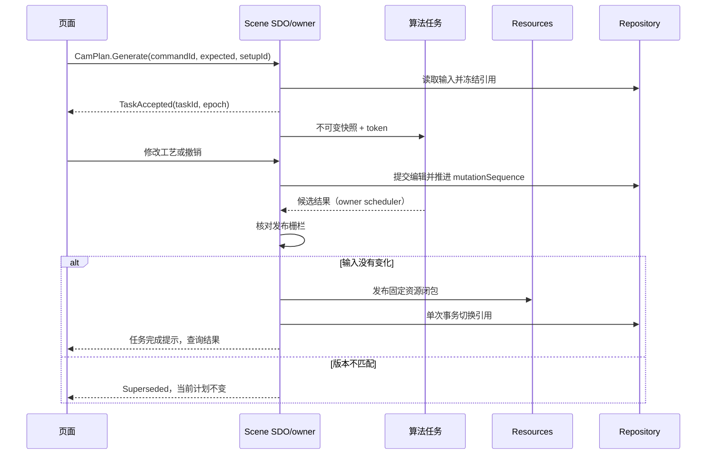

# 01 框架接入与一致性内核

版本 1.0 · 2026-10-13。范围：M01/M10 及各模块公共提交机制，覆盖功能表 F44、F47、F48，并约束所有业务功能。本文定义新产品的接入方法，不修改 iCAX 的整体架构。与上级技术基线第 17—24 章共同使用；本文将其拟定契约收敛为可实施的模块责任和执行规则。

## 1 从现有代码出发的判断

1. 运行归属已经是 ApplicationRuntime → ProductRuntime → Project → Scene。Scene 自有 Repository、Resources、Universe、SDO/PDO、Views 和执行线程，不能另造一个 CAM 全局工程管理器。
2. 目前产品 manifest 主要装载 CamRuntime；通用 IntentToolpath 和 ProcessPath 已有组件/资源，**有数据类型不等于具备五轴规划器**。尤其现有轴轨迹资源只有时间、位置、速度采样，尚不足以唯一重建带动态保证的连续运动。
3. FiveAxisCAM 以通用 IntentToolpath 的 `CEditableDocument/Plan/OperationComponent` 保存唯一编辑定义，精确结果保存在 `CEditableDerivedComponent`。补偿、裁剪、引线、分段和刀轴使用同一操作图；ProcessPath/执行数据只投影当前结果，再进入完整 Plan，不另做一次工艺计算。CPath、旧产品组件和资源字段不作为可编辑镜像，不做旧工程兼容迁移。
4. 当前资源组件若仅保存 `CurveResourceID` 这样的字符串，会隐式追随当前版本；本产品输入和结果必须补齐固定版本引用。不是仅在文档里写“版本化”就能满足。
5. `ICadFeatureModelService::DifferenceNative` 的接口含 `TopoDS_Shape`，不能直接成为产品层的中性接口。内核类型只留在 OCCT 插件内部，产品调用几何中性门面。

源码依据见本文末尾。以下新增类型均为设计，不声称已实现。

## 2 模块接入位置与依赖方向

| 位置 | 处理内容 | 禁止承担的内容 |
| --- | --- | --- |
| `src/apps/five-axis-cam` | manifest、五页网页、产品能力声明 | 原生计算实现、私有资源池、第二套工程格式 |
| `src/iCAX-Plugins/product/FiveAxisCAM`，拟新增 | Scene 业务 SDO、组件、领域编译器、任务 owner、检查器 | 通用 CAD 内核类型、应用级配置写入 |
| `src/iCAX-Plugins/cam/IntentToolpath` | 可编辑切割定义、来源与派生关系、通用几何资源 | 工艺求解、机床轴、输出文件 |
| `src/iCAX-Plugins/cam/ProcessPath` | 曲线、方向、事件、轴轨迹、来源映射的通用表达 | 活任务、排序策略、控制器语法 |
| `src/iCAX-Plugins/cam/Machine` | 机床描述、关节/部件、实例、运动状态 | 以机床实例选择代替作业机床绑定 |
| CAD/运动学/碰撞算法插件 | `IService` 接口，计算中性数据与诊断 | Repository 提交、撤销、输出发布资格 |
| 既有 ProjectFile / Resource / View | 文件、资源和投影协议 | 产品工艺规则 |

目录选择跟随当前 `iCAX-Plugins/product/TubeDesigner` 等产品模块布局；Services README 中 `apps/<product>/backend/service` 是概述路径，不据此新建另一套运行体系。逻辑编译器初期可以在一个产品 DLL 内，独立测试接口先于拆 DLL。只有通用算法具有真实复用和独立依赖时才拆模块。

manifest 必须显式装载实际使用模块及注册项；不能依靠别的产品预先加载某 DLL。组件、服务、SDO、资源 codec、Behaviour 的回放均落到当前产品环境。框架没有同名 SDO 覆盖注册机制，所以新方法使用技术基线中的 `CamCut.*`、`CamPlan.*` 等身份，不能“覆盖”现有 `Toolpath.*`。

## 3 三种状态各有唯一 owner

| 状态 | 保存位置 | 生命周期 | 示例 |
| --- | --- | --- | --- |
| 可编辑业务事实 | Repository 组件 + Embedded 固定版本资源 | 保存、重开、撤销 | Setup、材料/工艺、夹具设计、Intent、关键点 |
| 已发布计算结果 | 不可变 Resources + 小型结果引用组件 | 随输入保留历史，资格独立判断 | 夹具装配、拆单、Plan、报告 |
| 运行态 | Scene 的 Behaviour/运行组件或前端 | 关闭 Scene 后释放 | Task、取消源、播放会话、筛选、焦点 |

SDO 保持无状态。拟新增 `CCamTaskOwnerBehaviour` 在 Scene 内管理任务表，保存任务 ID、取消源、预算、输入版本和完成回执；任务调度用已有 Task 与 Universe scheduler，不自建消息总线。SDO 只定位 Scene owner、校验并交付请求。业务方法不依赖浏览器当前选中项，`setupId/intentId` 必须显式传入。

`IService` 允许 `OnSceneTick` 并不意味着通用几何服务应保存场景业务。中性求交/投影/运动学服务只读计算输入；如果领域任务 owner 采用服务形式，必须按 ProjectID+SceneID 隔离并由 Scene 关闭清理。首选 Behaviour owner，使销毁归属显式。

## 4 对象和引用关系

```text
Project / 主 Scene
  Job → Setup[]
    Setup → MachineInstance + ExecutionProfileRef + Placement[]
    Placement → Workpiece + T_Setup_Workpiece
    Setup → FixtureAssemblyRef + CollisionPolicyRef
    IntentDocument → Intent[] + SourceRecipeRef
    Intent → ProcessAssignmentRef + PosePolicyRef + EditAnchorsRef
    PlanState → LastSuccessfulPlanRef + CurrentInputDigest
      Plan → OrderedOperation[] → ProcessPath 实体及固定资源束
      Plan → Transition[] + Entry/Exit + AxisTrajectory + EventTimeline
      Verification → PlanRef + ConfigRefs + Coverage + Issues
      DeliveryRecord → 文件清单/摘要 + ReplayReportRef
```

Workpiece 原始模型坐标不被粗定位覆盖；Placement 表达摆放。实体身份和资源内容身份分开：Intent ID 在改尺寸后保持，几何资源版本变化；拓扑子 ID 只在所属几何版本内有效。生成结果存在不表示当前可用，显示历史结果时必须标记过期。

`ResourceRef` 在线路上使用 `{url:string, version:uint64}`，对应既有 `CResourceReference{URL,nVersion}`。不能用 `?version=...` 修改规范 URL；资源读取通过既有固定版本参数/请求头。JS 的 uint64 用十进制字符串或正式 FlatBuffer bigint 映射，禁止损失精度。

## 5 最小持久组件与新增资源

复用上级技术基线字段；这里明确提交时必须一起维护的字段组合。

| 组件/资源 | 核心字段 | 不变量 |
| --- | --- | --- |
| Job | JobID、ActiveSetupID、InputRevision | ActiveSetup 只决定默认 UI，不决定请求作用域 |
| Setup | 机型/执行配置/碰撞配置引用、Placement 列表、InputRevision | 固定版本；修改后依赖结果失效 |
| Workpiece | SourceRef、GeometryRef、TopologyMapRef、单位来源、InputRevision | 原文、精确几何、显示网格分开 |
| FixtureDesign | SourcePlacementRef、RecipeRef、DesignRevision | 不将草稿板厚写入已经发布的装配 |
| Intent | 通用 Intent 组件 + FeatureRef、ProcessAssignmentRef、PosePolicyRef | 孔形与姿态独立；切割起点仅一份 |
| PlanState | Validity、LastSuccessfulPlanRef、CurrentInputDigest | 不持有 worker、Task 或可变轨迹数组 |
| VerificationSummary | ReportRef、PlanRef、QualificationDigest | “通过”必须覆盖所需检查集 |
| DeliveryRecord | OutputID、ManifestRef、PublishedAt、OutputDigest | 文件不变成第二种领域 Path |

同一 ProcessPath Entity 在发布时附加曲线/方向/事件/轴轨迹固定引用，保持通用插件的表达方式。Plan 记录此时的资源束，历史报告按资源束读取，不从已被后次生成修改的 Entity 查询“当前字段”还原旧结果。

## 6 修订、摘要和缓存不是同一个量

- `inputRevision`：持久业务修订，可随 Undo 恢复。
- `sceneEpoch`：本次 Scene 生命周期标识；重开工程即变化。
- `mutationSequence`：本会话任何输入提交、Undo、Redo 均递增，不随撤销回退。
- `generationSequence[setup]`：同装夹每次替换生成请求递增。
- `inputDigest`：规范化输入内容摘要，用于缓存和可复现性；不能独立授权发布。

摘要包含固定几何/拓扑资源、布局、所有启用 Intent、继承后工艺、人工约束、机床/工具/配置、算法版本与容差。集合按稳定 ID 排序，序列保持业务顺序；数字明确单位，拒绝 NaN/Infinity，统一负零。派生 UI 展开状态和显示网格质量不入加工摘要。内容哈希不代替资源版本，二者同时记录。

首版发布使用保守全 Scene mutationSequence；其他装夹编辑也可能使结果 Superseded，这是正确性取舍。等真实依赖收集和负例证明完备后才缩窄到 Setup。缓存命中只省计算，仍走同一提交核验。

## 7 完整命令生命周期

### 7.1 可靠写命令

```text
Scene SDO 收到 commandId、expected、业务参数
 → 检查 Scene/Job/Setup 归属
 → 查询幂等回执：同 ID 同载荷返回原结果，不重复修改
 → 检查 expected 与对象版本
 → 解析固定资源，规范化、校验适用参数
 → 准备候选数据（需要计算则走异步任务）
 → 再次核对资格
 → 发布所有候选资源叶节点，再发布依赖它们的资源
 → BeginUndoCommand → BeginTransaction
 → 更新组件引用、修订、失效状态
 → CommitTransaction；失败 CancelTransaction
 → End undo；推进运行序号；存储回执；通知查询
```

资源发布与 Repository 提交不是同一个事务。资源可以先成功、组件提交后失败；失败资源没有权威引用，不得改变当前工程。资源池不提供单版本强删，不能设计“失败后硬删除版本”的补偿。候选先用 RuntimeOnly 数据；准备正式提交时发布 Embedded 的不可变副本和完整依赖闭包。持久资源不能依赖 RuntimeOnly 资源。

若提交成功但响应丢失，同 commandId 返回已提交回执。幂等表归 Scene 运行态，跨进程不假装仍有回执；重连先读 epoch。文件落盘另有发布协议，见 06。

### 7.2 异步任务

SDO 在 Scene 线程解析完不可变快照后返回 TaskAccepted。worker 只捕获独立数据/只读固定资源 owner、取消令牌，不捕获可变 Scene、Entity、Component 指针。worker 结果通过 `ContinueWith(..., engineScheduler)` 回到 owner 线程，不能依赖 Task 默认 continuation 回 Scene；默认调度器是线程池。

完成时按顺序检查：owner 未关闭、epoch 匹配、未取消、序列匹配、引用仍有效、输入摘要匹配、结果完整。任一不符返回 Superseded/Cancelled，并允许保留可查看的诊断。最后再进行短事务。Scene 线程不对同池任务 `.Wait()`；资源读取等待用异步组合，避免线程池自我饥饿。

关闭时先停止接收、撤销发布资格并取消；运行记录进入异步排空，任务只持有独立快照和可失效的弱 owner 句柄。Scene 销毁不在自身事件循环上阻塞等待需要该循环处理的完成回调。worker 完成后先检查 owner 生存期，再尝试投递；调度器已停止时仅释放候选和快照，不访问业务对象。中性内核不支持及时中断的调用也不得发布关闭后的结果。

### 7.3 序列示例



## 8 协议与数据面

SDO 方法名严格两段 `CamFixture.Generate`，实例 ID 放参数，不创建 `Cam.Setup.123.Generate`。SDO Frame 已有 CallID、MethodCode、Kind、Status，业务不再造运输 envelope；commandId 表达用户动作幂等，taskId 表达跨请求计算，它们不替代 CallID。

SDO 传查询、修改和结果引用；大几何、轨迹、问题列表分页块经 ResourceClient 固定版本获取。PDO 只发布可覆盖的进度/播放时间/轴状态，丢帧可以补查。任何删除、完成、报告引用都能通过可靠查询恢复，不能只在某一帧 PDO 中出现。

`CamScene.ReadState` 返回 epoch、projectionSequence、对象摘要和结果引用；`CamPlan.QueryStatus/Cancel` 复用基线契约。取消不撤销已完成编辑。模拟 Play/Pause/Seek 按 sessionId/controlSequence 仲裁，见 06、07。

## 9 保存、撤销和诊断

保存复用既有 Project 保存入口及 ProjectFile 的文档、codec、store 调用链，以冻结 Repository 及其资源闭包为输入。新资源必须注册 codec、稳定类型名及依赖枚举。历史冷存储只保证当前会话撤销，不等于重开后的撤销历史；不新增跨会话 Undo 承诺。

保存期间后续编辑成功时，文件仍描述冻结版本，只在当前 revision 等于保存 revision 时清除未保存标记。重开后任务全部是非运行状态，重新校验配置/结果资格；不“恢复”线程指针、模拟控制序号或失效的 Scene epoch。

领域失败返回问题码、对象/几何/轨迹定位、违反约束、实际值/上限及可操作建议。用户看不到 C++ 栈和指针；诊断包可保存脱敏栈、算法版本与输入摘要。没有理由写“未知失败后重试成功”。

## 10 实施验收

本文件要求至少验证：错误通道拒绝；同命令重复提交只产生一次 Undo；资源成功但事务失败不替换旧计划；编辑→Undo 后旧任务仍不能发布；关 Scene 后回调不访问已销毁对象；跨 Scene 同 ID 不串任务；保存冻结与后续编辑并发；缺失 codec/依赖明确失败。具体样例编号见 08。

## 11 已核对源码

- [框架运行归属](../../../src/iCAX-Engine/framework/README.md)：ApplicationRuntime、ProductRuntime、Project、Scene 的职责。完整源码索引和新增契约见 [09](09-源码依据与设计校核.md)。
- `src/iCAX-Engine/framework/ProjectContext/ISceneContext.h`：Scene 能力、Views 非 Service、停止信号。
- `src/iCAX-Engine/framework/Database/IRepository.h`：显式事务对象及独立 Undo scope。
- `src/iCAX-Engine/framework/Resources/ResourceInfo.h`、`Resources/README.md`：固定版本依赖、持久化、冷存储与无硬删除语义。
- `src/iCAX-Engine/foundation/Task/README.md`：调度器继承和线程池等待边界。
- `src/iCAX-Plugins/cam/IntentToolpath/README.md`、`ProcessPath/ProcessPathComponents.h`、`ProcessPathResources.h`：通用表达及当前缺项。
- `src/licensing/include/LicenseSDOGuard.h`：共享入口按宿主产品/Scene 作用域核验，不因 namespace 名称而推断五轴产品必须使用 TubeDesigner 授权。新产品授权策略属于产品注册，不能由请求体指定。
