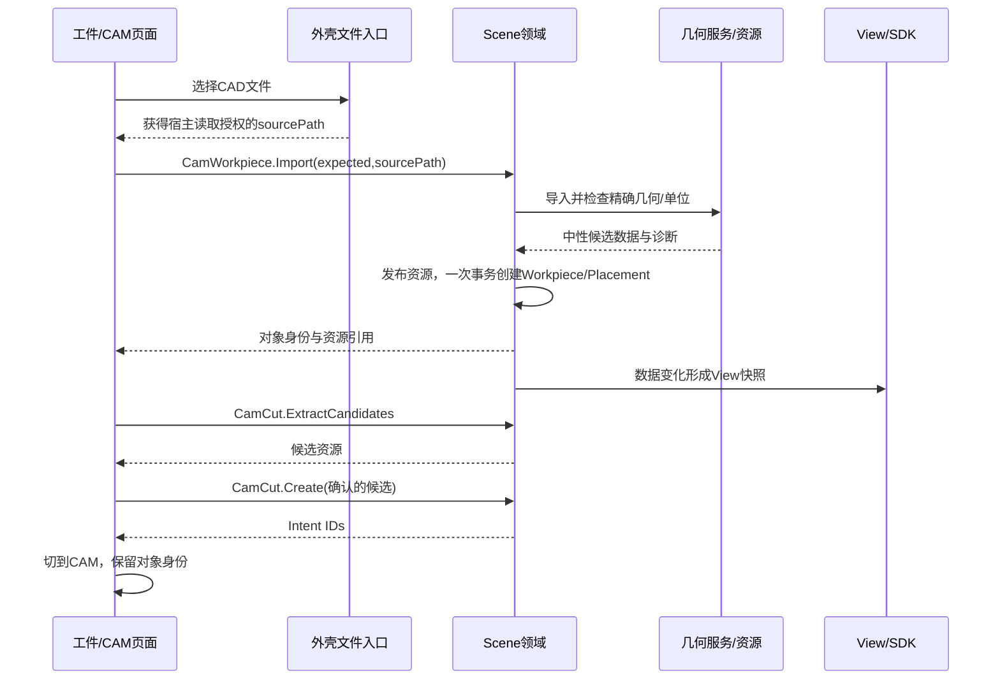

# 07 工作台交互与端到端消息

版本 1.0 · 2026-10-13。覆盖 F39—F49，并落实 F01—F38 的交互通道。前端拥有操作草稿和显示状态，正式业务事实由 Scene 查询得到。

## 1 五页共用工程上下文

外壳继续管理新建、打开、保存、窗口、项目切换和公共日志，产品只提供工件、CAD、CAM、仿真、帮助。内部 `toolpath` 页面 ID 可保留，展示名称统一为 CAM。

左树的规范身份是 `(sceneEpoch, entityId, objectKind)`，不是文本标签、行索引或当前页面。工件、CAD、CAM、仿真切换保留任务选择；右栏根据所选工具显示当前操作，不因切页重新创建 Intent。

节点可以展示源定义、过程路径和完整计划状态，但三者分别标识。为节点定义 `inputState=Saved/LocalDraft/Conflict` 与 `resultState=Missing/Valid/Stale/Failed` 两个轴，不用一个“完成”图标同时表达输入保存和计算成功。

## 2 草稿不是工程的另一份副本

草稿键为 `(sceneEpoch, objectId, editorKind)`；排序/设置等全局操作按 Setup 或 operation scope 保存。每份草稿含 `baseRevision, originalValues, editedFields, currentValues, validation, pendingCommandId`。

刷新时未编辑字段可以更新，编辑字段保持当前文字。后端同一字段也发生变化时标记冲突，让用户比较来源值/当前值/本地值；不能无条件用服务器覆盖，更不能自动重放旧 patch 覆盖新的修改。冲突后重新提交使用新 commandId 和新的 expected。

数字输入区分原始文本和可提交数值，“-”“1.”属于输入中间态，不提交 NaN，也不在每个按键后改写成 0。校验错误留在字段旁，正常操作结果进入公共日志。涉及几何失效时保留“重新生成”动作，不出现重复常驻成功状态条。

字段显示/禁用复用 parameterConditions 与统一描述符；永久隐藏使用 `presentation.visible=false`。五轴参数 schema 定义单位、作用域、适用能力及影响，不在视图里按名称猜“这像装配参数”。

## 3 增量更新与交互保护

采用当前产品 `workspaceDom` 的稳定键局部更新，保留画布、输入节点和监听器。模型资源或 View 快照变化更新 SDK 对象，不重建整个挂载点。输入、面板、嵌套树、时间线各自有稳定键。

确需替换节点时，替换前调用共享 `capturePaneInteraction` 捕获最新状态；不能在请求发送时捕获位置，等待响应后覆盖用户刚滚动的新位置。恢复焦点使用 preventScroll，随后恢复滚动。字段消失时不把焦点送到另一个“同索引”字段。

所有异步响应需核对 projectId、sceneEpoch、viewSession、request identity。业务结果可更新原工程的数据缓存，但不能让原页面重新获得焦点，也不能把已关闭子编辑器重新弹出。全局选中 Scene 由外壳决定，业务体不能指定另一个 channel 并让后端跟着跳转。

## 4 三种通道如何配合

| 通道 | 应传内容 | 不能承担 |
| --- | --- | --- |
| SDO | 可靠编辑、查询、任务开始/取消、模拟控制、低频状态提示 | 大型轨迹/网格正文、高频逐帧坐标 |
| Resources | 固定版本几何、轨迹、报告、View 快照 | 暗中提交业务输入 |
| PDO | 可覆盖的进度、播放时间和轴状态 | 唯一的任务完成证据、不可补查的对象删除 |

ResourceClient 读取先核验类型、schema、版本、长度，再解码；旧版本返回的数据只能加入对应缓存，不覆盖“当前资源”。同 URL 不同 version 缓存条目必须区分。二进制读取使用正式 FlatBuffer verifier/file identifier。

View 根据业务实体上的 RenderInstance/Transform 投影到前端。前端不扫描资源池猜哪些是工件；用户选择先映射为对象/拓扑引用再发 Scene 命令。模型坐标、装夹变换和机床动态 transform 不混入同一个前端坐标字段。

## 5 具体请求示例：修改与生成

以下为设计中的 JSON 表示，线协议仍遵守现有 SDO Frame；示例 UUID 为说明值，正式输入由系统分配。

```json
{
  "contractVersion": 1,
  "commandId": "28b89ecb-71ba-4db3-a9db-7b1d28e34688",
  "expected": {
    "sceneEpoch": "1f7c0bfd-c359-496c-b97c-8ddf8413a114",
    "mutationSequence": "104",
    "setupId": "0dcd3b23-c8da-4fbe-8827-cad24c8a54b8",
    "setupInputRevision": "18"
  },
  "intentIds": ["a486c6e2-7925-4dd7-9961-76e651a27b54"],
  "patch": {"overcutLengthMm": 0.6}
}
```

调用 `scene.invoke("CamProcess.Update", payload)`。后端还需校验所列 Intent 均属于该 Setup 的合法 Placement；一个归属不合法时整批拒绝。响应复用基线 `CamReply`，包含 setupInputRevision、mutationSequence、changed、invalidated 和 data.assignmentRefs。

随后 `CamPlan.Generate` 是独立命令，冻结 revision=19 等真实响应值，不由前端自行加一预测。返回 taskId 后只显示计算中；等待可靠状态查询得到已发布 planRef 才显示已生成。事件/PDO 通知只是触发查询，可以合并更新。

## 6 端到端流程 A：导入后直接加工



CAD 页面不出现在必经序列里。结构检查发现影响目标区域的问题时才引导修复；可选三维编辑未安装不影响正常模型加工。

## 7 端到端流程 B：修改投影孔距

编辑器打开固定 Recipe 和目标几何，用户改孔距形成草稿。Preview 生成新分支结果；旧 Preview 晚到按 request identity 丢弃。Confirm 发父 Scene 命令，核验目标几何和 Recipe revision；冲突时保留用户草稿并要求重新预览，不能把旧结果接到新工件。

成功提交保留存活孔组成员的 Intent ID、适用工艺和原始设计轴。无法重绑的人工关键点显式待处理；所有受影响过程路径、相邻连接和报告变过期。撤销一次恢复改孔距前的定义和资源引用，不复活已经取消的后台任务。

## 8 端到端流程 C：碰撞修正到交付

```text
CamVerification.Run(planRef, requiredChecks)
 → 报告固定版本 + 具体工序/时间/部件对
 → 用户点击问题，前端读取对应资源并定位
 → 选择关键点/整体姿态/空移/装夹中的正确入口
 → 编辑命令一次Undo，旧报告失效
 → CamPlan.Generate（保留人工硬约束）
 → 重新验证新Plan
 → CamOutput.Preflight
 → CamOutput.Generate：实际文件重放
 → 发布前再次核验 → Published
```

问题修复入口由 issue.repairTarget 推荐，不能自动把所有碰撞都归咎于刀头姿态。若来源是夹具、限位或错误标定，应转对应对象。用户可返回上一个任务位置，页面不丢选中对象。

## 9 端到端流程 D：断线、取消与重连

前端断线不推断后台任务失败。重新连接先读 Scene epoch：相同 epoch 则查询任务与 commandId 回执；不同 epoch 则重载业务状态，不向新 Scene 重发旧编辑。未提交草稿可以提示恢复，但需要按新基础版本合并。

用户取消：发送可靠 Cancel(taskId, epoch)，后台立即撤销该任务发布资格，再协作取消运算。UI 在确认请求收到后显示 Cancelling，收到最终状态再结束；不能因取消按钮已按下就在列表删除任务，使迟到发布无法解释。

超过等待时间显示“结果未确认”，提供查状态/安全重试同 ID；不以新 commandId 自动重复创建工件/夹具/输出。SDO CallID 超时与业务任务结果分开。

## 10 帮助、日志、诊断与布局

操作说明按任务链接到功能 F 编号及参数描述符，随产品版本离线部署。关于页显示产品、模块和 schema/build 摘要；不显示无意义的“算法全部可用”。

公共日志保存时间、severity、category、correlation(commandId/taskId/outputId) 和简明结果；详细问题仍从固定 reportRef 读取。分页/过滤使用稳定 cursor，不每次读取全日志再在网页筛选。

诊断包默认收集版本、支持组合、任务状态、输入摘要、相关错误和配置结构。工件原文/几何可能是客户资料，必须在导出界面明确包含范围，不能默认上传或发送。生成本地包不等于分享；本产品不自动发送给第三方。凭据、签发私钥、用户授权材料不进入包。

重置布局复用外壳动作，只清理布局与显示偏好，不清业务草稿、选择来源、工件或工艺。普通页面刷新不触发该动作。

## 11 必须使用真实浏览器和真实原生的两层验收

浏览器验证：双栏及嵌套滚动、焦点/选区、请求发出后继续滚动、输入节点/监听器/画布身份、条件字段消失、跨页响应、换项目、子编辑器取消、回执超时重试。受控代理必须拒绝错误产品/Scene 通道。

原生验证：同一操作经真实 Scene SDO 提交，查询实际持久实体/资源/Undo，保存重开核对。UI 17 组预览测试只证明当前交互，不证明新命令与算法已经存在。独立宿主文件选择、模型视图、实际资源获取、保存重开与输出文件回读必须另测。
