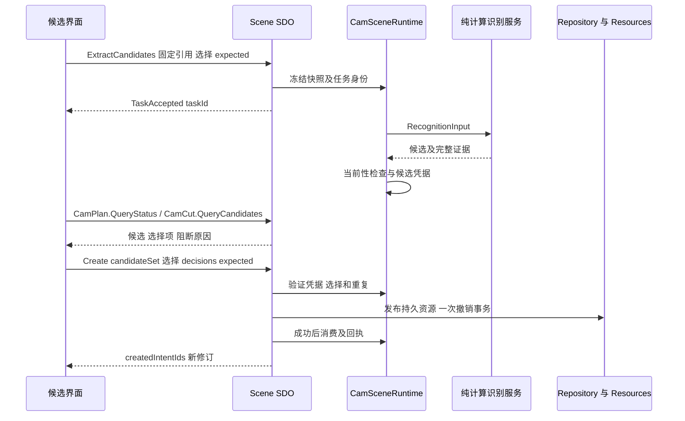

# 11 加工特征识别算法与数据契约

版本 1.0 · 2026-10-13。细化工作台 F14 自动提取、F15 手动选面、F18 孔与姿态，以及 M02-R07、M04-R01/R06、M10-R02 的识别规则与阈值。上级规格中的“竞品参考 F42 标准孔识别阈值”是另一套编号，不与工作台 F42 关于混用。本文定义实现规则，**不是现有功能通过证明**。本文与 [03](03-CAD准备与切割定义.md) 的区别是：03 管切割定义及来源的生命周期；本文负责从精确几何得到有证据的加工候选。

当前已实现独立 CutRecognition、限定范围的解析边界/通道证据，以及 CamCut 的精确选面、异步提取、分页和确认事务；8 项领域测试和原生浏览器覆盖候选失效、整票消费、失败重试、Undo/Redo、曲线/来源/证据保存闭包。工艺及连续姿态可与切割定义一并确认。完整支持矩阵和 FR01—FR36 仍未全部通过；详见 [08](08-实施分解与验收矩阵.md) 与产品 README，不能把几何候选 Ready 当作加工通过。

识别分成四个独立结论：**边界在哪里、是什么形状、开口通向哪里、能否按指定工艺加工**。圆形边界可以属于通孔、盲腔、凸台顶面或独立曲线。仅判圆不能证明是孔，判孔也不能证明可用固定机床轴加工。

## 1 现有实现及缺口

2026-10-13 核对的 [FeatureRecognitionService.cpp](../../../src/iCAX-Plugins/cam/CamRuntime/FeatureRecognitionService.cpp) 具有以下行为，不能作为本专篇的实现完成状态。

| 代码位置或行为 | 实际能力 | 本产品必须补齐 |
| --- | --- | --- |
| `_BuildWireUseMap` | `Face.WireIds` 中索引大于零即记为 hole | 面域内外判定、面使用方向、周期缝及真实开口判断 |
| 主循环只处理 `Wire.Closed` | 枚举闭合 wire | 开放修边、跨面拼链、分叉诊断及提取范围约束 |
| `_CollectWirePolyline` | 收集端点，不求值精确曲线 | 完整圆仅一个拓扑顶点也必须识别；曲线及 pcurve 全区间验证 |
| `_ComputeCenter/AverageRadius` | 顶点平均中心、平均半径 | 圆/矩形/腰型的类型条件、尺寸及残差上界 |
| `axis=[0,0,1]` | 固定全局方向 | 坐标系明确的无向几何轴、入口方向和人工功能轴 |
| `dConfidence=0.72/0.58` | 固定展示数 | 可检查的证据和离散判定状态；不使用虚假的成功概率 |
| `Scope/Options/Definition.Parameters` | 接口声明有字段，当前识别路径未执行其范围/阈值过滤 | 已注册且有 schema 的规则、范围和容差；未知项拒绝 |
| `RecognizesInnerWireAsHoleFeature` 测试 | 检查一个内 wire 返回 hole、版本和预览数 | 本文 FR01—FR36 的精确几何、失败分支、真实 Scene 提交 |

现有服务不修改 Repository 这一点可保留；其 `ISceneContext&` 取资源方式不进入新纯计算接口。下列方案不包装旧启发式并将其改名为完整识别。现有测试源码见 [CamRuntimeTests.cpp](../../../src/tests/icax-plugins/cam/CamRuntime/CamRuntimeTest/CamRuntimeTests.cpp)，本次未重新运行该测试。

## 2 支持范围及结果分层

### 2.1 几何范围

| 工件输入 | 自动提出的候选 | 必须提供的条件 | 无法满足时 |
| --- | --- | --- | --- |
| 有向单层曲面 | 面片外缘、孔口、人工限定的开放修边 | 选定面片、加工侧；制造厚度单独声明 | 可报告边界；没有实体时不声称证明贯通 |
| 薄壁有效实体 | 加工皮面的轮廓、孔口；匹配的另一层作为出口证据 | 明确入口皮面，或确认系统提出的皮面组 | 双皮不唯一为 NeedsChoice，不能输出两条重合切割 |
| 一般有效实体 | 已选入口面上的孔口；解析直通孔、直槽和盲腔诊断 | 有效闭合实体、完整侧壁、入口与出口/底部证据 | 交叉孔、多分支腔体为 ComplexPassage 或 Unresolved |
| 弯管 | 选定外壁的孔口、端部修边 | 局部壁厚/内壁配对及所在局部壁域 | 内壁为局部出口；远侧管壁另外报告穿束风险 |
| 变截面梁 | 跨面的端部边界、选定壁的开孔 | 连通有向壁域、接缝映射和材料侧 | 不用固定截面拉伸假设替代实际几何 |
| 多实例装配 | 每个 Placement 独立候选 | occurrence 路径和固定几何版本 | 相同 partId 不合并不同实例的加工定义 |
| 显示 mesh、破损非流形体 | 检查与诊断 | 无 | 不进入精确自动识别；需另行修复/建模 |

圆、矩形、腰型是首批标准形状。椭圆、带圆角矩形、任意自由轮廓若几何有效，保留为 `GeneralContour` 并说明标准分类未通过；不把它们强改成近似圆/矩形。这里的“首批”是实施次序，不代表现有二进制已支持。

### 2.2 四个互不替代的分类

| 字段 | 枚举或类型 | 含义 |
| --- | --- | --- |
| `boundaryRole` | OuterTrim / Opening / OpenTrim / PatchBoundary / Unknown | 在选定材料面片上的边界角色 |
| `geometryKind` | GeneralContour / Circle / Rectangle / Slot | 唯一对外形状枚举，与技术基线一致 |
| `passage.kind` | ThroughLocalWall / Blind / ComplexPassage / NotApplicable / Unknown | 开口在声明局部壁域中的连通类型 |
| `processEligibility` | NeedsProcessValidation / Blocked | 识别只能移交下游，不能授予可加工资格 |

单个标准分类还具有 `classificationStatus=Exact/WithinTolerance/NotStandard/Unresolved`。`WithinTolerance` 表示相对输入精确几何的误差被界定，不能解释为一定满足最终加工公差。`NotStandard` 保留一般轮廓；`Unresolved` 表示检验未完成，不能等价为“不圆”。

`confirmationEligibility=Ready/NeedsChoice/Blocked` 沿用 [09](09-源码依据与设计校核.md) 的候选合同。Ready 仅允许创建 Intent。盲腔不进入本产品的贯穿激光切割流程；手动改类型不能绕过此限制。单层曲面的 `passage=Unknown` 只有在用户明确采用曲面加工模式并提供厚度和加工侧后才可创建相应 Intent，后续工艺检查仍不得借此冒称实体贯通证明。

## 3 框架分层与接口落点

| 层 | 新增或复用 | 输入与输出 | 不应持有 |
| --- | --- | --- | --- |
| 中性几何服务 | 新增 `IGeometryFeatureAnalysisService : IService`，OCCT 插件实现 | 精确 BRep 值/只读快照；拓扑图、曲面/曲线求值、点域分类、射线交、截面、偏差界 | Setup、工艺、选中对象、Repository |
| CAM 识别服务 | 新增 `ICamCutRecognitionService : IService` | 归一化 `RecognitionInput`；返回 `RecognitionResult` 值、几何结果及证据 | 活 Scene、资源写权限、事务 |
| 场景业务 | `CamCut.ExtractCandidates/Create` 对应 SDO 与 CamSceneRuntime | 解析引用、冻结输入、调度、存候选、校验并提交 | SDO 对象内的持久状态 |
| 领域组件/资源 | 扩展 Intent 来源、CutFeature 和固定版本资源 | 用户确认的来源/几何/材料区域/分类/证据；版本及失效 | 显示网格作为几何权威 |
| View/前端 | 候选表、精确来源高亮、选择与残差展示 | 本地草稿和业务投影 | 自行判孔、自行写几何版本或推导 B/C 角 |

中性服务只给几何关系。哪些开口用于切割、盲腔为什么阻止贯穿切割、何时需要选择皮面，均由 CAM 识别规则承担。原有管型直接反解 `fitting.py` 不进入本链；本方案不通过管型正向 build 搜索工件形状。

建议新增模块 `cam/CutRecognition` 承担 CAM 规则；中性几何门面及 OCCT 实现在几何/CAD 公共模块内。以下文件为实施落点，不是已存在文件：`CutRecognitionTypes.h`、`CutRecognitionService.cpp`、`RecognitionTopology.cpp`、`RecognitionBoundary.cpp`、`RecognitionPassage.cpp`、`RecognitionStandardShape.cpp`、`RecognitionEvidence.cpp`。五轴产品域仅放快照构造、命令适配和提交，不在网页重复这些规则。

## 4 输入数据及固定引用

所有公共基础类型复用技术基线 §17：长度 mm，角度 rad，坐标为右手刚体坐标；SDO 中 uint64 为十进制文本。算法中的索引只能在冻结快照内使用。

```text
RecognitionInput {
  schemaVersion: u32,
  source: {geometryRef: ResourceRef, topologyMapRef: ResourceRef,
           occurrencePath: U64Text[], modelFrame: FrameRef},
  representation: SkinSurface | Solid,
  workpieceFamily: SheetSurface | ThinWall | GeneralSolid | BentTube | VariableBeam,
  selection: {mode: Faces | Edges | ConfirmedSkinGroup,
              faceUses: TopologyUseRef[], edgeUses: EdgeSpanRef[]},
  side: OrientedFaceSide {outwardSign: -1 | 1}
        | ExplicitDirection {entryDirection: FramedUnit3},
  thickness: None | DeclaredConstant | GeometryDerived,
  declaredThicknessMm: double?,
  measurement: MeasurementContract?,
  requestedKinds: GeometryKind[],
  ruleProfile: {planningProfileRef: ResourceRef, normalized: RecognitionProfile},
  cancellation: ComputeCancellation, budget: ComputeBudget
}
TopologyUseRef {
  geometryRef: ResourceRef, occurrencePath: U64Text[],
  kind: Face | Edge | Wire | Shell | Solid, localId: U64Text,
  usePath: U64Text[]
}
EdgeSpanRef {
  use: TopologyUseRef, first: double, last: double,
  traversal: Forward | Reverse, sourceSpanId: UUID
}
MeasurementContract {
  mode: SpatialPlanar | DirectionalProjection,
  plane: {frame: FrameRef, origin: Point3, x: Unit3, y: Unit3},
  projectionDirection: FramedUnit3?, provenance: User | SourceRecipe | GeometryEvidence
}
```

`TopologyUseRef` 是新领域序列化记录，映射到现有 `BRepShapeRef/Coedge` 使用关系，不能只用 faceId。`usePath` 包括实例、shell/face/wire 使用位置；同一边在一个周期面上可能使用两次。每个路径分量是快照中的使用位置，不宣称跨导入稳定。

入参先校验资源版本、单位、有限数、选择范围、正交平面、变换、厚度和规则能力。选择为空不隐含“全部装配所有面”；全自动入口先产生皮面建议，用户确认范围后运行上述识别。未知规则/未实现的工件族组合返回 `RECOGNITION_UNSUPPORTED`。

`requestedKinds` 是确认结果的允许集合；默认包含四种形状。用户限定“只找圆孔”时，不符合者仍可出现在诊断覆盖清单，但不能自动确认成一般轮廓。要接受一般轮廓须明确更改筛选/草稿再提取。显式给出的 entryDirection 是用户输入，可参与计算；未经重算不能把它覆盖到已完成候选的证据上。

placementId、Setup、sceneEpoch 等保存在场景业务快照和候选凭据，不传入算法决定形状。解析后的快照必须能求精确曲线、裁剪面和实体内外。若 neutral BRep 的转换损失 pcurve、实例位置或方向而无法满足这些查询，返回 `EXACT_GEOMETRY_UNAVAILABLE`，不能退回网格点拟合并宣称精确识别。

## 5 容差和证据判定

`RecognitionProfile` 是 `CamPlanningProfile.recognition` 固定版本中的识别子配置，包含以下必填预算；不另建一个与 M10-R02 设置竞争的阈值来源。技术基线中的单值 `featureRecognitionToleranceMm` 收敛到该子配置，不同时保留两个可写值，不做旧格式迁移。

| 字段 | 用途 | 校验 |
| --- | --- | --- |
| `joinToleranceMm` | 验证连接一致性 | 不产生自动缝合；超界先修复 |
| `planarityToleranceMm` | 空间轮廓到测量平面的最大距离 | 独立于形状残差 |
| `shapeToleranceMm` | 到候选标准形状的最大距离 | 不覆盖平面性/闭合/自交检查 |
| `angleToleranceRad` | 平行、垂直、切向与圆弧覆盖 | 大于数值不确定度且小于业务允许角误差 |
| `minFeatureSeparationMm` | 近邻独立开口不得混并的保护距离 | 低于输入可分辨精度时报告不确定 |
| `radiusRangeMm/widthRangeMm/lengthRangeMm` | 产品允许的标准特征尺寸区间 | 两端有序；非正尺寸拒绝 |
| `maxSubdivisionDepth/maxEvaluations` | 每项偏差界与区域检验的局部预算 | 耗尽记该谓词 Unresolved，不转成通过 |
| `thicknessVariationMm` | 壁厚配对策略的允许变化 | 只约束适用策略，不把变厚曲面强修成等厚 |

输入导入/修复的不确定度记为 `e_source`。认证为标准形状需满足 `upperDeviation + e_source <= shapeToleranceMm`，平面和角度各用自己的预算。若仅对已存 BRep 求值，则记录该残差相对 BRep；不得声称恢复了原 CAD 的未知精度。导入未提供误差元数据时，标准分类标记误差覆盖限制，生产尺寸检查要求补齐源精度合同。

对近标准 B 样条，离散样本只产生初始参数。将每条曲线按节点/不连续点分段，对区间构造包络；使用解析极值或带舍入裕量的区间细分验证平面距离、形状距离和导数方向。线性点集拟合 RMS 只能展示，不能作为通过标准。距离上界没有收敛或落在阈值两侧时为 Unresolved；存在可证明超界的区间为 NotStandard。不得剔除“离群点”而吞掉真实缺口。

首批实现允许对精确解析类给 Exact，对已实现有界检验的样条给 WithinTolerance，其余输出一般轮廓和 `SHAPE_BOUND_UNRESOLVED`。这项降级必须列入支持矩阵；不能把 `GetGap()` 或采样最大误差直接当作本产品所有区间的误差证明。

### 5.1 误差界求值的首个实现

对多项式 B 样条，以节点插入拆为 Bézier 段；对正权 NURBS 在齐次坐标细分，权重不全为正的输入不使用凸包结论，切到已验证的一般区间求值，否则 Unresolved。变换后的控制点凸包包住整段曲线。平面距离函数是线性的，因此所有控制点的有符号平面距离的最小/最大值给出该段距离界。

圆残差先将每个控制包络投到测量平面，取得包围盒 B。圆心为 c，`dmin=distance(c,B)`，`dmax=max(distance(c,corner(B)))`，则径向有符号残差在 `[dmin-r,dmax-r]` 内。该区间与输入误差、数值舍入合并后全部在允许范围内才证明通过；真实求值点超界可证明失败；其余沿参数中点 de Casteljau 细分。B 太大时 dmin=0 是正常的宽界，不能误认曲线穿过圆心。

线段残差需要点到**有限线段**的距离界并检查投影参数覆盖。把候选矩形/腰型按四个角或四个切点分配源区间，区间端点来自有界交点/最近点求解；多种归属不能唯一分离时 Unresolved。每段对所分配的有限直线/圆弧求偏差界，再用投影参数或圆弧角度的单调性、起止区间覆盖验证整个目标边界。只证明源曲线离标准形状很近，不能证明目标形状被完整覆盖；必须同时完成后一项。

多项式导数使用 Bézier 导数控制包络；NURBS 对齐次分子/权重使用商求导并构造区间，不把有理曲线导数当作原控制点差。圆的角度单调性可由平面内 `(C-c)×C'` 的有符号区间及非零半径判定，直边通过 `C'·direction` 判定；区间包含零时细分或诊断停滞/回走，不猜符号。所有细分保留原 nativeParameter 区间，停止条件是已证明通过/失败或预算耗尽，不能以线段“足够短”无条件通过。误差恰在阈值附近的输入允许 Unresolved，测试分别构造有明确裕量的正反例。

## 6 识别流水线

```text
Recognize(input):
  validate_schema_units_refs_selection_and_capability(input)
  exact = geometry.open_frozen_snapshot(input.source)
  graph = build_oriented_occurrence_graph(exact)
  patches = resolve_selected_material_patches(graph, input.selection, input.side)
  borders = extract_coedge_boundaries(patches)
  chains = assemble_topological_chains(borders)
  for chain in deterministic_order(chains):
    check_closure_degeneracy_self_intersection_and_source_coverage(chain)
    role = classify_material_region(chain, patches)
    skins = correlate_local_wall_and_alternative_ports(chain, graph)
    passage = classify_passage(role, skins, exact, input)
    measurement = resolve_measurement_contract(chain, passage, input)
    shape = classify_circle_rectangle_slot(chain, measurement, profile)
    evidence = combine_predicates_without_dropping_failed_checks()
    candidate = derive_eligibility_and_choices(role, passage, shape, evidence)
  return candidates, coverage_manifest, issues, algorithm_identity
```

失败需区分三层：资源/拓扑根本不可读为任务 Failed；已完成识别且发现无效候选可为任务 Succeeded、候选 Blocked；计算预算耗尽导致选择范围未检查完为任务 Failed、`terminationReason=BudgetExhausted`。局部诊断可展示，但不发布可确认的半成品集合。任务 Succeeded 且零候选是合法结果，必须有完成覆盖清单及无匹配原因。

局部谓词预算与任务总预算分开：前者允许给出该分类 Unresolved，并在一般轮廓本身完整有效且被 requestedKinds 允许时保留它；后者耗尽使整个选择范围未处理完，则任务失败。coverage.complete 表示请求范围均得到明确检查结果，不能用于把 Unresolved 谓词改成 Pass。

## 7 有向拓扑图和面片边界

### 7.1 使用图

一次建立 `vertexId/edgeId/faceId → record` 哈希索引和 `EdgeUse → FaceUse` 邻接，避免逐 wire 线性查所有记录。身份含 occurrence，先组合几何局部位置和拓扑使用方向，再求坐标；法向使用曲面导数叉积并结合面/shell 的有效方向。

共边按使用次数解释：一个使用是开壳边界；两个相反使用且同属于所选面片时可抵消内部边；多于两个为非流形，不能任取两个抵消。不同实例或空间重合但不同拓扑的边保留各自身份。一个面内的周期 seam 由两个 pcurve 使用及空间同一边的证据识别，只有两侧映射完整时消除，不能按“闭合 edge”一律删除。

退化边可能只有 pcurve，不能因没有 3D 曲线就丢掉它的拓扑连接；在极点建立零空间长度连接并记录来源，不能将极点变成待加工零长段。缺失 pcurve 且无法精确重建面域时进入 Unresolved。

### 7.2 选中面片和真实切割边

自动皮面扩展仅提出建议：从用户种子面按相邻面角度、曲率和厚度证据扩展，遇侧壁、锐折、分叉或不确定关联停止。G1 连续只是几何条件，不能独自决定“同一加工皮面”。用户确认后的面集合才是识别范围。

删除片内共边得到的是**选择面片边界**，不一定是材料边界。边另一侧若仍有未选但连续的同层材料面，标记 `PatchBoundary`；必须通过明确修边意图及材料区域选择才能创建，不能默认为外轮廓。内孔边、外缘、台阶/筋根边分别追踪相邻侧壁关系。

### 7.3 拼链

以有向顶点使用关系建立连接图。闭链各节点一入一出；开链仅有两个端点；T 形或多出口返回 `BOUNDARY_BRANCH` 和全部相关使用。完整圆可能是一条首末顶点相同的非零长 edge，靠曲线区间和长度识别，而非用顶点数判零长。

没有共享拓扑但端点距离很小只产生 `BOUNDARY_GAP` 修复建议。识别流程不能移动端点/补线/缝合后悄悄使用新几何。可同参合并的共线段、同圆弧仅作分类视图，原始精确段及参数映射保持不变。

## 8 材料区域和轮廓角色

平面面片在其有效平面建立二维精确环，先检查自交，再根据裁剪域包含关系构造嵌套树。不要依赖 wire 数组位置、最大周长或屏幕顺逆时针。针对每个环，取远离端点的边界区间，在切向两侧构造不超过局部分离距离的见证点，经精确面域分类确认哪侧存在材料；贴边返回 ON 时逐级缩小/更换见证位置，不能强制转为 IN/OUT。

简单板件最外界为 OuterTrim，材料中的空域边界为 Opening；嵌套的独立材料岛单独保留所属连通材料域。凸台顶面外缘不会因为闭合且圆形就成为孔。区域树和材料见证共同决定角色，曲线遍历方向只决定参数顺序。

曲面面片使用局部 UV 图册：跨周期 seam 时保存参数偏移及邻面映射；不能直接将两端 UV 当作大跨度边。无法在单一图内建立包含关系时，以面域连通性和边界两侧材料关系分类，角色可为 Unknown。不可展曲面不整体压成 XY 后套二维嵌套算法。用户指定保留材料区域消除角色歧义，但不能消除几何自交或拓扑损坏。

开放修边必须有明确端点、连续支撑面和 `RetainedRegion`，沿链每段左右关系应连续；经过真实尖角需保留分段。闭链不可以仅为“闭合”强行添加一条跨空域连线。

## 9 薄壁双皮和通道判定

### 9.1 局部壁域

入口皮面和出口皮面的关联不能按空间最近中心匹配。对入口边界的**材料侧邻域**求穿壁方向，排除侧壁与切线交；将射线与裁剪面求交，按参数排序，通过实体 IN/OUT 分类得到首次连续材料区间及其两端。结合侧壁邻接、法向相对关系、壁厚连续性和源区间单调对应，提出局部壁域。

配对必须覆盖整个孔口/修边邻域，保存入口区间到出口区间的映射。一个入口对应多个出口、厚度变化超策略范围、或薄壁互贴时为 NeedsChoice/Unresolved；不能用局部一条法线代表全圈。射线相切或 ON 区域无法分类时返回具体区间。弯管的首次局部材料区间可能在同一管壁内结束，不跨空腔延伸到远侧管壁。

### 9.2 孔口侧壁图

从入口环相邻的孔侧壁面开始建立通道子图；识别其与入口皮面、匹配出口皮面、封底面、其他孔通道的界面。解析直孔/直槽要求侧壁在共同方向上形成完整直纹通道，边界只有一个入口环和一个局部出口环，没有封底或侧向分支。圆锥侧壁、沉孔多级圆柱和台阶底面单列，不混作圆柱直孔。

这一拓扑判定还需几何证据。对直通标准形状，在垂直候选轴的平面定义孔口区域 A，构造 A 内部沿入口到局部出口的开通体（边界保留容差带），检查与实体内部的交是否为空、出口截面是否覆盖全部要求区域。可采用经过验证的实体求交/区域分类；一般情形按区域和轴向区间分块，用保守包络排除无关面并细分可能相交块。中心射线只能作初筛，不能证明 A 内没有偏置小台阶。

含容差带的边界必须单独核验侧壁与孔口映射；布尔失败、微小残体未能界定或预算耗尽为 Unresolved，不以“体积看起来接近零”当作贯通证据。非直纹曲面孔口可以完成几何边界识别，但未实现的复杂通道判断保持 Unknown/ComplexPassage。

### 9.3 结果及下游责任

| 证据 | `passage.kind` | 处理 |
| --- | --- | --- |
| 双孔口、完整局部侧壁、区域贯通证据 | ThroughLocalWall | 记录局部壁厚范围及方向，交由工艺验证 |
| 孔口下有封底且无局部出口 | Blind | 保留孔口形状诊断，贯穿切割候选 Blocked |
| 多孔交叉或侧向开口，不能对应单一入口/出口 | ComplexPassage | 不自动创建单一直通孔；需要专用规则或人工构造 |
| 单层曲面没有实体内外 | Unknown | 标明 SurfaceOnly，按 §2.2 的声明厚度模式处理 |
| 不是孔口，例如开放修边 | NotApplicable | 继续检查边界/材料侧，不能反推贯通 |

对弯管外壁孔，ThroughLocalWall 只表示穿过这段壁。沿工艺指定束线继续检查远侧壁，输出 `downstreamMaterialHits` 及固定来源。它们交给工艺/安全验证，不能作为出口再创建一刀。识别既不证明光束能量作用范围，也不证明喷嘴、机器人或龙门头部可达；这些仍由 04—06 负责。

## 10 标准形状识别

### 10.1 共同前置条件

所有标准形状必须是一个简单闭合连通环、源区间完整覆盖、无重复遍历、尺寸在配置范围内、测量合同确定。形状识别用于任何合格环，是否为孔由 boundaryRole 单独决定。先保留精确原曲线，再建立标准参数视图；识别不会替换原轮廓，也不会自动改变孔径。

空间平面模式首先核验 `max |n·(C(u)-o)| <= planarityToleranceMm`。样条平面候选可由弧长加权样本协方差最小特征向量初始化；特征值退化或近直线时不提供唯一平面。通过后才投到 `(x,y)` 进行形状判定。

### 10.2 圆

精确圆优先读取 Circle/Arc 的圆心、半径、局部轴与有效区间。多段需同平面、同心同半径、首尾连续；有向角度展开后恰好覆盖一周，覆盖区间并集无缺口、无重复，且绕数为 ±1。两段重复半圆、闭合的往返圆弧和自交星形均不能通过。

近圆初值在测量平面解 `x²+y²+A x+B y+C=0`，圆心 `(-A/2,-B/2)`，半径平方 `(A²+B²)/4-C`；秩亏或半径非正拒绝。该线性解只作初值，再最小化弧长加权的径向残差，使不均匀参数采样不偏置圆心。最终以全区间最大径向误差、平面性、角覆盖及无回走验证，不以 RMS 或顶点均值通过。

输出中心、半径、测量平面、径向/平面误差界、原参数到角度的分段映射及解析/近似来源。圆平面法线仅是无向几何轴候选；不能直接写入有方向的工具轴或固定 B/C 角。

### 10.3 矩形

在分类视图合并相邻共线同向段；保留原段映射。要求恰好四条有效直线边，每条为单调区间；相邻垂直，对边平行且长度匹配。无限直线交点给四个理论角点，原曲线必须覆盖对应有限边，连接误差有界，四个转角同号且总转角为一周。

输出中心、平面基底、正 width/height 和四角，不以有序包围盒的长宽代替识别。梯形、菱形、平行四边形、带缺口矩形、明显圆角矩形均不满足。近正方形存在 90° 基底对称性，保留对称等价集合；未经工艺需要，不用几何噪声强行选一个功能方向。

若输入明确含独立解析圆角弧，首版不通过增大 shapeToleranceMm 抹去其曲线类别；保留 GeneralContour。样条表达的近直边只能在四个真实角点/区间已可靠分离时做容差认证，光滑圆角处没有这些角点时仍不算 Rectangle。

### 10.4 腰型孔

腰型限定为两条平行直线和两段同半径半圆组成的简单凸环。合并共线/同圆分段后，要求两弧半径相等，每段覆盖 π，直线与两弧均相切；两弧圆心连线平行直线，端点沿该方向有相同偏移。全环应完整覆盖标准 stadium，不能用四边包围盒通过。

设两弧中心距 `c>0`，半径 `r>0`，输出宽 `W=2r`、总长 `L=c+2r`、中心 `(c1+c2)/2` 和长轴。面积 `2rc+πr²`、周长 `2c+2πr` 作为独立一致性诊断，不能替代局部形状条件。`c` 小到无法与零区分时按圆/歧义处理，不能产生任意长轴。两端不等半径、非半圆弧、缺一侧直线、圆角矩形都不算腰型。

### 10.5 重叠分类与失败

分类器返回每类的谓词状态与残差。只有一个通过时选该类；多个通过且参数退化时返回 NeedsChoice 或按照明确等价规则归为 Circle，不能靠分类器注册顺序覆盖。未通过标准分类但轮廓完整时 `GeneralContour + NotStandard`，保留精确曲线可继续人工定义。超出半径/长度范围是规则拒绝，不能偷偷放宽阈值。

## 11 曲面功能孔及轴向

曲面上圆柱切出的孔口通常不是空间平面圆；普通空间圆识别应失败，但可在有依据的测量平面上识别其截面圆。`DirectionalProjection` 必须同时给平面 P 的原点 o、法向 n 和方向 d，且 `|n·d|` 有足够数值裕量。对源点 p，投影为 `p' = p - d * ((p-o)·n)/(d·n)`。这种投影表达功能截面，不是将相机屏幕图像拿来拟合。

方向/截面来源优先采用用户已确认的 SourceRecipe 或完整解析孔侧壁轴；仅由最小拟合残差搜索得到的“看起来最圆”方向不得成为确定功能轴。对孔口各区间保留一一映射，并检查投影没有折返、自交、分支重叠或漏段；满足形状条件后保存截面尺寸与原空间曲线。绘制孔径时标注采用的测量截面。

完整圆柱侧壁轴是无向直线；材料入口方向可消除正负歧义，用户指定功能轴也可以。证据不足时保留 `designAxis=null` 和候选方向，要求选择。腰型长轴位于测量平面内，不等于穿孔轴。局部曲面法向、截面法线、投影方向、功能轴和最终工具方向各有归属，不能合并为一个 axis 字段。

沉孔/倒角入口可能有两个同轴圆：应把它们列为不同测量截面及侧壁链，给 `SteppedOrChamferedPassage` 诊断，不能任意取较大或较小圆为成品孔径。坡口/倾斜工艺若需要控制某一截面，由用户的尺寸合同和 04 工艺编译负责。圆锥不能因为有圆形边界就归为圆柱直孔。

## 12 输出资源和证据结构

```text
GeometryKind = GeneralContour | Circle | Rectangle | Slot
RecognitionResult {
  inputDigest: Digest256, algorithmIdentity: {providerId, buildDigest},
  coverage: {requestedUses: TopologyUseRef[], checkedUses: TopologyUseRef[],
             excluded: ExcludedUse[], unresolved: Issue[], complete: bool},
  candidates: CutCandidate[], issues: Issue[]
}
CutCandidate {
  candidateId: UUID, sourceKey: Digest256,
  sourceRecipeRef: ResourceRef, geometryRef: ResourceRef,
  topologyRefs: TopologyUseRef[], supportPatchRef: ResourceRef,
  curveRef: ResourceRef, curveFrame: FrameRef, closed: bool,
  boundaryRole: BoundaryRole, geometryKind: GeometryKind,
  classificationStatus: ClassificationStatus,
  measurement: MeasurementContract?, parameters: ShapeParameters,
  designAxis: {frame: FrameRef, direction: Unit3, provenance: AxisEvidence}?,
  passage: PassageEvidence, retainedRegionRef: ResourceRef?,
  alternativeGroupId: UUID?, conflictCandidateIds: UUID[],
  confirmationEligibility: Ready | NeedsChoice | Blocked,
  processEligibility: NeedsProcessValidation | Blocked,
  sourceDigest: Digest256, evidenceRef: ResourceRef, issues: Issue[]
}
ShapeParameters =
  GeneralContour {} |
  Circle {center2: Vec2, radiusMm: double} |
  Rectangle {center2: Vec2, xAxis2: Unit2, widthMm: double, heightMm: double} |
  Slot {center2: Vec2, longAxis2: Unit2, widthMm: double, overallLengthMm: double}
RecognitionEvidence {
  predicates: {id: string, state: Pass | Fail | Unresolved | NotApplicable,
               sourceUses: TopologyUseRef[], witnessRef: ResourceRef?,
               lowerBound: double?, upperBound: double?,
               unit: mm | rad | count | None, threshold: double?, method: string}[],
  measurementProvenance: User | SourceRecipe | GeometryEvidence | Unavailable,
  sourceErrorCoverage: KnownBound | RelativeToStoredBRepOnly,
  residuals: {radialMaxMm?, planarityMaxMm?, tangentMaxRad?, rmsDisplayMm?},
  ruleProfileRef: ResourceRef, geometryDependencies: ResourceRef[],
  sourceMapRef: ResourceRef, algorithmIdentity: {providerId, buildDigest}
}
PassageEvidence {
  kind: PassageKind, localWallRef: ResourceRef?,
  entrance: BoundaryRef?, exit: BoundaryRef?, sideFaces: TopologyUseRef[],
  bottomFaces: TopologyUseRef[], thicknessRangeMm: [double,double]?,
  downstreamMaterialHits: {sourceUse, parameterInterval}[],
  proof: None | TopologyAndAnalyticVolume | BoundedRegionTest
}
```

这些是资源完成发布后的合同；worker 返回对应的纯值和本地结果编号，由场景 publisher 一次分配引用，不在 worker 内写 ResourceLibrary。`SourceRecipe(kind=BoundaryRecognition)` 保存输入选择/规则/测量合同及证据固定引用，不另存起点或方向权威。正式 Intent 的起点、遍历和分段仍用已有 IntentToolpath 契约。

`sourceKey` 在同一 geometryRef、occurrence、支撑皮面、原始边区间集合内规范化计算，消除循环起点/遍历反向差异；不同皮面和不同实例不得相同。它用于同版本重复检测，不用于重导入身份推断。`candidateId` 仅在本候选集合有效；重导入遵守 03 的来源重绑定。

标准参数字段复制到正式 CamFeatureDefinition.standardParameters，measurement 对应其 recognitionMeasurement，evidenceRef 对应 recognitionEvidence；shape/frame/版本须一起发布。`BoundaryRef={curveRef,supportPatchRef,sourceMapRef}`，`AxisEvidence={kind:User|SourceRecipe|AnalyticSideWall,sourceRefs:ResourceRef[]}`，`ExcludedUse={sourceUse,reasonCode}`。持久 Feature 的 measurementSection/sectionDepthMm 仍是工艺成品测量条件，必须与识别截面明确一致或由工艺提供可验证换算，不能把两个截面数值直接混用。

边界曲线、source map、证据和确认后的 Recipe 必须有持久化 codec。正式资源闭包不得引用 RuntimeOnly 候选凭据。`proof` 仅表示采用了哪类已完成检验，所有必要谓词都通过才有相应资格；不能仅填字符串就算证明。

## 13 提取与确认消息流

### 13.1 提取

`CamCut.ExtractCandidates` 保留技术基线名称，扩展业务体如下：公共 `CommandContext` 加 `placementId, sourceGeometry, selection, extractionRuleRef, measurement?, draftId, draftRevision, draftDigest`。`extractionRuleRef` 指向完整的固定 CamPlanningProfile 资源，读取其中唯一的 recognition 子对象，须与 Setup 当前引用一致；不能把资源 URL 拼上字段路径，也不单独发布第二套规则。运行时不得从库读 latest。识别仍用已有任务种类 Extract。

1. Scene SDO 在场景调度器上校验通道、expected 和引用，规范化请求并生成摘要；创建 Extract 任务和只读快照，返回 `TaskAccepted{taskId}`。
2. worker 仅计算；PDO 可提供阶段/数量进度，不能承载最终可消费候选。取消在面片、链、形状和区域细分边界检查。
3. 结果回场景调度器，检查 sceneEpoch、mutationSequence、Setup 输入版本及草稿身份。旧结果为 Superseded，不更新当前候选。
4. 发布 RuntimeOnly 候选资源，建立 `CandidateTicket(kind=CutExtraction)`。其 resultManifest 指向集合；使用既有 `CamPlan.QueryStatus(taskId)` 获得终态及 TaskStatus.result，读取结果清单中的 `candidateSet` 固定引用。新增 `CamCut.QueryCandidates(candidateSet, pageToken?, pageSize)` 只读分页候选和证据摘要，不新增另一套任务查询命令。
5. UI 以 candidateId 局部更新列表和高亮；异步返回不得替换画布/输入框，也不覆盖用户之后的焦点、文本选区、左右栏或嵌套滚动位置。

服务端只能核对最近已登记的提取草稿；尚未提交的本地按键不在其可见范围内。前端还须按当前本地 draftId/draftRevision/digest 拒绝旧结果成为活动候选，确认时再次提交当前草稿摘要；不能把“后端版本没变”理解为本地草稿也没变。

### 13.2 确认

`CamCut.Create` 使用已有 `candidateSet, candidateIds, process, pose`，扩充 `draftDigest, decisions[]`，并携带公共 CommandContext。`decisions` 只可选候选中列出的皮面、材料区域、测量合同或方向选项，不允许上传 arbitrary curve 或 `forcePass=true`。

| 确认步骤 | 要求 |
| --- | --- |
| 核对凭据 | candidateSet 能定位对应 ticket；同 Scene/Setup/草稿、未过期且输入未变 |
| 核对选择 | ID 唯一且属于集合；互斥组不可同时选；全部阻断问题解除 |
| 核对语义 | 选择后的角色、测量、材料区域及 passage 仍一致；如果需要重新计算，就产生新候选，不在确认中偷换几何 |
| 核对重复 | 同 Placement 的启用 Intent 若已有相同 sourceKey，返回 EXISTING_INTENT_SOURCE；不创建重复加工，也不静默覆盖旧工艺 |
| 发布资源 | 将所选曲线、证据、来源/测量等闭包发布 Embedded 固定资源；失败不提交实体 |
| 一次事务 | BeginUndoCommand 包裹全部 Intent、来源、CutFeature、工艺和 PosePolicy 关联；统一推进输入修订并使下游失效 |
| 完成消费 | 事务成功后保存 commandId 回执及 consumedByCommandId；重试返回同一结果 |

为避免集合局部消费语义不清，首版**一次确认消费整个候选凭据**，其中只有明确选中的候选创建 Intent；未选候选不创建。之后还要创建其余项时，重新提取当前输入。另一个 commandId 再消费旧集合返回 `CANDIDATE_ALREADY_CONSUMED`，不会重复加工。撤销恢复工程但不复活已消费的运行凭据；重做通过 Repository 历史恢复资源引用。

用户需要改分类、平面或功能轴时，更新草稿并重新运行 `ExtractCandidates`；改阈值先经设置形成新的固定规划配置并显式应用 Setup。一般轮廓可显式保持 GeneralContour。`CamCut.SetType` 若赋予标准尺寸语义，必须引用相同检验器产生、与当前源几何和参数一致的候选证据；只有策略变化时复用已有有效形状证据。缺证据返回 `CLASSIFICATION_PREVIEW_REQUIRED`，不在 Scene 提交临界段运行重计算，也不把下拉选项当作证据。需要候选证据时，SetType 扩充 candidateSet/candidateId/draftDigest，并按同一凭据规则原子更新现有 Intent、消费凭据，不新建对象。工艺/pose 引用必须显式有效，识别不会自动构造 FixedRotary。

SetType 的重复来源检查排除本次更新的 intentId，仍检查其他启用 Intent；候选必须与该 Intent 的源曲线区间对应。用户主动改为 GeneralContour 可以取消标准尺寸语义，但保留几何有效性、材料侧和通道阻断；已有工艺依赖标准形状时需同时校验或拒绝，不能暗中丢掉孔尺寸要求。



## 14 错误码及恢复方式

| 错误码 | 含义 | 恢复路径 |
| --- | --- | --- |
| `EXACT_GEOMETRY_UNAVAILABLE` | 缺精确曲线/面域/实体查询 | 重新导入合格精确模型或修复适配器 |
| `RECOGNITION_UNSUPPORTED` | 规则、工件族或组合没有实现 | 切到已支持流程；不提供假结果 |
| `NON_MANIFOLD_TOPOLOGY` | 多使用边或方向冲突 | 独立修复预览并确认新几何 |
| `BOUNDARY_GAP/BOUNDARY_BRANCH` | 断链/分叉 | 高亮精确来源，修复或重选 |
| `SEAM_MAP_UNRESOLVED` | 周期 pcurve 映射不完整 | 修复映射；不可删点闭合 |
| `PATCH_IS_NOT_MATERIAL_BOUNDARY` | 仅选面边界 | 用户定义修边意图/材料侧，或扩展选择 |
| `AMBIGUOUS_SKIN_PAIR` | 双皮配对不唯一 | 显示互斥分支并重新提取 |
| `BLIND_PASSAGE/COMPLEX_PASSAGE` | 盲腔/复杂相交通道 | 保留诊断；不按简单贯穿切割确认 |
| `MEASUREMENT_REQUIRED/AXIS_AMBIGUOUS` | 截面/方向不足 | 用户选择有来源的合同后重算 |
| `SHAPE_BOUND_UNRESOLVED` | 误差界未完成 | 保持一般精确轮廓或使用已验证求界能力 |
| `STANDARD_SHAPE_MISMATCH` | 指定圆/矩形/腰型谓词失败 | 展示失败区间；可作为 GeneralContour |
| `CLASSIFICATION_PREVIEW_REQUIRED` | 改分类/截面/功能轴没有当前证据 | 在草稿中重新提取后提交 |
| `CANDIDATE_EXPIRED/REVISION_CONFLICT` | 候选资格过期 | 当前输入重新提取 |
| `EXISTING_INTENT_SOURCE` | 同来源已有启用 Intent | 定位现有定义，用户改它或先禁用/删除 |

所有问题包括 `issueId, code, stage, severity, sourceUses, parameterIntervals, predicateId, recoveryOptions`。错误文字供用户理解，稳定 code 供测试和 UI 分支；不得用全局“识别失败”覆盖所有原因。

## 15 可复算的基础样本

以下尺寸是测试夹具参数，不是生产容差默认值。样本生成应在独立准备程序中完成并固化 STEP/BRep、单位、hash 及期望 JSON。识别运行不能调用样本构造器取得答案。无模型输入时只核验本文公式和预期，不宣称执行了识别。

### 15.1 任意朝向圆孔

局部板为 `[-50,50]×[-40,40]×[-2,0]`，扣除中心 `(12,-7)`、半径 `5 mm` 的贯通圆柱。入口为 z=0。再对整个模型施加绕 X 轴 30° 的旋转和平移 `(100,200,300)`。

期望一个入口 Opening 候选和一个出口证据，非两刀；截面圆心为 `(12,-7)`、直径 10。世界入口中心约为 `(112,193.937822174,296.5)`。原局部向材料内方向 `(0,0,-1)` 变成 `(0,0.5,-0.866025404)`；固定 `[0,0,1]` 必须被测试拒绝。长度/形状误差由解析参数断言，截面和方向以明确 frame 比较。

### 15.2 矩形与非矩形反例

局部中心 `(0,0)`、边长 `12×8 mm` 的矩形整体在平面内旋转 17°，并把一条直边拆成三段共线边。期望仍为 Rectangle、尺寸 12/8；原始边来源全部保留。将一个角平移 `0.5 mm` 得梯形时，即使包围盒相近也必须为 GeneralContour/NotStandard。

### 15.3 腰型与退化圆

两端圆心 `(-10,0)/(10,0)`，半径 4；期望 `W=8, L=28 mm`、周长 `40+8π mm`、面积 `160+16π mm²`。把一端半径改为 4.2 且重新保持闭合，应拒绝 Slot。令中心距归零并提供真正完整圆，应为 Circle，不产生随机腰型长轴。

### 15.4 弯管局部贯通和盲腔

解析空心圆柱轴沿 Z，外半径 30、内半径 28；在 +X 外壁沿 -X 开一条半径 3 的圆柱孔，仅去除该局部壁，远侧壁保留。测量平面垂直 X；期望截面 Circle、直径 6，空间孔口不是平面圆，局部出口为内壁，并报告远侧壁命中。不能把远侧出口作为第二条同一工序切割线。

另取厚 10 mm 平板，从入口开半径 5、深度 4 的盲腔：形状为 Circle，但 passage=Blind、贯穿切割确认 Blocked。追加一个只挡住孔截面偏侧的小台阶，中心射线保持通畅，区域检验仍必须阻止 ThroughLocalWall。

## 16 原生验收矩阵

所有 FR 案例目前为**计划，未执行**。D10/D13 覆盖的功能需要以下细项；M10-R02 阈值也必须使用真实算法验证，不能只检查表单。每项保存模型/配置 hash、资源固定引用、完整候选与证据、独立断言及运行版本。

| 编号 | 输入或动作 | 必须观察的结果 |
| --- | --- | --- |
| FR01 | §15.1 任意朝向圆孔 | 一个入口候选、正确尺寸和方向、贯通证据 |
| FR02 | 一个顶点的一条完整 Circle edge | 仍识别完整圆；不因端点重复变成零半径 |
| FR03 | 同圆拆成不等长多段并改变起点/遍历 | 参数一致；来源完整；sourceKey 不变 |
| FR04 | 重复半圆、覆盖缺角、往返圆弧 | 角覆盖/绕数失败，不认完整圆 |
| FR05 | 椭圆且长短轴差高于容差 | GeneralContour，不能因平均半径近似而判圆 |
| FR06 | 近圆样条，独立构造偏差上下界 | 阈值内 WithinTolerance，明确超界 NotStandard |
| FR07 | 样条只有采样点近圆，中间小缺口超差 | 全区间检查发现；不得剔除离群区间 |
| FR08 | 空间波纹闭环，XY 投影为圆 | SpatialPlanar 失败，不能自动换屏幕投影通过 |
| FR09 | §15.2 分段/旋转矩形 | Rectangle；角、边长及原始来源一致 |
| FR10 | 梯形、菱形、圆角矩形 | 不判 Rectangle；保留有效一般轮廓 |
| FR11 | 正方形及极小旋转扰动 | 等价基底处理稳定，不篡改功能轴 |
| FR12 | §15.3 腰型及不等半径反例 | 8×28 的参数正确；反例拒绝 Slot |
| FR13 | 中心距为零的圆、极小不确定中心距 | Circle 或明确歧义；不输出随机长轴 |
| FR14 | 同形状凸台顶面与真实孔口 | geometryKind 可相同，boundaryRole 必须不同 |
| FR15 | 外轮廓、多内孔、独立嵌套材料岛 | 材料域/角色正确，不按 wire 顺序猜测 |
| FR16 | 圆柱 seam 与跨 seam 的真孔 | seam 不出刀，真孔连续且来源完整 |
| FR17 | 选两个相邻同层面，再仅选其中一个 | 前者内部边抵消；后者为 PatchBoundary |
| FR18 | 双皮孔、等距三层皮面 | 唯一局部壁不重复；三层歧义不自动择一 |
| FR19 | 盲腔、沉孔、锥孔和相交孔 | Blind/复杂诊断正确，不能全部认作圆柱直通孔 |
| FR20 | 中心畅通但偏侧有挡料 | 区域贯通检查拒绝 ThroughLocalWall |
| FR21 | §15.4 管壁孔及远侧壁 | 局部贯通；截面尺寸正确；远侧壁单独报告 |
| FR22 | 有/无厚度声明的单层开曲面 | 均不宣称实体贯通；确认资格按曲面模式分别判定 |
| FR23 | 开放修边及未指定保留侧 | 有效链可保留；缺侧 NeedsChoice；不自动闭合 |
| FR24 | T 分叉、近接未缝边、非流形边 | 定位问题；不补线、不任意抵消 |
| FR25 | 两个同几何不同 Placement、空间重合独立边 | 不误去重；来源及实例身份可区分 |
| FR26 | 曲面投影折返、相切方向、缺测量合同 | 分支/方向/合同阻断，不用视口投影认孔 |
| FR27 | 寸与毫米模型；大坐标刚体变换 | 归一化结果一致，数值界及单位正确 |
| FR28 | 超预算、求交返回 ON/未知、失效 BRep | Unresolved/Failed 有覆盖，不返回合格半集合 |
| FR29 | 候选预览取消、关闭 Scene、迟到回调 | 无业务提交、无跨 Scene 回写 |
| FR30 | 提取期间改输入再 Undo、变阈值 | 旧候选 Superseded；不得因内容还原而获准提交 |
| FR31 | 批量确认、同 commandId 重试、再次消费 | 一次事务；幂等回执；旧集合不重复建 Intent |
| FR32 | 重新提取后确认同 sourceKey | 定位已存在 Intent，不叠加重复加工 |
| FR33 | 发布资源后事务失败、Undo/Redo/保存重开 | 无半实体；历史完整；正式引用无 RuntimeOnly |
| FR34 | 无证据直接 SetType 强改圆/覆盖 axis/forcePass | 原生执行共同校验；合法用户轴需先重算；不能绕过阻断条件 |
| FR35 | 识别为圆后选择连续/固定方向并更换机型 | 圆参数保持；不隐式写 FixedRotary 轴值 |
| FR36 | 双栏滚动和编辑期间识别回包、选择条件变化 | 节点/监听器/焦点/选区/最新滚动保留；移除字段不抢焦点 |

FR01—FR28 先在不依赖 Scene 的真实精确几何服务上验算法；FR29—FR35 再经真实原生场景通道核验提交和资源闭包；FR36 使用真实浏览器并串接原生回包。受控前端代理不能代替这些层次。误识别、漏识别、Unresolved 数及分阶段性能分别统计；禁止把大量返回 Unknown 的案例计为识别成功率。

## 17 实施步骤和开放条件

| 子工作包 | 实现内容 | 前置 | 开放条件 |
| --- | --- | --- | --- |
| W06-R1 | neutral BRep 使用图、精确查询、范围/方向和误差元数据 | W01/W02 | FR16/17/23—28 的边界基础通过 |
| W06-R2 | 解析圆/矩形/腰型及一般轮廓回退 | R1 | FR01—05、09—15；轴向不得固定 Z |
| W06-R3 | 近标准曲线的参数求解及全区间误差界 | R2 | FR06—08/13/28，未支持求界组合明确关闭 |
| W06-R4 | 局部壁配对、孔侧壁图、直通/盲腔和曲面截面 | R1/R2 | FR18—22/26，弯管与变截面梁分开验收 |
| W06-R5 | 候选/证据资源、Scene 消息、确认事务和交互 | W01；R1—R4 相应能力 | FR29—36；保存重开不丢识别来源 |

库能返回一个圆、wire 或点分类，只证明具备基础几何算子。产品开放自动识别时必须同时有已执行样本、可复算参数、完整来源、阻断分支以及真实确认链路。当前工作完成的是本设计补充，没有编译、接线或执行上述识别验收，不能在功能清单上勾选“已实现”。

## 18 几何内核依据

仓库已有 [GeometryData.h](../../../src/iCAX-Engine/foundation/GeometryData/GeometryData.h) 提供精确 Curve2/Curve3、曲面、BRepCoedge pcurve、使用方向与模型结构，可作为中性输入基础；它本身不负责 CAM 判孔。OCCT 内部类型不穿过公共服务接口。

| 内核能力 | 使用方式 | 本产品另需承担 |
| --- | --- | --- |
| [ShapeAnalysis_CanonicalRecognition](https://occt3d.com/dev/doc/refman/html/class_shape_analysis___canonical_recognition.html) | 提供圆/直线/平面/圆柱等解析形式识别及 gap/status | 整环覆盖、最大偏差资格、矩形/腰型组合和加工语义 |
| [BRepTools](https://occt3d.com/dev/doc/refman/html/class_b_rep_tools.html) | 外 wire、UV 边界等局部拓扑工具 | 多面片、周期图册、材料岛、加工角色 |
| [BRepClass3d_SolidClassifier](https://occt3d.com/dev/doc/refman/html/class_b_rep_class3d___solid_classifier.html) | 有效实体点分类 | 区域全覆盖、容差带、局部壁和通道定义 |
| [IntCurvesFace_ShapeIntersector](https://occt3d.com/dev/doc/refman/html/class_int_curves_face___shape_intersector.html) | 有限参数范围内与形状求交及交点信息 | 实例/面域/交点状态解释、排序、分支与保守区间检查 |

已核对仓库 `occt-8.0.0-p1` 的 [CanonicalRecognition 头文件](../../../src/third_party/opencascade/occt-8.0.0-p1/src/ModelingAlgorithms/TKShHealing/ShapeAnalysis/ShapeAnalysis_CanonicalRecognition.hxx)，存在 `IsCircle/IsLine/IsPlane/IsCylinder/IsCone/GetGap/GetStatus`。在线参考是 8.0.1，不能据此升级仓库或假定所有 API 二进制一致；实施以本地头文件和原型验证为准。
