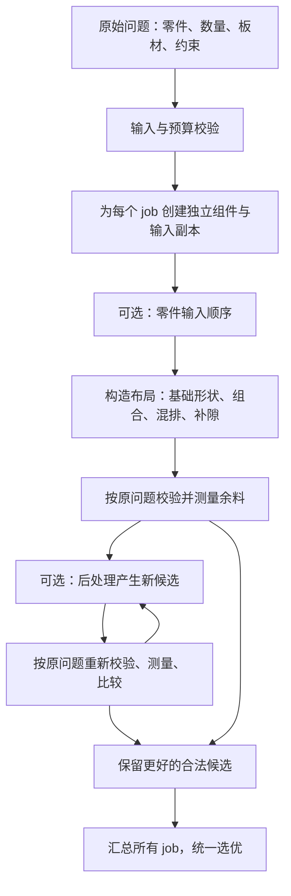

# 二维排样模块架构

本模块的目标是用独立 job 比较不同排法，同时保持原始需求、真实几何和评价口径一致。矩形、平行四边形、圆与类基础形状组合是当前构造能力；扫描线和 NFP 后续沿相同任务接口接入。

本文区分已经落地的接口与尚未完成的能力。参考照片中的源码分析用于讨论设计，不能代替对相应供应商源码、版本或运行结果的核实。

2026-10-27新增29张照片的逐项源码对照、批量阵列／补隙时机／有限前瞻建议及不可照搬的门槛，见[新增图片分析与借鉴](新增图片分析与借鉴-20261027.md)。其中建议是后续试验方向，不改变本文已经实现的接口与能力范围。

## 1. 主流程和依赖



流程没有强制所有构造器使用同一种放置方法。MaxRects、行列模式、解析圆接触、互补组合及未来的扫描线/NFP，各自保留适合自身的数据结构。执行层不按算法 ID 写分支，也不理解具体拼图、圆阵列或合并树。

依赖方向为：执行与算法依赖公共输入/输出契约；算法和验证依赖几何服务；统一评估依赖原问题、验证结果和余料测量。几何服务不反向依赖任务调度，产品 UI、CAD 文档、撤销及工程持久化不进入算法模块。

## 2. 代码职责

| 文件或模块 | 负责 | 边界 |
| --- | --- | --- |
| `SheetNesting.h` | 原始问题、输出、约束、预算、策略/job/portfolio 公共契约 | 不放具体策略实现 |
| `SheetNestingPipeline.h` | 可选输入排序、构造器和后处理的组合契约 | 不把每种排列写成一套算法 |
| `SheetNestingRuleStrategies.h` | 同一批量规则工厂供默认停滞补隙与可选即时补隙 | 不建立第二套job或库存契约 |
| `NestingJobs.cpp` | 建 job、创建组件、并发、异常隔离、汇总结果 | 不注册具体算法，不定义评分公式 |
| `NestingStrategies.cpp` | 策略工厂注册、内置构造器适配 | 不持有跨 job 的剩余库存或最好布局 |
| `NestingPipeline.cpp` | 执行排序/构造/后处理，共享预算，保护已取得的合法解 | 不实现排序启发式或压紧算法 |
| `NestingRectangleRefill.cpp` | 可选矩形跨板回填，固定目标，只在整板搬完后提交 | 不进入默认策略表，不替换原问题，不将保守包围盒当真实材料 |
| `NestingAssessment.cpp` | 原问题校验、余料重测、测量诊断与计时 | 不信任策略自报的已验证标记 |
| `NestingRanking.cpp` | 合法状态守门和统一比较键 | 不混入放置启发式，不由线程到达顺序决定胜负 |
| `NestingGeometry.cpp` | 真实几何、允许角度、碰撞、间距、板内包含 | 不修改订单或库存 |
| `NestingValidation.cpp` | 原编号/实例、数量守恒、板材库存、材料、方向和真实几何复核 | 不依赖构造器的空闲区或组合缓存 |
| `NestingRemnants.cpp` | 可验证规整余料矩形及测量上下界 | 不把总空白面积当作可回收矩形 |
| 各构造器及 `NestingPatterns.cpp` 等助手 | 组合生成、方向/顺序启发式、放置、补隙、局部库存状态 | 输出恢复到原件；不自行宣布跨 job 胜者 |

`NestingInternal.h` 和 `NestingExecution.h` 是模块内部契约。宿主调用公共头；研究原型留在 `output/research/plane-nesting/`，不由正式库链接。

## 3. 三种概念必须分开

**构造策略**负责从一个问题生成布局。`IStrategy` 是当前统一入口，内置构造器可以按当前空位动态选件。基础图形识别、组合候选生成、空位寻找和整体排样不是同一个概念。

**流水线定义**选择可选的输入顺序、一个构造器和若干后处理器。它是一份可重复创建组件的配置，不拥有剩余数量。`MakePipelineFactory` 将其变成可注册工厂；没有创建第二套注册系统。

**job**是一次执行。它拥有独立问题副本、各阶段对象、预算、取消状态和最终结果。portfolio 只调度和比较 job。默认策略以 `DefaultStrategies()` 的显式注册为准；保留既有策略，新增的矩形构造和确定性排序分别注册独立 job。流水线接口不会自动把方法、顺序和后处理做笛卡尔积扩张。

每个组件工厂每 job 产生新对象。portfolio 在启动工作线程前串行调用工厂；工厂或自定义组件主动捕获共享可变数据时，调用者仍须保证其线程安全。不能因接口使用 `const` 就认为外部共享捕获自动安全。

## 4. 原始数据、规划单元与恢复

原始 `Problem` 是校验依据。输入排序只返回完整的原 `Parts` 下标排列，每个下标恰好出现一次，包括数量为零的规格；不得借排序改形状、数量、材料或允许角度。构造器收到重排后的 job 内副本，后处理始终收到原顺序的原问题。

输入顺序是构造偏好。已有构造器内部的大件优先、空位适配、稀缺候选等动态决策仍然生效；重排输入不能冒充替换了所有内部零件选择规则。

顺序矩形构造器 `NestingRectangleOrdered.cpp` 则明确逐件遵守接收到的顺序；同一 MaxRects 内核可选择不同放置评分。面积、长边、短边、高度和宽度排序通过已有 `IPartOrder` 流水线接入，不增加第二套任务或库存系统。`NestingRectangleSkyline.cpp` 使用天际线维护候选位置，并可回收天际线下的已知空白矩形；它也保持输入顺序。

`NestingRectangleCavity.cpp` 是另一种独立构造：在最低未覆盖平台上回看不同规格/方向，所有搜索帧在堆上管理，避免大数量导致调用栈溢出。满面积且尺寸为精确整数时，用水平跨度及垂直余高的有界子集和做必要条件剪枝；没有离散取整。允许角度不同的规格不能仅因当前长宽相同就合并分支。剩余材料的整数面积因子仅产生额外紧包络候选，原板材、原件和统一校验不变。它目前限同材质、512实例以内的一张板；未搜到解不是不可排证明。

横向与纵向回看是该构造器的独立配置。交换的是规划坐标轴，恢复姿态时把坐标换回；它不能给原本只允许0°的零件添加90°权限。面积、宽度、高度等分支排序只影响搜索顺序，不改变公共验评。

`NestingRectanglePinwheel.cpp` 是独立的满矩形组合构造器。五个单元由尺寸等式建立围合关系，每次同时验证扩张矩形的包含、互不交叠及面积与包络相等，再保存所有原件成员。不能把带孔或缺口的近似矩形当作满块。组合可递归；重复组合按实际成员库存计算可重复次数，避免同一尺寸多次占用把整批需求拆乱。末级矩形块复用 `RunRectangleOrdered`，不引入外部求解器或第二套job框架。扩张块边长减去一次间距后交给矩形构造器，由它再添加一次间距，避免递归组合重复扩大缝隙。当前最多512实例、一种材质、每个原规格取一个合法矩形方向；大订单及组合方向搜索仍需扩展。

密实矩形块库由 `NestingRectangleBlockLibrary.cpp` 管理，库存组合、MRV、rollout、余区生成和区域修补分别保留为独立策略。块必须由真实原件精确拼满，不以带空洞的包络代替材料。当前 fair 搜索处理正整数、零件零间距、单一固定矩形方向、总需求面积等于一张可用板的输入，最多512个实例。密集搜索坐标范围为每边512、面积65536；超过范围的物理尺寸先尝试沿X/Y分别按所有边长和板边长的公约数精确缩放，不能整除或缩放后仍超限则保留未排需求。还原时先将放置坐标乘回物理单位，再加原轮廓的合法局部姿态偏移。原来范围内的输入不缩放，保持原搜索次序。

`NestingRectangleStripeRepair` 和 `NestingRectangleStripeRegions` 是共享局部几何服务，不新增调度框架。前者检查真实空域的行列条纹和棋盘面积必要条件，再调用纯原件空角精确核；后者自动生成孔洞闭包、选择少量接触边界的原件一起释放，在保留外部原件为障碍的条件下重排。现有宏块修补失败且还有原job预算时可继续调用这条路径。局部时间/节点上限保持未知；穷尽得到的不可行结论只适用于该固定外部布局。整板闭包、候选截断与局部无解均不能说明原输入不可排，只有完整核验后的全部原件才发布。

`SheetNestingRepeatCell.h` 的可选 `MakeRectangleRepeatCellFactory` 包装指定构造器与一个明确的列数/行数假设。它将一个可用板内区域划成等大的候选单元，用每个原需求行除以单元数后的数量重新求解。只有单元完整合法且真实材料面积填满，才恢复为全板全部原ID/副本；允许姿态与源轮廓不变，外板边距只加一次，再对原输入核验。准备、内部求解、展开和核对共用原job预算与取消。每个单元形状×构造器由调用者注册为独立job，不增加第二套调度，也不默认加入策略表。当前最多4096原件/单元、零件零间距、单个兼容板材规格、原需求填满可用板内区域；原始需求行数量须可整除，不自动归并数量1的等尺寸需求行。失败不限制其他单元或整板构造策略。

同类需求归并与互补零件组合有不同目的：

- 同类需求归并减少规划状态；归并后仍须恢复每个原 `PartID`、`Instance` 及其实际合法姿态。不能仅凭近似尺寸连通分组，也不能忽略材料、方向和原始局部坐标。
- 互补组合用若干真实成员形成矩形、平行四边形或保守规划包络。必须保留成员相对变换和库存消耗；共享原件的备选组合互斥，不能重复消耗。
- 放置时的包络不是材料。映回原件后，碰撞、间距和数量从原问题重查。几何等价、规划需求等价及相同包络不互相替代。

组合质量必须另行检验。包络面积比单件包络之和小，只证明包络有所缩减，不能证明组合足够密；带大量内空的组合不可因此被称为紧密类矩形。一个单元反复铺排时，内部空洞也会反复出现，必须同时查看真实材料占比、必要间距与整板结果。矩形基础验收先使用有完整坐标见证的密排输入，再检验打乱输入顺序和重复数量；测试通过、零碰撞及相对旧实现改善均不等于商业排样质量。

当前混合单元构造器已有原件恢复；跨 ID 通用规划需求归并尚未接入。当前各专用构造器仍拥有自己的局部规划状态，没有虚构一套已经统一的预处理/恢复引擎。

新增批量构造仍使用同一 `RunRules` 与 `Pattern`，按真实成员需求计算重复次数，比较满宽／满高行列候选。类基础组合节省的规划包络仅用于内部选件，统一验评仍从原需求检查实际材料和最终余料。每个重复单元分别提交，未放满的末行不整体占用；两种补隙时机通过同一工厂参数配置，不复制调度、多板或恢复代码。补隙子预算耗尽不结束主体构造，失败缓存仅对固定候选、需求递减且布局未变时复用。当前不包含多步前瞻、斜周期或绕圈模式。

## 5. 后处理是候选，统一验、比、保留

`IPostProcessor` 接收不可变的原问题和当前布局，返回一个新候选。它可以实现平移、压紧、拆板重排或跨板回填，但不能替换原问题。候选重新经过 `AssessCandidate`，再用同一 `Eligible` 和 `Quality` 与当前解比较。

只有合法、可使用且严格更好的候选才替换当前解；相同分数保留先前解。几何合法但状态为 `Failed` 的候选也不能替换合法解。非法、缺件更多、板数更多或评分更差的候选保留诊断并被拒绝。

后处理抛异常时保留已经取得的合法结果，并终止该 job 剩余后处理链。原因是异常组件无法报告已消耗的尝试数，继续执行会破坏共享预算。其他正常返回但被拒绝的候选仍计入工作量，可在剩余预算内继续后续阶段。

评价顺序为：合法可用 → 未排数量 → 已用板数 → 最终兼容板的规整余料面积 → 辅助指标。未使用的空板不计余料。每种兼容材料选一张实际已用板作为可安排最后加工的板，不直接取数组末项。

`Options.Ranking` 是当前 job 的评价口径；`RunPortfolio` 将 `PortfolioOptions.Ranking` 显式传入每个 job。因此后处理接受规则与最终选优一致。构造器内部的 ShortSide 等放置启发式仍可独立，不等于最终布局的评分。

已验证的 C 形反例说明：同一张板和同样的占用包围盒，强制左移会让规整余料约从 14400 降到 10000。因此“整理至左下角”只能生成候选，不能无条件覆盖结果。见研究目录 `postprocess-remnants/c-corner-counterexample.png`。

已有通用后处理执行接口及可选 `MakeRectangleRefillStage()`；平移压紧、限板整体重排和扫描线/NFP没有作为默认能力接入。仅压缩板材库存的先导实验中，省板都可由同一个较强构造器在原库存下取得，未发现限板本身的独立贡献，因此保留为负结果。

矩形回填阶段在原件已验证完整的初解上工作：选择一张只含可搬矩形的源板，以其他板的固定真实环境生成保守空位；保留每个原实例，逐件检查实际几何、方向和间距。全部原件插入后，删除源板并对原问题复验；少一板直接改善公共比较前缀，无需在阶段内部反复测量余料。任何中途失败回滚该试排，取消保留最近已提交的合法解。

目标位置、`StockID/StockInstance`和原目标元数据不变，不把剩余库存编号重排。迁入单件的 `Group` 清0，表示拆开其原规划分组；分组不构成刚体约束。`Statistics.CombinationGroups/CircleLatticeGroups/GapFilledParts`保留所选结果的构造来源，不能从分组成员形状猜测这些来源计数。尝试、试排和验证等工作量另计。

可选阶段有独立的私有操作范围（32板、512排件等），超限保留初解；当前实测不代表100000件规模或硬实时承诺。直接调用阶段工厂需自行提供针对同一原问题重新验证的初解，不能只设`GeometryValidated=true`；推荐始终从流水线调用。阶段不会自动注册到默认策略表。

## 6. 预算、取消、计时和确定性

一个流水线 job 共用构造时间和放置尝试预算。每阶段收到剩余时间/尝试数，不能重新获得一整份预算。返回候选的 `Stats` 表示本次调用新增工作；后处理复制布局时须重置统计，不能把当前解累计工作再报一次。

阶段必须协作遵守预算和取消；C++ 接口不强行终止不合作的扩展代码。中心校验与余料测量单独计时，不消耗构造时间配额，实际调用延迟仍包含它们。被拒绝候选的尝试、候选生成、中心验证和评估成本也计入总工作；所选布局的组合组数等仍描述所选布局。

取消一旦被看见就锁存；一次性取消脉冲不能被下一次 `false` 抹掉。已取消的候选即使被几何守门拒绝，仍停止后续阶段。最终保留最近的合法布局和明确余量，状态仍为 `Cancelled`，不能改为 `Complete`。

计时字段为负表示尚未采集。`PostProcessingSeconds` 单列后处理执行时间，验证/余料测量计入各自字段。短墙钟预算仍受机器负载影响；确定性规则和稳定平局不等于任意负载下的输出完全相同。

## 7. 扩展方式与本轮边界

扩展排序实现 `IPartOrder`；扩展构造实现 `IStrategy`；扩展后处理实现 `IPostProcessor`。按需要组装流水线，再注册到同一个 `StrategyRegistry`，执行层无需增加算法名称分支。

```cpp
#include "SheetNestingPipeline.h"
using namespace iCAX::SheetNesting;

StrategyPipeline pipeline;
pipeline.Construct = constructorFactory;
pipeline.Order = {"area-desc", orderFactory};
pipeline.PostProcessors.push_back({"compact", compactFactory});

StrategyRegistry registry;
registry.Register("experiment.area-compact", MakePipelineFactory(pipeline));
auto result = RunJob({"job-1", "experiment.area-compact", problem, settings}, registry);
```

例中工厂由调用者提供，不表示内置了这些具体排序或压紧算法。组合生成与底层放置的进一步抽取，应在第二个实际后端需要共用时进行；不先建空壳接口，也不强行将专用规则构造器改成通用异形放置器。

candidate-12 的框架整理保留了原构造算法。后续深化针对混合单元内部的完整结果选择独立修改：每个骨架最多保留一份待验证候选，最好缺件/板数前缀改善时清空旧池；同前缀候选延迟到构造结束再恢复原件、校验和测量，调用同一 `AssessCandidate` 与 `Quality` 选优。待验候选不会直接覆盖已经验证的布局，取消时保留安全布局。

当原件已验证完整、且板数达到兼容材料键数这一安全下界后，后续骨架共享剩余构造时间及尝试数的 10%；这份上限只激活一次，不为每个骨架重发。仍可能减少板数或补齐需求时使用原预算。10% 是经过合成对照的私有资源启发式，不是最优配额；验证和余料测量另行计时，不能说整个调用只增加 10% 等待。

这一深化没有增加默认策略数量，也没有引入新的几何容差或放宽谓词。先导100例、原1000例及新500例的直接配对、成本和未完整案例见研究目录 `mixed-quality-selection/README.md`。预排序和局部压紧仍为隔离研究；其收益与实际完整初解配对，不能把另一轮因时间截断得到的不同初解当作排序或后处理收益。

2026-10-27 candidate-14构建和17个CTest程序全部通过，其中框架专项15项、可选矩形回填24项检查。覆盖排序排列、原件编号和本地偏移、非法/失败/异常/更差后处理回退、少板优先、余料接受、平局稳定、并行组件隔离、共享尝试/时间预算、取消脉冲、内外评分同源、统计保留和无效组件工厂；回填另核对固定目标、库存留洞、合法角度、整板事务及源组拆解。正式库工厂还独立重放235例并做原件和证书核验。独立审查未发现尚未解决的阻断问题。

算法数据实验、独立几何审计和框架测试分别报告；本模块仍是独立原生库，尚未接入平面产品、CAD 导入或工程持久化。

## 8. 批量构造默认接入

经过固定大数量对照与两个完整34策略补测，默认表仅追加 `rules.batch-on-stall`，共35项；即时补隙仍从同一工厂显式创建，不为同一能力复制框架。输入/输出、公共统计布局、调度、验评和比较契约未扩张；新增状态限于构造器的job内Bin。

补隙共享子预算耗尽时继续主体构造，不污染全job停止原因；中断不缓存为完整失败。主候选与补隙失败缓存的Count键只适用于当前append-only布局、固定候选规则和需求递减，未来回溯、移动、整批联合验证或动态候选需要重新证明。详细代码边界与数据证据见[本轮结果](组合批量排样迭代结果-20261027.md)。

当前构建19个CTest程序通过，其中批量16组含无需外部registry的默认入口、原34项顺序和真实子预算旧库失败／新库通过。大数量研究的固定快照仍保留当时的34+2注册方式；实际默认35调用另验，不将注册方式倒写进历史结果。
