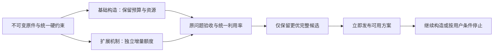

# 00 业务分流与独立策略调度

把业务约束、候选策略生成、几何构造和结果验评分开。一次策略执行只拥有自己的输入快照、库存、布局与预算；最终由共同规则选优。此篇规定各独立策略如何接入，不另造一个布局算法。

类型：调度契约。当前实现状态：**复用调度并新增显式注册**。核对日期：2026-11-08。

## 随案例扩展时必须保持的约束

用户于本轮明确要求：增加细节、补救措施、候选机制或演化，不能隐性挤占原强构造的时间，导致结果反而变差。调度不能仅按注册路线数平均分配时间；“全部策略获得一次启动机会”和“及时得到有竞争力的完整初解”是不同目标。

| 工作类别 | 质量与预算合同 | 扩展时的处理 |
| --- | --- | --- |
| 必要约束与原件验证 | 所有路线使用同一原始需求、材料、镜像/角度权限、孔、边距、间距及共边规则 | 不能为保利用率或赶时间跳过。新增硬约束可能使旧布局不再合法；这种变化必须与搜索退化分开解释。 |
| 基础强构造 | 独立输入状态、连续执行机会、明确的时间/尝试数与计算资源保留量 | 新增扩展不能靠改变路线分母而自动缩短它的预算。原向与镜像是提案策略，不能修改原件许可来伪装输入不变。 |
| 扩展候选与补救搜索 | 使用单独、可截断的增量预算；保留全部已验完整候选，统一以真实利用率择优 | 每种新机制声明触发条件、上限、成本计数和停止原因。应先保障跨规格覆盖，再扩展同一规格的方向/镜像；不能让首规格吃完整个准备窗口。 |
| 完整方案的持续演化 | 接在初始解之后，由上层明确选择继续投入 | 不得把它的耗时和收益混作初始构造能力；已验较好方案不被较差演化覆盖。 |

**可以严格保证的是本次运行的选择单调性**：在同一规则下，最终方案不低于本次已发现的合法完整候选中的最高利用率；新候选只在公共质量严格更好时晋升。不能把它等同于“固定总时长下，新版本必然重新发现旧版本的成绩”。线程竞争、异构核、降频、缓存及新增硬约束都可能改变实际覆盖，跨版本必须以重新运行的证据验收，不能读取历史布局作为答案。

长期预算应由“必要计算、基础保留、扩展余量”组成，基础份额不能由 `globalCap / registeredRoutes` 隐式决定。基础计算资源也应有保留池/并发额度；只有连续 wall deadline 而所有线程仍争抢相同核、缓存和内存，不能称为资源隔离。具体保留量要根据零件数、轮廓复杂度、孔、方向数、数量分布及实测成本确定，本轮不臆定统一比例。

时间参数分为用户期望的快速初解时刻与允许继续搜索的总上限；上限不是要求每次耗满。更好的完整候选一经原问题验收就应发布，不等待子竞赛遍历剩余排序，也不等待所有路线退出。硬上限仍受取消与不可中断几何调用影响，不能承诺任意新增细节都在同一秒数内完成。

新增机制进入默认调度前，验收至少包含：基础路线的实际连续时间和尝试份额不被减薄；完整性/合法性不变；相同输入/规则/核数/时间下的早期及最终利用率；重复 wall/CPU 测量；大量种类、重复件、凹件、孔、镜像/禁镜的覆盖。若不通过，应修机制或将其保留在明确的扩展预算中，不能增加一个绕过评估的强制替换，也不能把较差成绩标为达标。

网页应分别记录原始构造、已验完整候选产生、父调度收到、首次发布、最终选择及各阶段成本。并行 wall 不相加，嵌套准备/验证时间不重复相加。没有运行到的机制标为预算未进入，不冒充不可行。

**当前实现与长期合同仍有差距**：本轮接入了三条主路线的连续时间声明、按硬件自动选择 worker，以及子构造优胜候选及时上报。23项原生回归、3项CLI和13项独立几何审计通过；原32件正式任务在10秒/8worker下重新构造出74.4938%，8.426秒发布优胜、10.044秒结束。尝试数仍使用公共公平租借池，尚未实现基础尝试数和硬件资源的独立保留，也没有完成按问题复杂度估算快速初解目标。因此不能把本轮补丁宣称为上述长期预算设计全部完成。

### 后续接入的预算模型（设计，尚未全部实现）

任务预算计划应显式包含：快速初解目标、用户允许的共同截止点、基础构造的并发/计算份额与尝试保留、扩展的最大并发及剩余额度、发布规则、输入/规则/评价版本。新增机制必须声明所属类别、触发条件、原始提案/精验/NFP构建等成本上限、可取消点和产物；不能仅注册一个名字就自动分走基础份额。

基础构造集合也要版本化，并可按几何类型/数量分布选择经过回归的组合，不是永久只有三种方法。扩展通过同预算质量和成本回归后可以升为基础机制；这是有证据的预算计划变更，不能由新增条目数量隐式完成。存在预算不足时，应保留硬约束、基础构造和已验优解，明确记录扩展未进入/截断；不得擅自延长用户硬上限、删需求或把部分解叫完整解。

已验快照及缓存证明必须绑定原件与规则版本、库存、角度/镜像姿态、最终坐标和板材条件。新硬约束或输入变化时，旧证明失效；不能用旧布局的分数比较新可行域。当前流式发布为了维持原问题验收边界会再验一次完整候选，已计入 `snapshotAssessmentSeconds`；后续只能凭可验证的同源不可变证书消除重复，不能直接相信生产者自报的 `valid=true`。

计算资源保留需要同时考虑 CPU、并发、内存与共享缓存压力。硬件核数是容量上界，不是应始终跑满的目标。本案单次10秒测量中，8worker与24worker都得到74.4938%，但进程CPU时间分别约69.14与196.13秒；8worker更早发布强解。因此不能把线程数设成“核数×2+2”作为通用性能承诺，也不能把本案8worker硬编码为所有素材的最优值。

实际证据：[v16→v17单次worker对照](<D:/penguinchinage0609/iCAX/output/research/plane-nesting/20261108/materials-audit/textile-self-pair/v17-speed-workers-comparison.json>)、[v17原生回归](<D:/penguinchinage0609/iCAX/output/research/plane-nesting/20261108/materials-audit/scheduling-v17-final-native.junit.xml>)、[当前真实过程](http://127.0.0.1:8769/construction.html?materialTask=textile-0)。这些数据只覆盖相应案例、程序和预算，不代表整批或跨版本必然不退化。

## 代码实现与调用

入口：`RegisterPlaneStrategies / RunJob / MakePlaneInitialFactory / MakeParallelConstructionPortfolioFactory`。实现位置：[NestingPlaneStrategies.cpp](<D:/penguinchinage0609/iCAX/src/iCAX-Engine/foundation/SheetNesting/NestingPlaneStrategies.cpp>)、[NestingJobs.cpp](<D:/penguinchinage0609/iCAX/src/iCAX-Engine/foundation/SheetNesting/NestingJobs.cpp>)。

注册 30 个显式入口；`plane.initial` 的基础初解候选为 27 个，有正需求允许镜像时额外加入独立的 `plane.order-ultra-original`，共 28 个候选。它与允许镜像的 `plane.order-ultra` 使用相同原始问题、独立提案策略并行，不复制历史布局。候选覆盖保守包络天际线、普通/原式评分阵列、即时/延后补隙、扫描线、NFP、递归、随机、多排序及逐板竞赛。每条路线新建独立构造器、需求、库存与布局，共用原件验证和任务排名。完整优化入口 `plane.nfp-all` 与调度入口 `plane.initial` 自身不进入默认候选；异形板与工艺任务保留单独类型和验证器。此前26候选的83程序回归与G025三次审计保留历史范围；新增路线与素材对比仍按对应程序/输入验收，候选配置数量不代表独立几何算法数量。

## 并行初解与后续迭代

全部正需求原件都是无孔真实矩形时，基础 27 个初解候选准入；存在正需求非矩形或带孔件时，跳过 `plane.rect-contact`、`plane.single-column`、`plane.single-product`、`plane.rect-block-search`、`plane.four-block` 五个矩形专用入口，基础保留 22 个候选。有正需求允许镜像时再增加上述唯一原向路线，分别成为 28/23 个。零需求原件不影响资格判断；准入不表示必然完成或达到目标，内部几何、数量与有限候选条件继续生效。

`Workers=0` 按硬件并发数自动选择，至少 1，且不超过本次实际可运行路线数；不再硬封顶为 4。平面入口显式配置范围为 1～32。`plane.initial` 强制公平探测，有限线程从同一启动门释放，完成一条便可领取下一条。普通探测路线的局部时间为 `remainingTime / ceil(unfinishedRoutes / W)`；产品声明的 envelope、原向 order、允许镜像 order 三条主路线使用公共剩余截止时间。二者都受同一总截止点约束。连续时间声明不增加尝试数，也不构成 CPU 资源独占；局部份额到期不能误记成用户取消。

尝试数使用互斥租借池：初始 `available=globalCap`、`unleased=候选数`；启动时预留 `ceil(available/unleased)`，结束按真实消耗退回未用部分，失败或超报保守计满本次份额。后排可以共享已退回余量，总实际/保守计费不超过全局上限；配额全被活动路线预留时先等其归还，不提前饿死排队路线。通用 `MakeParallelConstructionPortfolioFactory` 的 `FairScheduling` 仍默认 `false`，保留旧的固定尝试份额和全局剩余截止模式；只有显式开启或调用 `plane.initial` 才使用新公平模式。

每次初解执行新建一份有界 `NfpCache`，只在本次适用候选及其内部有限构造之间共享不可变几何。需求、布局、世界坐标件对认证、构造器缓存和随机状态保持独立，不复用以前任务的布局。缓存命中和并发等待不免除当前查询的取消与预算检查。

`IsPureConstruction()` 表示是否属于纯构造；`OwnsRefinementLifecycle()` 表示是否自行管理生命周期和预算，两者分开。多排序、`PlaneInitial` 和通用构造组合可以同时拥有预算并声明纯构造，不因拥有生命周期而被误排除；真正完整优化工作流不得进入纯初解竞赛。

通用 `MakeParallelConstructionPortfolioFactory` 的工厂调用、原始 `Cancel` 轮询、`OnImprovement` 和 `StopWhen` 均在 `Run` 调用线程串行执行。只有经原问题验证完整、且公共质量严格改善的方案触发这两个回调；引用只在回调内有效，需异步使用时由调用方复制。单个回调异常被记录并停用该回调，其余路线继续。工作线程只读取内部取消标记，返回前全部回收；单次几何操作、回调或最终验评仍可能越过名义截止点。

`plane.initial` 默认不安装 `StopWhen`：找到完整一板方案或达到名义材料板数下界，都不自动终止其他适用路线，继续在共同预算内比较完整质量。板数下界不证明余料、紧凑度、板型配比或容差验收意义下的全局最优，不能用它代替完整质量竞赛。调用方仍可显式提供 `StopWhen` 选择自己的成功停止条件。显式成功停止及时间截止保留最好完整/部分结果，只有原始 `Cancel` 确认取消才返回整体 `Cancelled`。历史 G025 的板数下界提前停止记录属于当时快照，不代表当前默认调度。

纯初解 `plane.initial` 与单路线 `plane.nfp-initial` 均不运行完整布局的持续迭代；后者仍在自己的预算内进行有限评分/轴向 trials。`plane.nfp-all` 则先以剩余时间的 75% 和按 75% 取整、至少 1 次的尝试份额运行并行初解，再对完整单板或多板运行压紧、回填及持续优化，初解未用预算留给后续阶段。达到初解板数下界只结束构造竞赛，后续优化仍可改善余料与紧凑度。

范围与差异：没有替换 DefaultStrategies，也未接入产品界面。业务选择专用任务后必须保留其上下文和验证器。

完整调用示例、注册清单及测试范围见 [实现状态](<D:/penguinchinage0609/iCAX/doc/Plane/策略/实现状态.md>)。

## 输入输出与独立边界

| 项目 | 本策略契约 |
| --- | --- |
| 输入 | 原始 Problem、业务约束、候选工厂清单及总预算。 |
| 输出 | 候选执行记录、胜出原件布局、未排需求与停止原因。 |
| 显式配置 | 能力准入、工厂列表、任务级或共享预算模式、构造与后处理分工。 |

本节保留原资料的目标契约；实际可用字段以本篇代码入口及头文件为准。下述设计步骤中超出“代码实现与调用”范围的内容仍是待扩展项。

原始材料与需求是权威数据；不改变原件角域和数量。候选几何、局部分数、最终质量分别表达，完整性与合法性先于收益比较。

## 原资料的方法与实际分支

照片将旧系统分为 DoNest 业务分流、规则优先级和几何内核三层。桥切、门业、显式选择、矩形邻近、矩形专用、安全距离、普通智能依次分流；一个界面选项可能展开多个 ARRAY 候选。异形板先排、矩形板后排属于阶段式消费库存，不能解释成两种板联合优化。上层创建候选后，内核还会再次按数据准备状态过滤。

旧系统的枚举、线程包装、实际策略类和工程编译项必须分别核对。照片的 500 种、首轮不超过 5 种等门槛属于该实现，不作为 iCAX 的默认准入。

## 面向 iCAX 的独立策略步骤

1. 宿主把材料、尺寸、允许方向和需求转换为原始 `Problem`，业务模式独立于算法名称。
2. 为每种算法建立能力检查，说明不适用的几何、库存或工艺条件；保留未排需求。
3. 显式形成候选工厂清单；同一算法的排序、首件和评分变体作为可辨识的配置。
4. 每次通过工厂新建对象，用独立输入副本运行；仅不可变几何缓存允许共享。
5. 原问题验评后再比较候选。几何非法、数量丢失、状态失败均不能获胜。
6. 多条初解路线可同时独立竞赛；需要“先初解、后改进”时再接流水线，不把多个结果的坐标直接拼起来。
7. 输出采用哪种策略、哪些候选不适用、停止原因及实际缺件。业务路由不嵌入几何内核。

## 原有代码复用点

| 代码位置 | 符号或分支 | 复用关系 |
| --- | --- | --- |
| [SheetNesting.h](<D:/penguinchinage0609/iCAX/src/iCAX-Engine/foundation/SheetNesting/SheetNesting.h:167>) | `class IStrategy` | 原始输入、实例身份、状态、预算及公共结果模型；业务扩展须与此契约兼容。 |
| [NestingJobs.cpp](<D:/penguinchinage0609/iCAX/src/iCAX-Engine/foundation/SheetNesting/NestingJobs.cpp>) | `JobResult RunJob` | 独立任务或共享预算的构造竞赛、结果评估与选择。 |
| [NestingJobs.cpp](<D:/penguinchinage0609/iCAX/src/iCAX-Engine/foundation/SheetNesting/NestingJobs.cpp>) | `PortfolioResult RunPortfolio` | 独立任务或共享预算的构造竞赛、结果评估与选择。 |
| [NestingStrategies.cpp](<D:/penguinchinage0609/iCAX/src/iCAX-Engine/foundation/SheetNesting/NestingStrategies.cpp:264>) | `StrategyRegistry DefaultStrategies` | 工厂包装、排序配置与真实默认注册入口。 |
| [SheetNestingPipeline.h](<D:/penguinchinage0609/iCAX/src/iCAX-Engine/foundation/SheetNesting/SheetNestingPipeline.h:62>) | `MakeConstructionPortfolioFactory` | 排序、构造、后处理及共同验评契约。 |
| [SheetNestingPipeline.h](<D:/penguinchinage0609/iCAX/src/iCAX-Engine/foundation/SheetNesting/SheetNestingPipeline.h:65>) | `ParallelConstructionSettings / MakeParallelConstructionPortfolioFactory` | 有界并行初解、调用线程回调、共享截止点及固定总尝试数分配；原有串行工厂保留独立语义。 |

## 当前适用边界

没有替换 DefaultStrategies，也未接入产品界面。业务选择专用任务后必须保留其上下文和验证器。

## 实现后的验收条件

以下保留原资料导出的完整验收目标，不表示每项已通过。当前已执行的测试与未覆盖范围见“实现状态”，尤其保留上述适配差异。

- 同一输入并发运行互不扣库存。
- 取消一个任务不污染其他任务。
- 不支持的策略保留完整需求。
- 相同分数稳定选择。
- 每个配置能追踪到真实注册和工厂，未注册建议不显示为已启用。

## 来源与相关策略

来源目录：[0](<D:/penguinchinage0609/iCAX/doc/Plane/0>)；对应照片内原文编号 `00`。下列 4 张照片共同构成本篇来源，重叠拍摄段落已合并。

- [微信图片_20261107113117_27_285.jpg](<D:/penguinchinage0609/iCAX/doc/Plane/0/微信图片_20261107113117_27_285.jpg>)
- [微信图片_20261107113119_28_285.jpg](<D:/penguinchinage0609/iCAX/doc/Plane/0/微信图片_20261107113119_28_285.jpg>)
- [微信图片_20261107113122_29_285.jpg](<D:/penguinchinage0609/iCAX/doc/Plane/0/微信图片_20261107113122_29_285.jpg>)
- [微信图片_20261107113124_30_285.jpg](<D:/penguinchinage0609/iCAX/doc/Plane/0/微信图片_20261107113124_30_285.jpg>)

原照片分析的是 WiseCAM-Restricted，标注基线 `05ffc57d`；其中旧类名、启用状态和静态疑点归属于该基线。iCAX 对照取当前工作区文件，代码位置不表示整个源算法已移植。

相关但不同的策略：[07 多排序独立构造竞赛](<D:/penguinchinage0609/iCAX/doc/Plane/策略/07-多排序独立构造竞赛.md>)；[37 同一板上的多策略完整候选竞赛](<D:/penguinchinage0609/iCAX/doc/Plane/策略/37-同一板上的多策略完整候选竞赛.md>)；[40 固定实例布局的持续迭代压紧](<D:/penguinchinage0609/iCAX/doc/Plane/策略/40-固定实例布局的持续迭代压紧.md>)。

[返回总索引](<D:/penguinchinage0609/iCAX/doc/Plane/策略/README.md>)
