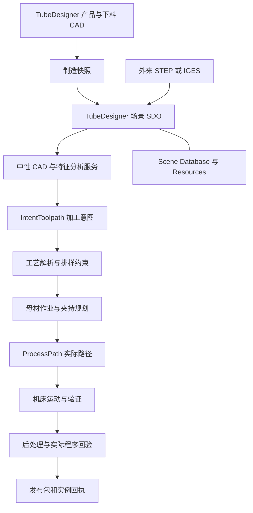

# 管材 CAM 详细技术实施方案

文档版本 V1.0 评审稿  
基线日期 2026 年 10 月 13 日  
适用产品 TubeDesigner  
配套文档 [管材 CAM 详细规格说明书](01-管材CAM详细规格说明书.md)

## 1 实施结论与范围

按 2026 年 10 月 13 日最新产品决策，TubeDesigner 在同一产品中组织设计、下料和加工：下料提供制造零件与排样快照，加工承担编程、机床验证和程序输出。TubeOne、Laser3DCAM 的专属页面、清单和产品代码已移除；共享 CAM 业务模块归入 CamRuntime，机床公共实现由 Machine 独立管理；框架的多产品能力保持完整。复用中性 CAD、TubeNesting、IntentToolpath、ProcessPath 与 Machine 的现有基础，补齐激光工艺、夹持作业、运动规划、输出回验和发布记录。TubeCAM 只是文档目录，不另建产品或复制加工引擎。

首个生产版本绑定一台双卡盘激光切管机，支持经批准材料和尺寸范围内的直线恒截面圆管、方管、矩形管。侧壁通孔、槽、端切与相贯分别取得设备证据后开放；不摆头的直切不等于只能垂直截断。首期以独立切割为默认，简单共边若提前开放，必须执行本方案第 9 节和全部适用的共边验收，不以“简单”减少双件尺寸检查。

P0 交付可审阅的中性加工闭环；P1 交付首台机床经过验证的生产闭环；P2 分别建设共边、坡口、开口型钢、多卡与高级支撑能力包；P3 扩展锯切、冲孔及外部生产系统。几何能够表达的范围与设备能够加工的范围分别声明。

本文中的接口名、资源名、模块拆分和工作量，除明确列为现有实现外，均为待实施设计。它们不代表当前程序已经提供相关命令。规格中的 CAM-001 至 CAM-064 是需求权威编号；本文给出落地方法与对应验证。本文不修改业务源码，不引入历史数据迁移、旧字段映射或兼容回退。

## 2 竞品研究如何落实到设计

柏楚 TubesT 的公开资料覆盖离线编程、排样、工艺和加工文件交付，TubePro 承担控制执行；官方资料同时证明参数化护栏拆单和 Lite 阵列共边已经存在。因此，我们不能把单独的“拆单”或“共边”作为独有能力。应把产品来源、独立 CAD 修订、制造实例与程序段持续关联，减少中间导出造成的语义丢失。[TubesT 拆单资料](https://www.bochu.com/tubest_help/tubest-楼梯护栏拆单（护栏）/) [Lite 产品资料](https://www.bochu.com/ch/soft/tubest-lite/)

维宏 WiseCAM Tube 的官方产品页列出装配拆分、排版、共边、法向和碰撞检测；小管版也列出参数化拆单。其 TU 系列设备控制能力不能直接归入所有离线安装。我们据此把零件解释、工艺适用域、机床能力与已验收组合拆开建模。[WiseCAM Tube](https://www.weihong.com.cn/products/detail/35) [小管版本](https://www.weihong.com.cn/products/detail/36)

| 研究发现 | 我方工程决策 | 验证落点 |
| --- | --- | --- |
| 共边与坡口存在组合限制 | 独立能力标志之外保存组合约束 | 两件材料保留和实际工艺共同验收 |
| 防撞结果依赖刀头模型与检测范围 | 验证按对象和层级记录覆盖 | 缺卡爪模型不能显示整机通过 |
| 多卡和零尾料依赖机械模式 | 尾料由夹持状态与末刀求得 | 移交宏、剩余连通体与实机试运行 |
| 输出格式受设备及版本限制 | 后处理绑定正式接口和控制版本 | 检查实际程序，不重复播放输入轨迹 |
| 估时存在未计入动作 | 分项估时并记录未知项 | 计划值和完工实绩分别统计 |

表中工程决策为我方设计推导，不推测竞品闭源算法。具体版本、历史手册限制及全部官方来源见规格第 2 节和第 16 节；后续采购或机床适配仍需保存实际版本资料。本次没有运行竞品软件、构建业务程序或执行实切，公开资料和源码证据不能被写成设备验收结果。

## 3 架构与代码复用

### 3.1 数据流和责任

主链路为：TubeDesigner 产品与独立下料 CAD → 制造快照 → TubeDesigner 工件与意图 → 工艺和排样约束 → 母材作业计划 → ProcessPath 实际路径与轴轨迹 → 验证报告 → 后处理程序 → 实际程序回验 → 发布包与回执。

CAD 几何、拓扑查询、识别与计算通过已注册的 IService 和 ServiceProvider 获取。算法只接受中性值、已解析的几何和配置，返回结果及诊断，不读取产品或场景、不打开业务事务、不发布资源。CAM 算法可以接受中性的机床和工艺模型，但这些输入不得反向进入通用 CAD 服务。SDO 负责通道校验、权限、版本、资源解析、事务、撤销和持久化。

流程图中的箭头表示数据依赖。计算结果通过 SDO 事务进入 Database 和 Resources；服务之间不通过图中任意箭头修改场景。排样、引线和夹持可能相互影响，业务调度执行有预算的重新规划，不能用无上限循环直到碰巧通过。

### 3.2 现有代码与新增工作

| 基础模块 | 当前可复用证据 | 本次方案要求补齐 |
| --- | --- | --- |
| TubeDesigner | 独立下料 CAD、制造件、排样关联、版本检查、名义刀路解析与编辑 | 产品内制造快照、来源状态确认与生产加工链路 |
| TubeNesting | 有限母材、有限姿态、端部互嵌和优先级 | 加工禁区、引线及释放约束反馈 |
| BRepToCamPath | Analyze 返回独立名义路径、Complete 与诊断 | 特征覆盖账和生产能力适用性 |
| IntentToolpath | 意图组件、来源、生成关系、稳定 RoleKey | 产品主链接入、工艺绑定与人工编辑保护 |
| ProcessPath | 曲线、姿态、事件、轴轨迹与来源映射组件 | 实际编译器、参数单位、事件次序和证据状态 |
| Machine | 设备定义、关节、限位与显示基础 | 全路径运动学、夹持、支撑和动态检查 |
| CADIntentSDO | 当前有参数编辑后 CSG 求值及 BRep 发布代码 | 项目重开、撤销与拓扑对应回归 |

ProcessPath 的 PlanningState 当前默认值 GeometryReady 不是可生产证据；新增作业必须从未规划状态建立，并由各阶段实际结果推进。Machine.CheckReach 当前是规划服务入口提示，不能把返回 Ready 当成全路径可达。旧 CAM 产品清单曾声明 simulation、postprocessing，这不证明服务闭环已经存在；当前 TubeDesigner UI 也不能凭页面入口声称已完成这些能力。源码定位见第 22 节。

### 3.3 建议模块落点

在现有 cam 插件体系中增加 TubeMachining 业务编排和 LaserTubeProcess 算法实现；通用运动求解进入 Machine，通用验证和后处理接口位于 CAM 共用层，具体控制器适配器单独注册。名称为建议，最终 DLL 划分以依赖审查为准，不要求一个类或服务一个 DLL。

TubeDesigner 的业务目标与场景 SDO 组织设计、下料快照、加工任务、意图、实际路径、检查和发布；中性 CAD/CAM 服务仍通过 IService 注册和 ServiceProvider 获取。UI 复用共享工作台，产品内工作区通过已有项目状态和场景通道协作，不依赖已撤下产品的入口。已有独立名义路径继续作为加工页基础，不为本方案自动增加旧工程迁移。

## 4 数据契约与持久化

### 4.1 身份和资源引用

所有实体 ID 只在明确的产品和工程命名空间内解释。跨工程引用使用 sourceSystem、productId、projectId、objectId、revision 的完整来源键；不能把不同工程的相同 objectId 当同一零件。几何定义和制造实例分开，同一个定义可对应多件实例，但每件实例拥有独立 occurrenceId、排样位置与质量结果。

资源引用至少包含 type、resourceId、version、contentHash、byteLength。内容哈希校验指定序列化文件的确切字节，不用浮点坐标近似比较代替身份。逻辑输入指纹采用有版本的规范化序列化：固定字段顺序、数值表示、单位、数组顺序，拒绝 NaN 和无穷值；算法版本进入指纹。不同内核生成的等价实体可有不同哈希，不能据此合并身份。

同进程内，只有框架授权且可解析的资源才能按引用交付；跨产品或工程不存在天然可见性。不可共享时导出显式资源包，导入端重新发布本地资源并保存来源映射。导入后项目不依赖原工程临时文件。包解压检查清单、哈希、大小与路径范围，拒绝越界路径、缺失资源和未知必需类型。

### 4.2 核心对象

| 对象 | 最小字段 | 权威归属 |
| --- | --- | --- |
| ManufacturingSnapshot | schemaVersion、sourceRevision、units、parts、demands、resources、sourceValidity | 来源 SDO 导出，接收端冻结 |
| PartDefinition | partId、revision、finalGeometryRef、neutralGeometryRef、materialRef、sectionRef、tolerances | CAD 所属业务；CAM 只持快照 |
| DemandOccurrence | occurrenceId、partRevision、sourceProductInstance、componentRole、qualityRequirements | 上游需求快照 |
| StockInstance | stockId、revision、geometryRef、measuredLength、batch、endCondition、availability | 上游或现场确认的母材记录 |
| Placement | placementId、occurrenceId、stockId、transform、orientationRule、lockState | 本任务排样计划 |
| MachiningJob | jobId、revision、snapshotRef、machineRef、phaseRefs、inputFingerprint | TubeDesigner 场景 |
| ProcessBinding | intentId、recipeRevision、overrideRef、effectiveValuesRef、approvalDomain | 工艺任务 |
| Operation | operationId、intentRefs、placementRefs、dependencies、processKind、pathRefs | 母材作业计划 |
| SetupStage | stageId、remainingBodyRefs、grips、supports、operationIds、preconditions、postconditions | 作业计划 |
| ValidationReport | scope、fingerprint、checks、coverage、diagnostics、softwareVersion | 只读验证资源 |
| ReleasePackage | releaseId、revision、fingerprint、files、qualificationRef、supersedes | 发布记录 |
| ExecutionEvent | eventId、releaseId、occurrenceId、eventType、quantity、source、timestamp | 去重后的外部或人工回执 |

PartDefinition 保留精确成品几何；无法提取参数化意图时 neutralGeometryRef 可以缺失，但状态明确为待解释。不要把空引用填为默认管型。DemandOccurrence 在对接边界展开到可追溯实例；内存中可以压缩存储数量，但一旦排样或回执必须能稳定寻址每件实例。

资源本体不可原位覆盖。编辑发布新版本，在同一事务中更新实体引用和依赖；无引用的候选资源按框架清理规则回收。历史发布包的引用受归档保留保护。算法缓存不成为唯一权威存储，缓存丢失应可从冻结输入重新计算。

### 4.3 坐标系和单位

统一内部长度为毫米、时间为秒、角度为弧度，速度和气压等工艺字段带明确量纲及约定；控制器所需度、毫米每分钟、绝对或表压只在适配层显式换算。既有字段没有量纲元数据的，新增契约必须补足，不能仅在界面标签约定。

零件局部轴、母材轴、机床基座、工件当前夹持坐标、TCP 与光束方向各有独立坐标系。定义 T_AB 表示把 B 系列向量变到 A 系，列向量约定下，p_M = T_MS × T_SP × p_P。装配变换只应用一次；导入世界坐标后再次应用同一装配变换会产生错误，必须用已知基准点测试。

Placement 的旋转矩阵应正交且行列式为 +1。掉头通过真实刚体旋转实现，不能用负尺度镜像；带镜像的外来 CAD 要么由 CAD 导入明确求值并重建方向，要么拒绝该导入路径。曲面法向在允许变换下重新求值和定向，不复用错误朝向。四元数只描述连续空间姿态，不能替代带圈数的旋转轴坐标。

### 4.4 工艺与事件扩展

复用现有 ProcessPath 曲线、姿态场、事件场和轴轨迹资源；增补误差预算、axisUnits、timeBase、输入指纹及来源映射。事件至少含 eventId、phase、segmentId、parameter、sequence、kind、typedParameters、sourceOperationId；同一点上多个事件靠 sequence 排序，不依赖容器遍历顺序。

Pierce、CutOn、CutOff、Dwell、ParameterChange 为已有事件方向；Rapid、SyncBarrier、GripRequest、GripConfirm、SupportChange 与 PartRelease 为待定义的作业事件。夹持确认代表执行前提或设备反馈，离线规划不得伪造传感器已确认。引用宏必须携带宏版本、参数、前后条件及可校验语义。

## 5 原生命令与服务接口

### 5.1 命令通道

下表均为拟新增命令契约。命令进入对应场景或产品 SDO，前端不得绕过原生校验写权威数据。产品通道只处理不依赖活动场景的资源目录与文件读取；任务创建、编辑、规划和发布使用场景通道。现有 TubeDesigner.GeneratePreview 的场景创建约定保持不变。

| 拟议命令 | 通道 | 输入要点 | 返回与提交规则 |
| --- | --- | --- | --- |
| Manufacturing.ExportSnapshot | 来源场景 | 选定零件、expectedRevision、包含排样范围 | 冻结快照或完整错误清单 |
| Job.ImportSnapshot | 接收场景 | 包引用、requestId、导入策略 | 校验全部后原子创建任务 |
| Job.QueryCapabilities | 接收场景 | 任务与机床修订 | 支持域及逐项拒绝原因 |
| Job.AnalyzeFeatures | 接收场景 | expectedRevision、重分析范围 | 返回 taskId，不立即覆盖旧意图 |
| Job.SetProcess | 接收场景 | 意图选择、工艺版本、覆盖值 | 校验后新修订并失效下游 |
| Job.Plan | 接收场景 | expectedRevision、目标、预算、锁定范围 | 发布可行结果或明确部分结果 |
| Job.Validate | 接收场景 | 规划版本、检查范围 | 冻结报告，未覆盖项显式返回 |
| Job.BuildOutput | 接收场景 | 已验证修订、后处理版本 | 暂存输出与回验，尚未生产放行 |
| Job.Release | 接收场景 | 报告、输出哈希、能力资质、requestId | 原生重查并发布不可变包 |
| Job.ImportExecution | 接收场景 | 回执批次、事件 ID、来源 | 幂等应用与逐项冲突结果 |
| Catalog.ListApprovedProcesses | 产品 | 材料与设备筛选 | 资源目录，不修改场景任务 |

导入重复 requestId 且载荷相同，返回既有结果；相同 requestId 携带不同载荷，返回 IDEMPOTENCY_CONFLICT。预期修订不匹配返回 REVISION_CONFLICT，不能默默覆盖。部分导入只在用户事先选定的显式策略下允许，并逐项标出缺失需求；默认整包失败不留下半个有效任务。

### 5.2 中性计算服务

建议定义 IManufacturingSnapshotValidator、ITubeFeatureAnalysisService、ILaserProcessResolver、ITubeJobPlanner、IProcessPathCompiler、IMachineTrajectorySolver、ICamVerificationService 与 IPostProcessor。服务输入为可拥有的值或受生命周期约束的只读模型；不得保留指向临时 BRep 的悬空引用。

每项服务返回 Result<T>，包括 status、value、diagnostics、coverage、inputFingerprint、algorithmVersion、metrics。status 分为 Complete、Partial、Unsupported、Failed、Cancelled；空路径不是成功，Partial 不能直接放行。诊断包含 code、severity、stage、objectRef、segmentRange、messageKey、details 与 suggestedActions。界面翻译为普通工艺语言，日志保留可定位上下文。

### 5.3 异步与事务

SDO 先读取修订 R 并冻结计算输入，启动 taskId；后台仅计算中性结果。提交前重新检查活动工程、目标对象、expectedRevision、完整输入指纹和取消状态，任一改变即丢弃提交资格。长计算不持有数据库写锁。可以保存过期结果作为明确的诊断缓存，不能让其替代当前实体。

用户取消后立即停止接收该任务结果，内核无法中断时允许后台完成清理，但不得提交。A 请求晚于 B 返回的测试必须证明 A 无法覆盖 B。批量操作先构建候选，再用单个业务事务替换引用；撤销和重做恢复实体、资源引用及失效状态，不能只恢复界面。

## 6 状态机与依赖失效

### 6.1 阶段有效性

每阶段保存输入指纹、输出资源、状态、诊断和验证覆盖；总体状态由这些记录派生，不允许前端直接写“已放行”。建议阶段依次为 Source、Interpretation、Process、Placement、Setup、Path、Motion、Validation、Output、Release。Placement 与 Setup 允许有界反馈，但每轮必须生成新候选版本。

用户状态“可审阅”要求有完整可查看的候选及问题；“已放行”还要求适用能力、来源和库存前提、全部必需检查、实际输出回验以及首台资质记录满足。未执行、不适用、不支持、失败和通过分别保存；不适用必须指向具体规则，不能用它掩盖缺失模型。

### 6.2 精确失效矩阵

| 变更 | 保留 | 必须重算或重验 |
| --- | --- | --- |
| 成品 CAD、材料、截面快照 | 独立人工路径和历史记录 | 来源确认、解释关联及所有受影响下游 |
| 只改需求数量 | 零件定义、已验证单件几何算法缓存 | 实例分配、母材、顺序、程序与标签 |
| 改排样姿态或间距 | 零件局部特征 | 共边、引线、夹持、路径映射、运动和输出 |
| 改速度或功率 | 成品 CAD | 有效工艺、动态轨迹、热策略、验证和输出 |
| 改割缝或喷嘴 | 成品 CAD 与名义意图 | 去除带、引线、共边、实际路径及后续 |
| 改卡爪或支撑 | 成品与独立意图 | 可加工区、作业、运动、碰撞和发布资格 |
| 改后处理或宏 | 可独立证明有效的几何与运动 | 输出、程序回验及受宏影响的验证 |
| 只改显示名称 | 几何、工艺、运动 | 含名称的程序标识、标签和发布包 |

结构创建后固定、manufacturingOnly 只影响制造清单、用料变化使模型过期，继续按产品描述符处理。模型未重新生成或清单未重新拆单时，不能以“快照是旧版”继续新建生产任务。独立下料零件保持其自身修订，不被来源产品变化自动改形。

### 6.3 来源断联和冻结任务

跨工程离线包不能自动得知上游后来发生的修改。SourceValidity 应保存 CheckedCurrent、Stale 或 Unverified，以及核对时间、来源修订和有效范围。来源在线时收到修订变化使当前生产资格失效；来源不可访问时显示“来源当前状态未确认”，必须按批准的现场版本确认流程取得记录，不虚称实时同步。

冻结快照确保任务可复现，但不自动证明它仍应生产。已发布历史记录不可改写；放行前再次校验当前需求和来源政策。无联网控制器时，撤回只能改变本系统状态并输出现场核对要求，不能宣称已删除机床上的旧程序。

## 7 几何识别与加工意图

### 7.1 输入准备

保留导入文件、实体、装配实例、单位、变换和来源哈希。加载后先检查空体、拓扑有效性、封闭性、尺寸量级与重复实例；修复操作形成新 CAD 修订并给出差异，不在识别服务内暗改原始体。网格仅用于显示或明确受限的检查，不代替精确成品几何。

恒截面识别利用已有中性 CAD 和侧壁关系；模板参数反解严格遵守 fitting.py 直接求解约定。通用几何关系查询可以共享，管型匹配规则留在模板。反解运行链路不调用正向 build、evaluate_section 或 _evaluate；通用 CAM 求值只用于后续几何处理，不能被反解当成候选搜索通道。

### 7.2 意图来源与覆盖账

优先读取已确认中性 CSG、Side Atlas、特征关系和来源边面；仅有 BRep 时调用 BRepToCamPath 并保留 Complete 与全部诊断。把分析得到的边界与成品材料关系合并为覆盖账：每个待加工边界必须归属切割意图、经证明的继承边界，或者未处理项。端部毛坯边界无需切割必须以实际母材端况为依据，不能把理想原点当现成合格端面。

多腔管上的一个贯切生成体可以对应多个材料跨度，不能按连通碎面创建重复工序。穿透分类只有贯穿、盲、气泡三种几何关系；未知属于识别状态。首台激光切穿策略拒绝未经认证的盲特征和无入口空腔。UV 表面图形保留自己的来源，工艺确认之前不默认成为打标。

AlternativeNode 未选择时返回 INTERPRETATION_REQUIRED，不能用推荐项代替决定。CompositeVolume 或 ResidualBRep 可以保留精确实体并允许人工解释；只有全部加工相关残余都有可验证策略后才可能放行，不能仅凭某些已识别孔成功而忽略剩余体。

### 7.3 路径来源与拓扑关联

CAD 生成名义路径后，用户可将其作为独立值编辑；移动、复制、修剪等保留编辑来源与撤销事务。活链接参数化派生与独立手工路径是不同模式，必须显式记录。源几何改变只把独立路径标为来源过期，不自动覆盖；主动重分析时先展示替换范围。

拓扑引用保存几何修订、源特征 ID、边面身份、方向和必要几何证据。重算只接受内核历史或唯一可证明对应；分裂、合并和歧义进入 TOPOLOGY_RESELECT_REQUIRED。稳定 RoleKey 用于同一生成操作的输出角色，不是用最近距离恢复任意 CAD 边的理由。

坡口沿用中性模型的壁厚剖面曲线场及物理弧长坐标。加工策略从目标剖面求切割姿态和允许道数；CAD 中的角度、钝边、基础体与构造关系不得被实际路径替代。V 槽圆角保持槽根避空语义，不恢复 developed、独立右圆角或弧长展开定义。

## 8 排样与加工约束协同

### 8.1 分组和变量

分组键由材料、真实截面、壁厚、批次约束、表面、焊缝和质量要求组成。上游受控材料引用可以进入 CAM，产品编辑不新增自由材质牌号字段。母材列表必须是有限实例及修订；计划余料和现场已确认余料分开。带缺口或斜端余料使用真实端况和禁用区，不只使用一个长度。

排样决策包括每个 occurrence 的母材、允许姿态、轴向位置、相邻关系和保留连接关系。姿态集合来自截面对称性与工艺限制；目前适配层使用有限姿态及 PairTable，首期复用其实际范围，不宣称搜索所有连续角度。绕轴旋转和掉头都检查焊缝、基准面和左右手身份。

一维模式验证保守占长；三维模式进一步验证变换后的成品实体、去除区域和工艺空间。0.01 mm 整数量化沿用现有保守策略，零件占用向上舍入、母材容量向下舍入；不得由此承诺 0.01 mm 实切精度。与之不同的几何容差及刀缝标定独立记录。

### 8.2 有界求解流程

1. 校验来源、库存快照、锁定实例及机床粗加工包络，建立完整未排集合。
2. 用既有求解器生成候选；优先级与目标顺序由用户选择并冻结。
3. 对候选计算必要的引线、穿孔禁区和作业前置约束，调用局部及整管可行性检查。
4. 对失败候选返回可重用约束，例如某姿态组合禁用、最小间距增加或某末件不允许；约束带输入指纹，不能跨不同机床或工艺复用。
5. 在迭代次数与总时间预算内重排，只保留已经通过所声明检查层级的最好候选。
6. 到时返回可行方案、未排件及失败原因；无可行解时返回失败，不伪造默认摆放。

优化目标建议采用有说明的分层目标：先满足必需需求和锁定约束，再减少母材成本或根数，再减少废料与预计时间。权重方案需明确量纲与取值，不能直接把毫米、秒和件数相加。几何求解最优、固定顺序最优与整管可生产最优具有不同证明域，输出声明实际求解状态。

锁定位置与锁定工艺分别记录。用户手动调整立即更新修订并使相应工艺失效；锁定不能豁免不合法姿态、夹持失败或碰撞。对已执行前缀禁止直接重排，必须基于实际剩余体创建续作任务。

超母材长度的成品默认返回未排。裁断拼接仅在上游提供允许分割区域、接头方式、公差与批准记录时开放；先形成经批准的分段制造定义和新的实例映射，再重新排样。原成品、分段件、接头及装配标记一并追溯，排样器不能自行改变承载构件的设计来提高利用率。

### 8.3 库存占用

预览读取库存快照，准备生产时向上游按 stockId、revision、requestId 请求占用。上游成功返回占用凭证后，发布包记录其有效范围；发生冲突重新选择母材。先验证候选再占用可以避免长时间锁库，但发布前必须再次检查库存修订。

本地文件作业允许记录人工确认的实物母材和保管责任，但不显示已从外部库存扣减。外部占用成功而本地发布失败时进入待释放占用状态，并使用同一请求关联号重试撤销；不能假定跨系统有原子事务。现场确认余料长度、端况和身份后，才能申请回库。

## 9 共边与材料去除验证

### 9.1 共享操作的数据

共边关系保存两个或多个成品边界、对应 Placement、共享 Operation、切割中心曲线、有效割缝模型与释放依赖。共享操作只有一份实际切割，来源映射可指向多个零件；成品定义、需求实例和标签仍然独立。互嵌只表示允许空间交错，不自动创建共享切割。

设母材为 B，第 i 件经放置后的目标实体为 K_i，候选切割去除带为 W。通过局部剩余材料分类和尺寸检查，证明各 K_i 的关键边界在允许公差内保留且能分离；同时检查过切区域、未切连接和邻件受损。实体体积差只能辅助诊断，不能替代孔径、孔位和局部边界误差检查，因为细长局部过切可能体积很小。

直切、对称且有效割缝宽度为 0.20 mm 的算法样例：A 的目标末端在 x=100.00，B 的目标起点在 x=100.20，可使用 x=100.10 的共享中心轨迹。若两个成品边界都放在 x=100.00，同轨切割会吃掉两侧材料，不能报告双件尺寸正确。这是测试几何模型，实际割缝须经相应材料、厚度和姿态标定。

### 9.2 求解与拒绝

从相邻端部生成候选，只做便宜的方向与距离筛选；再检查局部工艺兼容、共同去除带、穿孔和引线、微连与释放顺序。倾斜端、相贯和坡口在真实三维局部几何中求解，不将轴向 kerf/2 平移当通用补偿。

双件质量要求、坡口剖面、保留侧、有效割缝或夹持阶段不兼容时返回 COMMON_CUT_INCOMPATIBLE，并说明是哪一件、哪一段及哪项约束。不得为共边自行改变成品、缩短留根或删除失败轮廓。解除共边时重建独立操作、间距与依赖，验证无重复截断和漏切。

孤岛、桥接与三刀切分别建立连接和释放策略，不靠“共边=true”处理。实际出光事件必须与保留连接一致。P1 默认关闭未经专项批准的共边；P2 对直切、斜切、相贯、坡口与多卡组合分别登记证据。

## 10 激光工艺解析

### 10.1 工艺模板与适用域

工艺模板包含身份、修订、状态、来源、材料、厚度区间、切割头、喷嘴、激光器、气体、焦点、速度、功率、气压、穿孔阶段、引线、角点和允许特征尺寸。工艺值及上下限由设备资料和试切提供，本文不虚构可上机参数。状态至少分试验中、批准和撤回；批准要指向设备和样件范围。

有效值按“批准模板 → 任务覆盖 → 特征组覆盖 → 单特征或段覆盖”的固定顺序解析。每层只覆盖显式字段，最后校验字段组合与设备批准域；越界不会因为局部覆盖优先级高就被允许。所有有效值连同来源形成只读资源，UI、规划器、后处理和报告消费同一份结果。

工艺库更新不修改冻结任务。用户主动升级工艺版本时展示变化并使下游失效。模板条件复用 parameterConditions.mjs 对应的共享声明与原生校验，不再创建另一套条件语言；不适用的子参数保留草稿但不进入有效计算。

### 10.2 穿孔与引线

起点候选应避开保留材料、危险角点、夹具禁区、邻件和不允许表面。每个候选生成穿孔位置、必要等待或设备确认、引入、主切与引出；对真实表面、光束和机床姿态联合校验。小孔容不下批准穿孔和引线时选择已经验证的替代工艺，或返回 PIERCE_SPACE_INSUFFICIENT。

多阶段穿孔保存每阶段有效值、持续时间或结束条件及失败行为。依靠控制器实时感知的结束条件，以明确宏契约表达；离线软件不能以预计时间伪造感知反馈。排序、起点或共边变化后重新生成引线，不保留未经检查的旧引线。

### 10.3 补偿责任

割缝补偿处理激光材料去除宽度；焊缝或拼接间隙改变制造接合方案；焊接收缩补偿改变经批准的制造尺寸依据。三者分别保存且显示作用层，不混成一个数值。下料 CAD 中开放线条的设计切缝宽度也不等于激光割缝。

割缝只能由 CAM 或被验证的控制器一方执行。工艺记录 compensationOwner，后处理必须核对不重复启用。控制器补偿模式下，程序回验还需理解控制器偏置语义及版本；只有路径显示但无法验证实际补偿时，不满足生产条件。

微连、桥接、飞行切割与经验热策略属于专项能力。P1 的硬规则先保证先孔后断、有效夹持和合法空移；P2 再增加热量分散与冷却。经验热规则必须说明适用材料和局限，不能宣称完成热力耦合仿真。

## 11 实际路径编译

### 11.1 编译步骤

编译器输入已确认名义意图、真实 Placement、有效工艺、保留材料关系与作业阶段。输出 CompositeCurve3、姿态场、事件场、来源区间映射和误差统计；机床轴轨迹由后续运动学阶段产生。编译时保留解析直线、圆弧或可用样条，只有后处理要求才按误差界离散。

先确定各边界方向和保留侧，再生成补偿中心轨迹；随后构造起点、穿孔、引线、主切、微连或关光区间、引出和合法空移。局部偏置产生自交、塌缩、过小圆角或无稳定方向时返回具体失败区间，不静默删段，也不靠改变输入曲线方向改变保留侧。

对于已验证的平滑表面，曲线切向、曲面法向与保留侧可以辅助构造局部偏置方向；真正补偿量仍需考虑光束方向、壁厚和标定割缝。平面近似或曲面展开只有证明在误差预算内才可用于该段。跨棱、接缝、曲率急变与多壁遮挡需分段处理，不能把二维等距偏移无条件用于任意三维坡口。

### 11.2 方向场和光束

CAD 法向表示表面方向，工艺切入方向表示希望去除材料的方式，TCP 姿态与连续机床轴解表示设备如何实现，三者分别存储。正反向显示切换不等于重定义成品材料。开口型钢从所选真实边面及局部邻接关系确定方向，不使用从截面中心向外的统一径向法。

对切入射线检查首次实体交点、预期进入壁面、材料跨度和非目标壁面的暴露；对闭口管也要处理背壁损伤风险。不能仅因刀头不碰撞就认定光束无误切。允许穿过空腔继续切下一壁必须是显式多跨度工艺，其他情况按阻断或已批准防护条件处理。

### 11.3 误差和事件

误差预算按几何求交、曲线映射、补偿近似、轨迹插值和后处理分别分配，并检查最坏合成界不超过软件预算。建议软件预算不超过对应成品公差的五分之一，最终分配需与机床、材料和测量预算共同签署。角度误差会随杆长和 TCP 偏置放大，不能只比较每轴角度数值。

事件状态机至少区分 LaserOff、Piercing、Cutting 和 Fault。Rapid 前必须完成关光；切割前要求工艺已设置、夹持阶段有效、穿孔前置满足；同位置先后事件顺序确定。段拼接检验位置、切向和刀姿连续性，需要不连续动作时生成明确停顿或退刀，不偷偷插入直线跨越成品。

## 12 机床模型与运动求解

### 12.1 设备档案

复用 Machine 的轴树、几何和实例机制，扩展机床档案：型号、控制器、固件、轴单位与正方向、零位、行程、回转圈数、速度加速度及适用动态限值、TCP、喷嘴、卡爪、支撑、夹持长度、允许悬伸、寻中方式、随动范围和宏集合。每份档案带修订、测量依据、批准状态和有效设备范围。

SDF 或 URDF 导入成功只能建立描述基础，不能自动推断激光工艺语义、夹爪接触或控制宏。轴名是设备映射，不能硬编码认为所有 A 轴或 B 轴具有相同物理意义。控制器的补偿、寻中、随动和姿态变换必须明确谁执行、执行前提及离线检查范围。

### 12.2 连续逆解与时间规划

针对实际路径按曲率、刀姿变化、限位距离和误差预算自适应取样，在每点计算可行轴解。跨样本选择连续解支，代价可包含轴位移、限位裕量和奇异性；不能逐点独立选择最近角度导致整圈跳变。转轴保存展开角和圈数，明确机械限位及软限位。

连续解还须验证样本之间的插值运动。求解失败定位到具体路径区间；可采用批准的退刀、空转重定位、重新寻中或分段策略，否则返回 MOTION_UNREACHABLE。刀头摆角不足不通过改小 CAD 坡口掩盖。

根据各轴约束进行时间参数化，验证速度、加速度与设备要求的 jerk 等限制。若由控制器完成时间规划，则把控制器约束语义及误差界作为契约；无法确认的量不作为精确估时。运动轨迹每个时间区间关联 Operation 和 ProcessPath，支持定位最差间隙与输出段。

## 13 母材作业与夹持规划

### 13.1 作业图

以加工操作为节点建立有向依赖图：内孔先于导致其失去夹持的截断、同一共享操作先后约束、移交屏障、支撑改变、成品释放及取件。并非所有孔必须全局早于所有端切；依赖应从零件与阶段的材料关系推导。拓扑排序后再优化合法候选内的空移，最近邻不能破坏硬约束。

每阶段状态包含剩余材料连通体、各卡盘握持的实体及接触区间、支撑对象、工件位姿、可加工范围和已完成操作。执行截断的几何状态转移为从当前剩余体移除去除带，重新识别连通体并继承来源。被切离的成品不再属于后续母材握持，即使对应卡盘仍显示闭合。

### 13.2 首台双卡策略

P1 从设备批准的少量装夹模式开始，按有限状态图规划，不泛化任意卡盘运动。定义装料与基准确认、粗端处理、受支持特征加工、逐件释放、末端处理与卸料阶段。每个阶段检查有效夹持长度、卡爪避让、支撑、悬伸、质量和可加工区，所有阈值来自设备档案与样件。

尾料是全部可执行操作结束后，不能被批准末刀继续加工的剩余部分。固定尾料值只能作为附加保守限制，不能覆盖实际夹持推导。最后一件和末端孔必须单独检查；把母材缩短到可排长度后仍应再验证末刀位置。

P1 可采用经批准的人工取件屏障和保守落料区；不宣称验证了废料自由翻转、柔性管材挠曲或复杂接触动力学。超出保守支撑和落料包络的任务拒绝放行。支撑不足不能靠自动加微连假装解决。

### 13.3 多卡移交扩展

P2 每条移交边定义发起条件、接收夹持请求、传感器确认屏障、供料释放、轴移动及完成条件。CAM 输出这些意图及检查结果，CNC 和 PLC 负责实时执行、急停与联锁。缺少接收确认或宏语义时返回 CLAMP_TRANSFER_UNVERIFIED。

多卡的可行动作取决于夹爪、行程、材料形状和剩余体，不能只在双卡逻辑中增加一个卡盘计数。零尾料作为特定设备及工件组合的验收结果登记，不能成为通用勾选开关。并行上下料需要独立的资源互斥和同步模型，未实现时使用顺序计划。

## 14 验证与仿真

### 14.1 检查覆盖

| 层级 | 检查内容 | 必需证据 |
| --- | --- | --- |
| V0 输入与几何 | 单位、有效体、意图覆盖、补偿和材料关系 | 源修订及几何检查报告 |
| V1 运动学 | 轴解、行程、连续性、动态限制 | 机床版本及全路径结果 |
| V2 设备干涉 | 喷嘴、刀头、工件、卡爪、支撑及空移 | 检查对象、误差界和最小间隙 |
| V3 作业状态 | 剩余体、握持、释放、支撑与宏前后条件 | 每阶段状态转移及诊断 |
| V4 输出语义 | 实际程序单位、轴、事件、参数与同步 | 程序哈希、回读或独立校验结果 |
| V5 设备资质 | 控制器受控试运行、代表样件与实切测量 | 指定配置、样件及批准记录 |

V5 是设备能力包与工艺域的资格证据，不要求每个新任务重复全套资质试切；新任务须位于批准域内并通过所有适用的 V0 至 V4。配置、控制版本或工艺超出已认证范围时，先补资格验证。每项检查仍保存通过、失败、未执行、不适用或不支持，不能只保留最高数字。

### 14.2 动态碰撞与间隙

先以保守包围体筛选候选碰撞对，再对相关区间进行精确距离或保守连续碰撞检查。检查对象排除激光的预期材料去除接触，但不能排除刀头、喷嘴或夹爪的非预期接触；合法夹持接触需明确接触对和允许状态，不可整组关闭检测。

用端点采样时，必须给出区间运动界：若整个区间内各物体最大运动加几何近似误差，小于已验证的安全间隙，才可证明区间无碰撞；无法取得该界则继续细分或标记未知。曲率、转轴长臂和高速旋转使均匀点距不可靠。至少用一个“两个采样端点均安全但中间碰撞”的反例验证算法。

报告保存 pairId、timeRange、operationId、minimumClearance、tolerance、meshDeviation 和 witnessPoints。网格检查必须把网格偏差加到保守间隙中；显示网格不能未经误差说明就用作生产认证模型。对未建模的柔性、振动、废料随机翻转和实时随动误差明确标注覆盖限制。

### 14.3 错误类别

| 稳定错误码示例 | 含义 | 可执行处理 |
| --- | --- | --- |
| SOURCE_STALE 或 SOURCE_UNVERIFIED | 来源已过期或当前性未确认 | 重新接入或完成规定版本核对 |
| RESOURCE_MISSING 或 UNIT_UNKNOWN | 包不完整或量纲未知 | 补齐来源，禁止猜默认 |
| INTERPRETATION_REQUIRED | 多解释未选择 | 定位候选并人工确认 |
| FEATURE_UNCOVERED | 加工相关边界未分配 | 补解释或改设计 |
| PROCESS_OUT_OF_DOMAIN | 超出工艺批准域 | 选择批准工艺或新增试切 |
| KERF_OFFSET_INVALID | 偏置塌缩、自交或保留侧不成立 | 定位区间并调整工艺或设计 |
| CLAMP_INVALID 或 SUPPORT_INVALID | 剩余体缺有效约束 | 重排、换装夹或设备 |
| MOTION_UNREACHABLE 或 AXIS_LIMIT | 无连续轴解或超限 | 合法重定位或换机床 |
| COLLISION 或 BEAM_OBSTRUCTION | 实体干涉或非目标壁遮挡 | 换顺序、姿态或设计 |
| POST_UNQUALIFIED 或 MACRO_UNKNOWN | 后处理未认证或语义未知 | 补正式设备适配 |
| OUTPUT_SEMANTIC_MISMATCH | 实际文件与批准计划不一致 | 阻止发布并定位差异 |
| REVISION_CONFLICT 或 STOCK_CONFLICT | 版本或占用冲突 | 重新读取并明确重试 |

诊断在原生层决定严重性。用户可以按规则处理提醒，但不能把单位未知、碰撞、失去夹持或未认证输出降级为“我已看过”。人工审核保留原诊断、理由与审核身份，不把未运行的算法改写为通过。

## 15 后处理与实际输出校验

### 15.1 适配器契约

每个后处理器提供 DescribeCapabilities、ValidateInput、Generate 和用于验证的正式回读或语义校验契约。能力声明绑定机床型号、轴布局、控制器与固件、格式版本、宏集合、单位、坐标方式、补偿责任和受支持工艺。运行前验证整个交集，不能单看文件扩展名。

中间程序表达包含坐标与单位声明、初始模态、工艺设置、穿孔、切割、空移、停留、夹持和支撑意图、同步屏障、程序段来源及结束状态。NC 为生成文件，不新增与 ProcessPath 竞争的长期几何树；中间程序可作为发布包的诊断资源冻结。

柏楚 zx、ctds、zh 和维宏 ncexa 等格式已知，并不证明存在可用于本项目的第三方生成协议。需要正式文档、SDK 或厂商认可接口，再实现指定适配器。没有协议时输出中性审阅计划，并在文件元数据与用户界面标为不可直接上机；不能把自定义格式改扩展名冒充设备文件。出处见规格 F06、W02。

### 15.2 回验流程

1. 从冻结且验证有效的 ProcessPath、作业阶段和工艺生成暂存程序。
2. 对实际写出的字节计算哈希，经正式回读或独立语义解析恢复程序含义。
3. 比较坐标系、单位、模态、路径、事件顺序、有效工艺、宏参数、夹持前后条件和实例数量。
4. 对控制器执行的坐标变换与补偿，使用相应控制版本的已验证语义；无法解释则标记未覆盖并阻断相应生产发布。
5. 记录差异位置和源 Operation，全部必需项一致后形成 OutputValidationReport。

校验器不能只是调用生成器的同一格式化函数并比较输出，也不能重新播放未经过后处理的输入轨迹。文本格式优先由独立解析器恢复模态与事件；二进制专有格式必须依赖认可回读或能证明等价的厂商验证链，不能用无法解析的文件哈希替代语义检查。

最小故障注入包括毫米与英寸切换、角度单位错误、轴方向反转、圆弧方向、绝对与增量混淆、跨 180 度异常回转、空移未关光、漏穿孔、漏宏参数、漏同步确认、多余切割段和缺失实例。对每项保留错误输出，证明检查实际失败。

### 15.3 发布与中断恢复

BuildOutput 仅写暂存目录；Release 重新校验输入指纹、当前状态、资质、库存前提和输出文件哈希，再写完整清单与完成标记。目录或文件提交必须遵循框架与文件系统可保证的原子性；不能假定跨盘重命名原子。数据库与文件系统无法同事务时使用发布日志及可重试恢复流程，以完成标记和已验证清单共同判定有效。

写入失败、空间不足、取消或进程中断不创建有效放行记录。恢复时先查发布日志和文件哈希，完整结果可幂等完成记录，残缺结果维持未发布并清理本任务暂存文件。所有清理只针对经验证属于该发布任务的路径，不扫描删除用户目录。

已发布程序不原位修改。新版本记录 supersedes，旧版本保持可追溯并标为失效或撤回；外部手改改变哈希后失去原批准标识。无控制器联网接口时，操作员在加载前核对发布编号和文件校验值，软件不声称自动阻止控制器执行离线旧文件。

## 16 报告与完整追溯示例

### 16.1 数量和时间

需求、已排、已发布、实际执行、合格、报废与待回补是不同维度；不得把它们作为互斥数量直接求和。对同一需求实例保存状态和加工尝试，返工可以有多个 attemptId，但只能有一个有效合格满足记录。回执按来源与 eventId 去重，相同事件 ID 不同载荷进入冲突审查。

例如需求 10 件，分别在两根母材排 6 件和 4 件。实际执行了 8 件，其中 7 件合格、1 件报废，还有 2 件未执行；待满足需求为 3 件。原排样剩余 2 件的生产意图必须与新增 1 件回补区分，避免重新下发全部 3 件又保留原 2 件，造成重复生产。

估时分切割、穿孔、空移、夹持、支撑和上下料。未知控制器延迟与人工时间单列未计入，不能填零混入总估时。净材利用率为合格目标材料体积与投入母材材料体积的计划比；轴向占用率另列。计划余料、夹持残料、切缝和切除废料分开，实际值由回执更新。

### 16.2 从产品实例到程序段

设计示例使用符号 ID，不代表已经跑通的工程：产品实例 PR-001 的某构件 MP-017 修订 4 需要 10 件；导入下料后成为独立件 NP-017 修订 2，保留 sourceProductInstance 与 componentRole。修改独立件孔位后，原产品几何不变。

快照 SNAP-023 冻结 NP-017 修订 2，生成需求实例 O-001 至 O-010。母材 S-01 分配 O-001 至 O-006，S-02 分配其余 4 件；每件保留自己的 Placement 和刚体变换。O-003 的孔特征 F-02 编译为意图 I-003-02，再成为操作 OP-018 和实际路径 PP-018。

机床计划把 OP-018 放到 STAGE-02，验证报告 VR-09 绑定机床 M-01 修订 3、工艺 R-07 修订 5 和后处理 POST-01 修订 2。发布 REL-04 的程序段映射记录 OP-018 对应的实际输出区间；标签携带 REL-04、O-003、S-01 与 NP-017 修订 2，扫码可回查到源产品。

现场提交 O-003 合格事件 EV-031 后，重复 EV-031 不再增加合格数量。若 EV-031 内容被改为报废，则产生冲突；更正必须使用新事件并引用原事件。若工艺后来升级，旧发布包仍保留原工艺值，新任务按新版本重新验证。

## 17 产品界面与交互实现

TubeDesigner 顶部提供产品、下料、加工、资源库和关于五个页面；加工区内提供刀路编程、加工工艺、机床与夹持、加工仿真、程序输出五个阶段。左侧统一选择母材，中间保留三维视口，右侧按阶段编辑或检查。已有排样接收、模型导入和刀路编辑使用 TubeDesigner.MachiningData 场景接口；未接入的工艺、机床、夹持、仿真和输出显示明确状态且禁用执行。阶段切换与异步响应采用局部 DOM 更新，保留焦点、选区、侧栏滚动和画布。首期不加入订单管理、采购或库存总账页面。

左树和右栏按稳定实体 ID 局部更新，画布维持同一实例；耗时预览只替换必要模型或诊断。输入使用本地草稿，确认时提交明确修订。状态捕获发生在实际 DOM 替换前；恢复焦点用 preventScroll，随后恢复各层滚动。响应必须检查工程和页面是否仍匹配，不能跨页面抢回焦点。

资源库常规编辑和预览回调继续使用 libraryDomPatch。条件字段消失时不把焦点交给其他同位置字段；字段出现不自动滚动到顶部。选择、相机、左右及嵌套滚动、文本光标和选区分别保护。普通结果写日志，必要重新生成入口保留；显示机制遵循共享工作台声明。

前端可以预检提高反馈速度，但能力拒绝、版本冲突和发布门禁以原生 SDO 为准。UI 上的“检查通过”必须来自当前指纹的报告，不能因为按钮回调成功就显示。问题列表支持零件、特征、母材阶段和程序区间的双向定位。

## 18 验收样件与测试实施

### 18.1 样件目录

| 样件组 | 输入和变化 | 验证重点 |
| --- | --- | --- |
| S01 标准圆方矩 | 端切、孔、槽、已知基准变换 | 首台基础路径与尺寸 |
| S02 装配来源 | 重复件、不同数量、单位与方向 | 不漏件、不重复变换、数量追溯 |
| S03 不支持输入 | 网格、空体、盲孔、气泡、未知单位 | 明确拒绝，不产生假成功 |
| S04 拓扑变化 | 一孔变两孔、倒角拆边、重导入 | 重选、独立路径保护、修订冲突 |
| S05 排样共边 | 等长、不等长、互补斜端、非对称件 | 双件尺寸、割缝、引线和解除 |
| S06 双卡末端 | 短件、末端孔、长悬伸、换卡爪 | 有效夹持、支撑、末刀和尾料 |
| S07 运动碰撞 | 跨正负 180 度、中间碰撞、极限行程 | 连续轴解与区间检查 |
| S08 输出故障 | 单位、轴、事件、宏和文件篡改 | 实际程序回验及完整性 |
| S09 交互持久化 | 异步迟到、双侧滚动、保存重开 | 原生事务和真实浏览器操作 |
| S10 扩展组合 | 坡口共边、开口型钢、多卡移交 | 专项及组合资质 |

算法样件可以人为构造，但加工尺寸、材料和公差必须由验收表确定。模板反解样件只在准备阶段正向生成；运行反解时禁用正向入口，包含批量目录读取。随机与扰动样件保存种子和原始输入，失败能够复现。

### 18.2 验证层次

算法测试核对几何误差、覆盖和确定性；原生测试核对 SDO、通道、事务和资源；真实浏览器验证交互状态；独立程序验证文件入口、保存重开及部署；后处理与设备测试验证实际程序、控制器和实切。每条用例记录具体覆盖层，代理成功不等于原生成功，截图不等于运动或几何正确。

Excel 回归属于上游完整链条：产品通道导出和读取工作簿，文件选择后直接通过场景通道创建，原生查询核对实际实例、数量和构件。产品代理拒绝场景创建；报告分别列文件选择器、容器和独立程序覆盖范围。不能新增导入确认框来规避既有流程要求。

浏览器用例必须断言输入和画布节点身份、事件监听器、光标选区与最新滚动值。先发请求，再继续滚动和编辑，等待迟到响应，确认不恢复请求发出时的旧状态；同时覆盖字段条件变化和切换工程。

### 18.3 资格与交付记录

首台资格按模型核对、受控不出光试运行、分项试切、整根母材试切推进。记录设备实际配置、程序包哈希、材料批次、测量工具、判定公差、每件结果与异常。坡口增加截面测量，多卡增加移交与末刀记录；未执行项目写未执行。

验收记录最小字段为 testId、requirementIds、buildId、sourceRevision、inputHashes、machineRevision、recipeRevision、postRevision、coverageLevel、expected、actual、evidencePaths、status、reviewer。本文件中的表是后续验收计划，不是已通过记录。

## 19 实施工作包与排期

### 19.1 建议工作包

工作量为立项估算，不是交付承诺。人周指一人一周有效研发工作；现场等待、协议获取和返修可能拉长日历时间。先按双卡圆方矩范围估计，复杂坡口、多卡及型钢不放进 P1 总量。

| 工作包 | 交付内容 | 前置 | 估算人周 |
| --- | --- | --- | --- |
| WP01 范围与机床接口 | 首台资料、宏契约、能力矩阵、验收样件定义 | 设备合作方参与 | 2 至 3 |
| WP02 快照与任务 | 来源包、实例、通道、版本、事务和失效 | WP01 数据约定 | 4 至 6 |
| WP03 意图与覆盖 | 几何接入、覆盖账、解释选择和编辑保护 | WP02 | 4 至 6 |
| WP04 工艺与实际路径 | 工艺解析、刀补、穿孔、引线和事件 | WP03 与初始工艺资料 | 8 至 12 |
| WP05 排样与作业 | 约束反馈、双卡阶段、支撑与末刀 | WP02、WP04 原型 | 6 至 9 |
| WP06 运动与检查 | 连续轴解、时间规划、干涉和覆盖报告 | WP01、WP04、WP05 | 8 至 12 |
| WP07 后处理与发布 | 正式适配、输出回验、发布包和回执 | WP01 协议、WP06 | 6 至 9 |
| WP08 产品与交付验收 | UI、原生浏览器回归、安装包、现场闭环 | 各包逐步接入 | 8 至 12 |

总计约 46 至 69 人周。建议核心配置为 1 名框架与业务工程师、2 名几何与路径工程师、1 名机床与后处理工程师、1 名前端工程师、1 名测试工程师，并有设备和工艺人员固定参与。按 6 名核心研发粗除约 8 至 12 周只是满负荷算术下界；考虑依赖、集成与现场，建议先以 16 至 24 个日历周作评审窗口，在 WP01 后重新估算。协议或设备未就绪时不给定 P1 上机日期。

### 19.2 里程碑与关键路径

M0 完成 WP01，明确首台设备和输出接口。如果只能获得几何演示数据，可以继续 P0，但把生产后处理标为外部依赖。

M1 完成快照、意图、示例实际路径和审阅包，证明原生状态、错误通道、异步与保存链条成立。该阶段输出不可生产。

M2 完成批准工艺、双卡夹持和连续运动，打通独立切割虚拟闭环；此时已有完整任务输入和可定位诊断，仍需实际输出与现场验证。

M3 完成正式后处理、实际文件回验和发布包；故障注入全部可阻断，配置变更正确失效。M4 完成首台受控试运行、整管实切和清洁安装，才开放 P1 生产能力。

关键路径是“设备协议与档案 → 实际路径及作业 → 机床运动检查 → 正式后处理回验 → 实机资格”。UI 可以并行接入，但不得把页面完成率当加工能力完成率。每个里程碑按可验收结果退出，发现外部依赖时继续独立可做的框架和样件工作。

### 19.3 后续能力包

P2 建议先按真实订单选择共边、坡口、型钢或多卡中的一个，以独立能力和与 P1 的组合回归发布。每包重新评估设备资料、算法风险、样件与人力，不能把四项同时作为免费附加。P3 的锯切、冲孔分别增加自身工艺组件和动作生成器，复用任务与来源，不要求激光气体、焦点和穿孔字段。

## 20 部署与运行维护

产品清单按既有模块依赖注册，系统工艺、机床和后处理资源使用明确版本及发布清单。TubeDesigner 用 src/tools/build/deploy_tube_designer_manifest.ps1 部署运行清单，禁止原样复制含 Platform/Configuration 的源码清单。共享 CAM 能力按实际依赖接入 TubeDesigner，撤下的独立产品清单不再参与产品发现和运行包。

发布包只含程序、依赖与系统内置资源；排除个人项目、自建管型和模具、日志、缓存、个人设置、客户授权以及签发私钥、口令和签发库。测试使用干净目录和新工程，核对每个发布文件及模块路径。不要从开发运行目录整体复制打包。

运行日志记录任务、阶段、指纹、耗时、缓存命中、错误类别及发布 ID，默认不记录客户完整几何或凭据。崩溃恢复从最后有效事务和发布日志恢复，未完成候选不会伪装为有效程序。几何缓存键包含内核及算法版本，缓存未命中重新计算，不回退到旧模型冒充新结果。

监测指标包括任务总耗时、各阶段 P95、内存峰值、取消响应、未排原因分布、输出回验失败率和现场返工分类。性能基准固定硬件和样件规模，沿用规格建议目标；本次不报告未测量的性能或节材比例。

## 21 需求与实施验收追踪

下表逐项对应规格的 64 条需求。T01 至 T10 引用规格第 14 节；S01 至 S10 引用本文第 18 节。WP 是建议工作包，负责范围包含实现与适用回归；P2 和 P3 行表示后续同职责扩展，不计入第 19 节 P1 工作量。所有行均为待实施或待验收，不表示当前版本通过。

| 需求 | 主要实施位置 | 工作包 | 验证入口 |
| --- | --- | --- | --- |
| CAM-001 制造快照交付 | 第 4 和 5 节 快照及来源映射 | WP02 | T01 S02 原生导入与重开 |
| CAM-002 来源状态校验 | 第 6 节 依赖失效与来源当前性 | WP02 | T01 T02 各类变更 |
| CAM-003 外部 CAD 导入 | 第 7 节 导入准备 | WP03 | T03 S02 S03 单位与装配 |
| CAM-004 二维图形与标记 | 第 7 和 11 节 表面意图 | WP03 扩展 | S03 S10 CAD与工艺区分 |
| CAM-005 数量守恒 | 第 4 和 16 节 实例与回执 | WP02 WP07 | T01 T09 10件回执样例 |
| CAM-006 材料分组 | 第 8 和 10 节 分组与批准域 | WP04 WP05 | T09 S01 错料与替代 |
| CAM-007 有限母材占用 | 第 8 节 库存事务 | WP02 WP05 | T09 唯一余料并发争用 |
| CAM-008 余料再用 | 第 8 和 13 节 实测端况 | WP05 WP07 | T09 斜端缺口与长度变化 |
| CAM-009 齐套回补 | 第 8 和 16 节 需求及尝试 | WP05 WP07 扩展 | T09 材料不足与重复下发 |
| CAM-010 直接识别 | 第 7 节 模板与中性识别 | WP03 | T03 禁用正向入口反解 |
| CAM-011 意图确认 | 第 7 节 候选解释 | WP03 | T03 S03 未选候选阻断 |
| CAM-012 特征完整性 | 第 7 节 覆盖账 | WP03 | T03 多跨度和残余特征 |
| CAM-013 独立路径编辑 | 第 7 和 17 节 编辑事务 | WP03 WP08 | T07 S04 重分析取消 |
| CAM-014 拓扑重选 | 第 7 节 引用对应 | WP03 | T07 S04 拆边与增孔 |
| CAM-015 几何差异 | 第 9 和 11 节 保留材料 | WP04 | T05 S01 CAD与去除带 |
| CAM-016 盲与气泡 | 第 7 节 穿透关系 | WP03 WP04 | T03 S03 拒绝假通孔 |
| CAM-017 坡口 CAD | 第 7 节 剖面场 | WP03 扩展 | T10 S10 改参重开 |
| CAM-018 V 槽语义 | 第 7 和 10 节 槽根避空 | WP03 WP04 | S01 既有槽形几何核对 |
| CAM-019 排样模式 | 第 8 节 求解状态 | WP05 | T04 一维与三维范围 |
| CAM-020 允许姿态 | 第 4 和 8 节 刚体及规则 | WP05 | T04 S05 左右手及焊缝 |
| CAM-021 可切出性 | 第 8 至 13 节 联合约束 | WP04 WP05 | T04 引线侵入及先断反例 |
| CAM-022 排样解释 | 第 8 节 状态及未排原因 | WP05 WP08 | T04 超时及不足母材 |
| CAM-023 手动锁定 | 第 8 和 17 节 锁定与失效 | WP05 WP08 | T04 T07 锁定前缀续排 |
| CAM-024 双件尺寸 | 第 9 节 共享去除带 | WP04 WP05 扩展 | T04 S05 两侧独立测量 |
| CAM-025 共边适用性 | 第 9 节 候选拒绝 | WP04 WP05 扩展 | T10 S05 厚度坡口变化 |
| CAM-026 共边解除 | 第 9 和 13 节 操作与连通 | WP05 扩展 | T04 S05 解除及末连接 |
| CAM-027 裁断拼接 | 第 8 节 上游分割授权 | WP02 WP05 扩展 | T04 未授权长件拒绝 |
| CAM-028 工艺适用域 | 第 10 节 模板域 | WP04 | T05 厚度边界和未批准料 |
| CAM-029 工艺覆盖 | 第 10 节 有效值资源 | WP04 WP08 | T05 覆盖优先级及程序 |
| CAM-030 穿孔起点 | 第 10 和 11 节 穿孔阶段 | WP04 | T05 小孔空间不足 |
| CAM-031 引线连接 | 第 10 和 11 节 表面路径 | WP04 | T05 S01 跨圆角及近端孔 |
| CAM-032 割缝补偿 | 第 10 和 11 节 偏置与责任 | WP04 | T05 S05 内外轮廓反向 |
| CAM-033 三类补偿 | 第 10 节 分层参数 | WP04 | T05 分别启用及重复校验 |
| CAM-034 微连桥接 | 第 9 至 13 节 连接策略 | WP04 WP05 扩展 | T10 S05 出光与释放 |
| CAM-035 小特征工艺 | 第 10 和 11 节 批准策略 | WP04 | T05 S01 参数回读及实切 |
| CAM-036 排序热影响 | 第 10 和 13 节 依赖图 | WP04 WP05 | T05 先断后孔拒绝 |
| CAM-037 实际路径 | 第 4 和 11 节 资源与事件 | WP04 | T05 来源及开关光映射 |
| CAM-038 型钢法向 | 第 11 和 14 节 射线及遮挡 | WP04 WP06 扩展 | T10 S10 内凹与跨棱 |
| CAM-039 坡口工艺 | 第 7 和 11 节 剖面到姿态 | WP04 WP06 扩展 | T10 S10 换机床及剖面 |
| CAM-040 机床档案 | 第 12 节 设备模型 | WP01 WP06 | T06 缺模型和换喷嘴 |
| CAM-041 夹持连通性 | 第 13 节 剩余体阶段 | WP05 | T06 S06 切离后的握持 |
| CAM-042 尾料末刀 | 第 13 节 双卡计划 | WP05 | T06 S06 卡爪与末端孔 |
| CAM-043 夹持移交 | 第 13 和 15 节 屏障宏 | WP05 WP07 扩展 | T10 S10 缺确认和失联 |
| CAM-044 支撑落料 | 第 13 和 14 节 包络与覆盖 | WP05 WP06 | T06 S06 长悬伸和取件 |
| CAM-045 回转运动 | 第 12 节 连续逆解 | WP06 | T06 S07 角度跨越及超限 |
| CAM-046 控制责任 | 第 12 和 13 节 实时边界 | WP01 WP07 | T06 寻中与随动前提 |
| CAM-047 覆盖等级 | 第 14 节 分层报告 | WP06 WP08 | T08 缺模型不能绿色通过 |
| CAM-048 动态干涉 | 第 14 节 区间运动界 | WP06 | T06 S07 采样中间碰撞 |
| CAM-049 问题与审核 | 第 14 和 17 节 原生门禁 | WP06 WP08 | T08 严重问题不可豁免 |
| CAM-050 后处理范围 | 第 15 节 正式适配 | WP01 WP07 | T08 设备与版本不匹配 |
| CAM-051 输出一致性 | 第 6 和 15 节 指纹重查 | WP07 | T08 校验后改工艺 |
| CAM-052 实际程序回验 | 第 15 节 独立语义校验 | WP07 | T05 T08 S08 故障注入 |
| CAM-053 包完整性 | 第 15 节 暂存及恢复 | WP07 | T08 S08 中断及文件替换 |
| CAM-054 变更撤回 | 第 6 和 15 节 不可变发布 | WP07 | T08 新旧包及外部手改 |
| CAM-055 估时报表 | 第 16 节 分项统计 | WP05 WP07 | T09 复算材料和未知耗时 |
| CAM-056 标签回执 | 第 16 节 实例追溯 | WP02 WP07 | T01 T09 重复及冲突回执 |
| CAM-057 交互保持 | 第 17 和 18 节 局部更新 | WP08 | T07 S09 节点焦点滚动 |
| CAM-058 条件一致 | 第 10 和 18 节 共享声明 | WP04 WP08 | T02 T07 原生预览与Excel |
| CAM-059 资源边界 | 第 4 和 17 节 快照与选择 | WP02 WP08 | T01 冻结资源及字段范围 |
| CAM-060 通道并发 | 第 5 节 SDO 提交 | WP02 WP08 | T02 T07 错误通道与迟到 |
| CAM-061 重开撤销 | 第 4 和 5 节 事务资源 | WP02 WP08 | T07 S09 保存与原生重查 |
| CAM-062 能力拒绝 | 第 5 和 14 节 诊断契约 | WP03 WP06 WP08 | T03 T08 错误逐类定位 |
| CAM-063 安装交付 | 第 20 节 清单部署 | WP08 | 干净目录安装与包内容核对 |
| CAM-064 其他工艺 | 第 19 节 专项策略 | 后续独立工作包 | 新工艺完整设备链验收 |

## 22 设计决策与源码索引

### 22.1 需要落实的设备输入

首台型号、轴配置、控制器和固件、正式输出协议、卡爪与支撑几何、TCP 标定、批准材料及尺寸包络、工艺表、公差和取件方式，是 P1 的必要输入。它们在当前资料中没有形成完整可执行档案，因此先作为 WP01 交付内容，不在文档内填写虚构参数。库存对接与审批方式可按本地确认流程起步，但必须明确来源和责任。

项目级决策记录至少包含 decisionId、问题、已选方案、依据、适用范围、未决项及影响的需求。建议首先登记：沿用 TubeDesigner、快照边界、独立切割首发、首台机床、工艺批准域、后处理接口、来源当前性和人工现场确认流程。后续改变必须同步能力矩阵、样件和发布门禁。

### 22.2 当前源码证据

- [TubeDesigner 产品说明](../../../../src/apps/tube-designer/README.md)说明设计、拆单、独立下料、排样与加工的统一工作流；[当前产品清单](../../../../src/apps/tube-designer/product.manifest.json)声明正式产品身份和依赖。
- [中性管材 CAD 与编辑器接入](../TubeDesigner/04-中性管材CAD表达与编辑器接入.md)说明 CAD 数据与公共服务边界；[CamRuntime](../../../../src/iCAX-Plugins/cam/CamRuntime/README.md)保留可选接入的工件、刀路及机床业务能力。
- [CADIntentSDO](../../../../src/iCAX-Plugins/cam/CamRuntime/CADIntentSDO.cpp)中的 _CommitReevaluatedTubeIntent 和 HandleSetCADIntentParameters 已有重算与发布实现；本次仅只读核查，未运行该链。
- [BRepToCamPath 接口](../../../../src/iCAX-Plugins/cam/BRepToCamPath/BRepToCamPathService.h)定义中性 Analyze、Complete 和独立路径所有权。
- [IntentToolpath 组件](../../../../src/iCAX-Plugins/cam/IntentToolpath/IntentToolpathComponents.h)与[管材意图契约](../../../../src/iCAX-Plugins/cam/IntentToolpath/TubeMachiningIntent.h)提供来源、生成角色、边界与保留侧。
- [ProcessPath 组件](../../../../src/iCAX-Plugins/cam/ProcessPath/ProcessPathComponents.h)和[资源](../../../../src/iCAX-Plugins/cam/ProcessPath/ProcessPathResources.h)提供曲线、刀姿、事件、轴轨迹和映射基础，尚不能据此认定生产算法完成。
- [MachineSDO](../../../../src/iCAX-Plugins/cam/CamRuntime/MachineSDO.cpp)的 CheckReach 目前为就绪提示；[碰撞行为](../../../../src/iCAX-Plugins/cam/Machine/MachineColliderBehaviour.cpp)须与真实检查能力区分。
- [TubeNesting](../../../../src/iCAX-Engine/foundation/TubeNesting/README.md)、[排样适配](../../../../src/iCAX-Plugins/product/TubeDesigner/NestingAdapter.cpp)、[名义路径保存](../../../../src/iCAX-Plugins/product/TubeDesigner/MachiningToolpaths.cpp)是排样和独立路径的复用入口。
- [项目约定](../../../../AGENTS.md)约束产品参数、资源、Excel 通道、直接反解和交互刷新。共同服务和业务 SDO 的边界也遵循本次用户提供的要求。

规格第 16 节保留完整竞品来源编号。研究底稿为[柏楚证据](../../../../artifacts/tube-cam-research-2026-10-13/friendess-evidence.md)、[维宏证据](../../../../artifacts/tube-cam-research-2026-10-13/weihong-evidence.md)、[代码基线](../../../../artifacts/tube-cam-research-2026-10-13/tubedesigner-baseline.md)及[设计审查清单](../../../../artifacts/tube-cam-research-2026-10-13/design-review-checklist.md)。证据用于需求和方案评审；性能、设备精度、实切质量及生产资格仍须按第 18 节取得实际记录。
