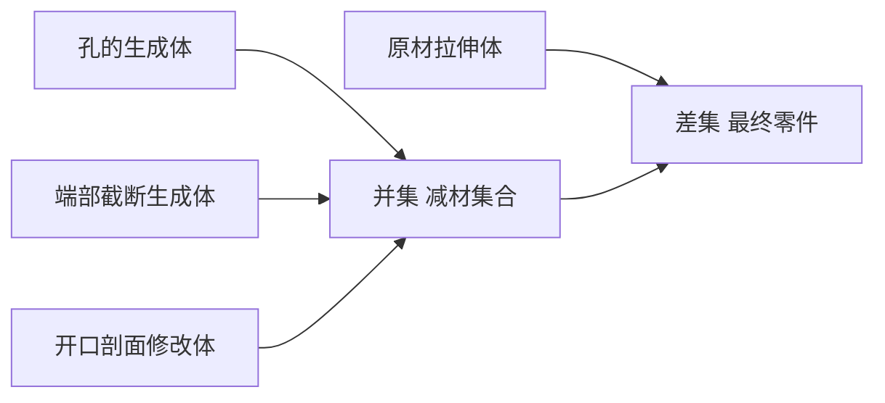

# TubeDesigner 中性管材 CAD 表达与编辑器接入

TubeDesigner 下料区的二维绘制、三维绘制、冲孔和实体导入共同编辑一份管材几何定义。二维轮廓、空间构造、贯穿关系和精确实体证据一起保存；求值后的零件 BRep 和网格用于显示、测量及后续加工。切换编辑器不应重新识别整件几何，也不应丢弃当前编辑器没有显示的特征。

本文面向几何服务、产品 SDO、前端编辑器和持久化实现人员，说明现有 `CTubeCadDocument` 的表达、接口和验收边界。它对应 TubeDesigner 当前实现；TubeOne 的 EC 原语设计由该产品目录中的设计基线定义，二者不能互相作为实现完成的证明。

## 权威数据与职责

`CTubeCadDocument` 是可独立求值和保存的中性几何资源。零件通过 `CTubePartCadComponent.DocumentResourceID` 与 `DocumentResourceVersion` 引用它。中性文档中的节点 ID 表示构造身份；场景 Entity ID 表示零件身份；资源版本表示场景中发布的快照。三者各有用途。

| 层次 | 保存或处理的内容 | 入口 |
| --- | --- | --- |
| GeometryData | 精确曲线、区域、构造节点、关系、精确 BRep 数据 | `TubeNeutralGeometry.h` |
| 注册 CAD 服务 | 导入解释、节点校验、约束重算、构造视图和实体求值 | `ITubeCadDocumentService` |
| TubeDesigner SDO | 零件资格、版本检查、事务、撤销、资源发布、测量和排样失效 | `TubeCadDocumentSDO.inc`、`TubeDesignerSDO.cpp` |
| 前端编辑器 | 选择节点、修改可编辑值、提交草稿、展示原生结果 | TubeDesigner 网页模块 |
| 加工层 | 从零件模型派生制造意图、加工策略和刀路 | CAM 模块 |

公共 CAD 服务通过 `AUTO_REGIST_SERVICE` 注册，调用者通过 `Services().Resolve<ITubeCadDocumentService>()` 获取。服务输入输出都是中性数据，不接收产品、场景、资源发布或排样状态。下料区修改的是材料和几何；激光、钻削、铣削、运动轴和设备姿态属于后续加工。

加工侧识别 `SConnectedComponentNode` 与 `STopologyBevelNode` 的类型及子图依赖，仍可读取子图的孔构造。连通分件的制造意图须与当前选中实体求交，返回 `RequiresGeometricIntersection`；拓扑坡口尚无对应的制造意图表达，返回明确的 unsupported 诊断并保持 `Invalid`。几何编辑与保存通过，不代表这些构造已经支持刀路生成。

## 文档结构

```text
CTubeCadDocument
  Revision           文档修订
  Unit               mm
  Geometry           CTubeNeutralGeometry
    BaseNodeID       原材主体节点
    RootNodeID       最终材料表达式节点
    SolidNodes       构造节点及关系
    UVFeatures       零深度表面内容
    Diagnostics      识别诊断
    Metadata         中性描述信息
  Bodies             文档拥有的精确 BRep 数据
  Metadata           文档描述信息
```

`Geometry` 描述如何构造最终材料集合。`Bodies` 为复合体、残余实体和导入证据提供可携带的数据，避免只保存一个依赖外部场景资源的字符串。求值只恢复当前节点引用的精确体，源模型证据不自动成为求值操作数。

曲面转换为中性模型支持的精确有理表达时，必须同步三维边曲线与面上参数曲线。OCCT 的 NURBS 转换会沿用旧 `SameParameter` 标记，不能因此假定转换后的参数仍一致。当前转换调用强制参数同步并校验实体有效性；服务再次校验中性重建体。圆角方管跨接缝椭圆的回归同时比较转换前后两个方向的差集。

服务 `Create` 生成初始修订 1。`Edit` 要求提交的修订与原文档一致，成功后同时递增 `Revision` 与 `Geometry.Version`。失败不修改输入文档；修订冲突必须重新读取，不能用旧草稿直接覆盖新状态。

### 二维材料区域

`CPlanarRegion2` 包含填充规则和多个有向边界环。每条边界由带稳定 ID 的精确曲线段组成，材料位于行进方向左侧。外边界通常逆时针，内腔通常顺时针；任意数量的腔体都用边界环表达，不为双腔管、多腔管或型钢增加专门几何分支。

曲线段保存曲线类型及参数范围，不能用屏幕折线替代。圆、线段、圆弧、样条等几何通过 GeometryData 曲线契约传递。前端不能表示的曲线仍保留在原节点中。

`SSectionPrimitive` 是从精确边界解释出的可编辑截面原语。它引用 `LoopID`，可描述圆的半径、矩形的宽高，或一般曲线环；精确 `Section.Boundaries` 仍决定几何。服务在编辑后同步参数解释，避免二维曲线已经变化而尺寸字段仍旧。

整圆可以由一段或多段精确圆曲线组成。尺寸解释要求各段同心、同半径、首尾连续、行进方向一致，并完整覆盖一圈；不能仅按曲线类型推断整圆。修改半径同时更新该环的所有圆段，保留各段 ID、构造架和参数范围。

### 三维材料构造

每个 `SSolidNode` 保存 `ID`、`Label`、构造 `Data`、可选关系和诊断信息。节点引用形成有向无环图，`RootNodeID` 的求值结果是最终零件。

| 节点 | 几何含义 | 可读取的二维构造 |
| --- | --- | --- |
| `SExtrudedRegionNode` | 区域沿构造架轴向在 First 到 Last 之间拉伸 | 截面区域与构造架 |
| `STaperedRegionNode` | 截面沿轴向线性一致缩放 | 参考截面区域与构造架 |
| `SHalfSpaceNode` | 平面限定的半空间 | 无独立区域投影 |
| `SBooleanNode` | 子材料集合的并、差、交 | 读取其构造子节点 |
| `STransformNode` | 子材料集合的空间变换 | 读取其构造子节点 |
| `SConnectedComponentNode` | 从子材料集合选择唯一包含内部锚点的连通实体 | 保留子图的可编辑构造 |
| `SWrappedVolumeNode` | UV 材料区域沿支撑侧壁外法向提升成体 | UV 区域与侧壁支撑 |
| `STopologyBevelNode` | 对子材料集合的实际边、参考面施加几何坡口 | 选边绑定与坡口参数 |
| `SOpeningProfileSweepNode` | 沿开口轮廓变化的壁厚剖面修改体 | 开口剖面场 |
| `SAlternativeNode` | 几何等价的多个构造解释及当前选择 | 读取所选或建议的构造子图 |
| `SCompositeVolumeNode` | 保留精确封闭体与解析面证据的局部复合体 | 依据能力声明处理 |
| `SResidualBRepNode` | 尚未解释的精确实体 | 不冒充已参数化轮廓 |

拉伸体的 `Frame.XDirection`、`YDirection` 定义截面平面，`ZDirection` 定义构造方向。一个直孔可以由圆形区域拉伸得到；斜孔只需改变构造架。孔、端部截断和坡口附加减材最终都参与普通材料集合运算。



几何类型不包含圆管、方管或型钢名称。管型资源负责材料截面的管理和选择，产品只暴露实际需要的有限参数；不能把管型库所有管理字段复制到 CAD 编辑器。

### 侧壁展开域与表面内容

`SBoundarySurfaceRef` 通过 `ExtrusionNodeID + LoopID` 指向整个侧壁图册，进一步通过 `CurveID` 指向一条截面曲线对应的母曲面。Side Atlas 保存接缝规则、物理周长 `UPeriod` 和轴向范围，不用求值后的面序号作为稳定引用。

`SWrappedVolumeNode` 保存精确 UV 区域及深度规则。`ExplicitNormalOffsets` 使用明确的上下法向偏移；`FirstHostWall` 根据支撑原材的实际连续管壁求切除范围，避免错误切到对侧管壁。法向由支撑侧壁导出；固定空间方向的贯穿体使用拉伸体表达。

展开曲线的 U 是原材外截面的真实弧长，S 是轴向距离。接缝与曲线段交接处按原材支撑分段，减材体先形成真实并集再参与差集。平面、圆柱和小于壁厚的圆角沿用原二维创建的实际几何规则；需要近似的曲面映射明确报告近似状态。公共求值器接收精确原材、截面构造架和 UV 区域，不接收二维页面配方或场景状态。

跨接缝和多圈图形在文档中保留完整源曲线；周期平移和分段裁剪只发生在求值中，不能将裁后的两半圆当成唯一可编辑源图。带内孔的复合轮廓按共同材料区域编译，内环和保留岛的语义由精确区域决定。页面中的 `fillGroup/evenodd` 是该区域的会话投影。

`SUVFeature` 保存侧壁上的向量路径、区域或图片。这些零深度内容不参与实体布尔运算。二维构造视图可能是截面、UV 区域或开口剖面，不能把所有视图都称为整件展开图。

### 开口剖面与坡口

`SOpeningProfileSweepNode` 引用源切割节点和目标开口，`ProfileField` 保存沿轮廓变化的精确二维壁厚剖面。普通直线坡口只是其中一种剖面，折线、圆弧和样条可以表达更复杂的边缘修改。

坡口角、钝边和深度由剖面相对于名义切割面的关系解释；它们不能替代中性剖面曲线。剖面 X 坐标位于源切割构造架中的绝对轴向位置，Y 是相对源切割边界向减材侧的有符号偏移。增加贯穿切割余量时，剖面不得跟随 First 或 Last 平移。

`EvaluatedVolumeNodeID` 保存对应的几何证据。修改剖面后必须从 `ProfileField` 重求值，不能重用旧减材体冒充编辑结果。

原绘图页面的实际选边坡口由 `STopologyBevelNode` 表达。三维工作台使用子材料集合的几何签名、边和参考面持久名称校验选中拓扑；上游几何改变后不能把旧面序号直接套到新实体。二维图元坡口保存源 `WrappedSourceNodeID` 和精确 `UVBoundary`，求值时重新映射到当前子实体的开口边及实际切壁参考面。坡口参数属于几何定义，刀路由加工层后续计算。

## 几何关系与导入解释

`SFeatureRelations` 描述依赖、宿主位置、材料贯穿范围、材料角色、曲面证据和连续材料跨度。这些关系属于几何构造，不指定加工设备或策略。

| 关系 | 作用 |
| --- | --- |
| `DependsOnNodeIDs` | 明确上游构造依赖 |
| `Extent` | 固定范围、全部贯穿、指定边界贯穿、盲孔深度或封闭范围 |
| `Placement` | 固定空间位置、相对宿主构造架或依附宿主边界 |
| `MaterialEffect` | 相对于宿主的贯穿、截断或边界修改角色 |
| `SurfaceEvidence` | 来源 BRep 面片、证据角色和可信度 |
| `MaterialSpans` | 同一生成体在母材中穿过的多段连续材料 |

盲孔的 `Depth` 从选定材料入口边界测量。宿主截面变化时，可重算的贯穿和盲孔关系随宿主更新，而不是继续使用旧快照的有限裁切范围。一个穿过多腔管的生成体可以对应多段材料，不因差集不连通就强行拆成多个设计孔。

布尔分组和解释选择通过子节点引用表达归属，不重复持有子特征的贯穿范围。实际编辑的原语拥有自身关系，避免父分组二次重算造成范围错误。

例如，矩形管上的圆形盲孔可以用一个圆形区域、位于侧壁的构造架、相对宿主的入口边界和 `Depth` 表达。二维编辑改变同一个圆的半径，三维编辑改变同一个构造架的位置，冲孔编辑改变该节点的入口和深度。修改管坯截面后，服务重新计算入口位置与有效裁切范围，圆孔节点 ID 和用户给定深度仍保留。

### 参数可观测性

`SScalarParameter` 保存值、上下界、描述信息及可观测性：

- `Observed` 表示当前几何可直接观察。
- `Reconstructed` 表示按几何关系恢复。
- `Underconstrained` 表示当前证据不能唯一确定。

导入的最终 BRep 可以证明当前材料集合，却不能总是证明被其他特征遮挡的原始长度或构造顺序。不能把欠约束参数当成确定设计意图。

### 等价候选和精确保留

`SAlternativeNode` 可以保存多个在容差内几何等价的子图。例如，同一局部减材可以解释为锥形贯穿，也可以解释为等截面贯穿加坡口。`RecommendedCandidateID` 是建议；`SelectedCandidateID` 与 `SelectionSource` 表示已做出的选择，建议分数不等于人工选择或概率。

候选首先满足几何硬约束，复杂度和可编辑性只在已通过几何验证的候选之间比较。无法完全参数化的局部保留精确复合体或残余 BRep，并明确其编辑能力；几何保真不意味着每个节点都能进入轮廓参数编辑器。

## 服务接口与保存

| 服务方法 | 输入和行为 |
| --- | --- |
| `Import` | 从中性 BRep 恢复表达和精确证据，独立核对重放结果 |
| `Create` | 从完整中性图和精确体创建文档并求值 |
| `Evaluate` | 校验文档并输出最终 BRep、构造体和诊断 |
| `Edit` | 以预期修订提交完整中性图，保留原文档精确体和描述信息 |
| `ReadSketch` | 按节点 ID 读取精确区域或剖面及其构造位置 |
| `ReadSketches` | 一次读取多个构造视图，保持请求顺序和身份 |
| `EditSketch` | 只替换指定节点的二维几何，再求值同一文档 |
| `SetSectionDimension` | 按节点和边界修改已定义的圆或矩形尺寸 |

`EditSketch` 不把显示坐标重新解释为空间位置。三维移动修改节点构造架；二维轮廓编辑修改节点中的精确区域。两者指向相同 ID，并保留未编辑的构造和关系。

服务校验 ID 非空且唯一、基体和根节点存在、引用完整、依赖无环、侧壁支撑有效以及精确体可恢复。成功结果仍需恢复成有效中性 BRep；前端显示成功不能替代原生校验。

### 场景接口

`TubeDesigner.GetTubeCadDocument` 与 `TubeDesigner.ApplyTubeCadDocument` 使用场景通道。读取请求指定 `partEntityId`，可附带零件 `resourceVersion` 和需要读取的 `nodeId`。返回文档资源引用、文档修订和中性 `geometry`，按节点读取时还返回 `sketch`。

编辑入口校验独立零件、文档组件和所引用的实际文档资源。`manufacturing.requiresBending` 是后续业务与排样资格信息，不能阻止已有文档的平直 V 槽下料件进行 CAD 编辑。

保存必须携带读取时的零件 `resourceVersion` 与文档 `revision`。提交节点 `sketch` 时调用 `EditSketch`；提交完整 `geometry` 时调用 `Edit`；原二维、三维页面提交 `authoringEdit` 时先校验当前投影绑定，再编译局部增删改。SDO 发布新的文档、零件 BRep 和缩略几何，事务更新组件引用、截面快照及实际几何测量，同时清空旧排样请求和结果。提交前再次检查资源引用，防止并发操作覆盖。

`TubeDesigner.PreviewTubeCadDocument` 使用相同版本检查和中性求值，但只发布会话拥有的运行时 BRep 和网格，不修改文档、零件或排样。预览请求携带唯一 `previewResourceKey`。前端合并连续请求，核对编辑会话、文档修订和零件版本，丢弃会话或权威版本已失效的响应。关闭显示器后调用 `TubeDesigner.ReleaseTubeCadDocumentPreview` 删除该会话的资源；仍在途的响应返回后再次释放它自己的资源，不能写入后来打开的页面。

预览返回的 `documentGeometry` 是服务已重算宿主关系和尺寸解释的草稿。期间没有继续输入时，前端直接接受该规范化结果；继续输入后，前端将用户增量合并到规范化结果，保留用户修改并接收未编辑字段的原生重算，同时不展示该响应的旧网格，排队求值最新草稿。同字段合并冲突时保留草稿并重新预览。预览不会推进持久化文档修订。

下料零件的原材轴向保持在局部 X 轴。SDO 对截面和轴向包络进行领域校验；中性服务本身不约束所有调用者的轴向。

管型模板匹配是几何编辑后的领域校验，与中性构造解释分开。匹配器根据完整截面轮廓直接求参数、旋转和平移；不匹配必须明确返回，不能通过正向生成和参数搜索冒充支持。未知但有效的截面也不应被强行替换为系统默认管型。

### 传输与持久化

`TubeCadJson` 用命名字段传输 C++ 结构，联合类型表示为 `{ "type": "类型名", "value": ... }`。64 位整数使用十进制字符串，避免 JavaScript 数值精度丢失；包括文档修订和拓扑身份。接收端拒绝字段数量错误、未知类型、非有限数值和无效枚举。

`TubeNeutralPersistence.h` 按明确字段顺序写入二进制，并校验格式标识、枚举和完整读取。当前文档格式为 `ICTCAD04`，几何格式为 `ICTUBE03`。字段或类型序列变化需要显式变更格式契约，不能悄悄改变顺序。当前版本直接遵循新设计，不提供旧配方恢复或旧格式迁移路径。

`OpenCascadeResourceImporter.cpp` 注册 `tube.cad_document` 的资源持久化编解码器。保存项目时文档及其拥有的精确体进入资源保存流程；重开后按组件引用恢复。最终 BRep 和网格是另行发布的求值结果，不能反过来覆盖构造表达。

## 编辑器接入与验收

### 新增与编辑共用页面

标准件、侧面二维绘制、三维绘制和冲孔的创建界面仍负责收集各自的输入。SDO 编译原材与实际减材构造体，拼接中性材料表达式，并对编译结果与创建结果执行独立双向几何核对；核对成功后才把文档挂到新零件。STEP 导入直接通过注册服务恢复文档。

编译合并时，构造节点、UV 特征和精确体各自使用独立命名空间。只重写有类型定义的引用字段，标签和描述原样保留。普通壁面孔保留实际输入对应的管坯依赖、贯穿或盲孔深度、相对宿主构造架的位置；无法恢复的局部以精确复合体保留，并明确编辑限制。

创建输入是一次构造适配。创建后的独立管材只保存中性文档作为可编辑几何定义，不持久化另一套编辑配方，也没有“创建输入仍有效”的备用写路径。二维、三维与冲孔修改都提交同一文档。

二维端部裁切和实体分件保留完整原材与源 UV 构造。分件文档通过 `SConnectedComponentNode` 选择当前实际实体，求值必须恰有一个实体严格包含锚点；锚点落在边界、实体已消失或选择歧义均拒绝保存，不能悄悄选择另一件。制造体通过真实空间平移归零，不用固定包围盒或完成体交集代替可编辑构造。每件拥有独立文档，修改一件不改写其他分件。

裁切、分件后的二维页面继续使用原新增工作域：源 S 站位不因制造体归零而改写。读取结果的 `reference.sourceDomain` 明确原材范围，`reference.actualPiece` 给出当前件的源轴向范围、实际包络和源到零件的平移。画布标明原材长度，三维预览显示当前实际零件。

已有零件的二维编辑复用 `sketchArea.mjs` 的侧壁绘图页面，三维编辑复用 `partDrawing.mjs` 的新增三维工作台。画布、工具栏、选择、参数编辑和布局共用现有实现。不能另做一套节点参数弹窗替代这两个页面，也不能将管坯截面轮廓误当作零件的二维侧壁绘图。

完整单段椭圆投影为原页面的椭圆图元，保留中心、半径和控制柄编辑。多段椭圆路径保留分段身份，不能为简化显示而合并局部坡口选择。二维参考只展开原材截面；读取绘图投影不额外展开整件成品。三维预览和当前件包络仍来自实际实体。

新增调用各自的创建接口。编辑通过 `GetTubeCadDocument` 的 `authoringView:"side"|"drawing"` 读取当前中性文档的绘图投影，再通过 `PreviewTubeCadDocument` 和 `ApplyTubeCadDocument` 的 `authoringEdit` 提交局部修改。投影和绑定是当前会话的数据，不能保存成第二套权威配方。SDO 校验绑定、修订和资源版本，只修改对应构造，保留当前页面没有编辑的节点。保存结果从 `snapshot.tubeDesigner` 更新同一个场景零件。

被替代的独立件二维保存、三维与冲孔配方恢复和保存接口从注册表及实现中删除。`tubeCadEditor.mjs` 仅负责冲孔编辑；其中错误的独立二维画布和三维参数模式已撤除。

装配工艺计划仍保存自身业务输入。其当前创建和重新生成流程复用已知原材、实际减材构造和局部几何差异编译文档，避免对刚生成的整件重复识别；同时发布对应实体，领域版本校验由 SDO 负责。产品拆单进入下料时，在新独立管材创建阶段建立中性文档；后续编辑直接求值文档。

| 编辑目的 | 展示与编辑的内容 |
| --- | --- |
| 二维侧壁绘图 | 原新增页面的精确图元、选择与图形操作，横向 U 为周向弧长，纵向 S 为轴向位置 |
| 三维绘制 | 原新增页面的主管、减材构造、端部和工具选择；已有构造投影后继续编辑 |
| 冲孔 | 孔轮廓尺寸、位置、已有盲孔深度，以及新增贯穿圆孔 |

节点列表保留构造身份，显示名与几何参数独立。当前界面没有安全编辑能力的节点仍保留在文档中。几何诊断、可信度、源面编号和内部缓存不作为产品输入项。

位置字段使用零件局部 X、Y、Z；相对宿主的构造通过宿主逆变换同步 `LocalFrame`。宿主构造架的截面 X、Y 与拉伸 Z 不等于零件的轴向 X，不能直接把局部 X 字段显示成轴向位置。新增孔的轴向站位位于原材构造范围中，再通过原材构造架转换为空间位置。

显示投影不能替换权威几何。可编辑图元来自精确中性区域；未知导入构造保留为参考和原节点，不能把采样底图写回为新切割。圆弧显示必须使用完整构造架的 X、Y 方向及参数范围，允许左手基底；只提取 X 方向角度会将圆角反射并产生断口。

### 异步编辑状态

普通参数更新使用局部 DOM 更新。真正更新 DOM 之前捕获最新焦点、选区、左右栏和嵌套容器滚动位置，恢复焦点采用 `preventScroll`，然后恢复滚动。当前画布和事件绑定不因参数更新而替换。

冲孔文档编辑允许异步请求期间继续输入，按稳定 ID 合并提交后的增量。二维、三维工作台复用各自的提交状态和预览生命周期。发生修订冲突时保留当前草稿，不能自动用旧整图覆盖新状态。

异步结果受编辑会话、项目和视图所有权约束。离开编辑器或切换项目后不能抢回焦点，网格加载也不能让旧资源覆盖更新后的模型。

实时三维预览与持久化保存分开。二维画布即时显示草稿图形，三维视图读取原生求值出的草稿网格；点击保存才发布新的权威版本。切换页面关闭原工作台并释放其预览，保存后按最新场景快照刷新下料零件。

二维侧壁页显示当前实际零件，使用实际包络居中，不使用保留的完整原材包络平移分件模型。既有缩略图切换为 CAD 草稿网格时保持同一取景坐标和用户相机；实际网格更新独立于原材资源是否改变。分件预览的验收同时检查真实网格顶点投影全部位于视口内，不能只检查 GPU 资源存在。

### 当前编辑能力边界

共享冲孔视图可以修改已有可解释轮廓和盲孔深度，并新增贯穿全部材料的圆孔。新增圆孔的作用范围在界面明确说明，不能混同为只穿一层管壁。其他模具和丰富阵列输入仍由创建界面收集；编译后的阵列保留各实例的独立构造，当前共享视图不重新编组整体阵列参数。

精确复合体、残余实体及无法由当前界面完整表示的构造继续保存，不强制转换为默认孔型。构造视图能读取不等于界面已提供该构造的全部修改操作。现有入口和测试所覆盖的能力分别列入验收报告。

中性材料表达允许多个独立实体。三维绘制创建保留有效的多实体结果；冲孔创建仍执行单段管材的业务校验。相同八边形支管减材输入已验证三维绘制生成三个实体、文档求值与制造体一致，而冲孔入口拒绝该三段结果。

### 验收范围

本轮以真实下料编辑入口和原新增页面为验收对象。浏览器通过注册 SDO 调用实际原生几何、资源和项目存储，使用生产前端与 SDK/GPU；修改、预览、保存、磁盘重开后再次操作。底层通过不能代替页面操作通过，旧独立弹窗的二维、三维测试不作为本轮证据。

| 报告 | 范围 |
| --- | --- |
| `output/tests/cad-existing-workbenches-native-browser/report.json` | 15 项实际原二维、三维工作台操作：增改删、主件信息、跨页面保留、鼠标选边坡口、孔径、焦点与五处滚动、预览释放、保存重开、二维局部坡口、裁切后重复进入、分件独立编辑、跨接缝椭圆中心与双半径编辑 |
| `output/tests/unified-cad-document/report.json` | 四种创建入口、STEP、产品拆单、装配计划、关系重算、版本与通道拒绝、文档与制造体等价、磁盘重开 |
| `output/tests/cad-drawing-authoring-native/report.json` | 三维局部构造、整圆尺寸、主件信息、端部和主管长度重算 |
| `output/tests/cad-side-components/report.json` | 非零起点裁切、分件的独立可编辑文档、跨周期完整曲线、复合轮廓内孔与保留岛、局部坡口回读 |
| `output/tests/punch-cad-document-browser/report.json` | 实际冲孔入口、输入事件、规范化草稿合并、交互保留、原生预览、释放和保存重开 |
| `output/tests/tube-wrapped-kernel/report.json` | 完整源 UV 求值与原二维创建几何及中性重建体的独立对照；平壁、跨接缝、多圈、跨壁、大小圆角、圆柱、R3 接缝椭圆与三种坡口侧别 |
| `output/tests/cad-authoring-service/acceptance.log` | 注册服务的关系、图编辑、坡口、失败原子性与重开；工业 STEP 批次不重复计入本轮 |
| `output/tests/cad-side-components/service-report.json` | 严格内部锚点选择、图重算、独立差集、当前 JSON/二进制格式与独立边曲线传输 |
| `output/tests/cad-side-read-timing-final/report.json` | 裁切件读取、修改、保存重开后的重复读取耗时，以及实体和重开数据核对 |
| `output/tests/cad-machining-wrappers/gtest-report.json` | 分件、坡口包装节点保留孔构造身份，并明确拒绝不支持的加工状态 |
| `output/tests/cad-authoring-stage-bridge/acceptance-review.json` | 对最终原页面 15 项、冲孔 5 项和原生报告的独立核对；实际加载 DLL、121 个原页面资产、120 个冲孔资产均与当前文件匹配 |

几何核对使用两个方向的独立差集，防止漏切、多切或总体积相同但位置错误。保存重开同时核对表达身份、精确体、构造位置和参数。几何核心的对照结果和页面操作结果分别报告；只检查显示网格或总体积不足以证明互通。

Debug 原页面最终 15 项验收全部通过，覆盖实际入口、原控件、原生求值、保存与磁盘重开。分件取景修复后重新运行相关 6 项和完整 15 项，两个分件在首次打开及修改后的预览中，全部成品网格顶点均在相机可见范围内。完整页面报告的 121 个生产资产及冲孔报告的 120 个资产逐一匹配当前源码；侧面预览资产与 Debug、Release 部署一致（`4B170991…`）。冲孔浏览器 5 项、原生统一文档 12 项、三维 5 项、侧面专项 5 项及几何核心 14 项分别通过。页面采用 `TubeDesigner.dll`（`92E5D40F…`）和 `OpenCascadeResourceImport.dll`（`BA78536B…`）；独立核对记录完整 SHA-256、报告哈希及当前生产资产的一致性。

裁切件在最终完整页面测试中，磁盘重开后的两次真实入口读取约 269–288ms，画布与 GPU 就绪约 337–363ms，固定的 180 秒验收超时未放宽。独立原生对照记录删除无消费者的成品展开计算前后约 5–6 秒与 0.3 秒的读取耗时；此前一次偶发超时保留为失败阶段记录，不将这项优化声称为已证明的唯一原因。

原始运行保留 `buildPhase:"authoring-repair-stage"` 和 `completionClaim:false`，表示不声明整套 CAD 产品全部完成；本轮通过范围由实际 15 项及独立核对报告明确限定。旧哈希、失败和主动停止的阶段报告保留，不能改称最终通过。

Debug 与 Release 分别构建、按脚本部署网页和运行清单。浏览器到原生验收采用 Debug 插件；编译 Release 不等于完成 Release 实操。桌面自动化曾尝试启动当前构建，但未取得可操作的目标窗口；独立桌面和宿主文件选择器未计入本轮通过范围。工业 STEP 批量导入、完整产品运行时与此前 C++ 套件的历史记录保留在各自目录，不替代当前原页面验收。

## 代码定位

- `src/iCAX-Engine/foundation/GeometryData/TubeNeutralGeometry.h`：中性表达。
- `src/iCAX-Engine/foundation/GeometryData/TubeNeutralPersistence.h`：完整文档和几何二进制契约。
- `src/iCAX-Plugins/cad/OpenCascadeResourceImport/TubeCadDocumentService.h`、`.cpp`：服务与构造视图。
- `src/iCAX-Plugins/cad/OpenCascadeResourceImport/TubeCadConstraints.cpp`：宿主关系重算。
- `src/iCAX-Plugins/cad/OpenCascadeResourceImport/OpenCascadeTubeWrapped.cpp`：精确原材侧壁映射、周期求值和二维坡口的动态拓扑绑定。
- `src/iCAX-Plugins/cad/OpenCascadeResourceImport/OpenCascadeTubeCSGConverter.cpp`：导入解释、求值和几何核对。
- `src/iCAX-Plugins/cad/OpenCascadeResourceImport/TubeCadJson.h`、`TubeCadFieldNames.h`：前后端命名字段传输。
- `src/iCAX-Plugins/product/TubeDesigner/TubeDesignerComponents.h`：场景零件对文档资源的引用。
- `src/iCAX-Plugins/product/TubeDesigner/TubeCadDocumentSDO.inc`：场景读取和事务保存。
- `src/iCAX-Plugins/product/TubeDesigner/ProductAssemblyProcessCommit.inc`：装配计划的业务版本校验与文档同步发布。
- `src/apps/tube-designer/webpage/tubeCadModel.mjs`：中性参数修改、坐标转换和异步草稿合并。
- `src/apps/tube-designer/webpage/tubeCadCurves.mjs`：精确曲线的显示投影。
- `src/apps/tube-designer/webpage/sketchArea.mjs`：新增与已有零件共用的二维侧壁绘图页面。
- `src/apps/tube-designer/webpage/partDrawing.mjs`、`partDrawingModel.mjs`、`partDrawingView.mjs`：新增与已有零件共用的三维工作台。
- `src/apps/tube-designer/webpage/tubeCadEditor.mjs`：冲孔文档编辑会话。
- `src/iCAX-Plugins/product/TubeDesigner/TubeCadWorkspaceSDO.inc`：当前文档的绘图投影与局部编辑编译。
- `src/tests/iCAX-UI/TubeDesignerUnifiedCadDocument.native.mjs`：真实场景创建与跨视图保存链。
- `src/tests/iCAX-UI/TubeDesignerCadExistingWorkbenches.native.browser.mjs`：实际下料编辑入口、原二维/三维工作台、鼠标选择、原生保存和重开。
- `src/tests/iCAX-UI/TubeDesignerUnifiedCadDocument.native.browser.mjs`：实际冲孔浏览器事件到原生场景的编辑链。
- `src/tests/icax-plugins/product/TubeDesigner/TubeDesignerTest/TubeCadDocumentAcceptance.cpp`：服务与持久化验收。
- `src/tests/icax-plugins/product/TubeDesigner/TubeDesignerTest/TubeCadStepAcceptance.cpp`：STEP 导入和重放验收。
- `src/tests/BRepPersistence/TubeDrawingPersistence.cpp`：完整产品运行时的独立文档、资源隔离、保存重开和源产品删除验收。
- `src/tools/testing/test_tube_cad_step_import.py`：工业样本批量入口。
