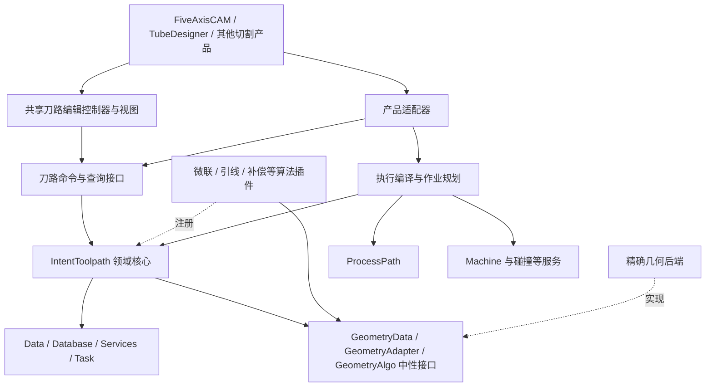

# 通用可编辑刀路组件方案

日期：2026-10-26。状态：完整目标设计，整体验收尚未完成；本次补充图层目录、刀路归属与右侧图层栏。业务语义以[规格文档](IntentToolpath规格文档.md)为准；本文将其落实到组件、接口、事务和迁移边界。文中的接口与新增字段描述目标契约；实际 API、已验证能力和接入状态见[源码说明](../../../../src/iCAX-Plugins/cam/IntentToolpath/README.md)，不能将设计描述视作验收证据。

## 1. 设计结论

扩充现有 `IntentToolpath` 公共插件，形成跨切割产品使用的刀路领域组件，统一承载刀路、基础编辑和操作图，工艺通过注册能力接入；产品负责业务上下文与交互组合。

基础数据模型一次完整确立并统一交付。身份、精确几何、操作端口、范围映射、图层目录与归属、工艺注册、有效输出、删除、异步计算、保存、撤销与跨产品边界属于同一完整契约。不得交付缺少这些契约的过渡模型，也不以同步替代异步、产品私有数据或双模型并行作为临时实现。未来增加工艺按既定扩展点注册算法与描述，不重新定义刀路基础结构。

采用“统一刀路身份 + 精确几何 + 操作输出端口 + 方案内替代关系”的模型：

- 绘制、导入、拆分、合并和工艺结果都是同一种可编辑刀路。
- 一个逻辑刀路允许经历多个操作版本；依赖引用明确的生产者端口，避免引用自己的当前值。
- 打断、合并和微联等拓扑操作显式产生结果；结果继续接受相同的编辑和工艺命令。
- 组织树服务浏览，操作图服务更新，替代关系决定加工输出，加工块决定排序约束。这些关系独立管理。
- 定义、参数、映射、删除决定及持久结果存入工程数据库。资源系统承载 CAD 等资产和运行期传输副本。

组件内部可以包含多个服务和 EC 组件。“通用组件”指统一模块与契约，不是把所有数据塞进一个 C++ Component。

## 2. 模块与依赖

箭头表示使用方依赖被使用方；虚线表示注册中性接口实现。



### 2.1 领域核心

继续放在 `src/iCAX-Plugins/cam/IntentToolpath/`，负责：

- 刀路、操作、端口、版本、范围、来源映射及方案的中性数据契约。
- 基础编辑命令的统一语义、预检、变更影响及事务发布。
- 工艺描述注册、求值调度、稳定输出匹配、替代与有效输出解析。
- 工程持久化、格式升级和诊断查询。

核心不依赖 FiveAxisCAM、TubeDesigner、Machine、CamRuntime、OpenCascade、渲染和前端 UI。它只调用中性几何/任务服务，不保存后端对象指针。插件可以使用几何后端，但公共签名不暴露后端类型。Engine 不反向依赖本插件。

旧资源业务值仅由工程格式升级器读取；运行期大结果传输放在 SDO 适配边界。核心对曲线、参数和操作只认工程数据库的唯一权威。现有工程引用尚含 Resources，须随本次统一替换解除业务耦合；当前尚未完成。

### 2.2 算法、产品与 UI

| 层 | 提供内容 | 必须遵守的边界 |
| --- | --- | --- |
| 几何实现 | 裁剪、拼接、投影、求交、偏置、承载面映射及误差证明 | 精度与支持范围明确；不决定用户选中了哪个加工分支 |
| 工艺插件 | 微联、引线、共边等类型及算法 | 返回中性刀路结果和映射；不能直接修改 Repository 或调用产品 UI |
| 产品适配器 | CAD/识别输入、材料区域、工件坐标、工艺预设、能力选择 | 不重写拆分/删除/替代规则；产品类型不进入核心分支 |
| 共享编辑层 | 拾取结果转换、精确范围选择、命令状态、属性描述呈现 | 不以显示折线、数组位置或产品树节点作为持久引用 |
| 作业规划与执行编译 | 排序、连接空移、执行路径、采样及事件编译 | 读取已完成的有效输出及约束；不能静默过滤失效分支 |

`CompileTubeMachiningIntent` 的管材编译职责归入管材来源适配模块，相关调用在接入时统一调整，通过公共来源接口创建刀路。共享核心头文件与构建依赖不暴露管材特定类型，其他产品无需链接管材编译能力。

编辑器是可选配套模块，可由不同工作台承载。无界面测试宿主必须能够完成相同的领域命令。产品的工装导入、机床组织及布局不属于本次刀路组件职责。

## 3. 数据契约与组件组合

### 3.1 文档、方案与身份

| 对象 | 关键数据及约束 |
| --- | --- |
| Document | `DocumentId`、格式版本、单位、容差策略、来源定义与刀路/操作容器；属于宿主工程 |
| Plan | `PlanId`、选用的来源根、启用操作集合、输出排除规则、加工组织约束；当前加工语义的解析作用域 |
| Layer | `LayerId`、所属 Document、图层种类、名称、属性及版本；图层目录的唯一权威 |
| LayerMembership | `(PlanId, PathId)` 的加工/显示图层覆盖；无覆盖时从持久声明解析继承，不存第二份可写有效值 |
| Path | `PathId`、名称、用户编号、来源说明及所属 Document；逻辑身份，不直接作为依赖图节点 |
| Operation | `OperationId`、类型/版本、输入槽、参数、输出端口表、状态及所处 Plan；一次有语义的变换 |
| OutputPort | `(OperationId, PortId)`、`PathId`、稳定角色描述；由输出声明与持久身份登记确定，是依赖与替代的基本地址 |
| OutputSnapshot | 端口当前精确数据、通道指纹、输入指纹、算法版本、映射与诊断；按计算批次原子发布 |

`PathId` 直接采用刀路身份实体的 UUID，不依赖名称、顺序、资源 URL 或算法输出下标，不再维护第二套可独立改变的实体身份。`PortId` 在同一生产者实例中稳定且永不分配给无关新角色。派生刀路身份实体由核心在合法派生发布中创建，其可见/可加工资格仍须由活动图与当前结果清单共同确定。

源定义可以被多个 Plan 只读引用。修改共享源定义明确影响引用它的所有 Plan；方案内的工艺实例、参数、替代及派生结果相互隔离。复制方案时分配新的方案内操作/结果身份，并显式重建内部引用，不共享可写工艺实例。源定义要独立修改时先建立独立副本。

Plan 的 `PathId -> 当前终端端口/已消费/已排除` 是可重建投影，不是第二套可写业务数据；一个源被拆为 B/C 后，A 显示为已被操作替代，不能虚构 A 的当前终端为 B。

几何和扩展通道属于具体端口的输出快照，不属于可随意覆盖的 Path 全局字段。C 的基础输出和加引线输出可以同时被引用，却只有各自一份权威值；Path 记录通过方案投影定位当前结果，不再复制一份“当前几何”。端口记录由操作持有，快照以端口为归属并可分块保存；运行中的只读任务固定其读取版本，后台发布不能原地改变任务正在读取的内存。

### 3.2 EC 组件契约

以下为目标职责拆分，实施时复用已有组件并升级格式，不同时新增一套平行实体模型。

| 组件职责 | 内容 |
| --- | --- |
| Document / Plan | 容器、根和方案选择，替代/排除策略 |
| PathIdentity | 名称、用户编号、逻辑身份；不包含几何大包或所有工艺字段 |
| GeometryDefinition | 精确曲线链、段标识、坐标系、权威表示、承载面及容差 |
| SourceBinding | CAD、绘制、导入、模板等来源定义、稳定外部键和关联状态 |
| OperationDefinition | 输入槽、替代消费类型、选择范围、参数及版本 |
| OutputDeclarations | 操作的输出族、固定角色/身份约束；属于可撤销定义 |
| OutputIdentityRegistry | 按操作实例登记稳定端口、PathId 和角色匹配依据；持久身份事实，不是可加工成员列表 |
| OutputState | 当前计算指纹、结果引用、有效性、必要的最近有效结果及诊断 |
| LineageMap | 输入区间到输出区间/构造段的映射及附着对象映射结果 |
| Organization | 单一所有权分组和成员序；其他过滤视图使用引用 |
| LayerCatalog / LayerMembership | 文档图层与默认层、方案内归属覆盖/继承策略、加工层参与及工艺绑定；与组织和几何分开 |
| ExecutionConstraints | 原子加工块、块内顺序、允许重排范围及先后约束 |
| Attribution | 多工件归属、完成判定职责 |
| ExtensionChannels | 姿态场、参数场、事件、保留材料侧等有版本的中性通道 |

特定工艺以“操作实例 + 注册类型”表达，不建立 `MicroJointPath : Path` 等继承树。工艺专用扩展组件可以存在，但其结果必须符合统一刀路契约。动态参数使用有 schema 的字段映射；不得退回无限制的任意 JSON 与永久中心白名单并存。

来源绑定明确区分 `EmbeddedSnapshot` 与 `LiveLinked`。前者以工程内定义为权威，原导入文件移动不导致来源失效；后者依赖工程内可定位的 CAD/其他来源，更新时需重新关联。不得把“外部文件路径不存在”和“工程内活动来源丢失”混成同一种故障。共享来源修改、方案内编辑与导入文件自动重载是不同命令。

CAD 来源记录来源版本、特征键及拓扑映射依据；运行时拾取标签、面/边数组序号不能视为跨重建稳定标识。来源适配器不能提供唯一映射时返回需要重新关联，不能以保留旧 TopologyID 的数值代替正确关联。

### 3.3 精确几何与坐标

复用 `GeometryData` 的直线、圆弧、NURBS、曲线参数域与中性曲面结构，为有序曲线段增加稳定业务段身份和来源记录，不另建同义数学类型。

```text
GeometryDefinition = {
  authority: Planar2D | SurfaceUV | Spatial3D,
  frameId, supportSurfaceBinding?, geometryTolerance,
  closed, traversalStart,
  segments: [{segmentId, exactCurve, nativeRange, traversalDirection}],
  derivedRepresentations: [{kind, fromVersion, mapping, errorBound}]
}
```

曲线、平面/曲面和坐标定义均随工程保存，不能只保存对临时外部文件的引用。CAD/BRep 作为资产可以由工程封装持有；其提取出的刀路权威定义是数据库业务值。大曲线可分块为数据库记录并共享不可变内容，不通过资源 ID 偷换存储权威。

同一输出只能有一种权威表达。UV 的物理长度与偏置必须通过承载面度量处理；UV 单位不是毫米。空间段跨面时，记录各区间的承载关系，不能强行保留一个全局面 ID。二维平面、周期曲面接缝、多圈遍历、退化段及几何容差均需显式处理。不支持的曲线族由能力查询和预检拒绝，不能偷偷离散成折线冒充精确结果。

坐标记录采用稳定 `FrameId + 版本`；引用姿态与本地几何分开。显示变换、机床装夹变换和几何编辑变换分开发布。跨工件合并要求命令指定目标坐标系及明确的源到目标变换快照/关联策略，材料归属也须可一致解释；不满足时拒绝合并。机床转台显示旋转不得修改工件区源几何。

### 3.4 选择与附着

```text
PortRef = {producerOperationId, portId}
Anchor = {portRef, segmentId, nativeParameter, traversalOccurrence,
          endpointSide?, seamSide?, observedGeometryFingerprint}
SelectionRange = {startAnchor, endAnchor, traversalDirection,
                  wrapsSeam, boundaryInclusion}
InputBinding = {slotId, sourcePortRef, selectedRanges, consumption,
                requiredChannels, expectedSourceFingerprint}
```

`observedGeometryFingerprint` 用于检查和映射选择，不将关联永久钉死在旧版本。持久依赖跟随同一生产者端口的后续有效版本；一次后台任务则冻结实际读取的输入版本。观察版本变化时先重新映射锚点，失败则需要重新关联，不能继续使用旧参数数值。

原生参数负责精确定位；“距起点多少毫米”“占总长百分比”“最近点”等可以是用户明确选择的定位规则，必须保存该规则与解析结果，不能在更新后擅自切换规则。操作构造的引线段使用构造来源与新段 ID，不伪造 CAD 来源参数。

姿态控制点、工艺参数区间和事件都使用同一地址体系。每种附着对象声明跨拆分/合并时的映射策略：可拆分的区间场可分段传递，单次穿孔等事件不允许自动复制成多次；无法唯一归属的对象产生诊断。不可用“把全部事件复制到每条子刀路”解决。

来源映射保存区间对应关系及 `Exact / BoundedApproximation / Unmapped` 等精度状态，必要时是分段或一对多关系，不能假设所有偏置与投影都有可逆的一维参数公式。后继操作声明是否接受有误差界的映射；没有证明的区间不得靠最近点自动接续。反向与镜像还需映射物理保留侧，不能只把 Left/Right 字符串照搬。

### 3.5 状态分离

| 轴 | 值及含义 |
| --- | --- |
| 定义/关联 | `Ready / NeedsDecision / NeedsRebind / SourceMissing / Unsupported / Invalid`，描述当前定义是否可求值 |
| 任务 | `Idle / Queued / Running / Succeeded / Failed / Cancelled`，只描述本次计算进度 |
| 结果 | `Missing / Current / Stale`，以当前定义、输入通道和算法指纹判定 |
| 端口生命周期 | `Active / Retired / NeedsRebind`，控制身份关联和退役，独立于任务 |
| 参与与显示 | 当前方案的参与开关/排除，以及独立的显示隐藏 |

任务完成不自动等于结果 Current；求值成功但发布时输入已变，仍不得变成有效结果。一次失败可保留 Stale 的最近结果用于查看。名称和用户编号独立于这些状态，不借清空字段表达失效。根操作及被加工分支要求的只读依赖都参与就绪判定；独立的只读分析任务失败不应阻止无关加工。

### 3.6 图层目录与方案内归属

以下为目标数据契约，统一存入工程数据库：

```text
Layer = {
  layerId, documentId, schemaVersion, kind: Processing | Visible, name,
  properties: Processing{processBinding?} |
              Visible{color, visible, locked, displayOrder},
  definitionVersion
}
DocumentLayerDefaults = {processingLayerId, visibleLayerId}
PlanProcessingLayerState = {layerId, participating, planningOrder?}
PathLayerOverride = {planId, pathId, processingLayerId?, visibleLayerId?}
OutputLayerPolicy = {
  processing: SameInputs | InputSlot(slot) | Explicit(layerId),
  visible: SameInputs | InputSlot(slot) | Explicit(layerId)
}
```

每类图层有独立的有效归属，引用必须属于同一 Document、类型匹配且可解析。新文档原子创建 8 个可编辑显示层及一个默认加工层；右侧色块对应显示层，不显示两套重复图层栏。无工艺刀路允许加工层暂未绑定工艺，执行能力按实际需要报告未配置，不伪造默认切割工艺。源创建时将当前默认/用户选择捕获为 `Explicit` 定义，不动态跟随以后修改的默认值。

层属性为文档共享定义；刀路换层、继承覆盖和加工层参与设置按 Plan 保存。共享源出现在两个方案时，不在全局 `PathIdentity` 上写可互相覆盖的图层字段。复制方案复制这些可写定义，复用本 Document 的层 ID；复制到另一文档时连同层目录、默认值和绑定快照统一重映射引用。

`processBinding` 使用有 schema/版本的工程内工艺快照和稳定外部工艺标识；切割系统 ID/名称由适配器解释。层默认工艺与操作显式参数按“显式参数优先”解析，失效按实际读取项传播。通用核心不内置机床或激光参数大表。`planningOrder` 是明确交给规划器的排序输入，须与加工块、必要先后关系共同校验。

`LayerId` 是引用权威，层名/颜色/顺序均不是。有效归属是解析结果，`SToolpathValue` 的几何、来源通道及工作线程候选值不保存另一份可写成员表。查询结果需携带两类有效 ID、归属来自显式覆盖还是继承，以及各层状态；UI 按 ID 连接目录。颜色采用可校验的 sRGB `#RRGGBB`，首次初始化使用规格第 3.8 节的默认配色，重开工程不补回已删除的默认层。

### 3.7 继承、用户覆盖与异步发布

源和独立副本保存明确的初始层。首次创建新 Path 身份的操作定义保存 `OutputLayerPolicy`；角色需要不同来源时，由输出契约明确对应输入槽。拆分/微联通常继承对应输入，两类层分别解析。多输入结果只有在对应输入同类图层一致时才能使用 `SameInputs`，否则返回 `NeedsDecision`，由用户为冲突的类别指定目标。输入以后换层使一致性破坏时同样诊断，不静默取第一条。

一对一继承 `PathId` 的编辑直接沿用该身份的方案归属，不再建立指向自身当前输出的图层继承边。新身份通过明确的上游端口/输入槽解析继承；规则引用服从无环依赖校验。分组/解组不修改图层。固化将当前有效图层捕获为独立定义；复制取得源的当前有效层但不继续跟随源换层。

用户换层写 `PathLayerOverride`，单独覆盖指定类别；恢复继承只移除相应覆盖。上游换层传播到仍继承的结果，手工指定的 C 不被重置。结果匹配继续使用稳定端口/PathId/角色证据，退役覆盖休眠，恢复同一角色后重新生效；歧义产生诊断，不把旧覆盖移到其他路径。

`DerivedPublish` 只登记输出身份和匹配证据，不补写用户覆盖、默认层或图层策略。输出数量未知时，新输出按已提交规则解析初始归属；并发换显示层后，几何任务仍可发布，展示读取最新归属。若任务实际读取了加工层绑定，其冻结读集合必须包含该绑定指纹；绑定改变后旧结果不得发布为 Current。

删层命令预检所有 Plan 的覆盖、源/输出策略、默认层、加工层状态及休眠身份引用。有引用时要求同文档、同类、不同 ID 的有效目标层，并在一个用户事务中迁移所有引用再删除；工艺快照不相同时列出实际失效范围。撤销恢复完整目录与引用。导入先检验种类、引用、继承无环及绑定版本，悬空层引用拒绝，不自动补默认层掩盖损坏。

## 4. 操作图、替代与编辑

### 4.1 同身份一对一编辑

给 C 增加引线时，C 保留逻辑 ID，增加新的操作输出：

```text
M.outC (PathId=C) -> L.input -> L.outMain (PathId=C)
```

L 的输入永久指向 `M.outC`，不能保存为“读取 C 当前 Head”。再次修改 C 时 E 读取 `L.outMain`。修改已有 L 的参数是在同一操作实例上重算，不能自动新建另一个引线叠加。明确再添加一个工艺实例才创建新操作。

编辑历史中的早期操作会重算后继；在当前结果上移动端点等直接编辑则创建局部编辑操作。局部编辑保存确定的约束/变换规则和锚点，既不直接篡改上游，也不复制完整上游几何当默认来源。无法重映射时保留编辑参数并显式失效。用户选择固化后，才变为独立源定义。

依赖图节点为操作，边来自输入槽引用的生产者。循环检查在操作实例和跨文档来源绑定层实施，组织树另行检查。图/树读取都维护 visited 集；导入遇到历史循环、悬空引用或反向索引不一致，应给出结构诊断，不能死循环或任意忽略节点。

### 4.2 替代消费与只读依赖

输入槽至少区分：

- `Replace`：替代输入端口的当前加工输出。
- `ReadOnly`：读取几何或上下文，不改变该输入是否加工。

同一 Plan 中，同一完整输出端口最多有一个启用的 `Replace` 消费者。替代资格在事务预检和提交时同时校验。两个工艺都选中了 C 时，第二个应接在第一个结果之后，或放进独立方案，不能让二者并列消费同一端口。

同一端口保持完整输出的唯一替代消费语义。局部编辑替代完整输入端口，其结果必须带上未改动部分；多个区间需要独立加工时，以明确的拆分操作表达区间身份，再分别操作。公共命令可以在同一用户事务内完成拆分和工艺绑定，接口不接受多个隐式且可能重叠的局部替代消费者。这是基础模型的不变量，不是等待后续版本放开的限制。

每个 `Replace` 输入需有覆盖说明：`映射到输出 / 明确排除 / 不加工材料保留`。中性结构校验检查输入范围没有无声明丢失；工艺校验检查真实制造含义。多输入合并需要全部输入就绪；从两个来源根到达同一个合并结果时只发布一次。

### 4.3 拆分、合并及角色身份

拆分 N 个输出拥有 N 个独立 `PathId`，输入保留为来源；一对一操作可以继承 PathId。合并 N→1 默认产生新 PathId，不拿某个输入的 ID 冒充全体。每个输出指定 `identityPolicy`，核心核验其满足操作签名，算法无权自行复用任意现存 ID。

继承身份只允许沿同一 Plan 的唯一替代链；只读关联副本必须创建新身份，不能产生两个同时有效却同名为 C 的逻辑对象。身份策略属于操作类型的稳定语义，不随本次偶然输出 1 条还是 2 条切换。例如微联的连通分量角色可以统一使用派生身份，不能在输出数量改变时临时借用 A 的 ID。

端口首次建立后保存角色描述和匹配证据，例如：

```text
{operationId=M, semanticRole=CutComponent,
 boundaryKeys=[SourceStart, JointJ.LeftBoundary], sourceFeatureKeys=[...],
 provenanceIntervals=[...], portId=pB, pathId=B}
```

用户改起点、反向或算法改变枚举顺序时，物理区间仍唯一对应的 B 保留端口与 PathId。“前段/后段”可以是标签，不能只凭当前排序匹配身份。

重算按“稳定来源键和边界关系 -> 精确区间映射 -> 唯一语义对应”匹配。几何距离和重叠度只作诊断辅助，不能替代明确对应。一个旧角色变成两个新角色、边界交叉、微联相合、承载面接缝改变等情况，不任意挑一个继承全部后继。

端口状态为 `Active / Retired / NeedsRebind`。退役记录和排除规则保存至无活动引用且超出撤销保留期后才能回收。此前删掉的角色即使暂时消失，也不能因下一次重算而丢失删除决定；新出现且语义不同的结果不得盗用这个角色。

角色被证明已消失且没有必需后继时，可以正常退役，不单凭保留历史记录阻止加工。对应的删除规则休眠保存；同一物理角色恢复后继续生效。若消失/拆分关系有歧义，或仍有需要该角色的后继，则产生需要重新关联的诊断，不能把它当作正常退役处理。

### 4.4 顺序与冲突

工艺顺序是用户操作链及显式依赖，不预设“微联→补偿→引线”的全球固定顺序。插件声明适用输入和先后约束；例如读取姿态的补偿必须依赖姿态输出。重排工艺要先预检锚点映射、替代和参数含义，不能单纯交换 UI 行位置。

合并时对方向、保留材料侧、参数场、事件和跨工件坐标逐项校验。可分段保留的信息通过来源映射保留；同位置冲突且无法按声明策略解决时返回 `NeedsDecision`。允许显式选择统一参数、保留区间差异或先拆开处理，但不默认丢掉后一输入的参数。

跨加工块合并还须检查原有块内顺序、连续性与先后约束；结果不能同时属于两个互相矛盾的原子执行块。能唯一继承的约束随映射保留；需要提升/拆块的情况由明确命令处理，提交前拒绝会造成约束循环或丢失必要顺序的合并。

几何端点不相连时，合并命令拒绝；分组不会变成几何连接。补线必须是显式桥接操作，具有自己的精确几何、来源和加工语义。连通但不满足工艺约束的结果也不能仅凭连续性接受。

## 5. 删除、禁用、取消与固化

### 5.1 持久排除

`DeletePaths` 默认解析用户所选刀路在当前 Plan 的终端输出，写入持久的 `OutputExclusion`，并更新可见状态。排除引用稳定端口/角色与删除范围；删除理由、命令 ID 和必要的匹配证据一并保存。它在输出解析中是一个明确的终止决定，不是删除缓存实体。

删除 B 后，M 仍替代 A。M 重算后若 B 可唯一对应，继续排除；若无法唯一对应，则保留排除规则并报告 `NeedsRebind`，阻止把可能应排除的新段直接投入加工。删除 C 的当前引线结果只排除 L 的输出，L 仍消费 M.outC，不能回退加工 C 的基础段。

删除后恢复使用独立恢复命令或撤销。临时不参与加工使用可撤销的参与开关，仍保留替代链。隐藏只控制显示，不影响加工；用户编号也不因隐藏、检测或排除被清空。

不能在已有替代消费者前面偷偷插入第二个“删除消费者”。删除来源定义和删除历史操作是不同命令，预检列出受影响的后继。删除组织组展开当次成员；外部后继保留数据并转为来源失效，不沿组织树物理级联清理。

### 5.2 取消与禁用操作

取消操作将其从当前 Plan 的活动替代关系中移除，允许输入恢复输出；存在后继时命令必须带明确策略：保留失效后继、显式重新绑定，或显式固化当前结果。不凭角色名称把 B 的引线转移给 A。

对无拓扑变化、映射已被证明等价的一对一工艺，可提供预检通过后的旁路禁用；拓扑工艺的禁用走相同的影响检查。普通可逆情况直接执行，不增加确认弹窗；只有真实多解或数据冲突才要求选择。

### 5.3 固化

固化保存当前精确结果、必要的承载面、参数场和事件，成为独立源定义，保留历史来源说明。输入缺失或插件缺失时可以固化最近结果，但命令必须明确选用哪个已保存版本和其失效说明；不能把旧结果自动认证为 Current。

单独固化 B 可以在同一事务内用新独立源替代原支路并维持其余输入消费，防止 A 随解除关联而重新参与加工。已有下游通过显式映射重新绑定到固化源，且检查是否有未包含的必要上下文。

## 6. 当前有效加工输出解析

### 6.1 输入与返回

`ResolveEffectiveOutputs(DocumentId, PlanId)` 基于一致性读快照返回：

```text
{
  status: Complete | Incomplete | Invalid,
  emptyReason: None | IntentionalEmpty,
  terminalOutputs: [{pathId, portRef, outputFingerprint, channels,
                     processingLayerId, visibleLayerId, layerOrigin}],
  executionBlocks, precedenceConstraints, exclusions,
  unresolved: [{operationId, portId?, code, affectedPaths}],
  planFingerprint, presentationFingerprint
}
```

`Complete` 表示此方案已选择的必要分支都已解析；不代表机床可达、碰撞通过或加工资格成立。执行规划/碰撞/后处理各有验证状态，并绑定本次输出指纹。

### 6.2 解析步骤

1. 读取 Plan 的来源根、已选操作、排除与加工约束，构建正向替代索引及所有输入的依赖闭包；只读辅助根不自动加入加工根。
2. 检查引用完整性、无环、替代唯一性、输入作用域与多输入覆盖。结构冲突直接 `Invalid`；不把冲突输入恢复为备用加工项。
3. 从加工根沿替代索引展开。遇到替代操作时，无论其计算是否成功，都不再输出该输入；只追踪其声明的输出及求值状态。
4. 一个多输入操作只展开一次，并核验全部 Replace 输入来自本方案的加工可达集合；ReadOnly 输入可以是显式辅助来源。未选入的加工输入不能因遍历偶然碰到而被偷偷消费。
5. 对终端端口解析图层归属，应用排除、刀路参与和当前方案加工层参与状态，解析其最新结果。显示层隐藏/锁定不参与加工过滤。保留仍被必需后继引用的退役端口、无法映射的删除决定和未确定的输出集合等未就绪项，不能从列表里抹掉；已证明消失且无必需后继的角色按正常退役处理。
6. 生成去重后的终端集合与加工块；检查块内/块间先后约束有向无环，检查归属和版本一致。稳定展示顺序只用来显示，不能充当加工排序算法。
7. 必需输入、结果或算法仍不就绪则 `Incomplete`。仅当所有必要分支有确定解释，且终端都被明确排除/停用、操作以完整覆盖说明合法产生零输出，或方案有意不选加工根时，才返回 `Complete + IntentionalEmpty`。

新增操作尚未得到完整输出集合时，即使暂时没有路径也属于 `Incomplete`。删除最近一次的全部已知输出，不能掩盖重算后出现的未知角色。插件缺失、角色匹配失败、来源丢失和求值失败均不能通过“过滤后列表为空”变成有意为空。

不完整状态可以返回可显示的当前分支和最近结果，但执行发布要求整个所选方案 `Complete`。需要只加工某部分时，由用户明确选取独立子方案/作用域并重新解析，不自动把失效部分排除。

停用加工层只影响其已知终端的参与，不在遍历前剪去该层来源或操作节点；该层输入仍可能被另一层结果依赖，替代消费也不能因此撤销。层归属冲突保留诊断，不能靠显示过滤得到成功结果。`planFingerprint` 覆盖实际加工归属/绑定与参与，`presentationFingerprint` 覆盖显隐/锁定/颜色等展示状态，纯展示变化不使执行证书失效。

### 6.3 复杂度与索引

维护端口到消费者、操作到输入、来源到引用者的索引；正常解析为相关图 `O(V+E+S)`，S 为实际使用的区间映射/约束规模。不为每条刀路扫描整个 Repository，也不反复递归组织树查替代。索引是可重建数据，保存重开须做一致性校验；缓存错误不能成为业务事实。

## 7. 工艺注册契约

### 7.1 描述符

一个工艺类型注册一份版本化描述与服务实现：

| 项 | 契约 |
| --- | --- |
| 标识 | 命名空间化 `typeId`、类型 schema 版本、算法版本；参数格式升级独立于算法升级 |
| 输入签名 | 槽位、数量、可接受的几何/承载表达、精确范围和通道要求 |
| 参数描述 | 类型、单位、范围、条件、默认值来源、预设快照结构及格式升级器 |
| 输出签名 | 输出族、允许的 0/1/N 数量、角色规则、身份策略和加工约束 |
| 读写声明 | 几何/拓扑/姿态/参数/事件等通道及材料、邻接、坐标等上下文依赖 |
| 顺序约束 | 可接受的前置语义、必须读取的上游字段和冲突关系 |
| 能力与校验 | 适用性、预检、结果校验、覆盖及制造语义校验 |
| 求值 | 纯输入快照到候选输出，取消检查、诊断及资源预算 |
| 来源映射 | 每个输出段的输入区间或构造来源，附着对象和排除角色的匹配结果 |

材料/设备物理参数不得用无依据的默认值补齐。专用字段留在该类型 schema 中；通用字段名和单位由公共契约定义。参数条件使用共享描述/条件机制，不在每个产品 UI 中各写解释器。

前端负责呈现和即时提示，原生命令仍按同一 schema、条件和能力做最终校验；隐藏/禁用字段保留草稿值，但不让不适用的子项影响算法或阻断计算。类型 schema 不得只在某个产品页面里生效。

### 7.2 服务接口与结果

```text
Describe(typeId, schemaVersion) -> Descriptor
CheckApplicability(inputSummary, capabilities) -> Supported / Unsupported + reason
ValidateDefinition(frozenInput, parameters, context) -> Diagnostics
Evaluate(frozenInput, parameters, context, cancellation) -> CandidateBatch
ValidateResult(frozenInput, CandidateBatch) -> Diagnostics
MigrateParameters(fromVersion, savedParameters) -> NewParameters | Unsupported
```

候选批次包含完整输出清单、精确几何/语义、稳定角色证据、映射、明确排除区间和加工组织约束。操作允许输出 0 条时，也必须返回“有意无输出”的明确语义和覆盖说明。核心统一分配/匹配身份、复核结构及精度、发布事务；算法不得先创建一半实体再向核心补报告。

新增工艺的正常接入只需注册类型、schema、算法和适配能力；不修改核心工艺枚举、全局字段白名单或中心 `switch`。可选的专用 UI 只增强交互，不能改变基础结果的可编辑性。

未知工艺保留完整参数、版本、端口和最近有效结果，展示为缺少能力。未加载匹配算法/合法升级器时状态为 `Unsupported`，不能把最近结果当作新输入的有效输出。升级算法不静默重写已保存参数；重算产生的新版本及差异由正常变更/撤销机制管理。

### 7.3 能力边界示例

微联支持开链/闭环时必须依据连通分量返回结果，不能约定“一处微联固定两个输出”。引线需验证保留材料侧、穿孔范围及其与邻接材料的关系；补偿需声明是纯平面还是与姿态/厚度相关。声明仅支持圆形平面轮廓的算法不能注册成通用曲线算法。

曲线还携带几何含义和已施加操作来源，例如零件名义边界与已偏置的工具中心轨迹必须可区分。工艺声明接受哪种含义及输出哪种含义；执行编译只编译未落实的执行语义，不再次添加已经落实到刀路的引线/补偿。采用 CAM 补偿还是控制器补偿由具体工艺/执行能力明确记录，不能在两个组件各做一次。中性几何数据可以相同，其加工含义不能因此被丢弃。

## 8. 增量求值与并行

### 8.1 通道与依赖

结果至少分别维护 `Geometry / Topology / Traversal / Pose / ProcessFields / Events / Provenance / Frame / Attribution / Presentation` 的版本及内容指纹。计算生成号用于防晚到，内容指纹用于判断真正变化，不能混成一个全局 Revision。

插件通过受控输入快照访问通道和上下文，记录实际读取依赖；动态读取不能绕过依赖跟踪。声明用于预检和预调度，运行时读取集合用于补充验证。未知依赖在受影响范围内保守失效，并作为插件缺陷诊断，不用乐观猜测保住旧结果。

| 变化 | 应有传播 |
| --- | --- |
| 名称/用户编号 | 更新展示，不重算几何、工艺或空移 |
| 显示图层归属、层名/颜色/显隐/锁定 | 更新目录、成员展示和选择能力；不重算几何或使加工验证失效 |
| 加工图层归属/工艺绑定 | 更新层分组与实际读取的工艺参数、相关几何派生、执行编译及验证；不篡改源曲线 |
| 加工图层参与/排序要求 | 重新解析有效输出及作业约束，更新受影响规划/连接，不修改操作替代链 |
| 一段源曲线 | 更新读取该区间/拓扑的操作及后继；映射不明时扩大到该输入的相关操作 |
| 一条切割姿态 | 更新实际读取姿态的补偿/执行编译及相关连接 |
| 纯功率字段 | 更新参数/事件及读取该参数的物理派生；不无条件更新几何 |
| 工件放置 | 更新读取放置的跨工件操作、作业转换和连接；本地几何不变 |
| 视图/机床显示姿态 | 更新显示对象；不反向修改源刀路 |

若名义上是功率字段，却被某工艺用来计算割缝宽度，相关几何仍需更新。按实际依赖决定传播，不能仅按字段标签硬编码。

### 8.2 任务过程

1. 用户命令原子提交定义、输出声明、替代变化和受影响状态；不等待所有几何计算。
2. 调度器对真实受影响子图拓扑调度，独立刀路/分支可并行。单条依赖链按顺序；批量内部算法是否再并行由线程预算统一管理。
3. 任务冻结其输入端口版本、读取通道、参数、上下文、算法版本及操作生成号。算法只读快照，不从“当前选择”“当前机床姿态”或可写 Repository 取隐含输入。
4. 候选结果先做完整校验和角色匹配；在发布事务中再次比较读取集合、操作生成号与 Plan 关系。
5. 匹配才原子发布整个操作的输出清单、几何、映射和状态。过期候选丢弃或只存为非权威缓存，不能写回新版本。
6. 只有实际改变的输出通道继续传播。M 重算后 B 的指纹没变，就不强制重新计算 B 的全部后继。

同一字段连续输入可以合并尚未开始的任务；撤销、关闭工程和取消使对应生成号失效。某个无关刀路改名，不应使全部任务因全局工程版本变化而失败。数据库发布按宿主线程/事务要求串行化，求值阶段仍可并行；发布线程不能承担逐段几何计算。

### 8.3 连接空移与碰撞的外部边界

连接规划器对每个连接保存实际读取集合，例如前后端点、进出姿态、工具包络、策略以及环境/装夹版本。改变 C 后，只失效读取到变化值的连接；不能以整套刀路数据包的版本作为所有连接的唯一依赖。环境变化确实可能影响多条连接，应据实传播。

碰撞由规划/机床服务读取冻结的执行路径和场景快照进行批量验证；播放位置不是离线检测的推进器。通用刀路模块只提供稳定输出与失效通知，不实现碰撞算法，也不以隐藏或清空编号表示检测进度。

## 9. 命令、查询与传输

### 9.1 公共命令族

拟议的 `Toolpath.*` 命令由公共服务承载；具体 SDO 注册名在实施时遵循仓库约定。

| 命令 | 作用 |
| --- | --- |
| CreateDrawn / ImportSource / CopyPaths | 创建源定义或显式副本 |
| UpdateSource | 修改源定义；预检显示引用它的所有方案及后继影响 |
| EditGeometry / Reverse / SetStart | 当前结果上的统一编辑 |
| Split / Merge / Bridge | 拓扑变化与显式连接 |
| AddOperation / UpdateOperation / ReorderOperations | 注册工艺与编辑操作的组合 |
| DeletePaths / RestoreOutputs / SetParticipation | 持久删除决定、恢复与临时参与 |
| RemoveOperation / SetOperationEnabled | 取消/禁用操作及明确的后继处理策略 |
| Detach / Rebind / DeleteSource | 固化、重新关联及删除定义 |
| Group / Ungroup / SetExecutionConstraints | 组织和加工约束分别修改 |
| CreateLayer / UpdateLayer / SetDefaultLayers | 创建/编辑图层目录及新建刀路的默认层；按种类校验属性与工艺快照 |
| AssignPathLayers / ResetPathLayerOverrides | 方案内单条/批量换加工层或显示层，以及按类别恢复继承 |
| SetProcessingLayerState / DeleteLayer | 当前方案的加工层参与/排序；删层时原子迁移全部引用 |
| Regenerate | 对明确作用域强制重算；不是保存已修改参数的必要步骤 |

参数修改提交后立即成为工程定义并触发受影响范围的计算；不再要求“更新/应用”按钮才生效。显式“重新生成”用于重试、强制刷新或执行产品所需的重建流程，必须注明当前刀路/当前连接/选中范围，不能默认全工程重算。

### 9.2 预检、并发及幂等

```text
CommandRequest = {
  commandId, documentId, planId, commandType,
  targets, expected:{readVersions, relationVersions}, parameters,
  dependencyPolicy?, conflictResolution?
}
CommandReceipt = {
  commandId, accepted, changedIds, affectedSummary,
  computation:{taskState, resultValidity}, taskIds, diagnosticsCursor?
}
```

预检返回几何/身份/后继影响和真实待决项；多数普通命令可合并预检与执行。预检结果不作为长期授权锁，实际提交重新检查相关版本。版本冲突不自动覆盖用户最近输入。

同一 `commandId + 内容指纹` 重试返回同一回执，不重复拆分/加工艺；相同 ID 配不同内容必须拒绝。回执和变更放进同一事务。跨保存重开仍需防止重放的命令，在工程中保留最小回执账本。请求另带由服务签发的请求代次；清理账本时关闭相应代次，过期代次明确拒绝，不能仅删除回执后把旧 UUID 当新命令执行。账本记录的是该命令曾被接受，即使后来撤销了它，同 ID 重试也不擅自重做。

### 9.3 小摘要与大数据

查询包括 `GetPathSummary / GetOperation / QueryEffectiveOutputs / QueryGeometry / QueryDiagnostics / GetChangeDelta`，支持分页、字段选择、稳定游标与一致性快照版本。

图层查询补充 `QueryLayers / QueryLayerMembers`，支持按类别/LayerId 和方案筛选；摘要包含有效归属、继承来源、参与/可见/锁定及混合值所需信息。筛选只改变查询范围。`GetChangeDelta` 返回层与受影响 PathId，分页游标绑定相关成员/展示版本；不能因几何没变而拼接换层前后的列表。批量换层先整体预检再一次提交，任何成员锁定、版本冲突或目标层无效时整批拒绝，不部分成功。

状态消息只推送变更 ID、计数、版本、状态及可继续读取的游标。禁止将几万段碰撞报告、整套曲线或所有工艺结果塞进状态推送。大几何和报告通过有界分页或运行期传输资源分块获取，带总量、范围、校验和、版本、生命周期及背压；过期游标明确要求重新读取，不能跨版本拼包。

持久业务值与传输句柄是单向投影关系。关闭窗口、释放传输资源或清理显示采样，不得删除刀路定义和编号。列表/图形选择通过稳定 ID 与端口关联，不能用页内行号保存选中项。

## 10. 事务、撤销、保存与恢复

### 10.1 两类提交

用户命令在原生 `Repository` 事务和统一撤销作用域中提交：源/操作定义、输入关系、输出声明、命令显式指定的身份、排除规则和组织修改全有或全无。中途验证失败必须回滚，不能残留半边父子关系或一个孤立结果。

计算发布采用独立的原生 `DerivedPublish` 事务契约：在同一原子批次中登记/匹配输出身份，写入完整结果清单、精确数据、映射和状态。它持久化并通知订阅者，不新增用户撤销步骤，不清空撤销/重做；不得修改用户参数、输入绑定、排除决定和其他可撤销定义。

现有 `CRepositoryUndoRedoHistory` 对普通外部可撤销变更有清空历史的规则，且结构性操作不能仅靠字段 Observable 分类解决。框架须完整支持派生批次及其归属校验：只允许在登记的派生归属范围内创建/更新结果记录，禁止借派生身份修改用户定义。该框架能力与领域组件一起完成验收，不保留同步降级路线、产品私有撤销栈或整工程快照替代方案。

### 10.2 撤销与异步身份

新增操作提交完整定义与输出声明，计算状态为 Queued。输出数量未知时，由合法 `DerivedPublish` 在持久 `OutputIdentityRegistry` 中按“操作实例 + 可证明对应的稳定角色”分配/匹配 PortId 和 PathId，并同时发布结果清单；算法无权绕过核心登记身份。

身份登记按 Document、OperationId 持久保存，生命周期不依赖某一份可被撤销移除的 Operation 实体快照。登记记录只说明某个角色曾分配何种身份，不能单独使它进入组织或加工清单。当前成员资格由活动操作定义与其指纹匹配的结果清单共同决定；未经有效清单引用的身份处于休眠状态。

撤销新增操作时，原生事务撤回其活动定义/关系，并推进运行期激活代次；其派生身份与缓存休眠，不留下可加工的孤立对象。重做恢复同一 OperationId，依据匹配证据复用原 PortId/PathId。身份登记不跟随撤销回退到可重新分配的计数器，也不把旧身份分配给其他语义角色。只有活动图、撤销/重做历史、保存快照和运行任务均不再引用时才可回收相关记录。

每次任务携带 `DocumentSessionId + OperationId + ActivationEpoch + DefinitionFingerprint + ReadSetFingerprint`。每次打开工程分配新的运行会话标识，关闭使该会话全部发布凭证失效；激活代次在撤销、重做、定义变更或操作停用时失效且不倒退。输入内容相同可用于复用缓存，不能使旧运行任务重新取得发布资格。发布事务须同时检查工程会话、操作仍活动、代次一致、读集合一致，再原子提交身份登记与结果；被拒绝的任务不得留下半份身份或结果。

`accepted=true` 仅表示完整定义命令已提交，回执分别返回任务进度与结果有效性，例如 Queued + Stale 或 Succeeded + Current。界面区分“修改已保存”和“生成完成”。计算失败保留已提交定义、参数和最近结果并阻止不完整加工，用户可修改或撤销；不自动撤回定义，也不以生成成功掩盖待计算状态。提交前的纯预览不登记业务身份或改变活动定义。

撤销/重做先恢复定义与引用，再以输入内容指纹检查缓存；匹配则复用，不匹配标记待更新并调度。撤销后晚到的旧任务因生成号和引用不符被拒绝。参数序列号可以变化，内容相同的历史结果仍可复用，不能仅比较单调序号判为无效。

不要求跨重开永久保留所有撤销步骤；遵循宿主工程的撤销历史策略。活动操作图、删除决定及必要关联必须跨重开完整保存，不能依靠内存撤销栈重建。

### 10.3 保存与缓存

工程数据库保存源定义、图层目录/默认值、方案内归属覆盖与继承策略、层工艺快照/参与设置、活动操作图、参数、端口分配账本、排除、映射、当前结果和必要的最近有效精确结果。保存捕获一致的定义/结果版本；尚未求值的结果以待更新保存，不能把旧指纹写为 Current。重开后比对算法与依赖再决定复用或重算。

历史几何按共享不可变块、最近有效结果及框架日志保留策略管理，不永久存每次编辑的整套上游副本。回收依据活动图、保存任务、当前/最近结果、命令回执、撤销日志和运行中快照的联合可达性；角色账本不能因显示缓存过期而清除。

格式升级先识别唯一权威，再把旧资源中的业务值导入数据库并校验；一旦升级成功，新路径不再回读旧资源兜底。无法解析的历史值保留并报告，不用默认值冒充成功。升级须可回滚、可重复执行，并保留原工程备份；迁移验证使用副本，保留用户最新工程。

## 11. 产品接入与交互

### 11.1 两类适配器验证

| 示例 | 来源与上下文 | 复用的相同能力 | 专属能力 |
| --- | --- | --- | --- |
| 平面切割适配测试宿主 | 平面草图/二维轮廓、材料区域 | 绘制、拆分、微联、C 加引线、合并、删除、有效输出、保存撤销 | 平面材料侧、平面偏置与平面引线算法 |
| 空间切割 / FiveAxisCAM 适配 | CAD 空间曲线/承载面、工件局部坐标、可选姿态场 | 相同 Path/Operation/Port 与命令、依赖及删除语义 | 空间/曲面几何、姿态相关工艺、后续执行编译 |
| 管材切割 / TubeDesigner 适配 | 管材中性特征、侧面图集/曲面、跨接缝来源 | 相同身份、来源映射、编辑及工艺注册契约 | 管材特征编译、曲面度量、管材加工策略 |

至少前两类在不加载具体产品的测试宿主中共享同一领域测试集。管材用例补充周期接缝和特征来源。第二产品适配器的测试证明公共性，不等于增加或交付一个新的产品。

### 11.2 选择、编号与刷新

场景选择得到 `PathId + PortRef + 精确范围`；由操作生成的子段同样可直接选择、编辑和显示属性。组织层级可以影响默认选取导航，但不能成为禁止编辑子段的依据。

显示采样带回精确段与参数映射，点击后由中性几何服务精化。编号是用户可见字段，顺序号是当前列表投影，两者不作为引用；重新生成和碰撞检测不清空编号。已删除结果可在来源/恢复视图中查看，不与当前加工结果混画为有效刀路。

右栏显示选中刀路的基本编辑与相关操作参数，源与派生结果使用统一控制器。修改参数后即提交并更新受影响结果；真实待决项才出现选择提示。结果待更新/失效时保留最近几何用于诊断，并明确其状态。

### 11.3 场景右侧图层栏

按规格第 3.8 节在场景右边缘提供独立竖排色块栏，初始 8 项，底部提供新增和管理入口；自定义多层时栏内滚动，不挤占或重建属性侧栏。色块显示颜色和简短名称，悬停提示全名，键盘操作与无颜色提示可用。刀路列表/属性区可查询归属，多选显示一致值或“混合”。加工图层与显示图层仍分别保存，右侧色块一次点击只修改显示层，不暗中更换工艺。

有刀路选择时，点击色块将当次选中的全部刀路通过 `AssignPathLayers` 一次提交，保留选择并立即更新其线条颜色；无选择时设置新建刀路默认显示层。事件使用点击时的方案/PathId/选择代次，异步回执不套用到后续选择。前端可用有回滚的临时颜色反馈，原生拒绝后恢复权威值并提示原因，不能显示换层成功而未保存。

右侧色块的新增、重命名、配色和删除调用同一原生命令。改色更新该层全部成员及色块，不逐刀路写颜色副本。空层且非默认时直接删除；有引用或默认层被删除时，仅为真实迁移选择同类接收层。只有一层时先新增接收层再删除，原生同样校验。普通换层、改名、改色不增加确认框；自定义层数不固定上限为 8。

原始轮廓、派生刀路及其引线使用有效显示层颜色；选中效果用外描边、线宽或控制点，保留主体层色，确保选中时换层就能看见变色。非刀路的辅助线、空移与诊断覆盖保留各自表达。换层/改色只局部更新材质及必要 DOM，不重建画布、左右侧栏、输入节点或监听器；验收覆盖异步响应前继续输入/滚动及多图层滚动。

前端以变更 ID 局部更新，不重建整个侧栏或画布；延迟响应处理前捕获最新交互状态，使用 `preventScroll` 恢复焦点，再恢复左右及嵌套滚动。新项目或新选择已获得焦点时，旧响应不抢回。必须验证节点、监听器、光标/选区和滚动都保留；仅显示正确不能算交互通过。

## 12. 完整推演与反例

### 12.1 A → 微联 → B/C → C 加引线 → 删除 B

设 A 为开链，J 为内部一段微联，输入映射唯一。

| 步骤 | 当前关系与输出 | 必要断言 |
| --- | --- | --- |
| 创建 A | S.outA，PathId=A | 无工艺也可保存与编辑 |
| 添加 M | S.outA 被 M 替代；M.outB、M.outC | B/C 有独立 PathId；A 不重复加工 |
| 给 C 加引线 L | M.outC 被 L 替代；终端 B、L.outMain(C) | L 输入固定为 M.outC；不形成 C 自引用 |
| 删除 B | 对 M.outB 写排除；终端只有 L.outMain(C) | M 仍替代 A；不能恢复 A |
| 修改 A，J 仍可唯一映射 | M 重算并复用 B/C 身份；L 按 C 变化重算 | B 的排除保留；无关分支保持结果 |
| A 变化导致 J 边界角色歧义 | 保留 M/L 参数、排除与最近结果；Incomplete | 不选最近段，不加工旧 A 或漏掉 B 的排除 |
| 撤销 A 的变化 | 恢复定义，匹配缓存或重算 | B 仍删、C 引线仍在；晚到任务不能覆盖 |
| 再撤销删除 B | 恢复 B 的参与 | 当前输出 B、C；PathId 和用户编号保持 |
| 保存重开 | 从数据库还原图、排除和最新状态 | 不依赖内存树或临时资源；无隐式结果复活 |

### 12.2 其他关键推演

- **多输入合并**：两个根分别到达 Merge，输出只有一个 D；任一输入缺失则该合并未就绪，不能只加工剩下一半，也不回退重复加工原输入。
- **闭环微联**：一处连续空缺通常形成一条开链；两处形成两条。跨接缝的同一物理区间不能按两条微联重复扣除。反向与改起点不改变保留材料的位置。
- **一对一连续编辑**：C 基础端口→引线→端点编辑；每条边指向前序端口。改引线参数重算后序，不额外叠加第二条引线。
- **派生段再次拆合**：将 B 拆为 B1/B2，再把连续的 B1/B2 合为 D；A→M→Split→Merge 的替代链保持，C 的引线分支不变，终端只有 D 与 C。恢复 B 的形状不等于取消 M，也不使 A 重新加工。
- **失效分支**：B 有效、C 所需插件缺失时，返回 Incomplete 并保留 C 的最近结果；不能返回仅有 B 的成功加工清单。
- **跨坐标系**：两个放置不同的工件合并，需指定目标帧与转换并核验材料语义；转台显示角变化只更新相应显示/作业变换。
- **未知工艺**：重开时保留原参数及端口；加载算法或显式固化后恢复，不能“忽略未知步骤”让 A 重复加工。
- **删除全部结果**：所有终端均被明确删除，且输出集合已确定时，得到 Complete/IntentionalEmpty；取消 M 则恢复 A。这两种动作不能共用同一个“删实体”实现。
- **派生结果换层**：A 在加工层 K1/显示层 V1，微联 B/C 默认继承；将 C 改到 K2/V2 后加引线、重算 M，C 的归属不变。再把 A 移到 K3/V3，B 随继承更新，C 保留覆盖；恢复 C 继承后才取得 K3/V3。恢复继承前隐藏 V3 不改变有效加工清单，停用 K3 只排除 B，C 仍按 K2 参与，A 不复活。
- **跨层合并与删层**：B/C 图层不同，合并须为有冲突的类别指定目标；删除该目标层时一次迁移所有方案、默认值、规则和休眠覆盖引用。失败全部回滚，撤销/重做与保存重开得到相同归属。

## 13. 现有差距与完整交付条件

### 13.1 设计时的仓库基线

本节保留设计成文时的源码基线与完整交付任务。后续实现已增加新的编辑入口和派生事务等能力，当前源码状态见本文件开头的源码说明；本表不代表这些任务已经全部通过验收。

| 现有位置 | 已有基础 | 本方案仍需补齐 |
| --- | --- | --- |
| `IntentToolpathComponents.h` | 来源、意图、层次、衍生、角色与部分 CurveData/ProcessData | Plan、端口版本、统一操作契约、稳定选择/映射、持久排除；历史 ResourceID 字段仍需兼容升级 |
| `IntentToolpathRelations.cpp` | 层次修改及替代关系查询 | 现有 CollectEffectiveLeafIntentIDs 跳过已替代输入后按组织树递归，不能解析完整操作输出；过滤非 Current 会掩盖未就绪分支 |
| `IntentToolpathRelations.cpp` | 层次循环的基础检查 | 完整事务、损坏历史的 visited 守护与结构恢复诊断 |
| `CamRuntime/LayerComponents.h`、`ToolpathComponents.h` | 已有 CuttingLayer/VisibleLayer 和旧 Path 的两类 UUID 字段 | 将目录/归属职责接入公共模型与命令，补齐方案隔离、继承/覆盖和异步发布；不恢复旧 CPath 业务镜像 |
| FiveAxisCAM 的 `layerKey` 工艺字段 | 工艺参数中的字符串标记 | 不能代替稳定图层目录、真实成员引用或换层界面，须接入统一 LayerId 契约 |
| `TubeMachiningIntent` | 管材中性特征到意图编译 | 移至来源适配边界，核心 API 不暴露管材产品专用类型 |
| `ProcessPlanningService` | `normal-circle-v1` 局部圆轮廓编译与部分语义校验 | 不能冒充通用注册式工艺；将已验证算法按真实支持范围包装接入 |
| FiveAxisCAM 的 `FiveAxisProcessEditing.inc` | 当前产品的工艺数据及编辑事务 | 接入统一公共命令并移除重复的基础模型逻辑；不把产品中心逻辑复制进核心 |
| `ProcessPath` | 执行曲线、姿态、事件等表达 | 接收新的稳定来源映射与指纹；历史资源字段不作为新业务值规范 |
| Repository / UndoRedo | 原生事务、日志与字段元数据基础 | 补齐并验证派生事务、归属校验、异步身份与撤销的完整契约 |

FiveAxisCAM 已有业务数据迁移是产品存储工作，本轮未重新核验或更改其运行状态；它不能证明公共操作图、编辑模型及注册机制已经实现。

### 13.2 一次完整交付的验收门槛

以下条件共同构成一次完整交付的验收门槛，全部满足后才能将该组件接管现有调用方。表中分类是同一契约的审查维度，没有独立交付的中间模型。

| 契约范围 | 必须同时满足的条件 | 必要证据 |
| --- | --- | --- |
| 对象与存储 | Document/Plan、稳定 Path/Port/Segment 身份、精确表示、来源、输出声明、身份登记、映射、排除、通道版本和格式版本完整落库；业务权威唯一 | 保存重开还原相同定义、关系、身份与有效输出；不依赖临时资源或原导入文件 |
| 图层与归属 | 稳定层目录、默认层、方案内两类归属、继承/覆盖、加工快照/参与、批量命令、删层迁移与右侧图层栏完整；产品不另建权威 | P18–P22 通过；原生保存/撤销/坏引用、派生重算及真实界面换层/配色/删除验证，展示变更不废弃加工证书 |
| 基础编辑与派生 | 绘制、几何编辑、反向、改起点、打断、合并、删除、恢复、复制、固化、重新关联及工艺结果继续编辑共用同一契约 | A→微联→B/C→C 加引线→B 再拆合→删除→修改来源的完整链路与故障推演通过 |
| 替代与输出解析 | Replace/ReadOnly、完整覆盖、唯一替代、多输入去重、加工块和 Complete/Incomplete/Invalid 共同生效 | 删除不复活上游，失败不漏加工分支；闭环/跨接缝微联的真实连通关系正确 |
| 注册扩展 | 类型、schema、单位/条件、输入输出签名、读写通道、校验、求值与映射机制完整；微联和引线均使用注册接口 | 新增一个未预置测试工艺无需修改核心数据结构、枚举、中心分支或参数白名单 |
| 异步与增量 | 独立分支并行、冻结读集合、激活代次、通道指纹、原子派生发布和局部传播完整 | 快速连续编辑/撤销/重做下旧任务不覆盖新定义；不因单条姿态变化使整套空移失效 |
| 原生事务与撤销 | 用户命令与 DerivedPublish 的权限、持久化、通知及历史行为完整；身份登记休眠/恢复和联合回收一致 | 中途失败全部回滚；异步创建输出不清历史；多轮混合撤销/重做保持身份和编号 |
| 公共边界与接入 | 无产品依赖宿主、平面与空间适配验证；管材来源能力归适配边界；当前调用方统一接入 | 同一命令/存储契约跨适配器成立；核心不链接产品、机床或 UI，执行编译不重复施加工艺 |
| 交互与传输 | 稳定选择/编号、局部刷新、有界分页/传输、幂等和一致性游标完整 | 真实浏览器验证节点、监听、焦点、选区和各层滚动；大报告不进入状态整包推送 |
| 旧工程升级与切换 | 升级器完整转换已有业务数据；所有引用、定义与身份校验后一次切换权威 | 真实工程副本升级、保存、重开及局部修改通过；失败保留原工程且不切换到半迁移状态 |

旧格式读取只存在于工程打开时的升级器，不成为运行期业务查询或产品编辑的回退分支。新工程以及升级成功的工程全部使用同一模型；不保留双模型写入、逐对象切换或产品私有刀路分支。必要数据不能完整转译时，保留原文件与诊断并拒绝本次升级；缺少算法但可以无损保留的已知版本数据，按 Unsupported 语义保存，不能丢失或假装已可加工。

完整验收覆盖[规格中的 P01–P22](IntentToolpath规格文档.md#13-跨产品验收)及本表所有条件。任何一项缺失都不能将基础组件标为交付完成；不能仅凭编译、对象数量或文本断言宣称完成。未来新增曲线能力或工艺算法须遵守现有契约，未知能力明确报告 Unsupported，不以改造基础身份/存储模型作为正常扩展手段。

## 14. 设计与实现状态

本目录提供规格、数据契约、模块边界、操作语义、接口及一次完整交付条件。源码已经实现并在独立宿主中验证新的操作图、编辑命令、异步发布和注册框架；现有产品统一切换、旧工程完整升级及真实界面验收仍未完成。用户运行目录和工程尚未切换到新模型，不能据此将第 13.2 节的整体门槛标记为完成。
