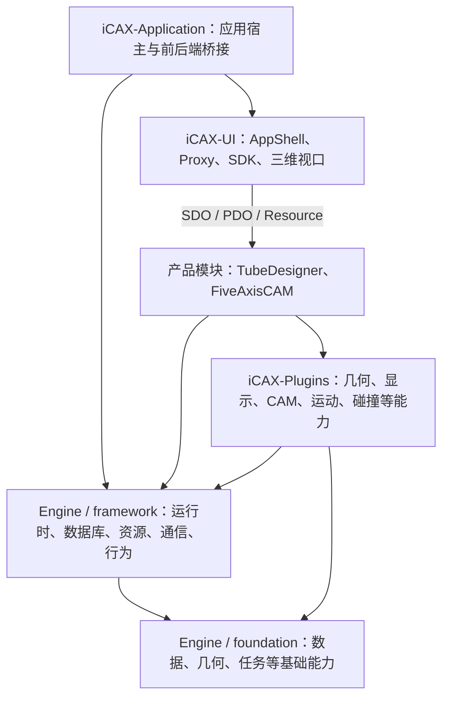

# iCAX 框架介绍

> 面向产品介绍、技术交流与团队协作。本文依据 2026 年 11 月 2 日仓库中的主线实现整理，重点说明框架定位、架构分层、核心机制与产品扩展方式。

## 1. iCAX 是什么

iCAX 是一套面向工业软件的模块化应用框架。它以 C++ 承载工程数据、计算能力和业务运行，以可替换的 UI 容器承载界面，为不同产品提供统一的对象模型、项目管理、前后端通信、资源管理、运行调度和持久化机制。

当前主要界面采用 **H5 + CEF**，三维视口采用 Three.js。产品通过清单声明需要加载的原生模块、前端入口和资源处理能力，在共同的框架上组织自己的业务。

框架与产品各有明确职责：框架解决工业应用中反复出现的基础问题；产品定义具体的对象、操作规则、计算流程和工作界面。例如，管材产品设计与五轴切割编程可以共用项目、数据、资源和交互基础，同时保持各自的业务模型。

### 可用于介绍的一段话

> iCAX 是面向工业应用的模块化软件框架，采用 C++ 后端与可替换前端相结合的架构。它通过实体与组件组织工程数据，以统一的事务、撤销重做和项目文件维护数据一致性，并通过 SDO、PDO 与版本化资源通道连接界面、计算和三维显示。不同产品可以按需组合几何、工艺、运动、碰撞等插件，在共享底层能力的同时独立定义业务流程和交互界面。

## 2. 框架主要解决哪些问题

工业软件既要处理复杂数据和计算，也要支持长时间编辑、反复修改、保存重开以及多种界面交互。iCAX 将这些共性需求组织为可复用的基础能力。

| 共性问题 | iCAX 的组织方式 |
| --- | --- |
| 不同对象拥有不同能力，继承关系容易膨胀 | 通过 Entity 与 Component 组合对象能力 |
| 页面、业务和算法相互耦合 | 划分 UI、产品业务、框架和计算服务的职责 |
| 多个项目或临时预览互相影响 | 用 Project 管理项目，用独立 Scene 承载编辑和运行现场 |
| 编辑结果难以一致地撤销、保存和恢复 | 在 Repository 中统一组织事务、操作日志与撤销重做 |
| 高频状态与大模型数据堵塞普通调用 | 分别使用 SDO、PDO 和 Resource 通道 |
| 后台计算结束时，用户输入可能已经变化 | 为异步任务提供调度和取消基础，由产品核对输入版本后提交结果 |
| 每个产品重复搭建宿主、项目工作区和三维交互 | 共享 Application、AppShell、Proxy、Viewport 与工作台能力 |
| 更换计算库或增加产品需要改动核心框架 | 通过接口、插件注册和产品清单接入能力 |

这些机制的共同目的，是让工程数据、计算结果、界面显示和项目文件围绕同一份正式数据协作。

## 3. 总体架构

iCAX 由基础层、框架层、能力插件、产品模块、前端框架和应用宿主共同构成。



### 3.1 Foundation：基础数据与算法

Foundation 提供可复用的基础模块，例如通用数据、几何数据、基础几何算法、异步任务、字体、图像和排样相关能力。

几何部分进一步区分三个职责：

- **GeometryData**：定义点、向量、曲线、曲面、BRep 拓扑和三角网格等中立数据。
- **GeometryAlgo**：对这些数据进行求值、变换、距离、相交等计算。
- **GeometryAdapter**：定义复杂几何能力与外部几何内核之间的适配接口。

这种划分使上层产品能够使用统一的数据契约；具体外部库的接入通过适配器或服务实现。

### 3.2 Framework：对象模型与运行规则

Framework 定义应用如何运行、数据如何组织、操作如何提交、界面如何取得结果，以及项目如何保存和恢复。

核心模块包括：

| 模块 | 职责 |
| --- | --- |
| ApplicationRuntime / ProductRuntime | 应用与产品的启动、模块加载和运行时管理 |
| Project / Scene | 项目组织以及独立编辑、预览和运行现场 |
| Database | 实体、组件、查询、事务、操作日志与撤销重做 |
| Behaviour / Universe | 组件生命周期、行为实例与帧内调度 |
| Services | 可复用能力的接口、注册与获取 |
| Resources | 大块数据、资源版本、导入导出与持久化策略 |
| EntityViewRuntime | 将工程对象查询结果组织为可供前端消费的 View |
| SDO / PDO | 普通服务调用与高频过程数据通信 |
| ProjectFile | 工程数据与资源的文件化保存、校验和恢复 |

### 3.3 Plugins：可组合的能力实现

插件层承载几何导入、显示适配、工艺与刀路、运动学、碰撞等能力。产品按需要选择插件；Engine 的基础框架保持对具体产品的独立性。

接口与实现分开组织。例如，上层通过几何服务接口发起计算，具体实现可以调用 OpenCascade 等库，再返回中立结果。工件身份、操作权限、结果是否有效以及如何写入工程，仍由产品业务层决定。

### 3.4 产品模块：定义行业业务

产品负责定义自己的业务对象、参数、编辑操作、计算流程、状态与界面。框架提供通用机制，具体规则由产品使用这些机制实现。

当前仓库中的产品包括：

| 产品 | 业务侧重点 | 使用的共同基础 |
| --- | --- | --- |
| TubeDesigner | 管材类产品设计、参数化资源、装配与制造数据 | 工程对象、模板运行、资源、事务、项目文件、工作台 |
| FiveAxisCAM | 工件与装夹、切割刀路、空移、碰撞与超限、仿真和输出 | 工程对象、几何与 CAM 插件、任务调度、通信、三维视口 |

这两类产品说明，同一套底座可以服务不同的工业工作流，而业务数据和操作规则仍分别归属各自产品。

### 3.5 UI 与 Application：界面和宿主

`iCAX-UI` 提供 UI 容器契约、前端代理、公共 SDK、AppShell 和三维视口。`iCAX-Application` 将后端运行时、UI 容器和前后端桥接组合成可运行的应用。

当前主要使用 CEF 承载 H5 页面。UI 容器通过 `IUIContainer`、`IFrontendBridge` 等契约接入；仓库还提供 WPF 相关实现与无窗口的 headless 容器。其他 UI 技术可沿这些接口扩展，具体接入和验收需由对应实现完成。

## 4. 运行层级：Application、Product、Project、Scene

这是理解 iCAX 运行结构的主线：

```text
ApplicationRuntime                 应用运行时
└─ ProductRuntime                  已启动的产品，可有多个
   └─ Project                      已打开的项目，可有多个
      ├─ MainScene                 正式工程数据现场
      │  ├─ Repository             实体、组件和编辑历史
      │  ├─ ResourceLibrary        场景资源与版本
      │  ├─ Universe              行为运行容器
      │  ├─ ViewSet               对外发布的数据投影
      │  ├─ Scene SDO channel     场景调用入口
      │  ├─ PDOHub                按需启用的高频数据通道
      │  └─ 工作线程与调度器
      └─ Child / Transient Scene   预览、导入或局部运行现场
         └─ 各自独立的数据、资源和运行实例
```

| 层级 | 管理内容 |
| --- | --- |
| ApplicationRuntime | 应用上下文生命周期、产品列表、产品运行时、应用级调用及通道注册表 |
| ProductRuntime | 产品定义、产品模块、产品级注册环境、产品用户数据和项目打开上下文 |
| Project | 项目身份、路径、项目设置、项目级资源域以及 Scene 集合 |
| Scene | 实际编辑与运行现场，持有自己的数据库、资源、行为、View、通信和工作线程 |

**Project 管理一个项目，Scene 承载这个项目中的具体编辑与运行现场。** 主场景负责正式工程数据，临时场景可以承载预览或导入操作，并在需要时由业务层明确提交结果。

当前项目运行采用进程内实现。不同 Scene 的隔离主要体现在各自的数据容器、运行实例和执行线程；进程级隔离可以通过项目运行时接口继续扩展。

## 5. 工程对象模型：Entity、Component 与 Repository

### 5.1 用组件组合对象能力

Entity 提供稳定的对象身份，Component 保存该对象某一方面的数据和状态。一个对象可以组合多个组件。

例如，一个可加工工件可以组合：

```text
Entity：工件实例
├─ 工件业务组件       工件身份、业务参数、几何引用
├─ Transform 组件    位置、方向和坐标关系
├─ RenderInstance    显示几何与材质引用
└─ 其他业务组件       根据产品需要增加的能力
```

组件组合使显示、变换和业务能力能够独立复用。组件类型及属性由元数据描述，框架据此组织属性访问、变更处理与持久化。

### 5.2 用 Repository 管理正式编辑

Repository 是 Scene 内的 EC 对象仓库，负责对象和组件的增删改查，并提供批处理、事务、变更事件、版本、撤销重做与操作日志。

一次用户操作可以包含多项数据修改，并由业务层组织为一个完整的撤销步骤。例如，调整一个关键点时，其位置、方向和相关状态应作为同一次正式编辑提交。

框架同时提供对象筛选、字段投影、分组、聚合与排序能力。Database 的 EntityView 用来增量维护符合条件的对象集合；界面需要的进一步投影由运行时 View 负责。

### 5.3 编辑历史与界面草稿各有用途

正式工程变更通过 Repository 的历史机制统一撤销和重做。界面可以保留输入草稿、拖动预览和当前手势的取消快照；一旦提交为正式编辑，其历史边界归入后端工程数据。

资源的 URL 与固定版本号也可以进入组件和历史记录，因此撤销能够重新引用此前的资源内容。

## 6. 业务执行：SDO、Behaviour 与 Service

三者分别承担对外操作、运行行为和可复用计算。

| 机制 | 关注的问题 | 典型内容 |
| --- | --- | --- |
| SDO 与产品业务操作 | 用户要执行什么、是否允许执行、结果如何提交 | 新增对象、修改参数、发起计算、保存、撤销、查询状态 |
| Behaviour | 对象发生变化或场景推进时，需要执行什么运行行为 | 组件生命周期响应、派生状态维护、逐帧更新 |
| Service | 给定输入，怎样提供一项可复用能力 | 几何计算、导入导出、运动学、碰撞距离计算 |

### Behaviour 与 Universe

Universe 是 Scene 内的行为运行容器。Behaviour 实例随各自 Scene 创建，响应组件启用、修改、移除等生命周期，并可参与帧更新。行为还可以声明执行先后关系，由调度器组织执行顺序。

组件数据归 Repository 管理，行为实例归 Universe 管理。Scene 为二者提供共同的运行上下文。

### Service 与业务规则

ServiceProvider 负责按接口注册和提供能力。应用级与产品级拥有各自的服务环境，产品模块的注册项回放到对应产品环境。

在工业业务中，可复用计算服务适合接收明确输入并返回中立结果。产品业务层负责输入有效性、事务、结果归属、保存和流程规则。例如，距离服务返回几何间距；该间距是否满足某次加工要求，由产品结合检测阈值和对象身份判断。

## 7. 前后端协作：三类数据走三种通道

| 通道 | 用途 | 典型数据 | 使用特点 |
| --- | --- | --- | --- |
| **SDO** | 服务调用、请求响应、事件和低频状态查询 | 编辑命令、对象信息、任务回执 | 表达一次明确的操作或查询 |
| **PDO** | 高频、可覆盖的过程状态 | 运动状态、任务进度、高频计算结果 | 允许跳过中间帧，读写遵守槽位及租约规则 |
| **Resource** | 版本化的大块内容 | BRep、网格、图片、材质、报告与采样数据 | 按资源 URL 和版本独立获取 |

SDO / PDO 的命名借鉴了控制系统中的分层思路，iCAX 中对应的是应用内部通信机制。

前端发起服务调用时使用异步 Promise，后端可通过 Task 表达异步结果。方法名称表达稳定能力，例如 `Machine.Jog`；对象 ID、轴和位移等信息放在参数中。

调用按 Application、Product、Scene 作用域路由。即使方法名以 `Project` 开头，操作项目数据的保存、撤销等调用也应进入对应的 Scene 通道，从而在正确现场中执行。

大模型或完整报告通过资源通道读取。SDO 可以返回资源引用和任务回执，界面再按需获取对应内容。

## 8. 资源与 View：从工程事实到三维显示

### 8.1 资源表达内容及其版本

资源系统统一管理资源身份、类型、来源、版本、依赖和持久化策略。组件通常保存资源引用，大块内容由资源库承载。

资源具有三类持久化策略：

- **RuntimeOnly**：用于当前运行期。
- **Embedded**：随工程文件内嵌保存。
- **External**：保存外部资源引用。

资源 URL 表达身份，内容版本表达某次确定的数据。资源之间的依赖可以锁定到明确版本，便于保存、重开和历史恢复时取得对应内容。

### 8.2 View 表达前端需要看到的数据

从工程对象到视口，主要经过以下链路：

```text
Repository 中的实体与组件
        ↓ 查询与成员集合维护
Database EntityView
        ↓ 来源组合、组件字段投影
Scene.ViewSet 中的 View
        ↓ 发布版本化快照与资源引用
前端 Viewport
        ↓ 读取几何、材质等资源
Three.js 显示与交互
```

Database EntityView 关注对象集合；运行时 View 负责组织前端可绑定的投影；Viewport 负责将这些数据转换为实际显示对象。

相机旋转、缩放、平移和显示模式等观察操作由前端视口维护。修改工件或刀路等正式业务数据，则通过产品操作提交到后端。显示网格上的拾取可以提供交互线索，精确 CAD 含义仍由后端业务与几何能力解析。

## 9. 异步计算与一致性

框架提供 Task、取消令牌、任务调度器和 C++20 Coroutine。产品据此组织耗时计算与运行流程。

推荐的数据流为：

```text
Scene 线程捕获当前输入
        ↓
计算服务或后台任务处理输入快照
        ↓
结果回到所属 Scene 的调度器
        ↓
产品核对输入版本、任务状态和取消状态
        ↓
通过事务提交结果并发布显示更新
```

Task 可以在线程池执行计算；Coroutine 适合在所属事件循环中跨多帧推进。计算完成后的正式数据修改，应回到对应 Scene 线程。

任务取消是协作式的：计算过程需要检查取消信号。框架提供执行与取消基础，产品定义哪些输入变化会使结果失效，以及失效后保留哪些已完成数据。

## 10. 工程保存与数据范围

`ProjectFile` 负责将数据库和资源组织为工程文件。保存时采集正式持久化数据并原子落盘；打开时校验产品与格式，再恢复数据库和资源。

当前主项目文件的正式数据域是 **MainScene 的 Database 与 ResourceLibrary**。临时子 Scene 用于运行或编辑隔离，其内容是否进入正式工程，需要由业务明确提交。

快速保存日志记录正式操作。打开工程时，在项目基线之上回放相应日志；完整保存成功后，再协调日志轮换。

工程数据与用户资料分开管理：

| 数据范围 | 示例 | 归属 |
| --- | --- | --- |
| 工程内数据 | 工件实例、参数、刀路编辑、装夹关系、工程资源引用 | 项目与主 Scene |
| 产品用户资料 | 用户保存的资源配置、常用参数、最近项目等 | 产品用户数据环境 |
| 临时运行数据 | 预览对象、计算中间结果、当前任务状态 | 所属运行现场与任务 |
| 界面观察状态 | 相机、当前选择、滚动和输入草稿 | 对应前端工作区 |

保存与撤销重做也具有各自的生命周期。项目保存重开能力，并不自动代表所有会话内撤销历史都会跨进程保存；需要跨会话保留的历史应有明确的持久化设计。

## 11. 如何接入一个新产品

新产品在框架上增加自己的定义与模块，基本步骤如下：

1. **定义产品清单**：声明稳定产品 ID、名称、前端入口、启动组件、项目文件识别规则和原生模块。
2. **设计业务数据**：定义 Entity、Component、组件元数据和需要引用的资源类型。
3. **实现业务操作**：提供 SDO 方法，组织输入校验、事务、任务发起、状态查询和结果提交。
4. **接入计算能力**：复用现有 Service，或通过接口增加新的插件实现。
5. **组织显示投影**：定义 View 的对象来源与字段，发布前端需要的资源。
6. **实现产品界面**：通过 AppShell、Proxy、SDK 和共享工作台组织交互。
7. **完成持久化与验收**：检查资源编解码、保存重开、撤销重做、任务取消以及真实宿主交互。

产品清单主要描述“需要什么能力”。原生模块通过组件、行为、服务、SDO、资源加载器及编解码器的注册机制接入；ProductRuntime 按本产品实际加载的模块组织注册环境。

当前原生插件按进程常驻管理。增加、组合产品模块是现有扩展方式；插件热卸载和热替换需要独立的生命周期设计。

### 一次典型编辑如何贯穿框架

以修改加工关键点为例：

1. 界面接收用户输入，必要时先显示局部预览。
2. 产品通过 SceneProxy 发起 SDO 编辑命令。
3. 后端在对应 Scene 中校验对象身份、参数和输入版本。
4. 通过 Repository 事务写入正式数据，形成撤销步骤。
5. 业务按实际依赖更新相关状态；需要计算时发起相应任务。
6. View 和资源引用反映新的正式结果，前端更新显示。
7. 用户保存时，主 Scene 数据与所需资源写入工程文件。

这一链路体现了框架提供的一致性基础：界面操作、业务数据、计算结果、显示和持久化有明确的衔接关系。

## 12. 当前代码组织

主线解决方案为 `src/iCAX.slnx`。

```text
src/
├─ iCAX-Engine/
│  ├─ foundation/                  数据、几何、任务等基础模块
│  └─ framework/                   运行时、数据库、资源、通信、行为等
├─ iCAX-Plugins/
│  ├─ cad/                         CAD 导入与相关能力实现
│  ├─ geometry/                    几何、碰撞、运动等服务实现
│  ├─ cam/                         可复用 CAM 领域能力
│  ├─ render/                      显示数据与适配能力
│  └─ product/                     当前产品原生实现工程
├─ iCAX-Application/                应用宿主、生命周期和通用桥接
├─ iCAX-UI/                         容器、AppShell、Proxy 与前端 SDK
├─ apps/
│  ├─ _shared/                     产品共用工作台能力
│  ├─ tube-designer/               产品清单、前端、协议和资源
│  └─ five-axis-cam/               产品清单、前端、协议和资源
├─ tests/                          原生、前端与集成测试
└─ tools/                          构建、部署与维护工具
```

产品的逻辑归属通过产品清单组织。当前两个产品的原生实现工程位于 `iCAX-Plugins/product/`，前端、协议与产品资源位于 `apps/`；具体模块位置以清单和工程配置为准。

## 13. 介绍时建议强调的特点

- **统一的工业应用底座**：项目、数据、通信、资源、运行调度和持久化可以跨产品复用。
- **可组合的对象模型**：通过实体与组件表达复杂对象的多种能力。
- **清晰的数据所有权**：产品、项目、Scene、资源与界面状态各有明确范围。
- **统一的编辑一致性机制**：正式修改、事务、撤销重做、操作日志和工程文件围绕同一对象模型协作。
- **分工明确的通信体系**：普通调用、高频状态和大块资源分别使用适合的通道。
- **可扩展的能力与界面**：原生服务、产品模块和 UI 容器通过契约接入。

这些是架构特点。具体产品的功能完成度、性能指标以及特定平台的适配情况，应以相应产品和版本的实际验收结果说明。

## 附录：主要源码与说明入口

以下路径均相对于仓库根目录，便于进一步核对和阅读：

| 主题 | 入口 |
| --- | --- |
| 当前后端运行层级 | [Framework 说明](../src/iCAX-Engine/framework/README.md) |
| ApplicationRuntime | [应用运行时](../src/iCAX-Engine/framework/ApplicationRuntime/README.md) |
| ProductRuntime 与模块加载 | [产品运行时](../src/iCAX-Engine/framework/Product/README.md)、[产品定义](../src/iCAX-Engine/framework/ProductContext/ProductDefinition.h) |
| Project 与 Scene | [项目模块说明](../src/iCAX-Engine/framework/Project/README.md)、[Project](../src/iCAX-Engine/framework/Project/Project.h)、[ProjectScene](../src/iCAX-Engine/framework/Project/ProjectScene.h) |
| 实际 Scene 能力契约 | [ISceneContext](../src/iCAX-Engine/framework/ProjectContext/ISceneContext.h) |
| EC 数据、事务与历史 | [Database](../src/iCAX-Engine/framework/Database/README.md) |
| Behaviour 与线程边界 | [Behaviour](../src/iCAX-Engine/framework/Behaviour/README.md) |
| Task 与 Coroutine | [Task](../src/iCAX-Engine/foundation/Task/README.md) |
| 通信与资源 | [SDO](../src/iCAX-Engine/framework/SDO/README.md)、[PDO](../src/iCAX-Engine/framework/PDO/README.md)、[Resources](../src/iCAX-Engine/framework/Resources/README.md) |
| View 定义与投影 | [ViewSet](../src/iCAX-Engine/framework/EntityViewRuntime/ViewSet.h) |
| 工程文件 | [ProjectFile](../src/iCAX-Engine/framework/ProjectFile/README.md)、[文件读写入口](../src/iCAX-Engine/framework/ProjectFile/ProjectFileStore.h) |
| UI 与容器 | [UI 总览](../src/iCAX-UI/README.md)、[UIContainer](../src/iCAX-UI/UIContainer/README.md)、[CEF 容器](../src/iCAX-UI/CefUIContainer/README.md) |
| 前端工作台与三维视口 | [AppShell](../src/iCAX-UI/SDK/AppShell/README.md)、[Viewport](../src/iCAX-UI/SDK/Viewport/README.md) |
| 当前产品配置 | [TubeDesigner 清单](../src/apps/tube-designer/product.manifest.json)、[FiveAxisCAM 清单](../src/apps/five-axis-cam/product.manifest.json) |

部分较早的总览文档仍保留旧的目录与职责描述。涉及运行现场归属、通信通道和持久化范围时，本文以当前模块说明及实际接口为依据。
