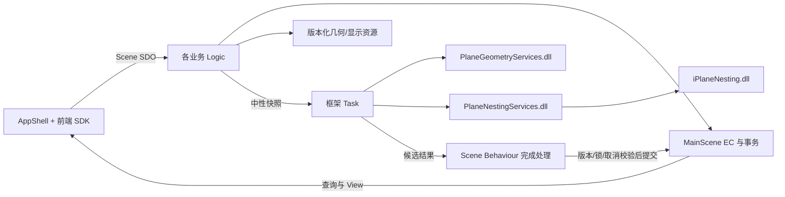

# iPlaneCAM 架构与领域设计

本文记录当前领域结构：业务数据使用 typed EC，SDO 按业务职责拆分，几何与排样通过注入服务执行，后台计算复用框架 Task。r8按 Laser3D 补齐八色图层、当前层、颜色和迁移删除；原生672次SDO调用通过，r8包内6套77组检查及资产核验通过，见 [交付汇总](../../output/tests/iplane-cam-layers/acceptance.json) 和 [原生日志](../../output/tests/iplane-cam-layers/native-test.log)。r7-final及更早结果保留为历史基线，不代替本轮验收。

r9仅调整前端：命令/日志使用AppShell选项卡，绘图辅助放入场景状态栏。包内10套119组及文件核验通过，见 [r9交付汇总](../../output/tests/iplane-cam-bottom-tabs/acceptance.json)。原生复用r8二进制及672次调用基线，本轮不重编、不重跑独立原生套件。

## 1. 产品概念与范围

iPlaneCAM 是基于 iCAX 的通用平面工作产品。基础能力包括 DXF 导入、二维绘制、图形编辑、吸附、图层、撤销重做、零件与板材、排样和报告。

底图是直接绘制/编辑加工轨迹几何的正式台面，可独立保存并接入后续加工扩展。它不是 CAD 草图，不要求先生成零件或排样。零件与板材有各自正式 CAD 草图；绘图交互复用，业务身份与提交规则分别维护。

| 业务概念 | 当前承载方式 | 关系与边界 |
| --- | --- | --- |
| 底图 | drawing 对象 EC + Drawing 角色 | 独立导入、绘制、编辑，不修改零件/板材/布局源输入 |
| 零件 | parts 对象 EC + Part 角色 | 解析轮廓、内孔、需求数量及正式草图 |
| 板材与库存 | stocks 对象 EC + Stock 角色和库存数量 | 导入不规则板材/内孔或创建矩形板；计算时展开独立物理板 |
| 正式草图 | owner→SketchID、Sketch→OwnerID、SketchCurve→SketchID | 稳定曲线实体与编辑会话，完成才更新 owner |
| 排样任务 | Task + TaskInput EC | 保存实际输入、参数、状态与结果关系，不隐式抓底图图形 |
| 布局结果 | Result + ResultBoard + Placement + Unplaced EC | 引用任务与输入；报告只读投影 EC |

行业工艺与 NC 是两个独立扩展，本轮不做行业工艺、机床和后处理。基础对象不以行业字段为必填项，不增加“从底图生成零件/板材”的流程。

## 2. iCAX 运行时所有权

```text
ApplicationRuntime
└─ ProductRuntime：iPlaneCAM
   └─ Project：身份、路径、设置、Scene 集合与项目资源域
      └─ MainScene
         ├─ Repository：业务实体、typed EC、关系、事务与历史
         ├─ ResourceLibrary：原始文件、版本化解析几何和显示载荷
         ├─ Universe / Behaviour：初始化和任务完成处理
         ├─ ViewSet：显示投影与资源快照
         ├─ Scene SDO channel
         └─ Scene 工作线程与调度器
```

依据为 [ApplicationRuntime](../../src/iCAX-Engine/framework/ApplicationRuntime/ApplicationRuntime.h)、[ProductRuntime](../../src/iCAX-Engine/framework/Product/ProductRuntime.h)、[Project](../../src/iCAX-Engine/framework/Project/Project.h)、[ProjectScene](../../src/iCAX-Engine/framework/Project/ProjectScene.h) 与 [ISceneContext](../../src/iCAX-Engine/framework/ProjectContext/ISceneContext.h)。总览见 [iCAX 框架介绍](../iCAX框架介绍.md)。

一个 MainScene 保存正式底图、零件、板材、草图和布局。页签、对象选择与草图上下文是同一 Scene 的工作区组合，不为零件/板材/结果各建页面或替换 Scene。底图/草图均不使用 Transient Scene 或前端私有 JSON 代替主工程持久化。

## 3. DLL、Service、Logic 与 SDO

### 3.1 模块依赖

| 模块 | 当前职责 | 边界 |
| --- | --- | --- |
| [foundation/iPlaneNesting](../../src/iCAX-Engine/foundation/iPlaneNesting/include/iPlaneNesting.h) | 独立 C ABI 排样内核 | 不依赖 Scene、EC、SDO、UI 和工程保存 |
| [PlaneNestingServices](../../src/iCAX-Plugins/geometry/PlaneNestingServices/PlaneNestingService.cpp) | 中性排样契约与内核会话/句柄转换，封装为 IService | 不管理版本、任务身份、资源和业务提交 |
| [PlaneGeometryServices](../../src/iCAX-Plugins/geometry/PlaneGeometryServices/PlaneGeometryService.cpp) | 独立 DLL，创建、导入映射、编辑、材料构建、阵列、闭合/尺寸描述与布局变换 | 不管理 owner/草图身份、权限、EC、Undo 和工程资源 |
| [OpenCascadeResourceImport](../../src/iCAX-Plugins/cad/OpenCascadeResourceImport/CadDocumentImportService.h) | 中性 CAD/DXF 文档读取 | 不决定零件/板材归属、需求、草图或正式创建 |
| [product/iPlaneCAM](../../src/iCAX-Plugins/product/iPlaneCAM/README.md) | EC、业务 Logic、SDO、资源引用、任务提交与持久化关系 | 通用几何算法与排样内核单独存在 |
| [apps/iplane-cam](../../src/apps/iplane-cam/product.manifest.json) | 产品装配、工作台、SceneProxy 命令/查询与交互草稿 | 不维护权威业务历史、不直接求解或调用 C ABI |

接口为 [IPlaneGeometryService](../../src/iCAX-Engine/framework/GeometryServices/PlaneGeometryService.h)、[PlaneGeometryData](../../src/iCAX-Engine/framework/GeometryServices/PlaneGeometryData.h) 与 [IPlaneNestingService](../../src/iCAX-Engine/framework/GeometryServices/PlaneNestingService.h)。产品经 Scene 的 [ServiceProvider](../../src/iCAX-Engine/framework/Services/ServiceProvider.h) 注入与解析。



Service 只做中性计算，不自行创建业务任务或扫描 Scene。调用者可同步执行轻量操作，也可把同一服务放入框架 Task。`iPlaneNesting.dll` 没有 iCAX Module 注册入口，清单加载适配服务，不把算法 DLL 当框架模块。

### 3.2 产品类和源文件

| 类/实现 | 源文件与职责 |
| --- | --- |
| `CPlaneSceneSDO` / `SceneLogic` | [PlaneSDO.cpp](../../src/iCAX-Plugins/product/iPlaneCAM/PlaneSDO.cpp)，只读 ReadState |
| `CPlaneDrawingSDO` / `DrawingLogic` | [PlaneDrawingSDO.cpp](../../src/iCAX-Plugins/product/iPlaneCAM/PlaneDrawingSDO.cpp)，底图业务 |
| `CPlanePartSDO` / `PartLogic` | [PlanePartSDO.cpp](../../src/iCAX-Plugins/product/iPlaneCAM/PlanePartSDO.cpp)，零件导入 |
| `CPlaneStockSDO` / `StockLogic` | [PlaneStockSDO.cpp](../../src/iCAX-Plugins/product/iPlaneCAM/PlaneStockSDO.cpp)，板材导入/矩形库存 |
| `CPlaneObjectSDO` / `ObjectLogic` | [PlaneObjectSDO.cpp](../../src/iCAX-Plugins/product/iPlaneCAM/PlaneObjectSDO.cpp)，属性和删除 |
| `CPlaneSketchSDO` / `SketchLogic` | [PlaneSketchSDO.cpp](../../src/iCAX-Plugins/product/iPlaneCAM/PlaneSketchSDO.cpp)，正式草图生命周期 |
| `CPlaneLayerSDO` / `LayerLogic` | [PlaneLayerSDO.cpp](../../src/iCAX-Plugins/product/iPlaneCAM/PlaneLayerSDO.cpp)，图层与归层 |
| `CPlaneNestingSDO`、`CPlaneLayoutSDO` / `NestingLogic` | [PlaneNestingSDO.cpp](../../src/iCAX-Plugins/product/iPlaneCAM/PlaneNestingSDO.cpp)，排样发起/查询、布局报告 |
| `CPlaneTaskSDO` / `EditTaskLogic` | [PlaneEditTasks.cpp](../../src/iCAX-Plugins/product/iPlaneCAM/PlaneEditTasks.cpp)，几何任务协调 |
| 共用曲线业务 | [PlaneCurveLogic.cpp](../../src/iCAX-Plugins/product/iPlaneCAM/PlaneCurveLogic.cpp)，目标校验、复制、阵列和几何引用更新 |
| 领域共用实现 | [PlaneCAM.cpp](../../src/iCAX-Plugins/product/iPlaneCAM/PlaneCAM.cpp)、[PlaneDomainInternal.h](../../src/iCAX-Plugins/product/iPlaneCAM/PlaneDomainInternal.h)，EC、资源、排样输入/提交 |
| 传输适配 | [PlaneSDODispatch.h](../../src/iCAX-Plugins/product/iPlaneCAM/PlaneSDODispatch.h)，解码、Scene/产品校验、成员绑定与返回 |

各 SDO 直接绑定自己的 Logic 成员，没有集中处理所有业务的 `Execute` 分支。Logic 负责业务调度，[PlaneGeometry.h](../../src/iCAX-Plugins/product/iPlaneCAM/PlaneGeometry.h) 只是服务解析/中性辅助薄入口。几何算法位于服务的 [PlaneGeometryAlgorithms.cpp](../../src/iCAX-Plugins/geometry/PlaneGeometryServices/PlaneGeometryAlgorithms.cpp) 和 [PlaneGeometryDimensions.cpp](../../src/iCAX-Plugins/geometry/PlaneGeometryServices/PlaneGeometryDimensions.cpp)。

## 4. typed EC、资源与显示

### 4.1 Repository 保存业务事实

字段定义见 [PlaneComponents.h](../../src/iCAX-Plugins/product/iPlaneCAM/PlaneComponents.h)。

| 组件 | 主要事实 |
| --- | --- |
| `CPlaneProjectComponent` | typed 排样参数、业务/排样修订、当前新建图层 DefaultLayerID、一次性 LayerCatalogVersion |
| `CPlaneObjectComponent` | Kind、名称、数量、单位、尺寸、孔数、LayerID、SketchID、几何版本/引用 |
| Drawing / Part / Stock 角色组件 | 对象业务角色 |
| `CPlaneLayerComponent` | 名称、typed Color / Order、Visible、Locked、派生显示 MaterialRef |
| `CPlaneSketchComponent` | OwnerID、Status、BaseGeometryRef |
| `CPlaneSketchCurveComponent` | SketchID、Deleted；同实体 Object 组件保存几何与图层 |
| `CPlaneSketchBackupComponent` | SketchID、CurveID、原名称/备注/图层/版本/几何与显示引用/尺寸 |
| `CPlaneTaskComponent` | 排样状态、输入对象/修订、参数/计算间距快照、结果关系 |
| `CPlaneEditTaskComponent` | Kind、目标/owner/sketch 关系、owner 基准、状态/错误、结果 ID |
| `CPlaneTaskInputComponent` | TaskID、ObjectID、角色、数量、几何版本、误差界和准确引用 |
| `CPlaneResultComponent` | 方案、typed 参数快照、指标、校验与诊断 |
| `CPlaneResultBoardComponent` | ResultID、StockID、物理板身份、序号与指标 |
| `CPlanePlacementComponent` | 结果/板/零件关系、实例序号、位置/角度/镜像 |
| `CPlaneUnplacedComponent` | 结果/零件关系、实例序号和原因 |

业务身份用框架 UUID，不用列表下标、显示采样点或 PN2 句柄。TaskInput 和草图 Backup 都是 typed EC，不保存为全工程 JSON、任务参数 blob 或草图资源对象。底图、零件和板材各有引用/版本，互不共享可变业务对象。

`CPlaneSceneComponent` 的排样/编辑 Runtime 是非持久指针；Worker、Task 句柄、取消源和执行快照不进入工程。

### 4.2 ResourceLibrary 与 View

原始 DXF、解析曲线和显示载荷采用 Embedded 版本资源，EC 锁定准确 `URL + version`。源文件/几何用 `resource.binary`，显示几何用 `resource.flatbuffer` / ICRG，显示材质用 ICRM 和 RenderData。图层颜色仍由 typed EC 的 Color 决定，MaterialRef 只是由颜色生成的显示内容引用。报告从 EC 查询，不再存权威报告资源。

显示复用 `CRenderInstanceComponent`、`CTransformComponent`、Scene [ViewSet](../../src/iCAX-Engine/framework/EntityViewRuntime/ViewSet.h) 与资源快照。采样不回写解析曲线；选择、相机、焦点/选区、滚动、输入草稿和预览是工作区状态，不成为排样输入修订。

Repository 事务不自动撤销资源库写入。目标、权限、参数、几何适用性先校验，成功准备内容后再用正式事务改变引用/关系；不能以“事务会回滚”代替发布顺序检查。

### 4.3 彩色图层目录与显示投影

新工程初始化当前 Laser3D 同款八色：`#22C55E`、`#06B6D4`、`#3B82F6`、`#F59E0B`、`#14B8A6`、`#84CC16`、`#8B5CF6`、`#EAB308`。颜色按严格 `#RRGGBB` 校验并规范大写；Order 保持稳定显示顺序，允许继续增加第九层及以上。当前层沿用 DefaultLayerID 字段，不另立第二份状态。

旧工程首次加载保留已有层 UUID、名称、对象归属和当前层，补齐颜色、顺序、派生材质及可用初始色层。LayerCatalogVersion 标记迁移已完成，用户随后删除的初始层不会因重开再次生成。新建和导入对象使用当前层，复制/阵列继承源层，草图原有曲线继承 owner 层，新增曲线使用当前层。

图层业务在 [PlaneLayerSDO.cpp](../../src/iCAX-Plugins/product/iPlaneCAM/PlaneLayerSDO.cpp) 中校验后发布派生 ICRM 材质，正式事务更新 Layer EC 及 `CRenderInstanceComponent.MaterialResourceID/Version`。创建、改色、归层、删除迁移和 Cancel 都使用同一显示接法；前端 SDK 继续读取正式 View/Resource，不直接改 Three 材质来模拟归层。

颜色、层名称及归属不改变曲线/预览几何资源和 GeometryVersion，也不改变排样参数或输入签名。持久层和材质引用随 Undo/Redo 恢复；Visible/Selectable 是非持久显示字段，Scene 初始化和 Behaviour 比较 EC 与 RenderInstance，仅对差异做无用户历史更新。稳定帧不写资源，不重复生成材质；查询不调用同步或发布。Deleted 草图曲线始终隐藏、禁选，改色不能使墓碑复活，Cancel 明确恢复删除标记及相应层显示。

## 5. 正式草图生命周期

### 5.1 打开和编辑

`PlaneSketch.Open(ownerId)` 只接收 parts/stocks，校验 owner 和层锁。首次建立 owner 的 SketchID、Sketch 的 OwnerID，从原解析曲线创建稳定曲线 EC 和 typed 备份；owner 几何、几何版本、数量和来源不变。

Ready 再打开保留曲线 ID，重新建立本次备份；仅当 owner 几何引用在外部改变时重新 seed。重复打开 Editing 草图返回既有会话，避免重复创建曲线。

`Create/Edit/Remove` 校验 parent 仍 Editing、owner 引用仍匹配 BaseGeometryRef，并检查 owner/曲线层锁。编辑只改变曲线；删除先置 Deleted，保留取消所需身份。查询 `sketchCurves` 排除已删除曲线，`sketches` 返回 owner、状态、基准与有效 curveIds。

### 5.2 完成、取消与删除

`Complete` 收集有效曲线，调用服务 `BuildGeometry(curves, true)` 校验材料。发布前重验 owner 和全部有效曲线层锁，随后一个事务更新同一 owner 的几何/显示引用和 GeometryVersion，清理 Deleted 曲线与备份，草图转 Ready、更新基准并使排样输入修订变化。无效材料、过期或取消不提交 owner。

`Cancel` 从 Backup EC 恢复原曲线 ID、名称/备注、图层、几何引用/版本和显示，移除本次新增曲线，清备份并转 Ready。owner 几何不动；owner 锁定或基准变旧后仍能取消。取消不隐式完成编辑。

Editing owner 拒绝删除，Ready owner 删除级联其草图/曲线/备份。上述事实由框架事务、Undo/Redo、保存重开维护，前端只保留当前编辑上下文和输入草稿。

## 6. Scene SDO 与编辑契约

所有产品业务必须在 `icax.iplane-cam` Scene 通道调用，Product/Application 不能替代。命令返回标识、状态/版本，列表、几何、任务与报告分别查询；方法名保持 `SDO.Method` 两段。

| SDO | 方法 |
| --- | --- |
| PlaneScene | ReadState |
| PlaneDrawing | Import、Create、Edit、ReadGeometry |
| PlanePart | Import |
| PlaneStock | Import、CreateRectangle |
| PlaneObject | Update、Remove |
| PlaneSketch | Open、Create、Edit、Remove、ReadGeometry、Complete、Cancel |
| PlaneLayer | Create、Update、SetCurrent、Assign、Remove |
| PlaneTask | Read、Cancel（几何任务） |
| PlaneNesting | SetParameters、Run、Cancel、ReadTask、ReadReport |
| PlaneLayout | ReadReport |

ReadState 含 drawings/parts/stocks/results/layers/sketches/sketchCurves、currentLayerId、参数和能力；layers 按 order 排序并返回 color/isCurrent/default/materialRef，对象返回 layerName/layerColor/materialRef。顶层 tasks 仍为排样任务。几何任务用 PlaneTask.Read，不混用 PlaneNesting.ReadTask。Drawing/Sketch.ReadGeometry 同形返回 curves、snapPoints、dimensions 与引用/版本，Ready 草图曲线仍可读。

底图/草图共用 move、rotate、scale、copy、mirror、delete、close、dimensions、nodes、array-rectangular、array-polar，但入口分别约束业务目标。dimensions/nodes 必带完整 expectedGeometryRef，按 URL/版本核对，避免 Undo 分支或晚到响应覆盖新几何。

复制创建新 EC；阵列保留源 EC，其余一次事务创建，继承图层/草图归属，上限 500。节点编辑只替换单一直线/多段线既有点且不变点数。已有开放多段线可原位闭合；闭合能力只读派生，不等于材料校验通过。

`PlaneLayer.Create/Update` 维护名称、颜色、显示与锁定；Create 自动分配顺序。`SetCurrent({id})` 设当前新建图层，拒绝锁定层。`Assign({ids,layerId})` 全量校验源对象和目标层后单事务归层，源层与目标层锁均阻止修改。

`Remove({id,targetLayerId?})` 删除当前层或有对象/草图备份引用的层时，必须显式提供不同的接收层；同一事务迁移全部对象、Backup.LayerID 和 DefaultLayerID，再删除层。锁定源层或接收层不允许迁移，最后一层不可删。缺少接收层时占用层仍明确拒绝。Undo 一次恢复层、归属和显示引用；取消草图不会恢复到已删的层。图层显隐、改色、当前层及归层不修改几何引用或排样签名。

## 7. Service 与 Task 边界

| 入口 | 当前执行方式 | 任务查询 |
| --- | --- | --- |
| PlaneNesting.Run | 建排样任务并用框架 Task 求解 | PlaneNesting.ReadTask |
| PlaneSketch.Complete | async:true 后台材料构建，省略时同步 | PlaneTask.Read |
| Drawing/Sketch.Edit 两种阵列 | async:true 后台生成中性候选，省略时同步 | PlaneTask.Read |
| DXF Import、普通创建/编辑/尺寸查询 | 当前同步调用服务 | 正常命令/查询 |

前端 Promise 不等于原生工作已经移出 Scene。本轮只将已实现的入口列为后台能力，不另建产品调度器。

1. Scene Logic 校验身份/权限，建 Task/Input EC，捕获中性数据、几何版本与准确引用。
2. Worker 经 [iCAX::Tasks::Run](../../src/iCAX-Engine/foundation/Task/Task.h) 和取消令牌调用服务，不持有 Scene/Repository。
3. [PlaneSceneBehaviour](../../src/iCAX-Plugins/product/iPlaneCAM/PlaneSceneBehaviour.cpp) 在所属 Scene 完成处理；后台返回只是候选。
4. 几何任务核每个输入引用/版本；草图完成另核 owner 基准、Editing 和有效曲线 ID 集；阵列核源曲线存在/未删及 parent 有效。提交前复核层锁。
5. Failed/Stale/Cancelled 不覆盖源对象；合法候选才准备资源并事务落地。排样另核需求/库存守恒、姿态和 PolygonMaterial 验证。
6. 终态几何任务释放 Work/计算输出并移除运行态，EC Task/Input 历史保留可查。几何提交是正式撤销步骤，状态更新不制造用户历史。

新增场景 OnAwake 初始化；基线加载不发组件添加事件，OnStart/启用/必要首次 OnUpdate 恢复 Runtime 与二维显示类型。读取不初始化或 Pump。关闭/销毁取消并 Wait，工程重开不恢复旧线程或 SDK 句柄，遗留 Running 转 Interrupted。

几何任务状态为 Running/Completed/Failed/Stale/Cancelled/Interrupted；排样另保存具体停止原因。材料构建和阵列有协作取消检查；排样适配在等待/调用前后检查取消，但 C ABI 不能中断已执行 solve，须等返回再丢弃。不能由多个前端 Promise 推断内核可并行。

## 8. 几何、版本与排样语义

DXF 当前支持 LINE、ARC、CIRCLE、含 bulge 的 LWPOLYLINE；绝对本地路径不超过 64 MiB。使用已知 INSUNITS，缺失/unitless 必显式 units；拒绝不支持实体、非 XY 与非法数值。完整 DXF 图层、旧 POLYLINE、BLOCK/INSERT、椭圆/样条未实现。

底图/编辑中草图允许开放曲线；零件/板材导入与 Complete 要求一个闭合外轮廓及内孔，分离外轮廓/嵌套材料岛明确拒绝。解析相交/重叠/闭合、离散和尺寸描述属于几何服务。

解析源曲线不改，排样用多边形快照；弦高界不超过 0.05 mm，另计连接误差。产品使用 `PartGap + 2 × maxPartError + 1.1e-6` 和 `StockMargin + maxPartError + maxStockError + 1.1e-6` 作为计算间距，报告同时保存用户参数/计算参数。验证范围是 PolygonMaterial，不把多边形通过表述成任意解析曲线精确验证。

产品用 1°～360° 离散步进、正数且不超过 120 秒预算。服务另支持连续角区间，不等于产品 UI 已开放。超量明确拒绝，不截断输入。物理板 ID 由库存 UUID 与从 1 开始的序号组成；零件实例从 0 开始。

| 变化 | 当前影响 |
| --- | --- |
| 底图几何编辑 | 更新本对象引用/版本，不改独立零件/板材/排样输入 |
| 草图曲线编辑 | 仅更新曲线；Complete 才改 owner 和排样输入 |
| 零件/板材数量、owner 几何、排样参数 | 对应输入变化，旧结果按快照判 Stale |
| 层显隐/改色/当前层/归层/迁移删除 | 不改几何/排样签名；锁定影响源对象编辑、接收归层和提交权限 |
| 相机/选择/草稿/滚动 | 只改工作区状态 |

revision/expectedRevision 用 Repository 项目组件版本并以字符串传输，避免 Undo 分支复用业务计数。历史结果按 TaskID、Input EC 与参数快照比较当前输入，保存重开仍可判断。报告读结果自身快照，不用当前参数解释旧结论。

失败/取消保留旧布局和来源状态。几何合法、需求完成、紧凑程度、可用余料分别表达；当前报告提供净板利用率、数量/用板与验证结论，不把利用率替代紧凑性或余料算法。

## 9. 前端 SDK 与工作台

前端沿用 [createWorkbench](../../src/apps/_shared/workbench/createWorkbench.mjs)、AppShell、正交视口、View 生命周期、选择与命令注入，参考 TubeDesigner/Laser3D，不跨产品导入业务 UI 或复写框架。

顶层保持底图/下料。下料左侧零件、中央显示、底部板材/结果 dock、右侧参数；草图是 owner 编辑上下文。绘制、编辑/变换、阵列、辅助/图层按组和菜单组织，不把所有命令平铺成按钮。

命令与日志通过 AppShell 底部选项卡共用一个可调高度面板。产品声明 `getBottomDockDefinition` 并用 `mountBottomDockPanel` 增量挂载命令输入，框架保留唯一日志数据及DOM。切换不清除命令草稿，不自动聚焦，普通外壳刷新保留面板节点；不同场景的选中页和高度独立。中央 `.cam-viewer` 通过可选 `renderSceneStatusBar` 在画布下方显示单位、当前工具、捕捉、正交、网格，右侧不重复显示这些交互开关。该调整不新增EC或服务，不改变正式几何与排样。

通用二维交互抽到 [iCAX-UI/SDK/Cad](../../src/iCAX-UI/SDK/Cad)：

| SDK 能力 | 产品保留 |
| --- | --- |
| planarEditorSession / planarNodeEditor | 业务目标、owner/sketch、Scene SDO 选择 |
| planarDrawingPreview / planarDynamicInput | 草稿适配、提交/取消时机 |
| planarDimensionPresentation / planarDimensionValues | 几何查询、引用校验和领域错误 |
| planarRibbon / planarEditorStyles | 产品命令 ID、能力、页签与面板 |
| operationTask | PlaneTask.Read/Cancel 通道、会话归属与刷新 |

产品入口见 [drawingCommands](../../src/apps/iplane-cam/webpage/drawingCommands.mjs)、[editingTarget](../../src/apps/iplane-cam/webpage/editingTarget.mjs)、[sketchOperations](../../src/apps/iplane-cam/webpage/sketchOperations.mjs) 与 [ribbonDefinition](../../src/apps/iplane-cam/webpage/ribbonDefinition.mjs)。底图/草图共享输入与标注，产品适配分别提交 PlaneDrawing/PlaneSketch。

绘制右键在光标处闭合/取消/结束。圆、矩形、圆弧使用动态数值与真实标注；折线显示相对上一段切向夹角。标签沿几何锚点，以相机缩放查看遮挡，不增加自动避让。原生派生解析尺寸，前端不将包围盒冒充可编辑几何参数。

异步响应局部更新，保留节点/监听、焦点/选区、左右栏与底部 dock 嵌套滚动、画布与相机，复用 [paneInteractionState](../../src/apps/_shared/workbench/utils/paneInteractionState.mjs)。切项目、取消或换工具后的旧回调不得恢复旧草稿/选择。浏览器交互验证与字符串/节点存在检查分开。

## 10. 工艺与 NC 扩展

工艺扩展以后接收明确来源/版本的底图、零件或布局几何，负责行业规则和加工配置；底图可直接进入。NC 扩展以后接收明确版本的加工成果与输出配置，独立后处理，不扫描可变 Repository 推断加工意图。

两者分别经契约接入，不修改基础 CAD/排样源数据，不将刀具、穿孔、切割头或 G 代码倒灌为基础对象必填项。本轮保留方向，不实现具体工艺/后处理。

## 11. 验证与历史基线

r8原生完整流程通过，日志 [native-test.log](../../output/tests/iplane-cam-layers/native-test.log) 记录 **672 次 SDO 调用**，含彩色图层专项、两份 r6/r7 旧工程复制兼容、后续真实排样和保存重开。专项见 [ColoredLayerTests.inc](../../src/tests/icax-plugins/product/iPlaneCAM/ColoredLayerTests.inc)，覆盖八色与第九层、当前层、颜色校验、正式材质、源/目标锁、含备份删除迁移、墓碑与Cancel、Undo/Redo、重开不补回删除层及只读稳定性。r8包内6套77组检查及文件核验通过：59组连接真实原生后端，18组为受控AppShell回归；每套90份加载资产与包/源码匹配，69个DLL与已测运行时一致。见 [交付汇总](../../output/tests/iplane-cam-layers/acceptance.json) 和 [产品文档入口](README.md)。

r7 历史原生579次调用及最终包9套浏览器105组检查通过，其中87组连接真实原生后端，18组为AppShell受控传输界面回归；各报告88份加载资产与当时源码/包一致，69个DLL与已测运行时一致。历史证据见 [交付汇总](../../output/tests/iplane-cam-refactor/acceptance.json)。这些不代替本轮彩色图层验收；独立桌面CEF、系统文件选择器及完整Release仍分别记录，不覆盖用户运行窗口。

历史 r5 是 0.1.0 Debug 圆弧角度/尺寸基线，其 [验收汇总](../../output/tests/iplane-cam-arc-angles/acceptance.json) 记录当时的 413 次 SDO 与浏览器检查。历史 r6 增加折线切向夹角预览，见 [历史汇总](../../output/tests/iplane-cam-polyline-angle/acceptance.json)。这些只证明相应版本，不证明本轮重构已完整回归。

当前仍不包括完整 DXF、修剪/延伸/偏移/圆角/倒角/连接/打断、手动布局与余料管理。限定流程通过也不代表全部 CAD 能力、原厂引擎等价或独立桌面完整验收；部署/启动另行明确，保留用户运行窗口和未保存工程。
